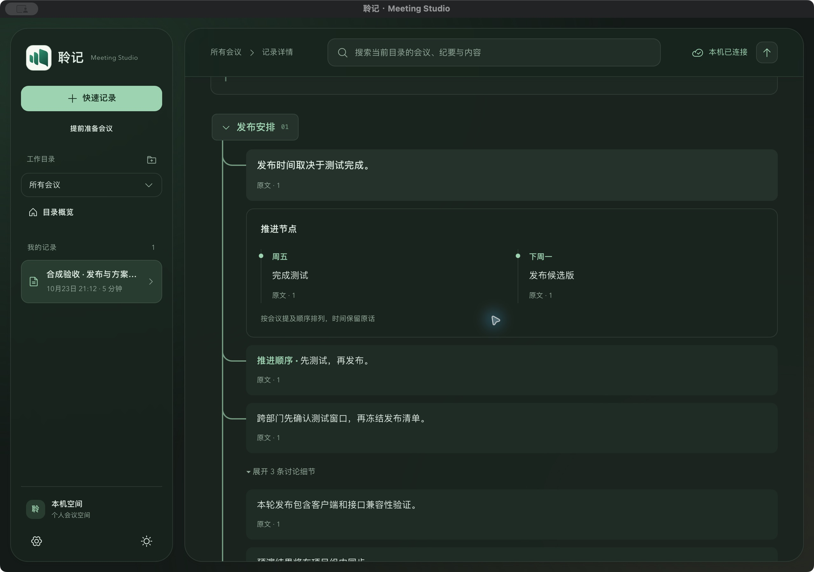

<p align="center">

[v0.2.0 Beta 实施](docs/releases/v0.2.0-preview.md)：官网与在线快照、通用场景词表和同音校对、稳定性整改；后台发布与线上状态以[验证记录](docs/evidence/beta-implementation-2026-10-30.md)为准。
  
</p>

<h1 align="center">聆记 · LingJi Meeting Studio</h1>

<p align="center">从会议原音，到逐字稿，再到有出处的纪要。</p>

<p align="center">
  <a href="https://github.com/RoyalLiang/LingJi-Meeting-Studio/releases"></a>
  <a href="https://github.com/RoyalLiang/LingJi-Meeting-Studio/actions/workflows/preview-release.yml"></a>
</p>

<p align="center">
  <a href="https://github.com/RoyalLiang/LingJi-Meeting-Studio/releases">下载安装</a> ·
  <a href="#快速开始">快速开始</a> ·
  <a href="#选择纪要方式">模型配置</a> ·
  <a href="docs/README.md">项目文档</a> ·
  <a href="https://github.com/RoyalLiang/LingJi-Meeting-Studio/issues">问题反馈</a>
</p>

聆记是一个会议记录工作台，把录音、转录、AI 纪要和行动候选放在同一条可回溯的记录中。可以在浏览器中使用，也可以安装 Windows、macOS 或 Linux 客户端，接入麦克风与系统音频。

当前提供预览版。最近一次已验证发布为 [v0.1.39](docs/evidence/preview-v0.1.39-2026-10-28.md)；下载、正文校验值及各版本验证范围以 [Releases](https://github.com/RoyalLiang/LingJi-Meeting-Studio/releases) 为准。

## 主要能力

- **随时开始记录**：快速记录无需先填写会议名称；也可提前准备会议、导入已有音频。
- **逐字稿与来源引用**：保留转录片段和版本，从纪要回到对应原文与录音位置。
- **按内容组织纪要**：主题、结论、行动候选，以及有来源的时间线、表格或数据视图。
- **波形回放**：点击或拖动定位，配合倍速播放复核原音。
- **应用内本地转录**：桌面包内置 SenseVoice 与语音分段引擎，使用时自动加载，无需另开转录服务器。
- **多种模型链路**：支持转录后整理，也可接入 OpenAI Realtime 或豆包音频模型直接理解音频。
- **桌面后台常驻**：Windows 托盘、macOS 菜单栏收起窗口后继续工作。

### 界面预览



原生客户端截图，使用合成会议数据展示纪要阅读和来源引用。安装界面历史示例见 [v0.1.23 回执](docs/evidence/preview-v0.1.23-2026-10-26.md)，当前安装验证见 [v0.1.39 回执](docs/evidence/preview-v0.1.39-2026-10-28.md)。

## 快速开始

### 安装桌面测试版

在 [Releases](https://github.com/RoyalLiang/LingJi-Meeting-Studio/releases) 选择同一版本的成品安装包。版本改动、安装步骤和 SHA-256 在发布正文中；Source code (zip / tar.gz) 为该标签源码。验证报告保留在 Actions，附件不再混入测试 JSON、校验文件或安装文档。

| 平台 | 系统要求 | 安装文件 |
| --- | --- | --- |
| Windows x64 | Windows 10 / 11、WebView2 | `Lingji-版本-windows-x64-setup.exe` |
| macOS Apple Silicon | macOS 14.6 或更新版本 | `Lingji-版本-macos-arm64.dmg` |
| Linux x64 | 已验证 Ubuntu 24.04，其他发行版待验 | `Lingji-版本-linux-amd64.deb` |

1. 按 Release 正文核对 SHA-256；Windows 运行 EXE，macOS 打开 DMG 并拖入“应用程序”，Linux 在下载目录运行 `sudo apt install ./Lingji-版本-linux-amd64.deb`。
2. Windows 默认勾选“安装本地 SenseVoice 离线转录模型”，可取消；macOS 和 Linux 包含本地转录模型。
3. 首次打开后进入**设置 → 模型与转录服务**，保存并测试所需服务配置。
4. 点击**快速记录**，选择音源并完成采集授权，即可开始。

本地模型负责离线转录；AI 纪要使用所配置的纪要模型。Windows 取消模型后，若没有旧模型，需配置云端转录；原位置升级可保留已有模型。取消勾选只减少安装后的模型文件，完整安装包的下载大小不变。详见[本地转录与高级服务配置](docs/engineering/funasr.md)。

> [!IMPORTANT]
> 当前 Windows 包未签名，macOS 包为临时签名且未公证。安装前请核对发布正文的 SHA-256；macOS 的系统提示处理方式见[安装与信任说明](docs/releases/macos-trust.md)。实体设备、长会议与干净机器的验收范围见对应版本回执。Linux PipeWire 系统音频与实体采音仍需目标设备验收，关闭窗口进入退出确认流程，不提供托盘常驻。

### 在本机启动浏览器工作台

准备 Node.js 24 与 npm；CI 使用 Node.js 24.21.0。

```bash
git clone https://github.com/RoyalLiang/LingJi-Meeting-Studio.git
cd LingJi-Meeting-Studio
npm ci
cp -n .env.example .env
npm run dev
```

已有 `.env` 会保留，可按需补充配置。打开终端输出的 Web 地址，默认是 `http://localhost:3000`。该命令同时启动 Web、Record API 和 worker；API 默认使用 `3030` 端口。进入设置完成模型配置后再进行真实录音。

浏览器的系统音频取决于浏览器、操作系统和共享对象的支持，需在共享对话框中显式选择音频。本机 `localhost` 可用于开发；对外部署的 HTTPS、身份与存储设置见[运行手册](docs/engineering/runbook.md)。源码启动不会自动附带已打包的本地模型资源。

## 选择纪要方式

在**设置 → 模型与转录服务 → 会议理解**中选择。每场会议的原音发送授权单独确认。

| 方式 | 输入链路 | 需要配置 |
| --- | --- | --- |
| ASR＋LLM · 转录后整理 | 转录生成逐字稿，文字模型整理纪要 | 本地或云端转录服务＋文字模型 |
| OpenAI Realtime · 音频直接理解 | Realtime 接收音频，独立转录并行留证 | Realtime 连接＋转录服务；[接入说明](docs/engineering/openai-realtime.md) |
| 豆包音频 · 独立 ASR 留证 | 豆包模型理解音频，独立转录提供引用 | 支持音频的方舟模型＋转录服务 |
| 仅豆包音频模型 | 同一个音频模型完成转录和纪要 | 支持音频的方舟模型；无需独立 ASR |

本地转录请选择 **SenseVoice（已内置）**。外部转录还可选择豆包语音、Deepgram、兼容转录接口，或高级 FunASR 服务。

纪要服务支持 **Responses** 与 **Chat Completions**。填写完整请求地址、模型或接入点 ID 和密钥，先保存，再测试连接。音频纪要的模型能力、协议和配额需与供应商配置一致；豆包两种音频方式的配置与验证边界见[豆包音频纪要](docs/engineering/doubao-audio.md)。仅豆包模式按短批次转录，不属于供应商流式识别。

## 一场会议的使用流程

1. **开始**：快速记录或选择已准备的会议，确认麦克风、系统音频和本场整理设置。
2. **会中**：查看逐字稿与纪要，按需标记、记笔记或核对来源。
3. **暂停**：停止采集，继续处理已收到的音频并补齐阶段内容；后续可继续会议。
4. **结束并整理**：正式收尾并处理剩余内容，完成后复核纪要、行动候选与引用。
5. **回看**：通过波形、原文和来源引用复核，按需导出或分享。

关闭桌面主窗口会收起到托盘或菜单栏，录音可继续。停止采集请使用会议内的暂停或结束；完全退出请使用托盘或菜单栏的退出命令。

## 数据与隐私

桌面版的录音和会议数据保存在本机后端；自建部署的数据位置由部署配置决定。使用云端转录、文本模型或音频模型时，对应音频或文字会发送至已配置服务。采集权限、原音保留与云端原音发送分别确认。

密钥通过设置保存在后端，开发环境也可使用 `.env`。不要将密钥写入 `VITE_*`、前端源码、截图或日志。录音保留、容量、备份和恢复方式见[运行手册](docs/engineering/runbook.md)。

## 开发与验证

前端使用 React / Vite / TypeScript，桌面壳使用 Tauri / Rust，Record API 与 worker 使用 Node.js。主实现与 Go 实验的边界见[当前状态](docs/engineering/current-state.md)。

```bash
npm test
npm run lint
npm run typecheck
npm run build:web
npm run check:docs
```

原生开发还需要 Rust、Tauri 系统依赖及随包后台资源；打包与安装验证见[客户端发布流程](docs/releases/actions-preview.md)。真实设备、供应商、数据库与长会话应按[验收表](docs/engineering/acceptance.md)单独验证，不能由单元测试代替。

## 使用与排障文档

| 场景 | 说明 |
| --- | --- |
| 本地模型未安装、外部 FunASR 接入 | [本地转录与模型配置](docs/engineering/funasr.md) |
| 语音服务不可用、模型连接失败 | [运行与诊断](docs/engineering/runbook.md)；检查服务地址、密钥、资源与配额 |
| 转录专有名词不准确 | [热词、背景与质量评估](docs/engineering/asr-quality.md) |
| 时间线、图表与实时翻译 | [智能纪要](docs/engineering/intelligent-minutes.md) |
| 浏览器与桌面采集范围 | [当前能力与验证边界](docs/engineering/current-state.md) |
| 设计、架构与历史发布 | [文档导航](docs/README.md) |

## 反馈与贡献

通过 [GitHub Issues](https://github.com/RoyalLiang/LingJi-Meeting-Studio/issues) 提供版本、系统、音源、复现步骤和脱敏后的诊断信息。请勿上传密钥或未经允许的真实会议内容。

提交代码前运行与改动相关的验证；涉及音频协议、权限、转录版本或人工编辑时，应补齐对应失败场景。项目源码尚未声明许可证；内置模型及第三方组件的许可说明见[本地转录文档](docs/engineering/funasr.md)。
