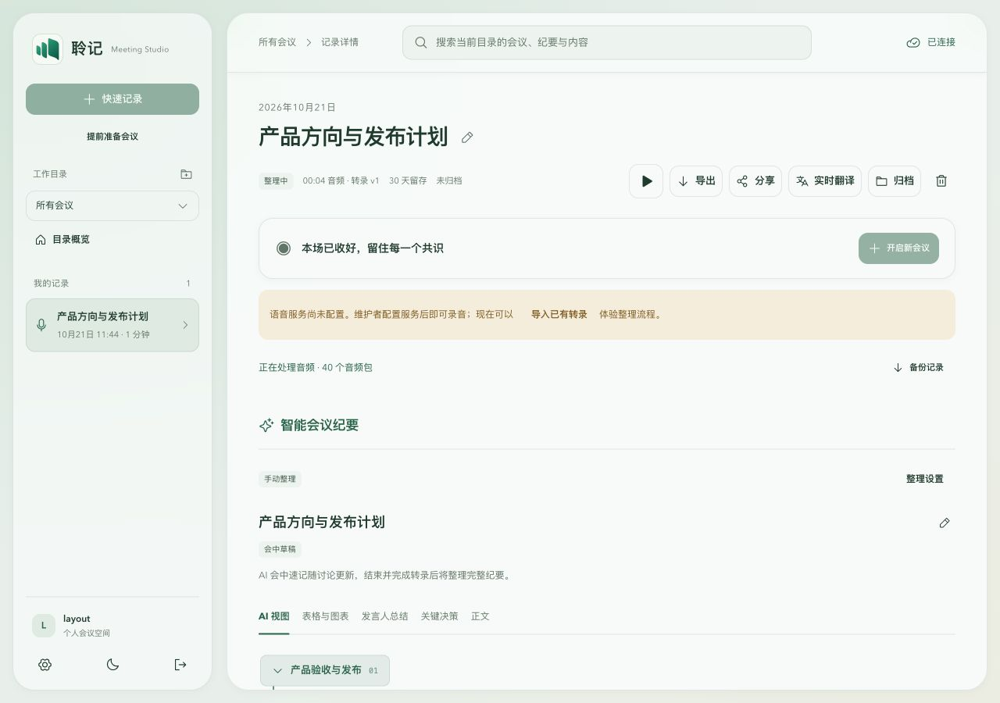
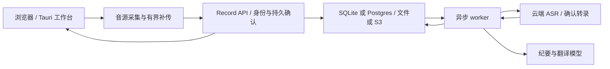

# 聆记 · LingJi Meeting Studio

把会议录音、逐字稿和有出处的 AI 纪要放在同一个工作台。

聆记面向中文会议，提供浏览器工作台与独立桌面客户端。可以采集麦克风和会议音轨、查看转录、整理主题与行动候选，并沿引用回到原文和原音。纪要可人工修改，后台重新整理不会覆盖人工编辑。

**当前版本：v0.1.3，公开测试版。** 本次提供源码与 macOS Apple Silicon 测试安装包。真实会议识别质量、长时间录制和全新设备安装仍需试用验证。

[下载测试版](https://github.com/RoyalLiang/LingJi-Meeting-Studio/releases/tag/v0.1.3) · [安装说明](docs/releases/v0.1.3-preview.md) · [文档目录](docs/README.md) · [问题反馈](https://github.com/RoyalLiang/LingJi-Meeting-Studio/issues)



上图使用虚构会议和隔离测试数据，仅展示界面，不代表真实识别结果。

本版采用已确认的 A 版单行播放器，支持前后跳转 15 秒、拖动进度与 0.75×–2× 倍速。构建与发布以 [GitHub Actions](https://github.com/RoyalLiang/LingJi-Meeting-Studio/actions/workflows/preview-release.yml) 和 Release 附件为准，[本轮验证](docs/evidence/playback-a-trust-2026-10-22.md)。

## 能做什么

| 功能 | 当前行为 |
| --- | --- |
| 会议采集 | 麦克风与共享会议音轨分别保存；暂停后继续同一会议；支持音频和文字导入 |
| 可恢复转录 | 持久确认、幂等补传、事件游标与重连；默认接入豆包双向 ASR，保留确认转录版本 |
| 智能纪要 | 当前讨论、连续主题、决策与行动候选，带片段和版本引用；会中增量整理、会后终稿 |
| 两分钟上下文 | 纪要模型读取当前窗口与近期已确认文字；保留历史引用和人工编辑保护 |
| 原音回放 | 完整持久保存的封存音轨可在 ASR 未完成时播放；两路音源共用播放和定位控件 |
| 导出 | 会议纪要 Markdown、按音源分别导出 WAV；另有结构化数据、日历和工单候选导出 |
| 阅读与整理 | 搜索、说话人编辑、工作目录、明暗主题、可选翻译；自动标题采用纪要名称，保护人工标题 |
| 本机与服务端 | 桌面包内置 Node 后台；开发默认 SQLite/本地文件；另有 Postgres/S3 适配器 |

录音保留、云端识别、AI 分析和分享各有独立权限边界。行动候选不会自行向外发送。部分功能需要开通供应商服务，费用由供应商收取。

## 选择使用方式

| 方式 | 需要准备 |
| --- | --- |
| macOS 测试客户端 | Apple Silicon Mac、macOS 14.6+、自己的 ASR/纪要服务配置 |
| 浏览器本地运行 | Node.js 22.14+、npm；推荐 Node 24 LTS |
| 自行部署 | HTTPS、身份与访问控制、持久卷、备份及供应商配置，见[运行手册](docs/engineering/runbook.md) |

桌面数据保存在本机，但启用的云端 ASR/LLM 会接收相应音频或文字。当前不包含本地离线语音模型。Windows/Linux 构建与自动更新代码已存在，本次没有发布这些平台的已验收安装包。

## 安装 macOS 测试版

1. 从 [v0.1.3 发布页](https://github.com/RoyalLiang/LingJi-Meeting-Studio/releases/tag/v0.1.3)下载 `Lingji-0.1.3-macos-arm64.dmg` 和校验文件。
2. 按[安装说明](docs/releases/v0.1.3-preview.md)核对 SHA-256，将 **聆记 Preview.app** 拖到 Applications。
3. 首次打开时按 macOS 提示处理应用信任和采集授权，在设置中填写自己的服务配置。

Apple 无法验证开发者的原因与单应用授权步骤见[macOS 安全提示说明](docs/releases/macos-trust.md)。当前尚无 Apple Developer Program 账号，未完成正式签名公证，安装仍可能被拦截。

此包采用 ad-hoc 签名，尚无 Apple Developer ID 签名及公证。包中包含运行时，不需要另装 Node。已有 Alpha 用户应先结束录制、等待补传并备份；Preview 与 Alpha 使用相同应用标识，数据目录可能共享，不适合同时运行。

## 从源码启动

```bash
git clone https://github.com/RoyalLiang/LingJi-Meeting-Studio.git
cd LingJi-MS
npm ci
cp .env.example .env
npm run dev
```

打开 [http://127.0.0.1:3000](http://127.0.0.1:3000)。启动器同时运行 React/Vite Web、Record API（默认 3030）与 worker；`Ctrl+C` 关闭本次启动的服务。不要把 `.env` 提交到 Git。

开发模式可创建本地账户，也提供 `dev@local.test` / `LocalMeeting2026!` 开发账户，只用于本机开发。生产模式禁用开发入口，可在本机设置 `RECORD_DEV_ACCOUNT=off`。端口冲突时：

```bash
RECORD_API_PORT=3031 WEB_PORT=3001 npm run dev
```

未配置供应商时可导入已有文字，语音识别和 AI 纪要会提示配置要求。只查看界面或演示时，可以显式使用带测试标识的 fixture 模式：

```bash
RECORD_PROVIDER=fixture npm run dev
```

fixture 返回预设测试内容，不能用于判断识别或纪要质量；生产环境不允许此模式。

## 配置识别与纪要

在“设置 → 模型与转录服务”填写配置，或编辑后端 `.env` 后重启。本机设置覆盖环境配置；密钥留空表示保留，清空需使用对应操作。密钥只放后端，不能写入 `VITE_*`。

| 用途 | 主要配置 | 说明 |
| --- | --- | --- |
| 默认 ASR | `ASR_PROVIDER=doubao`、`DOUBAO_API_KEY`、`DOUBAO_ASR_URL`、`DOUBAO_ASR_RESOURCE_ID` | 示例使用 `wss://openspeech.bytedance.com/api/v3/sauc/bigmodel_async`；账户需开通对应服务 |
| 专业术语 | `DOUBAO_ASR_HOTWORDS` | 逗号分隔，例如“聆记,Redis”；当前应用总长上限 100 字符 |
| 识别背景 | `DOUBAO_ASR_CONTEXT` | 可选，仅中英二遍识别使用；最多 400 字符且 1600 UTF-8 字节，是应用限额，不等于供应商 token 预算 |
| 纪要模型 | `LLM_API_URL`、`LLM_API_KEY`、`LLM_MODEL`、`LLM_PROTOCOL` | 选择 `responses` 或 `chat-completions`，模型需支持所选协议及结构化输出 |
| 其他 ASR | Deepgram 或 multipart 接口配置 | 见 [.env.example](.env.example) 与[运行手册](docs/engineering/runbook.md)；兼容不代表质量达标 |
| 可选翻译 | `DOUBAO_TRANSLATION_*` | 独立翻译配置，见[翻译说明](docs/engineering/intelligent-minutes.md) |

**模型地址必须是完整 API 地址。** 程序按保存值请求，不自动补接口路径；站点首页返回的 HTML 即使是 HTTP 200，也不是模型结果。

本版显式保留豆包口语信息（关闭顺滑改写），按端点处理语言字段，并支持主动填写领域背景。不会自动把历史会议送入识别上下文。准确率收益尚待人工金标准 A/B 验证，见[优化与标注方案](docs/engineering/asr-quality.md)。

## 记录第一场会议

1. 新建会议，可先留空标题；选择适当保存期限和音源。
2. 浏览器共享选择中，选会议所在标签页或支持音频的共享来源，并勾选共享音频。麦克风和会议音轨分别显示信号。
3. 查看转录与纪要，可暂停、恢复、修订说话人和内容。会议软件的静音按钮不会自动关闭聆记的独立麦克风。
4. 结束后等待音频补传与封存。音轨完整保存后即可回放，转录和终稿可能仍在处理。
5. 在会议操作区导出 Markdown 或各音源 WAV。缺片、过期或已清理的音频会提示，不能恢复为完整原音。

纪要两分钟窗口目前使用**已确认转录文字**，并非直接向纪要模型传音频。ASR 临时结果与最终确认片段状态不同，短批次结果不能称为供应商流式 partial。

## 数据、隐私与容量

- 开发数据默认在 Git 忽略的 `.data/records`。桌面数据在 `~/Library/Application Support/com.tts.meeting`，包括会议、配置和待处理内容；卸载应用不会自动删除数据。
- SQLite 使用 WAL/FULL；后台供应商配置文件权限为 `0600`。文件权限不等于加密，请保管设备和备份。
- ASR 接收选定音源的音频，纪要/翻译接收相应文字。屏幕共享授权不等于同意永久留存、云端处理或公开分享，请分别确认。
- IndexedDB 补传队列上限 48 MiB，满时明确停止并保留恢复入口，不能跨设备补传。音频文件导入上限 64 MiB、两小时，仍需浏览器全量解码，受设备内存限制。
- 分享可到期和撤销；下载/导出副本不受后续撤销控制。不要向公开 Issue 附上真实录音、密钥或个人信息。

生产服务需另外设置至少 32 字符的 `RECORD_SESSION_SECRET`、`RECORD_PUBLIC_ORIGIN`、HTTPS 代理和持久存储，并验证备份恢复。当前账户没有邮箱验证、密码找回、OIDC 和组织权限，公开部署前请评估这些边界。[部署与恢复说明](docs/engineering/runbook.md)

## 工作原理



Record 是长期会议容器；暂停和继续形成 Session，独立音源用 Source/epoch/sequence 标识。转录和纪要采用版本化提交，来源引用、重传和停止排空各有校验。见[当前状态](docs/engineering/current-state.md)、[领域词汇](CONTEXT.md)和 [ADR](docs/adr/)。

```text
apps/web/              React + TypeScript 主工作台
apps/desktop/          Tauri 2 / Rust 客户端、原生采集与内置后台
services/records/      Record API、worker、供应商与持久化适配器
packages/records/      领域、音频、转录与纪要公共逻辑
tests/                 自动回归与合成场景
scripts/               开发、打包、校验和离线评估工具
docs/                  使用、工程、研究、设计和验收证据
```

旧页面使用 `npm run dev:legacy-web`，不是主产品入口；`services/engine-go` 是单独实验，不能据此判断主链路运行情况。

## 开发与验证

```bash
npm test
npm run lint
npm run typecheck
npm run build:web
npm run check:docs
node scripts/prepare-client-backend.mjs
cargo test --manifest-path apps/desktop/src-tauri/Cargo.toml --locked
```

Node 回归覆盖领域、供应商协议、持久化、恢复、权限、播放及导出等。原生检查另需 Rust 和 Tauri 系统依赖；先构建 Web 并准备随包 Node/后台资源，再执行 Cargo，干净 checkout 不包含这些生成资源。Lint/类型检查只覆盖脚本声明的范围。Postgres 使用 `npm run test:records:postgres` 并准备真实测试数据库；Go 实验在其目录运行 `go test ./...`。见[验收表](docs/engineering/acceptance.md)。

离线评估使用 `npm run evaluate:asr -- GOLD.jsonl REPORT.json`。必须先准备核听参考文本；工具只比较已有结果，不调用云端、不训练模型、不替换主转录。[数据格式与标注流程](docs/engineering/asr-quality.md)

重新构建指定源码的 macOS 测试包，需要 Apple Silicon、Xcode 工具链和 Rust：

```bash
TTS_RELEASE_SOURCE_REF=<完整提交号> npm run release:macos:preview
```

产物写入 `dist/releases/0.1.3/`，包含 DMG、安装说明、SHA-256 和构建来源。同版本已有产物时拒绝覆盖；打包验证使用隔离数据，不替换现有安装。首发可用 [GitHub Actions 构建与发布](docs/releases/actions-preview.md)。正式多平台签名发布与可信更新是独立流程，见[客户端发版](docs/releases/github-client.md)。

## 常见问题

**录到了声音，但还不能播放？** 检查待上传数量和封存状态。播放依赖完整持久保存的音轨，不依赖 ASR 完成。已清理、过期和缺片音轨会给出原因。

**转录为空或反复重试？** 检查音源、服务开通情况以及密钥/资源 ID/接口是否配套。不要用 fixture 掩盖真实失败；诊断前保留待补传数据。

**专业词或中英混合不准？** 先避免双路重复收音，再添加少量术语和背景。用同一音频比较 CER 和关键实体，避免只看是否流畅。[优化方案](docs/engineering/asr-quality.md)

**macOS 没有系统音轨？** 检查屏幕/系统音频与麦克风授权，确认共享来源支持音频。浏览器与原生授权路径不同；重启前先结束录制并等待补传。

**模型接口报 HTML/JSON 错误？** 使用完整 API 端点，核对 `LLM_PROTOCOL`，不要填控制台或网站首页。

## 反馈、贡献与后续方向

通过 [GitHub Issues](https://github.com/RoyalLiang/LingJi-Meeting-Studio/issues)提供版本、系统/浏览器、音源、最小复现步骤和脱敏日志。提交代码前跑相关回归及上述检查；涉及音频协议、权限和人工编辑时请补失败场景。

后续优先验证真实会议 CER/实体准确率、长会话恢复、全新 Mac 安装及正式签名公证。跨平台安装矩阵、团队身份和直接音频理解需单独设计与验收；[路线图](docs/design/roadmap.md)中的目标不代表已实现。

项目暂未指定开源许可证。公开可见不代表授予任意再分发或商业使用权限；需要授权时请联系维护者。

结构参考 WhisperX、Buzz、Meetily、Vibe 等项目的一手文档，依据与能力核对见[研究记录](docs/research/readme-and-asr-quality-2026-10-21.md)。

For English readers: LingJi is a browser-first meeting recorder with cloud transcription, source-linked AI minutes, and a Tauri desktop client. This public preview includes source code and an ad-hoc signed macOS Apple Silicon test installer. Real-meeting accuracy and production readiness remain unverified.
