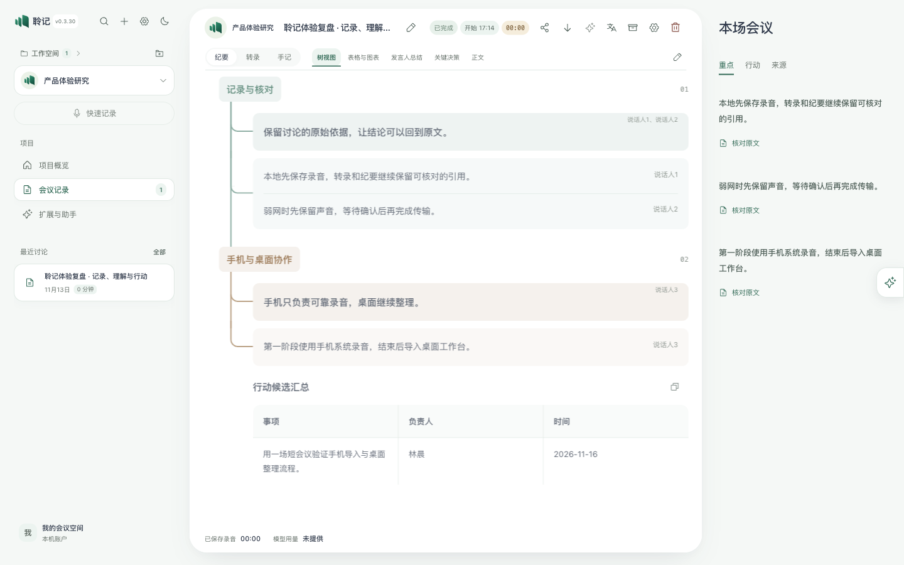
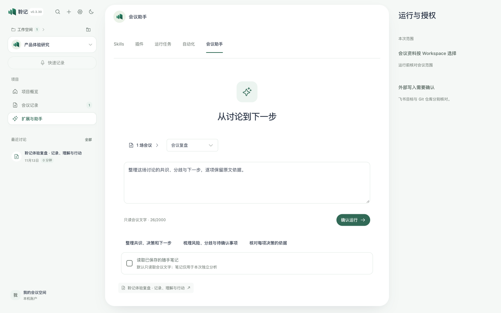
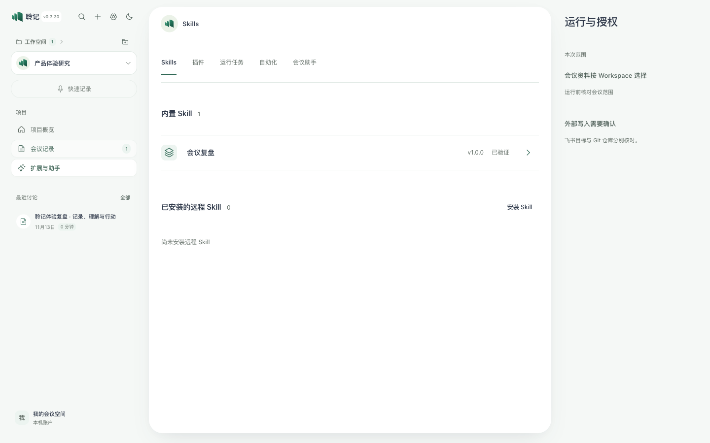
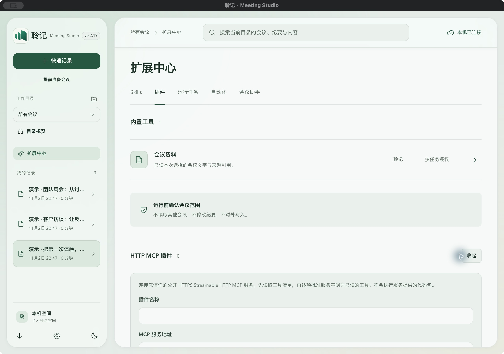
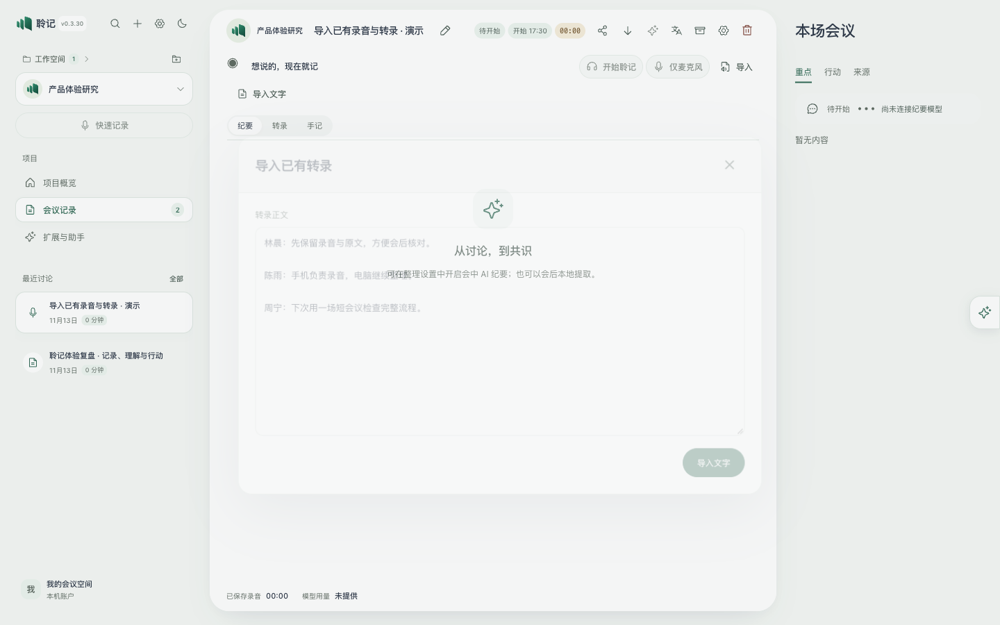
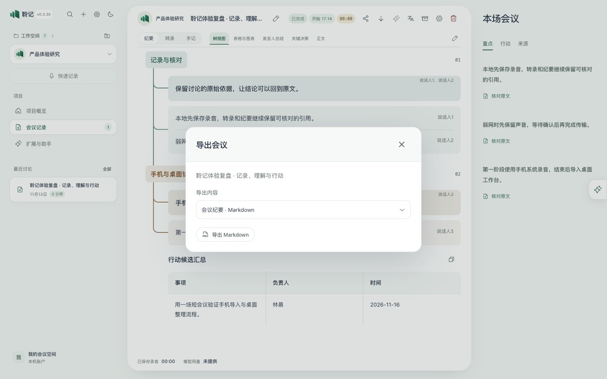

<p align="center">
  
</p>

<h1 align="center">聆记 · LingJi Meeting Studio</h1>

<p align="center"><strong>专心讨论。聆记，帮你记。</strong></p>

<p align="center">从录音、转录到 AI 纪要，让重要的讨论成为可阅读、可核对、可继续使用的记录。</p>

<p align="center">
  <a href="https://rookiecode.com">产品官网</a> ·
  <a href="https://github.com/RoyalLiang/LingJi-Meeting-Studio/releases">下载测试版</a> ·
  <a href="https://rookiecode.com/example">阅读示例纪要</a> ·
  <a href="docs/README.md">使用与开发文档</a> ·
  <a href="https://github.com/RoyalLiang/LingJi-Meeting-Studio/issues">反馈问题</a>
</p>

聆记是一款会议记录工作台。它把录音、逐字稿、主题纪要、原文引用和行动候选放在同一份记录中：会中跟上讨论，会后回顾结论，需要时还能回到那句原话。

支持 macOS、Windows、Linux 桌面测试版，也可从源码运行 Web 工作台。共享纪要可直接用浏览器阅读。当前仍在测试阶段，功能与验证范围见[当前状态](docs/engineering/current-state.md)，安装包与版本说明以 [Releases](https://github.com/RoyalLiang/LingJi-Meeting-Studio/releases) 为准。

## 为什么做聆记

讨论往往结束得很快，整理却才刚开始。记笔记容易错过下一句，整段录音难以回顾，孤立的 AI 总结又让人不确定“当时真的是这么说的吗”。

聆记希望把这几个环节连起来。

| 会议中的困扰 | 聆记如何帮助 |
| --- | --- |
| 边听边记，顾不上参与讨论 | 采集与转录同步进行，随手笔记补充你的观察，会中按配置持续整理纪要 |
| 录音很长，不知道从哪里回顾 | 按主题阅读，先看重点、决定和待确认事项，再定位相关原文 |
| 看到了结论，却不知道依据 | 纪要保留片段与版本引用；保留原音时，可结合波形、定位和倍速回放核对 |
| 人名、产品名、业务术语容易识别错 | 配置账户或工作目录词表，提供场景背景，核对候选后人工确认修订 |
| 散会后还要重新整理、复制、分发 | 导出 Markdown、HTML 或飞书云文档；按需发布可撤销的只读快照 |
| 同一个项目开了很多会，信息散落各处 | 用工作目录归档、搜索与回顾，按需生成有会议来源的跨会议分析 |

## 一份记录，几种读法

### 会中，跟着讨论整理

点击**快速记录**，不用先填写会议名称。按场景选择麦克风与受支持的系统音频，也可导入已有音频或文字。需要休息时暂停，回来继续；结束后，后台继续处理剩余内容。

开启 AI 纪要后，主题、当前讨论与重点随处理进度更新。你可以向上回看、核对引用或补充笔记，再主动回到最新内容。

### 会后，先看懂，再核对

按主题阅读正文、决定、分歧与行动候选；适合结构化呈现的内容，可展示为表格、时间线或有原文依据的数据视图。

每条引用指向对应的转录片段和修订。需要确认含义时回看原话，保留原音时再回放核对。AI 的理解不等于最终事实，聆记提供核对路径，由你确认内容。

### 重要的内容，由你把关

可以修正逐字稿、补充会议笔记、人工编辑纪要。人工编辑不会被后台重生成覆盖。行动候选的负责人和时间未在讨论中明确时，保留为待确认，不把候选当作已执行的任务。



## 适应你的会议方式

| 能力 | 可以做什么 |
| --- | --- |
| **多音源记录** | 麦克风与受支持的系统音频采集、已有音频与文字导入、暂停与继续 |
| **本地转录** | 桌面版内置 SenseVoice 与语音分段引擎，可在本机完成语音转文字，无需另开转录服务器 |
| **多种 AI 链路** | 选择 ASR＋文字模型，或配置 OpenAI Realtime、豆包音频理解方式 |
| **实时翻译** | 保留原文，按目标语言翻译，支持对照阅读与暂停处理 |
| **场景词表与校对** | 为账户和工作目录配置术语背景，确认纠错候选，保留原文与修订关系 |
| **波形回放** | 在原音可用时点击、拖动定位，配合倍速播放复核 |
| **工作目录与历史回顾** | 按项目归档和搜索，查看范围内主题、决策、行动，按需分析历史会议 |
| **会议助手与扩展** | 围绕当前记录处理任务，按需配置 Skill、MCP 等扩展与外部连接 |
| **导出与飞书协同** | 导出 Markdown、HTML；配置飞书企业自建应用后预览并确认写入云文档，也可另行确认自动导出规则 |
| **加密链接分享** | 无需登录，从客户端生成链接；官网接收密文，浏览器解密阅读，24 小时有效，可撤销，原音不上传 |

系统音频取决于浏览器、系统、共享对象与授权。翻译、纪要和需要外部连接的扩展依赖对应服务配置；来源引用并不保证模型理解准确。更完整的使用条件见[文档导航](docs/README.md)。

## 让 Agent 接着工作

纪要留下了讨论，会议助手接着处理你关心的问题。先选择 1–8 场已有转录的会议，再指定整理目标；任务结果独立保存，引用运行时选中的会议与转录版本，不覆盖原纪要。

可以这样使用：

- **需求评审**：对照前后两次讨论，梳理延续的决定、变化的条件和仍需确认的问题。
- **周会复盘**：从多场会议中整理共识、分歧和行动候选，为下一次会议准备议题。
- **研究访谈**：围绕一个问题整理所选访谈，要求每项判断保留来源，区分原话和理解。



### 用 Skill 复用整理方法

内置**会议复盘** Skill 用于整理共识、决策和行动候选。可以安装远程 Skill，把团队常用的方法带入不同会议任务。任务记录所选 Skill 的版本，便于回顾当时采用的方法。



### 用 MCP 接入只读工具

连接受信任的 HTTPS Streamable HTTP MCP 服务，先检查工具清单，再逐项批准服务声明为只读的工具。任务中选择本次使用的扩展与会议范围，按需单独确认笔记和远程工具的使用。



## 从这些场景开始

- **团队周会与需求评审**：按主题回顾决定、分歧和待办，减少下一次会议重复对齐。
- **客户访谈与研究讨论**：先整理发现，再回到受访者原话，避免把推断当作原始反馈。
- **课程与个人复盘**：把长录音整理成可阅读的内容，对照原文补充自己的理解。
- **跨语言沟通**：在原文之外查看译文，保留理解差异的核对空间。

这些是使用场景建议，不是对所有设备、语种或会议质量的验收承诺。建议先用非敏感内容做一次短录音，确认音源、识别与模型效果。

## 本地与云端，分别选择

桌面版的会议与录音保存在本机后端；自建 Web 部署的数据位置由部署配置决定。内置 SenseVoice 负责本地转录，**不代表 AI 纪要全部离线**。

| 处理方式 | 数据如何使用 |
| --- | --- |
| 本地 SenseVoice 转录 | 在本机把音频转成文字 |
| 云端转录 | 将音频发送到已配置的转录服务 |
| 文字纪要与翻译 | 将所需转录、笔记或相关文字发送到对应模型服务 |
| 音频直接理解 | 按授权将音频发送到配置的音频模型 |
| 在线分享与飞书导出 | 按所选范围和授权发送内容，和本机记录分别管理 |

采集权限、录音告知、原音保留、云端发送与内容分享分别确认。密钥通过设置保存在后端，开发环境可放在 `.env`，不要写入 `VITE_*`、前端源码或日志。留存、备份和恢复见[运行手册](docs/engineering/runbook.md)。

## 安装与开始使用

### 下载桌面测试版

在 [Releases](https://github.com/RoyalLiang/LingJi-Meeting-Studio/releases) 选择同一版本的成品安装包，按发布正文核对 SHA-256。Source code 是源码归档，不是安装包。

| 平台 | 系统要求 | 安装文件 |
| --- | --- | --- |
| macOS Apple Silicon | macOS 14.6 或更新版本 | `Lingji-版本-macos-arm64.dmg` |
| Windows x64 | Windows 10 / 11、WebView2 | `Lingji-版本-windows-x64-setup.exe` |
| Linux x64 | 已验证 Ubuntu 24.04，其他发行版待验 | `Lingji-版本-linux-amd64.deb` |

1. 安装客户端：macOS 将应用拖入“应用程序”；Windows 运行 EXE；Linux 在下载目录运行 `sudo apt install ./Lingji-版本-linux-amd64.deb`。
2. 进入**设置 → 模型与转录服务**，选择并测试转录和纪要服务。
3. 点击**快速记录**，确认音源与授权，开始一场短会议。
4. 结束后核对纪要和引用，再按需导出或分享。

Windows 默认勾选安装本地 SenseVoice 模型，可取消；macOS 与 Linux 包含模型。Windows 取消后若无已有模型，需要配置云端转录；这不会减小完整安装包的下载大小。原位置升级可保留已有模型。

当前 Windows 包未签名，macOS 包为临时签名且未公证。安装提示见 [macOS 安装与信任说明](docs/releases/macos-trust.md)。Linux 实体 PipeWire/声卡仍需目标设备验收；关闭窗口进入退出确认流程，不提供托盘常驻。Windows 与 macOS 收起主窗口后可继续工作，停止采集请使用会议内的暂停或结束。

### 选择纪要链路

在**设置 → 模型与转录服务 → 会议理解**中选择，按需确认音频发送授权。

| 方式 | 如何工作 | 配置说明 |
| --- | --- | --- |
| ASR＋LLM | 本地或云端转录产生逐字稿，文字模型整理纪要 | [本地转录与服务配置](docs/engineering/funasr.md) |
| OpenAI Realtime | 模型直接理解音频，独立转录并行留证 | [Realtime 接入](docs/engineering/openai-realtime.md) |
| 豆包音频＋独立 ASR | 音频模型理解，独立转录提供引用 | [豆包音频方式](docs/engineering/doubao-audio.md) |
| 仅豆包音频模型 | 同一音频模型完成短批次转录与纪要，无需独立 ASR | [配置与验证边界](docs/engineering/doubao-audio.md) |

文字纪要支持 Responses 与 Chat Completions。云端服务需要自行配置账户、请求地址、模型或接入点 ID、密钥及额度。仅豆包方式的短批次转录不属于供应商流式 partial。

### 从客户端创建加密分享链接

打开会议的**分享**窗口，选择仅纪要与引用原文，或另外包含全部转录。核对范围并勾选确认，点击**生成加密分享链接**，无需注册或登录官网。

内容在客户端使用 AES-256-GCM 加密，官网只接收加密内容，不接收解密密钥。密钥保存在完整链接的 `#` 片段中，接收者打开链接后，由浏览器本地解密。撤销凭据单独保留在创建方客户端，不包含在阅读链接中。

链接 24 小时有效，分享的是固定快照，后续编辑不会自动同步，原音不上传。当前明文限额为 700 KiB，匿名上传设有限额。完整链接包含阅读凭据，请只发给需要的人；缺少密钥时官网不能恢复内容。

回到客户端可查看或撤销链接。删除本机会议不会自动撤销分享，删除前请先处理链接；撤销无法收回已保存的副本。[分享使用说明](https://rookiecode.com/publish)。

加密分享从 v0.2.21 起提供。请使用新版客户端；[安装说明与版本范围](docs/releases/v0.2.21-preview.md)列出对应版本及验证边界。

### 导入已有资料，导出下一步成果

从已有音频或文字开始，不必重新录制。文字导入按自然段保留，不生成虚构的音频时间。转录与纪要整理后，可导出 Markdown、独立 HTML；保留原音时可另行导出 WAV。



配置飞书企业自建应用后，在导出界面预览目标内容，再确认写入云文档。需要会后自动导出时，另行确认规则和范围。



## 从源码运行 Web 工作台

需要 Node.js **26.12.1**（与 `.nvmrc`、`package.json` 一致）及 npm。

```bash
git clone https://github.com/RoyalLiang/LingJi-Meeting-Studio.git
cd LingJi-Meeting-Studio
npm ci
cp -n .env.example .env
npm run dev
```

已有 `.env` 会保留。打开终端输出的 Web 地址，默认 `http://localhost:3000`。命令同时启动 React/Vite Web、Record API 与 worker，API 默认端口为 `3030`。在设置中保存并测试模型配置后开始录音。

源码启动不会自动附带已打包的本地模型资源。浏览器采集需要完成授权，对外部署还需配置 HTTPS、身份与存储。官网本身不是公开录音工作台；自建步骤见[运行手册](docs/engineering/runbook.md)。

## 开发、验证与贡献

前端使用 React / Vite / TypeScript，桌面壳使用 Tauri / Rust，Record API 与 worker 使用 Node.js。主实现、Go 实验与验证层次见[当前状态](docs/engineering/current-state.md)。

```bash
npm test
npm run lint
npm run typecheck
npm run build:web
npm run build:site
npm run check:docs
```

测试通过、真实模型验证、实体设备验收与已发布状态分别记录。真实采音、长会议、Postgres/S3 与不同供应商效果不能由 mock 或单元测试替代，详见[验收表](docs/engineering/acceptance.md)与各版本发布回执。

| 想继续了解 | 文档 |
| --- | --- |
| 安装、本地模型与高级服务 | [本地转录](docs/engineering/funasr.md) · [发布与安装流程](docs/releases/actions-preview.md) |
| 纪要阅读、引用与回放 | [智能纪要](docs/engineering/intelligent-minutes.md) · [录音播放](docs/design/recording-playback.md) |
| 翻译、术语与纠错 | [多语种与词表](docs/engineering/multilingual-vocabulary.md) · [识别质量](docs/engineering/asr-quality.md) |
| 目录、历史分析与扩展 | [工作目录](docs/engineering/workspaces.md) · [飞书与远程扩展](docs/engineering/feishu-and-remote-extensions.md) |
| 飞书配置与导出权限 | [飞书 SDK 协同](docs/engineering/feishu-sdk.md) |
| 部署、故障与数据恢复 | [运行手册](docs/engineering/runbook.md) |
| 设计、架构与历史发布 | [文档导航](docs/README.md) |

通过 [GitHub Issues](https://github.com/RoyalLiang/LingJi-Meeting-Studio/issues) 提供版本、系统、音源、复现步骤与脱敏诊断信息，请勿上传密钥或未经允许的真实会议内容。

提交代码前运行相关检查；涉及音频协议、权限、转录版本或人工编辑时，补齐失败场景。项目源码尚未声明许可证，内置模型与第三方组件许可见[本地转录文档](docs/engineering/funasr.md)。
