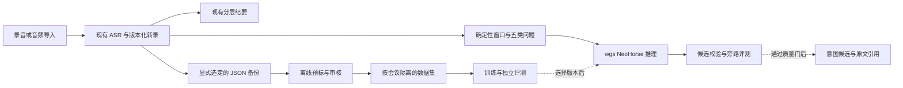

# ADR 0014：以旁路评测接入 NeoHorse 意图能力

状态：**proposed**。日期：2026-10-13。本文回答录音数据如何进入训练流程、模型如何进入现有系统；没有实施运行时接入、部署模型或处理真实会议。

## 已核实的接入位置

- [worker](../../services/records/src/worker.mjs) 已有独立 `intents` lane，使用最近 120 个片段，通过 `providers.intents` / `analyzeIntents` 或本地规则产出候选。当前模型就绪判断复用了纪要供应商状态与 `analysisConsent`。
- [通用意图供应商](../../services/records/src/providers.mjs) 使用 JSON LLM 提取五类内容；[提交函数](../../packages/records/src/intents.mjs) 校验 generation、transcriptRevision 和片段引用，再整份替换 `record.insights`。它不能直接接收单窗口增量结果，也不证明语义正确。
- [实验服务器](../../tools/neohorse/serve.py) 支持 `/v1/systemone` 与 `/v1/decision`，绑定回环地址，使用串行 HTTPServer。它是调试工具，没有正式推理队列、访问认证或部署可用性保证；协议不是 Chat Completions / Responses。
- [分层纪要流水线](../../services/records/src/minutes-pipeline.mjs) 使用原始转录和分层摘要，当前没有把 NeoHorse 或 `record.insights` 接入纪要生成。仅新增预测调用不会自动改善主纪要。
- [数据生成器](../../tools/neohorse/build_dataset.py) 消费 Record JSON 中的转录文本。已有合成数据训练、重载和评测证据见[数据说明](../engineering/intent-dataset.md)；原模型与 LoRA 在当时 10 条合成测试题上均为 70%，不能据此启用正式路由。

## 提议的分工与运行位置

录音继续进入既有采集、持久化和 ASR；NeoHorse 专注转录后的五类意图候选；现有 LLM 继续负责综合纪要。意图分类不等于业务批准、待办创建或外发授权。

首个接入实验使用已安装模型的 wgs。应用后端通过受控连接访问推理模块，浏览器与桌面 UI 不直接访问模型端口。wgs 是私有服务器上的推理位置，不等于用户设备离线；断网不可用，ASR 与纪要仍可能使用已配置的云供应商。Mac 本机推理、完全离线 ASR 和正式多用户部署另行验收，不从 RTX 实验推断支持。

## 一个推理模块与现有提交通道

新增 `IntentRuntime` 模块，Interface 接收不可变转录快照、焦点集合、固定版本组合和任务身份，返回逐窗口预测、弃判原因及运行信息。Node 侧 Adapter 将已接受预测映射为现有 `{items:[{kind,text,evidence}]}`，并保留模型元数据。版本、预算、匿名化、编码和缓存由模块的 Implementation 集中处理，避免在 worker、UI 与数据脚本各写一套规则。

1. 从现有生成器提取可复用的窗口构造。输入须补齐 source、说话人、startMs/endMs；现有 worker 的 id/revision/text 快照不足以复现训练窗口。采用最多两个已结束前文加焦点、同一提示与 criteria、同一 tokenizer 和基本脱敏策略。匿名编号按可见前缀稳定产生；训练与推理都不得依赖后续发言建字典。已有生成器按整份备份建脱敏映射，抽取时必须版本化修正并重建相应数据集。
2. 首轮沿用每个焦点五个独立 binary Choice 请求，允许多标签。使用实际编码器检查 state 128 / 完整行 256 tokens；只移除较早上下文，焦点超限则弃判。合并五题、扩大窗口或切分焦点都须另行评测，不能通过静默截断改变语义。
3. 模型返回概率和 present/absent；概率不是经校准的正确率。接受阈值、弃判区间与关键误报策略由独立 dev 集校准，test 只作最终评测。接受的正例使用焦点原文或其可验证的确定性文本，保留焦点及实际依赖的前文引用；不让分类器编造负责人、日期或决定正文。脱敏文本、原文展示和引用映射分别保留。
4. 按窗口输入哈希、片段引用、policy/prompt/tokenizer/model/adapter 版本缓存。修订片段或上下文会使依赖窗口失效；重复任务使用相同身份幂等处理。近期候选按固定排序去重并遵守现有 50 项上限，截去的数量必须可观测。
5. 提交前重新验证 generation、当前转录与所有引用；迟到结果不发布。后续任务可复用仍匹配输入的缓存，对当前快照重新聚合，再通过现有事务提交。新增 claim fence 防止旧任务清掉新 lease；不能把单窗口结果直接交给整份替换的 `commitIntents`。
6. 意图 provider 的就绪判断与纪要 provider 解耦，配置仅在后端。以下模式是拟新增配置，当前尚未存在：`off` 保持既有路径，`shadow` 写独立、有界的评测记录，`assist` 发布候选。配置须表达处理位置与允许的数据范围；模型调用不隐含训练许可。

旁路结果不能修改 `record.insights`、人工纪要或行动状态。超时、离线、预算不足与弃判分别记录；规则退路须明确标记为 rules，云端升级只在已有对应分析授权和明确策略下发生。推理工作保留独立限流与截止时间，不能拖住音频持久 ACK、转录或停止排空。

撤回分类只说明当前发言的语义。自动定位并撤销某个既有决定还需要关联和生命周期机制，本阶段不把一个 withdrawal 标签直接当成历史状态变更。

## 从录音形成数据闭环

已有系统记录：等待转录处理完成、核对否定词和专有名词后，导出 JSON 备份。只有外部录音文件时，先使用现有音频导入与 ASR；当前浏览器导入上限 64 MiB / 两小时，较大资料需显式拆分并保留共同会议分组。NeoHorse 不直接消费音频，JSON 备份也不包含录音字节。

按[现有操作文档](../engineering/intent-dataset.md)声明可训练 Record，生成预标、审核明确正负例，再输出 JSONL。原音只用于获准的核听和 ASR 质量检查；额外保存音频训练集是不同任务。原音未留存或已清理时，不能恢复核听依据，但已有转录仍可按其实际证据范围评审。

拟增加的反馈是每个候选的接受、纠正、否定与弃标，并绑定确切输入哈希及引用版本。未点击、未展示或后续纪要未提及都不表示负例。整篇人工纪要也不能直接作为逐句意图真值。产品内逐条审核、反馈导出及训练数据副本的自动留存清理尚未实现。

评测需同时保留两套口径：校正转录用于研究意图语义上限；原始 ASR 快照用于衡量系统实际效果。会后修改过的 JSON 不能重建当时实时输入，应另行采集获准的在线输入快照。同一会议的 Session、音频拆分、改写和训练窗口必须隔离到同一分组。

## 推进顺序与退出条件

1. **离线基线**：先积累获准真实语料及独立审核标签，覆盖五类正负例、否定/撤回、歧义、多说话人和 ASR 错误。比较规则、现有 LLM、原模型和 LoRA；固定 test，不以合成准确率定上线阈值。
2. **旁路接入**：补共享窗口模块、专用 Adapter、独立配置、claim fence 和有界评测记录，先只用合成输入验收，再在获准试点记录中观测。原模型先作基线，已有 LoRA 作为对照，不因训练损失下降自动替换。验证输出协议、越界引用、重复与迟到结果、修订/删除、离线/超时、GPU 饱和和一键关闭；这是接线阶段，不要求先全量训练。
3. **候选展示**：关键误报不劣于基线，且正确性、时延或成本至少一项有证据改善后，再启用 `assist`。复用意图候选视图，新增必要的审核反馈与版本展示；主纪要若要消费这些候选，仍须独立校验原文和评测，不直接提升为事实。

按五类分别报告 precision/recall/F1、弃判率、误把提议当决定的比例、撤回漏检、引用支持、人工修改量，以及排队与推理 p50/p95、显存/错误率、窗口超限率和实际调用成本。任务在执行期间固定版本；切换与回退仅影响新任务，旧结果不能以新版本名义复用。

本提议对应[演进方案 EP-08/09](../design/evolution-plan-2026-10-12.md)，不自动提前批准它们依赖的工作流、路由或部署。当前交付仅为源码核对和 proposed ADR，未改产品代码、录音、服务、模型制品或线上配置。
