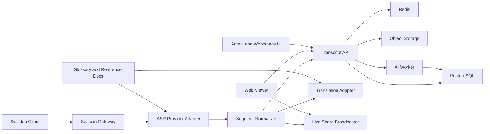

> 历史文档（2026-10-11 整理）：首版方向已改为浏览器优先、尽量免安装。本文保留原有设计背景，不作为当前实现或排期承诺；先读 [新文档入口](README.md) 与 [当前状态](engineering/current-state.md)。

# 技术架构文档 v1

- 文档状态：`Draft`
- 更新时间：`2026-03-19`

## 1. 架构目标

`v1` 的技术方案服务于三个核心目标：

1. 用最小团队交付可用的实时会话链路
2. 保持 ASR、翻译、AI 能力可替换
3. 让隐私、可观测性和回放能力从第一天就存在

## 2. 核心原则

- 单一主路径优先：先打透桌面端到 transcript 存储再扩展
- Provider 抽象优先：厂商能力通过 adapter 接入
- Partial 与 Final 分离：实时显示与持久化处理使用不同状态
- 文本是第一公民：纪要、搜索、分享都基于结构化 transcript
- 默认不保留音频：除非用户显式开启

## 3. 技术选型

为了降低 90 天落地复杂度，`v1` 统一采用 TypeScript 生态：

- `apps/desktop`: `Electron + React + Vite`
- `apps/web`: `Next.js` 或 `React + Vite`，优先 viewer 与管理界面
- `services/session-gateway`: `Node.js + Fastify + WebSocket`
- `services/transcript-api`: `Node.js + Fastify`
- `services/ai-worker`: `Node.js` 后台任务
- `database`: `PostgreSQL`
- `cache/realtime fan-out`: `Redis`
- `object storage`: 录音与参考资料对象存储

备注：

- 当 `session-gateway` 的 CPU 或连接数成为瓶颈时，再评估抽离到 `Go`。
- 在 `v1` 之前不引入多语言多运行时，避免团队认知负担过早上升。

## 4. 高层架构



## 5. 组件职责

## 5.1 Desktop Client

负责：

- 麦克风与系统音频采集
- 本地设备管理
- 会话创建、暂停、停止
- 浮动字幕展示
- 与 `session-gateway` 建立实时连接

不负责：

- 持久化 transcript 规则
- 权限判断
- AI 纪要生成

## 5.2 Session Gateway

负责：

- 接收音频 chunk
- 管理 session 级连接
- 调用 ASR provider adapter
- 处理 partial/final transcript 流
- 将标准化 segment 广播给桌面端和 Live Share viewer

关键要求：

- session 内消息顺序稳定
- provider 中断时可重试或降级
- 所有重连、超时、provider 错误必须打点

## 5.3 Transcript API

负责：

- 会话元数据
- transcript、translation 的持久化
- 工作区、文件夹、权限
- glossary 和参考资料管理
- 回放、搜索、viewer 补历史

## 5.4 AI Worker

负责：

- 会后摘要
- 行动项提取
- 主题切片
- transcript 问答索引

关键规则：

- 只消费 `final transcript`
- 输出必须可回溯到 `segment_id`

## 6. 数据流

## 6.1 会话启动

1. Desktop Client 请求创建 session
2. Transcript API 返回 `session_id`、上传令牌和 viewer 策略
3. Desktop Client 连接 Session Gateway 并发送音频流
4. Session Gateway 初始化 ASR adapter 和翻译配置

## 6.2 实时转录

1. Gateway 接收音频 chunk
2. 音频流送入 ASR provider
3. provider 返回 partial transcript
4. Gateway 将结果标准化后广播
5. provider 返回 final transcript
6. Gateway 提交 final transcript 给 Transcript API 持久化

## 6.3 实时翻译

1. Final 或足够稳定的 partial segment 进入 Translation Adapter
2. 结果按 `segment_id` 对齐
3. 广播给 Desktop Client 和 Viewer
4. Final translation 持久化

## 6.4 会后处理

1. Session 结束后发出 `session.completed`
2. AI Worker 拉取 final transcript
3. 生成摘要、行动项、主题
4. 写回 Transcript API

## 7. 共享数据契约

核心对象如下：

```json
{
  "segmentId": "seg_001",
  "sessionId": "sess_123",
  "sequence": 42,
  "status": "partial",
  "sourceLanguage": "en",
  "targetLanguage": "zh-CN",
  "startMs": 120300,
  "endMs": 122400,
  "speakerId": null,
  "text": "Let's review the roadmap",
  "translatedText": "我们来过一下路线图",
  "confidence": 0.94,
  "provider": "provider_a",
  "glossaryHits": [
    "roadmap"
  ]
}
```

约束：

- `segmentId` 在 session 内唯一
- `sequence` 单调递增
- `status` 只允许 `partial` 或 `final`
- AI 任务只处理 `final`

## 8. 数据模型

建议首批表：

- `users`
- `workspaces`
- `folders`
- `sessions`
- `session_participants`
- `segments`
- `translations`
- `glossary_terms`
- `reference_documents`
- `share_links`
- `ai_summaries`
- `audit_logs`

说明：

- `segments` 存原文与标准化字段
- `translations` 单独建表，支持一个 segment 对多个目标语言
- `share_links` 管过期时间、撤销状态、访问策略

## 9. API 边界

## 写接口

- `POST /sessions`
- `POST /sessions/:id/start`
- `POST /sessions/:id/stop`
- `POST /sessions/:id/audio-chunks`
- `POST /workspaces/:id/glossary`
- `POST /folders/:id/reference-docs`
- `POST /sessions/:id/share-links`

## 读接口

- `GET /sessions`
- `GET /sessions/:id`
- `GET /sessions/:id/segments`
- `GET /sessions/:id/replay`
- `GET /share/:token/bootstrap`

## 实时接口

- `WS /realtime/session/:id`
- `WS /realtime/share/:token`

## 10. Provider 抽象

定义三类 adapter：

- `ASRAdapter`
- `TranslationAdapter`
- `SummarizationAdapter`

统一接口目标：

- 上游业务只依赖标准化事件
- 可按工作区或 session 切 provider
- 可记录 provider 级成本、错误率和延迟

## 11. 隐私与安全

## 默认规则

- 会话开始前必须显示转录提醒
- 默认仅保存 transcript 和必要元数据
- 原始音频仅在用户显式开启时保存
- viewer 链接默认只读且具备有效期

## 最低控制基线

- 访问令牌短时有效
- 敏感操作写入审计日志
- 对象存储采用私有 bucket
- 参考资料与 glossary 按 workspace 隔离

## 12. 可观测性

关键指标：

- `session_start_success_rate`
- `audio_chunk_ingest_latency_ms`
- `partial_transcript_latency_ms`
- `final_transcript_latency_ms`
- `provider_error_rate`
- `viewer_join_success_rate`
- `ai_summary_job_duration_ms`

关键日志：

- session 创建与关闭
- gateway 重连
- provider 降级
- viewer join/leave
- share link revoke

关键追踪：

- `desktop -> gateway -> provider -> api -> viewer`

## 13. 可靠性策略

- Gateway 无状态化，便于水平扩展
- Session 元信息落 Redis，持久数据落 PostgreSQL
- Viewer 断线重连后先拉历史，再订阅实时流
- 所有后台任务幂等

## 14. 当前不做的复杂度

- 多区域部署
- 全量 speaker diarization 编辑器
- 企业级 SCIM / SSO
- 自研模型训练平台

## 15. 推荐实施顺序

1. 先打通桌面采集与 Gateway
2. 再打通 ASR partial/final 标准化
3. 再加 Transcript API 持久化
4. 再做 Viewer 补历史与实时广播
5. 最后加 AI Worker、glossary、参考文档增强
