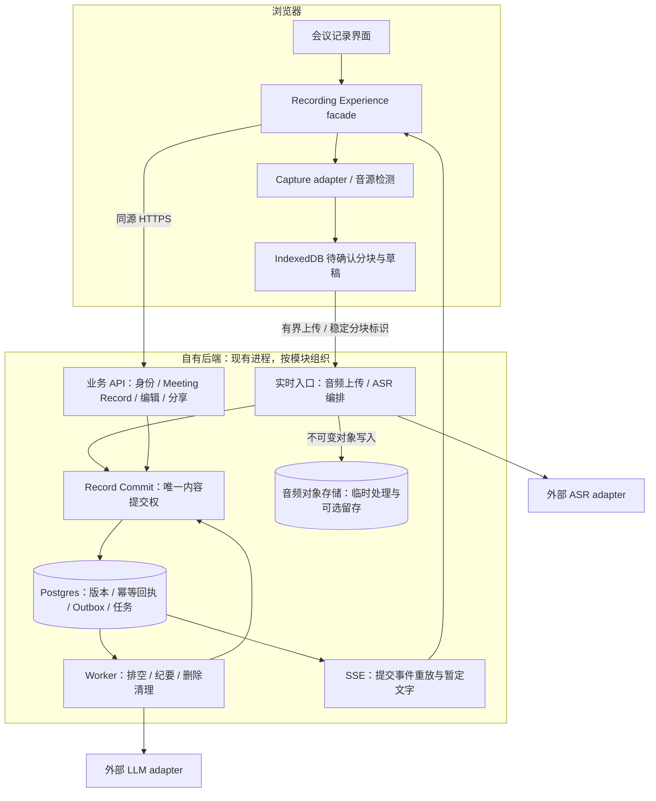
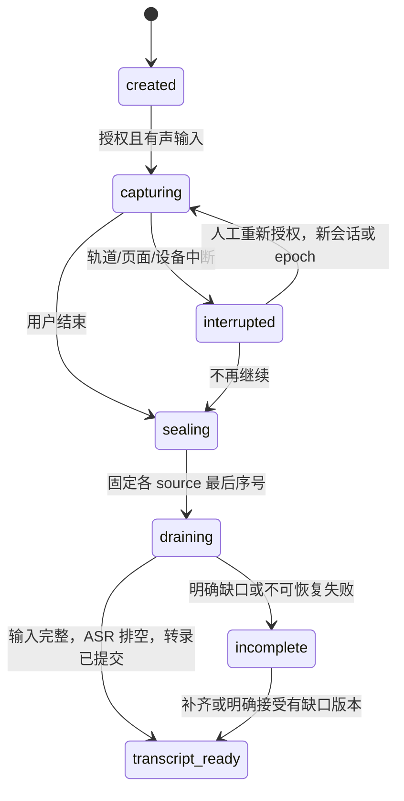

# 把可靠记录、可信纪要与浏览器体验连成一条链路

状态：**proposed，未实施**；2026-10-11。产品约束见 [产品设计](product.md)，现有实现见 [当前状态](../engineering/current-state.md)，术语见 [CONTEXT](../../CONTEXT.md)。

推荐继续使用现有 Node 主链路，先形成清楚的模块与持久化契约。Web 成为首版产品入口；桌面 preview 作为兼容面，Go 作为独立实验。React + TypeScript + Vite 可用于逐步拆解现有 DOM 壳，但选型与迁移不代替采集、恢复和纪要验收。

## 让事实有明确的所有者



这张图表达模块职责，不要求增加同数量的部署服务。保留 gateway/API/worker 的已有进程即可；初期不用 Kafka、图数据库、全量事件溯源或多地域部署。使用 Postgres 的任务表、租约和 outbox 起步，确有吞吐或运维证据时再增加基础设施。

| 所有者 | 权威事实 | 不能混同的东西 |
| --- | --- | --- |
| 浏览器 Capture adapter | 实际获得的轨道、采样时间、设备停止/静音 | 权限通过不代表有声输入 |
| 本地缓冲 | 已完成本地事务的待上传音频与草稿 | 浏览器存储可能被清理，不是永久备份 |
| Record Commit module | 权限检查后的内容、版本、输入回执与提交事件 | 网关内存状态和 UI 乐观状态不是权威 |
| ASR adapter | provider 原始结果及处理状态 | final 不等于真实无误，也不等于人类确认 |
| Minutes module | 某一封存转录版本上的 AI 草稿与人工编辑版本 | 模型输出不自动覆盖人工内容 |
| Action module | 候选、人工确认及其版本 | 确认不自动授权外部发送 |

## Web 采集必须尊重平台限制

Capture adapter 暴露能力检测、选择来源、开始、排空、停止；页面不处理 provider 或恢复序号。getDisplayMedia 必须直接在用户手势里调用，不能先 await 网络初始化；getUserMedia 与分享授权结果分别检查。共享流可能没有 audio track，必须检查轨道并验证电平，不能仅凭 audio:true 显示录制正常。[MDN](https://developer.mozilla.org/en-US/docs/Web/API/MediaDevices/getDisplayMedia)

共享要求 video track，但本产品不编码、持久化或上传画面。不要未经验证就停止 video track：对剩余音频的影响需要目标浏览器实测；始终保留停止共享入口。麦克风和共享音频保留独立 sourceId，避免过早混成不可逆单轨；首版可先支持单源，多源在对齐、回声与重复声音测试后启用。

AudioWorklet 用于采样与重采样；采样率以实际设备设置为准，不假定设备天然输出 16kHz。帧以真实 sample offset 与时基定义时间，避免用词数或 MediaRecorder timeslice 推算准确时间。兼容录制路径按 `isTypeSupported` 探测编码，按轨道结束事件记录缺口。[MediaRecorder 文档](https://developer.mozilla.org/en-US/docs/Web/API/MediaRecorder)

页面后台、休眠、刷新、磁盘额度和关闭都可能中断。IndexedDB 保存已确认的本地事务，使用有界缓存和配额告警；缓存失败时停止承诺“已保护”。PWA/Service Worker 只改善安装与恢复体验，不能替代仍存活的采集页面。首版不承诺完全离线识别。

## 使用两个 seam 隐藏不同复杂性

**客户端 seam** 是 Recording Experience facade：页面订阅 view model，绑定有权限手势要求的 controls，保存人工笔记、打开证据。它隐藏采集、缓存、上传、SSE 归并和恢复。

**后端 seam** 是有限会议协议：接收输入、封口、完成、修订、生成纪要等有明确语义的操作。HTTP chunk/SSE 是 adapter，未来 WebSocket 只有在实际吞吐与延迟数据支持时替换，不把传输技术当产品架构。

建议的音频与确认契约（类型示意，尚未实现）：

```ts
type AudioIdentity = {
  recordId: string;
  sessionId: string;
  sourceId: string;
  captureEpoch: string;
  sequence: number;
};
type AudioFrame = AudioIdentity & {
  digest: string;
  sampleOffset: number;
  sampleCount: number;
  sampleRateHz: number;
  encoding: string;
  channels: number;
};
type DurableAck = {
  identity: AudioIdentity;
  digest: string;
  durable: true;
  contiguousThrough: number;
  missingRanges: Array<[number, number]>;
};
```

sequence 在一次 source/epoch 内递增；captureEpoch 隔开刷新后新采集，不作为拒绝旧缓存的理由。相同身份、相同 digest 返回原 ACK；同身份不同内容返回冲突。允许乱序补传，只有连续水位推进后才缩减相应本地恢复范围。以至少一次投递加去重达到业务幂等，不承诺网络端到端恰好一次。

**ACK 返回前**：音频对象已按策略持久写入并校验，输入元数据与幂等回执已提交。对象写入与数据库不能靠单个事务原子完成：先写不可变对象，再提交 READY 元数据；崩溃遗留孤儿按宽限期清理，ACK 只引用已提交且可用对象。内容提交失败不发送 durable ACK；provider 已处理也不改变这个条件。

数据库事务同时提交转录版本和 outbox 事件。重试或重启由 worker 读取 outbox 投递；UI 的“已保存”只由提交事件推进。partial 可即时显示且允许丢失，但不进入正式证据或持久游标。

## 将三个生命周期分开



上图表示面向使用者的主流程，存储时要将状态拆开：capture 为 authorizing/capturing/stopped/interrupted，input 为 open/sealed/complete/incomplete，transcription 为 pending/streaming/draining/ready/failed，minutes 为 queued/generating/ready/stale/failed。不能把它们装在一个 completed 布尔量中。用户结束后先停设备，继续收尾；摘要失败时原音和转录仍可用。

完成屏障如下：

1. 浏览器排空本地采集处理器，提交每个 source/epoch 的 `lastSequence`。
2. `SealSource` 拒绝超出封口范围的新输入，但**继续接受范围内缺失音频的补传**；Finalize 固定输入 manifest。
3. 等待所有声明音频的持久 ACK；不连续时明确等待、超时或由人选择接受部分结果。
4. ASR adapter finalize/drain，处理迟到输出及重试边界。不同 provider 结束语义由 adapter 归一，不能仅关闭 socket。[Deepgram Finalize](https://developers.deepgram.com/docs/finalize)
5. 提交封存转录版本和 completeness 清单，才发布 transcript_ready。
6. 以封存版本调度纪要；UI 分别显示“记录已保存”“转录已收齐/有缺口”“纪要整理中/失败”。

provider 丢连接后优先重放仍可处理的已持久音频。跨 provider 切换需保留 attempt、输入范围和输出映射；可能重复计费与重复识别，需归并。无法恢复就标记缺口；用户录制不静默切到 mock。

## 修订、补历史与阅读视图保持一致

片段标识稳定，片段 revision 单调；provider 修订或人工纠错创建新版本，避免已引用的旧内容被原地抹除。recordRevision、transcriptRevision、segmentRevision 与事件 cursor 分开，不能都叫 sequence。

SSE 提交事件带 session/record 范围内的持久 `id`，客户端去重并按 cursor 续读。游标保留期限到期则返回需重新 bootstrap 的明确状态；先读 snapshot 的 watermark，再从该位置补事件。partial 不推进 durable cursor。EventSource 自动重连和 Last-Event-ID 是传输工具，不负责替系统存储历史。[MDN SSE](https://developer.mozilla.org/en-US/docs/Web/API/Server-sent_events/Using_server-sent_events)

分享与主界面从同一权威投影读内容；权限变化必须使补历史、实时订阅与缓存同时失效。翻译是 segmentRevision + language 的派生物，原文修订后标记 stale。

## 让纪要成为可校验的派生版本

纪要任务固定输入键：`recordId + transcriptRevision + sourceManifestHash + templateVersion + modelConfigVersion`。同输入幂等；worker attempt 使用租约与 fencing token，迟到结果不能覆盖较新版本或被删除记录。

步骤：读取只含 final 的版本快照 → 按语义与 token 预算分块 → 提取带引用的事实/分歧/候选 → 合并去重 → 校验引用存在、范围与版本 → 保存草稿。长会议先分块再汇总，避免一次塞入上下文；按需验证候选是否由证据支持。结构合法不等于语义正确，要保留人工评审。

每条纪要结论关联 `{transcriptRevisionId, segmentId, segmentRevision}`，有可用原音时附时间范围。责任人、日期、决议不明就保留未知；不能将猜测写成承诺。源转录更新后旧纪要标 stale，保留旧引用供核对；重生成另建草稿，人工修改不被覆盖。

MVP 先用关系数据保存证据引用，全文检索先从 Postgres 起步；有跨会检索评测证明需要时再评估向量和图检索。DeepPage 宣传 GraphRAG 不构成本项目选用图数据库的证据。

## 数据模型与迁移路径

| 实体 | 关键约束 |
| --- | --- |
| meeting_records | owner/workspace、revision、deletedGeneration；作为持续成果容器 |
| sessions | 归属 record；捕获/转录状态、manifest、completeness；首期可 1:1，允许后续中断续录 |
| audio_sources / audio_inputs | source/epoch/sequence 唯一；digest、sample 范围、对象状态与回执 |
| transcript_revisions / segment_revisions | 不可变版本快照或可恢复版本关系；时间从音频或可靠 provider 来源派生 |
| minutes_versions / notes | sourceRevision、作者、引用、模板模型版本；人工编辑版本前置条件 |
| action_candidates / confirmed_actions | 候选版本、确认人和时间；外部发送另有授权和执行记录 |
| outbox / jobs | 事务提交、幂等键、attempt 租约、失败分类与重试预算 |
| share_links / deletion_jobs | 最小可见范围、到期/撤销、删除 generation 与清理状态 |

先增加兼容字段和版本表，迁移旧 session 到 record 的 1:1 关系；旧接口保留 adapter，逐步去掉旧直写路径。不要同时引入第二个独立 Go 写入权威库。大音频移到对象存储，Postgres 留元数据，不继续扩大 base64 业务响应。

## 用可见数据流解释隐私

分开四个决定：录音告知、设备访问、云 ASR/LLM 处理、原音长期留存。`enableAudioStorage=false` 不能被描述成“声音不出本机”。为了可靠处理，可能仍有本地待传缓存和服务端临时音频；必须告知用途、保留时间及删除方式。

建议默认不长期保留原音；临时处理缓冲在成功处理后清理，失败设明确 TTL。具体 TTL（例如成功后 1 小时、失败最多 24 小时）只是待确认策略，按恢复需求和目标市场校准。原音长期留存需独立选择，不用默认开关隐藏成本。

生产入口使用 TLS、身份认证、workspace 隔离、命令限额、大小上限及日志脱敏。浏览器使用同源 API/SSE 与受保护会话 cookie，写接口防 CSRF；避免在 EventSource 查询串长期传凭据。分享令牌仅能读取指定范围，并执行到期、撤销、速率限制。

删除先提交 tombstone 并递增 generation，拒绝旧上传和旧作业写回；随后清理音频、转录、纪要、索引、缓存、分享与本地副本。备份与第三方保留分别报告，不将业务不可见说成全球物理删除。原音删除后可以保留授权的文字证据，但 UI 必须显示无法回听。

若未来采用 Tauri，使用按窗口限制的 capability；若采用 Electron，遵守隔离与沙箱原则。它们均为后续候选，不改变 Web 首版约束。[Tauri 官方安全文档](https://v2.tauri.app/security/capabilities/)、[Electron 官方安全文档](https://www.electronjs.org/docs/latest/tutorial/security)
