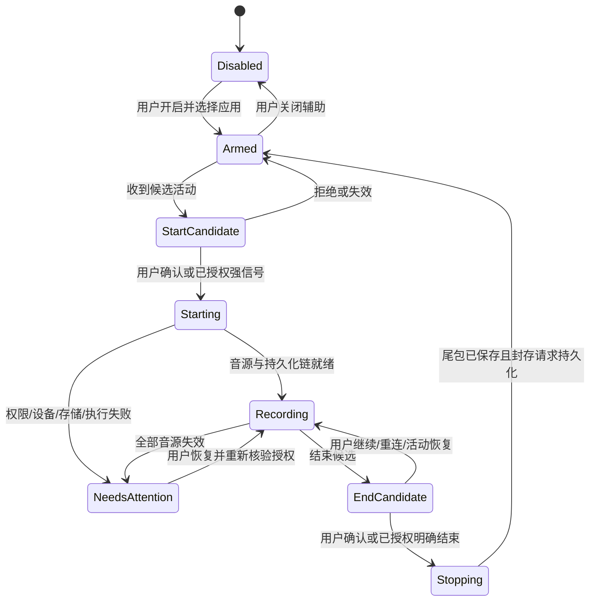

> 2026-10-31 追加实施：用户随后明确要求先监听浏览器、飞书的扬声器/麦克风调用。本轮已落地默认关闭的 macOS 最小音频调用联动；当前能力、授权和误触发限制以[实施说明](../engineering/background-meeting.md)为准。下文保留 2026-10-30 的长期 proposed 设计，专用高置信会议状态集成仍未实现。

# 后台会议辅助：先提示确认，再验证逐应用自动接管

状态：**proposed（待批准设计，未实现或启用）**。日期：2026-10-30，Asia/Shanghai。源码核查基线：`af6d800abfac51c56c8e638198801ab676ff4939`（v0.2.2）；本轮滚动纪要修复仍是工作树增量，不作为已发布能力。本文承接[自动起止信号研究](../research/meeting-lifecycle-signals-2026-10-28.md)，只规定后台开始、结束和异常恢复方案，没有新增监听器、计划任务或真实录音。

建议先提供**默认关闭的会议辅助**：用户逐个选择会议应用，检测到候选活动后提示确认；只有能够绑定到特定会议实例、区分重连和真正离会的专用集成，才允许单独开启自动动作。音量、静音、VAD、进程退出和日历到点都不能单独封存会议。通用音频接口表达的是流活动，浏览器共享还要求用户现场操作；这些限制无法靠提高“置信度分数”消除。[Apple 音频进程定义](https://developer.apple.com/documentation/coreaudio/audiohardwareprocess)、[Windows 会话状态](https://learn.microsoft.com/en-us/windows/win32/api/audiosessiontypes/ne-audiosessiontypes-audiosessionstate)、[W3C 屏幕采集](https://www.w3.org/TR/screen-capture/)

## 当前能复用什么，仍缺什么

以下是源码事实，不代表三端实体设备和后台长时运行已验收。

| 已核对的实现 | 证据与对方案的约束 |
| --- | --- |
| React 的 `quickRecord` 创建 Record，并调用采集控制器；浏览器权限在点击动作内发起。`stopCapture` 停止本地采集、读取最后序号清单并调用 pause/seal，上传和 ASR 继续处理。 | [App.tsx](../../apps/web/src/App.tsx)、[浏览器采集](../../apps/web/src/audio/capture.ts)。新入口要复用这条命令链，不能自行把“候选结束”写成“处理全部完成”。 |
| 桌面端已有原生采集、读取和保存后 ACK；正常停止会保留可读取的尾包。 | [原生控制器](../../apps/web/src/audio/native-controller.ts)、[Rust 包队列](../../apps/desktop/src-tauri/src/audio/packet_queue.rs)。开始/结束自动化不能绕过 Source/epoch、顺序、哈希和持久化确认。 |
| 桌面端已有托盘/菜单、录音悬浮条和关闭主窗口后的驻留逻辑；WebView 设置了后台限流策略。明确退出会停止采集，并结束应用拥有的本地后台。 | [main.rs](../../apps/desktop/src-tauri/src/main.rs)、[resident.rs](../../apps/desktop/src-tauri/src/resident.rs)、[local_backend.rs](../../apps/desktop/src-tauri/src/local_backend.rs)。**后台运行与已退出应用不同**；不能承诺退出后继续监听、录音或生成纪要。 |
| 当前采集和 Record 编排仍跨原生、WebView 与本地后台；没有已验证的逐会议应用自动起止闭环。 | 上述实际调用路径及[桌面可靠性验收范围](desktop-reliability-2026-10-30.md)。后台候选事件可以设计，Renderer 未就绪时不能绕开现有鉴权和持久化链直接录音。 |

历史[原生客户端说明](../engineering/native-client.md)含早期“没有后台录制”等时点描述。当前窗口驻留行为以上述源码为准；驻留实现也不证明锁屏、睡眠、崩溃或任意 WebView 版本下可连续工作。

## 提供两种逐应用策略

所有内容均为建议。总开关关闭时不登记 OS 观察器；系统授予过录音权限，也不会自动开启产品策略。

| 策略 | 允许的动作 | 无人响应时 |
| --- | --- | --- |
| **辅助提醒**，启用后的默认档 | 应用候选活动出现时提示“开始记录”；结束候选出现时提示“继续记录 / 结束并整理”。说明触发原因、音源、是否保存原音及云端处理选择。 | 不自动开始。已在录制时，弱结束候选保持原录制策略；提醒持续可见，并说明可能继续收录会后环境音。拒绝后本会议实例不重复催促。 |
| **自动接管**，每个专用集成单独授权 | 用户明确允许该集成自动开始/结束，且事件带可信的会议实例标识、账户和连接代次；原生音源获准、存储可用、命令执行端就绪后，才进入可取消倒计时。 | 符合预先授权的强条件才执行；条件不足转提醒，不扩大音源或云端权限。普通进程音频活动永远不升级成可靠入会/离会事实。 |

建议自动开始倒计时 10 秒、明确结束后 30 秒宽限；辅助结束提醒可用 5 分钟静音作为初始候选。**这些是待校准的产品初值，不是平台保证，也不是“5 分钟即散会”的规则。** 用户可随时取消；重新入会、活动恢复、手动继续或会议实例变化立即撤销旧倒计时。默认不做授权前音频预缓冲。

自动接管仅支持已经完成本机验证的具体会议集成。Zoom Web Meeting SDK 有 connected、connecting、disconnected、reconnecting 等状态，但这属于应用自己集成的 SDK 会话；仅有 disconnected 也不足以区分正常离会与故障，必须结合该集成实际提供的结束原因和实例状态。不能据此读取任意已安装 Zoom、腾讯会议或飞书客户端的内部会议状态。[Zoom 官方状态定义](https://marketplacefront.zoom.us/sdk/meeting/web/enums/onMeetingStatus.html)

## 信号只回答它确实能回答的问题

| 信号 | 可以确认的事实 | 建议用途 / 禁止的推断 |
| --- | --- | --- |
| 专用集成的入会成功、明确离会/散会、实例 ID、重连原因 | 该授权集成会话的状态；各厂商事件语义需分别核验。[Zoom 状态示例](https://marketplacefront.zoom.us/sdk/meeting/web/enums/onMeetingStatus.html) | 通过逐集成验收后作为强信号。重连、网络断开不按散会处理；旧实例回调不能结束新会议。 |
| macOS 进程音频输入/输出活动、PID、bundle ID | Core Audio 音频进程及其 IO 活动，不是会议业务状态。[Apple AudioHardwareProcess](https://developer.apple.com/documentation/coreaudio/audiohardwareprocess) | 仅观察用户选定应用的活动候选。不能把打开麦克风、播放提示音或关闭 IO 直接解释为入会/散会。具体 HAL 属性、Swift 封装和最低系统版本需按目标 SDK 分别检查。 |
| Windows 音频会话 Active / Inactive / Expired | 至少一个流运行、仍有流但未运行、没有流；可枚举会话并订阅新会话。[状态枚举](https://learn.microsoft.com/en-us/windows/win32/api/audiosessiontypes/ne-audiosessiontypes-audiosessionstate)、[IAudioSessionManager2](https://learn.microsoft.com/en-us/windows/win32/api/audiopolicy/nn-audiopolicy-iaudiosessionmanager2) | 提示候选；设备切换后重建观察，不能将失去旧端点当正常散会。 |
| Windows 会话 PID | `GetProcessId` 提供进程信息；跨进程会话可能没有唯一归属。[GetProcessId](https://learn.microsoft.com/en-us/windows/win32/api/audiopolicy/nf-audiopolicy-iaudiosessioncontrol2-getprocessid) | 浏览器多标签、辅助进程、PID 复用均需消歧；归属不明时只提示，不自动接管。 |
| 应用启动/退出、前后台变化 | macOS `NSWorkspace` 能通知应用启动；普通启动通知不覆盖部分后台/LSUIElement 应用，官方建议用 `runningApplications` 观察完整变化。[Apple 启动通知](https://developer.apple.com/documentation/appkit/nsworkspace/didlaunchapplicationnotification) | 用于候选和进程实例核对。打开首页不等于入会；客户端退出也可能是崩溃。最小化、切换窗口均不结束录制。 |
| 静音、低 RMS、长时间没有语音、音轨暂时无数据 | 当前声音/采集状态，未提供会议结束语义。轨道 muted 与 ended 含义不同。[W3C 轨道生命周期](https://www.w3.org/TR/mediacapture-streams/#life-cycle-and-media-flow) | 只能提醒或诊断。听会、阅读、等人、共享视频和音源故障都可能无声；会议内闭麦不应关闭聆记另行启用的麦克风。 |
| 系统音量为零、端点静音、耳机拔出 | 播放设置或端点变化；WASAPI loopback 获取渲染流，默认可包含系统混音。[Microsoft Loopback](https://learn.microsoft.com/en-us/windows/win32/coreaudio/loopback-recording) | 不因“听不到”自动结束，也不擅自恢复系统音量。音源范围必须向用户说明。 |
| 日历时间 | 计划而非实际参会状态；本阶段不接日历权限。 | 可在后续作为提醒上下文，不能到点开始录音或强制封存。 |

## 把候选判断与录制命令放在清晰的 seam

建议增加一个小的 **Lifecycle Module**：`observe(event) → {state, proposedCommand?}`。其 **Interface** 同时用于真实事件和回放测试，包含事件来源、采集时间、会议实例、连接代次、策略版本，以及命令的幂等键。Module 内部处理去抖、宽限、人工覆盖、重复/过期事件；不直接接触音频内容或供应商密钥。

macOS 与 Windows 的状态来源确实不同，分别实现平台 **Adapter**，在这个 **seam** 归一化事件。暂不引入全局事件总线、插件市场、独立系统服务或新的 LLM 判断器。开始/结束命令仍走现有 Record 与采集流程；未验证平台只提供“不可用”的明确状态。

原生驻留层保存候选与倒计时，不靠隐藏页面的 `setInterval` 累加秒数；使用单调时间，并在唤醒/重连时重新核对实际状态。WebView 只是当前执行入口之一：命令发出后必须收到同幂等键的执行回执，不能把“事件已发出”显示成“已经录音”。Renderer 无响应时打开主窗口提示处理，**不私自从原生层旁路创建第二场录音**。完整脱离 Renderer 的自主采集属于后续独立改造，本方案首阶段不承诺。

### 生命周期与后处理分开

`Armed` 只表示可观察新会议，不代表上一场 ASR/纪要已完成。上一场可以继续“上传中 → 转录排空 → 纪要整理 → 完成/可重试”，下一场使用新 Record，已暂停会议的继续则新建 Session/Source/epoch。任何旧命令都必须匹配原 Record、会议实例及连接代次。用户手动开始、暂停、结束和关闭策略优先；关闭辅助立即取消观察与倒计时，已有录音转为手动控制并保留指示，不把关闭监测等同于结束录音。自动候选不得自动恢复人工暂停，手动停止后本实例进入抑制状态，直到用户重新允许或出现已确认的新会议实例。

## 开始失败与结束排空的具体处理

**开始：** 先检查策略、实例归属、权限、可用音源和本地容量，再进入 Starting；首个音源真实接入后显示“录制中”，首包保存状态另示。若全部失败，显示“尚未开始”，撤销候选并保留可重试原因。若只接入一路，明确缺失来源，由用户决定是否继续；不得静默扩大为整机音频或开启麦克风。若 Record 已创建且已有保存块，则保留并标明不完整，不删除证据或伪装成完整会议。授权失败本次不循环弹框。

**结束：** 停止接收新声音 → 排空原生转换器/浏览器 worklet 尾部 → 本地保存最后包 → 固定各 Source/epoch 最后序号清单 → 幂等 seal。封存请求失联时显示“录音已停止，封存待确认”，保存意图和清单，恢复后先对账再重试；不得修改已封存的清单。网络上传和 ASR 继续，转录排空后再排队终稿；会中仍在运行的总结允许收尾，已校验内容继续可见，人工编辑和旧版本隔离照常生效。这是本轮滚动总结修复要满足的契约，实际发布与测试以对应回执为准。[当前停止流程](../../apps/web/src/App.tsx)、[Record 封存与纪要](../../packages/records/src/record.mjs)、[自动调度](../../packages/records/src/automation.mjs)

用户退出应用、进程崩溃或系统睡眠后，不能承诺采集/模型任务继续执行；重启只恢复已经实际持久化的内容和可重试任务。尚未落盘尾音或睡眠期间声音无法事后补录；界面应显示时间缺口，不能填充模拟音频或伪称连续录制。[现有退出所有权](../../apps/desktop/src-tauri/src/resident.rs)、[本地后台退出](../../apps/desktop/src-tauri/src/local_backend.rs)

## 异常场景按同一策略处理

以下是验收目标，不是已有运行结果。

| 场景 | 预期处理 |
| --- | --- |
| 重连、瞬时断网、会议服务器切换 | 撤销结束候选，保持同会议实例；连接代次递增，迟到断开事件作废。不能证明重连成功时提示，保留已保存内容。 |
| 自己闭麦、对方无声、只听不说、长时间阅读 | 不凭静音结束。开始检测不能要求用户麦克风活跃，单向听会也应能提示。 |
| 主窗口最小化、切到会议软件、关闭到托盘 | 维持明确的录音指示和手动控制；焦点变化不触发起止。后台限流设置不等于跨平台连续性已保证。 |
| 锁屏、系统睡眠/唤醒、合盖 | 区分窗口不可见和系统不能运行。睡眠前尽力保存并标中断；唤醒后重查授权、设备、实例，再提示继续。不把断开的 IO 当散会，也不自动开启新麦克风。Apple 有睡眠前通知，但通知不保证任意长任务能完成。[Apple willSleepNotification](https://developer.apple.com/documentation/appkit/nsworkspace/willsleepnotification) |
| 会议应用打开但未入会；音乐、提示音或视频 | 允许用户拒绝本次，持续抑制同实例重复提醒；未获得强会议信号不自动开始。 |
| 同一客户端两场会、浏览器多个标签页、共享进程 | 无法唯一关联则提示用户选场；首版一次只自动管理一场录音，不将另一场的关闭映射到当前记录。 |
| 麦克风/耳机/蓝牙/默认输出切换 | 重建观察并报告实际音源；用户关掉的一路不自动补开，仍健康的一路继续。 |
| 单音源故障与全部音源故障 | 单源隔离；全源进入 NeedsAttention/暂停，不能伪装成用户正常结束。 |
| 用户手动结束与自动倒计时同时触发 | 同一幂等键只执行一次，人工动作使旧候选失效；新 Record 不接受旧的结束回调。 |
| 重复事件、乱序事件、时钟调整、应用升级 | 按实例、代次与单调时间校验；过期事件不执行。更新仍遵循现有录音/保存门禁，不为自动化绕开。 |
| 客户端崩溃重启、强制退出、机器断电 | 优先恢复/补传已保存会议，列出缺口；不凭重启时“会议应用还开着”立即创建新录音。 |
| 权限撤销、磁盘满、Renderer 或后台无响应 | 停止依赖该权限的动作、保留已保存数据并提示；没有成功回执不宣称已录制/已封存，不无限重试或切换到 mock。 |

## 平台能力必须逐个承诺

| 平台 | 可以研究或复用的能力 | 首版承诺与不足 |
| --- | --- | --- |
| macOS 原生 | Core Audio 的进程 IO 信息；`NSWorkspace` 应用/睡眠通知。官方 tap 示例支持选进程/进程组的输出，示例要求 macOS 14.2+ 并声明系统音频用途。 | 当前产品基线是 macOS 14.6+，不能把示例最低版本当项目兼容声明；也不能将观察权限与采集权限混为一谈。逐应用采集、TCC 撤销、稳定签名升级、多屏和锁屏均要真机校准。[Apple tap 示例](https://developer.apple.com/documentation/coreaudio/capturing-system-audio-with-core-audio-taps) |
| Windows 原生 | WASAPI 会话枚举、状态通知和 PID；现有输出 loopback。 | 会话归属可能跨进程，当前通用 loopback 默认取系统混音，不等于只录所选会议应用。逐应用检测与逐应用音频过滤分开验收；设备切换、WebView2、蓝牙和远程桌面另测。[会话管理](https://learn.microsoft.com/en-us/windows/win32/api/audiopolicy/nn-audiopolicy-iaudiosessionmanager2)、[PID](https://learn.microsoft.com/en-us/windows/win32/api/audiopolicy/nf-audiopolicy-iaudiosessioncontrol2-getprocessid)、[Loopback](https://learn.microsoft.com/en-us/windows/win32/coreaudio/loopback-recording) |
| 浏览器 Web | 已经授权且仍存活的共享轨道可继续使用；主动点击后可新建共享。 | `getDisplayMedia()` 每次由用户选择源，需要瞬时激活且 granted 不可持久保存，因此后台检测只能提醒，不能无点击重获共享。[W3C Screen Capture](https://www.w3.org/TR/screen-capture/) |
| 浏览器后台生命周期 | Chromium 区分 hidden、frozen、discarded；冻结暂停可冻结任务，丢弃时不能依赖最后回调。2025 的节能冻结规则排除了符合识别条件的会议页面。 | 这些启发式不能推出所有采集页面永不冻结，也不能外推 WKWebView/WebKitGTK；不得只靠 JS 定时器做可靠起止。Service Worker 也不作为获得共享手势或常驻录音的替代方案。[Chrome 生命周期](https://developer.chrome.com/docs/web-platform/page-lifecycle-api)、[节能冻结规则](https://developer.chrome.com/blog/freezing-on-energy-saver) |
| Linux 原生 | 现有 PipeWire 录音与桌面托盘可以复用。 | 本次没有核查 Linux 逐进程会议检测接口、桌面 portal 和各合成器策略。先提供手动控制，自动策略标不支持，不按 Windows/macOS 结论类推。 |

## 授权与隐私要求

“观察选定会议应用”“允许自动开始”“麦克风/系统音频采集”“将内容发往云端”“保留原音”和“分享”分开选择。允许观察不等于允许录音；允许自动开始不等于允许新增音源或云端供应商。首次启用显示真实采集范围，尤其当前整机系统声音可能包含其他应用；不能因用户选择监测某应用就暗示音频已按应用隔离。[Apple tap 授权说明](https://developer.apple.com/documentation/coreaudio/capturing-system-audio-with-core-audio-taps)、[Windows 系统混音范围](https://learn.microsoft.com/en-us/windows/win32/coreaudio/loopback-recording)

首版只保留允许列表和必要事件元数据：应用身份、会议实例的本地标识、状态、原因、代次和时间。枚举结果先本地过滤，不持久化完整进程列表、窗口标题、参会人、聊天或日历正文，不将这些信号发给 LLM。录音前不采集音频来“猜是否开会”。所有自动动作有可见提示、立即停止入口与可读记录；用户可撤销单应用规则。系统锁屏时不在通知中暴露会议标题或内容。

## 分阶段验收，再决定是否开放自动动作

指标为建议目标，批准后才作为门禁；本轮没有目标设备数据或真实误触发测量。按平台、OS、会议应用版本、策略档和设备分别统计，不能把模拟成功率写成用户现场可靠性。

| 阶段 | 工作范围 | 退出条件与建议指标 |
| --- | --- | --- |
| A：信号与策略回放 | 纯事件 Module、命令幂等、人工覆盖、乱序/重连/睡眠/多会议测试；不自动录音。 | 固定场景每项可重复；未授权自动开始、旧事件结束新 Record、重复封存、人工暂停被恢复均为 **0 次**；所有不确定归属能降级提示。 |
| B：逐应用提醒试点 | 明确同意的 macOS/Windows 设备，至少覆盖 30 场真实会和 20 小时非会议活动；记录用户判断作为标签。 | 分别报告提示精确率、漏提示率、每小时误提醒数、触发延迟 P50/P95、CPU/唤醒/耗电。建议提示精确率 ≥95%、会议开始漏提示 ≤10%；样本量不足仍标不足，不开放自动动作。 |
| C：单个专用集成的自动接管 | 只选一种可唯一绑定会话并区分重连/结束的集成，逐应用单独 opt-in；通用音频活动保留提醒档。 | 至少 100 场带真值会议及规定负例，无未授权录音或误结束；真实开始延迟 P95 ≤15 秒（从已授权、明确入会事件计算），每次取消生效；样本零事故不代表总体风险为零。 |
| D：连续性与恢复 | 60 分钟以上双音源、隐藏窗口、锁屏、设备切换、网络断开、睡眠唤醒、崩溃、尾包落盘失败和后台重启。 | 对已接受 PCM 做逐 Source/epoch 序号、样本数和哈希核对，尾包完整率 100%；不可录制时段必须显式标缺口。ASR/纪要按自己的版本与失败状态继续/恢复，不被“结束会议”一并取消。 |

目前最大的未知是**哪些目标会议应用能提供可信、可授权且能唯一绑定实例的实际会议状态**。没有这项证据，就只有活动检测与提醒，不能承诺通用全自动。其次是锁屏/睡眠和 Renderer 不可用时的实录连续性、按应用音频过滤、平台权限升级、真实误结束率与后台耗电；这些都需要独立原型和设备验收，不能用本方案或现有 CI 代替。
