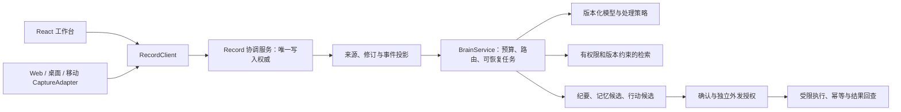
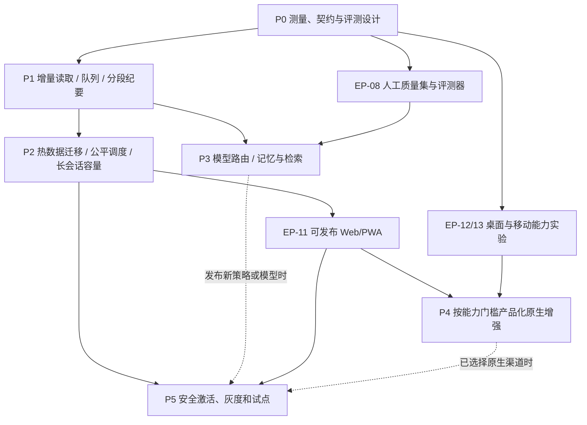

# 从可靠记录演进到跨平台会议大脑

日期：2026-10-12。状态：**proposed，待实施**。用户已要求基于研究规划演进；本轮交付方案、任务拆分和验收条件，不把规划请求解释为实施、真实会议访问、外发或部署授权。

依据：[研究与基准](../research/client-brain-evolution-2026-10-12.md)、[跨平台一手资料](../research/cross-platform-client-sources-2026-10-12.md)、[ADR 0010](../adr/0010-cross-platform-brain-evolution.md)。方案基线为 `d20f933`，现有实现事实仍以 [current-state](../engineering/current-state.md) 为准。

## 先交付可恢复长会话，再提升理解和跨平台能力

演进顺序：**测量与契约 → 增量读取、队列与分段纪要 → 存储和任务治理 → 质量驱动的大脑 → 原生增强 → 分层更新与试点。**

近期第一交付包限定为 EP-01～EP-04：测量链路、减少会中全量刷新、降低离线队列读取成本、解除终稿必须整场塞入一次模型调用的限制。不要把原生壳、全量存储迁移或新模型作为这四项的前置条件。

下一交付包 EP-05～EP-07 完成热数据存储、任务公平调度和容量语义，之后才有条件验收 **120 分钟录制内容、两路音源** 的完整闭环。这里的 120 分钟是建议验收目标，不是当前能力：现有总 samples 限制合计所有来源，双来源约 60 分钟可能触顶。

大脑的首个升级结果应是“更少错误、更可追溯、更低重复成本”，随后才是记忆、跨会检索和工具执行。客户端的首个升级结果应是“明确补齐某项系统能力”，随后才是全平台分发。

本方案没有日历工期承诺。团队规模、目标设备和供应商预算尚未锁定，以里程碑退出条件确定排期；复杂度 S/M/L 只表示本仓库内的相对改造风险。

## 沿用三个共享接口和一个独立授权边界

| 模块 | 对调用者承诺 | 内部负责 | 不能承担 |
| --- | --- | --- | --- |
| CaptureAdapter | 能力、来源状态、PCM packet、flush/结束结果 | 浏览器用户手势、设备/系统权限、原生插件、采样 | 持久 ACK、模型授权；授权成功不能当作有声音 |
| RecordClient | 已保存/待传/已确认状态、恢复、命令与订阅 | 本地队列、原始音频 hash、补传、水位、seal、cursor；Web 可先由当前 controller 渐进抽出 | provider 密钥、最终领域写入；切换客户端不能重命名旧 packet 身份 |
| Record 协调服务 | 幂等命令、原子持久化、版本检查、可重放投影 | record/session/source、音频索引、转录、任务、墓碑和迁移 | 模型自行覆盖人工纪要；从两套库分别确认同一输入 |
| BrainService | 任务版本、进度、覆盖声明、可追溯结果或明确失败 | 快照/窗口、预算、路由、重试、引用校验、恢复 | 自动扩大处理范围或工具权限；把中间预览当作已发布终稿 |
| 确认与执行边界 | 单项确认、独立外发授权、执行审计 | 前置条件、幂等键、失败恢复和远端结果回查 | 把会议中的请求、模型置信度或路由标签视为用户授权 |

建议共享客户端逻辑逐步归入 `packages/record-client`，但先以现有 Web 的局部 seam 交付，再证明第二种客户端确实需要共享。不要先创建大量只转发参数的包。后端继续使用 `packages/records` 和 `services/records`，不同时启动 Go/Rust 业务重写。

## 每个阶段都必须守住的契约

1. 音频身份仍为 record/session/source/epoch/sequence，sampleOffset/sampleCount 与**原始 PCM 字节** hash 参与冲突判断；编码从 base64 改为二进制不改变身份或摘要依据。
2. 持久 ACK 只能在对象可恢复、元数据和连续水位提交后返回；重复身份/相同内容可幂等重试，冲突内容明确拒绝。派生事件与对应业务提交保持同一事务或可靠 outbox。
3. 停止分为停止采集、flush、本地持久化、seal/补缺、供应商 final、排空完成；缺口和永久失败显式显示，不能以超时伪造完成。
4. transcriptRevision、minutesRevision、SSE cursor 独立；快照和增量之间不能丢事件；重复增量可重放，游标失效要 reset。
5. 任务固定 generation/fence 与输入版本；迟到结果不能覆盖新版本。人工转录/纪要修改受保护，后台再生成只形成可比较的新草稿。
6. 删除/撤销覆盖音频、任务、投影、缓存、摘要中间件、记忆、检索索引和分享；旧任务、重放和回退不能复活内容。
7. 每条 AI 结果可回查来源段及修订；引用结构有效与引用语义支持分别验证。缺失上下文必须反映在覆盖声明中。
8. 本地处理失败不能静默转为云处理；采集、云识别、模型分析、原音留存、训练和分享分别执行现有授权边界。
9. 服务端密钥不进入客户端；观测只记录必要标识、大小、状态、时长和版本，默认不记录原音、转录正文、提示词全文或密钥。

## 依赖决定交付顺序

能力实验和评测资料准备可以提前，原生客户端失败不阻塞 Web 的演进。版本元数据从 P0 开始记录，完整分发/自动更新在 P5 验收；不能到发布前才补版本设计。

各发布线独立进入 P5：Web/协议更新不等待记忆功能，只有发布新模型/策略时才要求对应质量门通过。EP-10 可以作为后续独立增量，不阻塞已经验证的记录、路由或客户端切片。

## P0：把真实耗时和验收口径固定下来

**EP-01｜链路观测与契约基线，M。** 从现有采集/队列、API、worker、LLM 适配器和订阅处增加关联 trace，记录本地持久化、排队、ACK、ASR 首字/确认、LLM 首字/完成、结果提交、页面显示。客户端端到端耗时使用同一单调时钟；跨主机只关联 span，不直接相减未经校准的墙钟时间。

- 文件入口：`apps/web/src/audio/{capture,queue}.ts`、`services/records/src/{server,worker,llm,repository}.mjs`、`apps/web/src/record-subscription.ts`。
- 产出：分阶段 p50/p95/p99、队列 age/深度、event-loop lag、RSS/堆、重试、写入/响应字节、tokens/成本；固定输入、环境、版本与失败分类。
- 验证矩阵：5/30/60/120 分钟、1/2 来源；单记录基线与 1/5/20 活跃记录、不同阅读者数量分开测试。不能把上一轮“20 条库存记录读取”写成“20 场并发录制”。
- 故障基线：ACK 响应前崩溃、乱序重传、断网恢复、停止补缺、final 迟到、游标失效、人工编辑、删除后的旧结果。
- 退出：能解释一次 slow request 的时间线，能复现现有放大因素；没有真机/供应商环境的项明确 pending，不阻塞本地可逆改造。
- 回退：关观测开关，不改变领域协议与默认 provider；日志中不得因诊断新增业务正文。

同时冻结 [下文的建议指标](#用分层指标验收)，记录 EP-08 的标注规范。先锁定已有 Mac 参考机；Windows、手机和部署环境单独列设备待办，不能虚构设备通过记录。

## P1：先减少读取放大，并让超长终稿可分段完成

**EP-02｜轻量投影与增量订阅，M；依赖 EP-01。** 分开工作区列表、录制状态、转录页、纪要版本和事件查询。SSE 不再靠每个连接反复解码完整 Record；页面按版本合并受影响投影，不再每个事件拉完整详情。

- 保留一致 bootstrap + cursor、reset、权限撤销、重连退避；转录历史按页/范围补取。正文是否虚拟化由 profiler 决定。
- 过渡期 JSON 聚合仍是写入权威；投影和事件是可重建派生数据，须随业务事务发布。先 shadow 比对同 cursor 的结果，再切读，旧读路径保留短期回退。
- 退出：重连无缺口、重复无重复显示；单段新增不会传回全部转录；20 个阅读订阅的 DB/响应字节成本有前后对比。
- 本项主要减少读取/网络/页面成本，不提前宣称解决整行写入。

**EP-03｜有界离线队列，M；依赖 EP-01。** IndexedDB 按账户可见范围、record/source 建索引，改计数/字节统计和有限批排空；独立来源允许有界并发，来源内维持协议要求的顺序。先保持上传接口兼容，再评估 Blob/ArrayBuffer 与二进制上传。

- 使用扩展式 IDB 迁移：读旧条目、逐条确认迁移、保留未确认输入；账户切换不能读取或提交其他账户积压。不要用清库恢复升级。
- 第一切片保留 48 MiB 原始 PCM 的现有 guard；实际磁盘配额和目标离线时长测清后再调整。二进制存储减少物理放大，但不自动增加离线时长承诺。
- 退出：临近 guard 的积压、断网/重启/多来源恢复不丢 packet；计数无需载入全部 payload；满额行为可见。
- 回退：兼容读取新旧格式；新写格式启用前先证明旧客户端/旧恢复工具不会丢数据。

**EP-04｜按预算分层整理终稿，L；依赖 EP-01，与 EP-02/03 独立。** 以不可变 manifest 固定 generation、转录/笔记/纪要基线版本、叶子来源 hash 和覆盖范围；按 token/保守估算预算分窗口提取，再综合主题与终稿。保留 provider 请求大小限制，改变整场输入方式，不能只删除 180,000 字符 guard。

- 中间摘要仍引用原始 segmentId/revision；最终引用展平回叶子，不能只引用无法复核的“摘要 3”。notesRevision 与人工纪要基线继续参与冲突检查。
- 窗口任务可恢复、可缓存；缓存键包含权限范围、输入版本、策略/模型版本。转录修订只失效受影响窗口及其上游结果；删除和权限变化立即失效。
- live 按新增确认内容/主题变化去抖；合并过期 live 请求，final 获得独立优先级和预算，不能无限等待重复 live 任务。
- 退出：等价短样本不丢既有行为；超过 guard 的合成转录能整理；开头/中间/结尾的关键事实、否定和撤回有质量用例；缺失窗口不标记“完整终稿”。人工编辑、stale/fence 和重试故障通过。
- 本项可用文本导入或回放先验收超长整理；完整 120 分钟双音源录制仍要等 EP-07，不能提前承诺。

P1 可独立发布 Web 改进，不更换框架、provider 或业务数据库权威。每项使用独立开关和独立本地提交，修复本轮引入的问题按仓库 amend 规则处理。

## P2：把写入和调度成本从整场记录长度中分离

**EP-05｜热数据持久化与迁移，L；依赖 EP-02/04。** 将 Record header、sources、audio chunk 索引、segments、events、jobs、minutes versions/证据成员拆为可索引数据；音频继续在文件/对象存储。领域规则仍在 `packages/records`，存储细节由 repository 封装。

热路径按命令加载有界数据：音频接纳读取对应来源、身份冲突/邻块和水位；转录提交读取目标片段/任务及必要 header。不能让新表 adapter 在每次写入前重组完整聚合，再以差量写回冒充解耦。计数和水位须事务维护并与原算法对照校验，不能替代 seal manifest 的完整性检查；全量组装只保留给明确需要的兼容读取/导出。

迁移分三步：

1. **expand/shadow**：旧 JSON 仍是唯一权威，同事务维护新表，回填并按记录比较身份、数量、内容 hash、水位、版本和 cursor。
2. **逐 Record 切权威**：在可恢复的静止点核对版本，原子记录 migrationVersion；已切换记录的命令只写新模型，旧接口从新模型组装兼容读，不允许两个独立写入者。
3. **contract**：观察期后才停止旧路径和清理冗余数据。保留明确恢复窗口与受控备份，不先删旧聚合。

SQLite/文件先验收；PG/S3 用专用环境复用同一契约再验收。对象先落、事务确认、失败孤儿回收继续适用；不把音频和 DB 伪装成一个跨系统原子事务。

退出：迁移前后既有记录可读、可导出、可补传、可修订；故障注入无半迁移 ACK；小更新不再重写全部转录/chunk 数组。新权威切换前可直接关新读；切换后降级需反向同步或恢复流程，不能声称只翻开关即可回退。

**EP-06｜按 lane 的公平任务队列，M；依赖 EP-05。** 任务按 lane/dueAt/status 可索引，稳定排序后原子认领并返回必要标识；保留 lease/fence/generation，增加 provider 配额、并发、重试、超时和取消语义。

- 以 101 条以上混合任务测试当前 `LIMIT 100` 可能带来的遮挡：音频热任务不能让 final、翻译或后面的记录无限等待。
- 供应商限额决定全局并发，任务类型决定优先级；不能只增 `RECORD_WORKER_CONCURRENCY`。单记录/单来源状态由领域约束控制。
- 连续 ASR 按来源维护连接所有权/心跳；一秒音频块不能变成互相争抢新识别 session 的任务。重连保留原音锚点与会内说话人映射，验证重复 final、身份连续性和停止排空。
- 退出：到期任务不扫描全量聚合；崩溃重新认领但不会重复发布；慢 provider 不阻塞其他 lane；重试不会形成无界队列。

**EP-07｜容量语义与长会话闭环，M；依赖 EP-03～06。** 分开录制内容时长、来源 samples、chunk 数、待传字节、保留音频与推理预算。暂停与多来源重叠按明确口径计算，不能继续用所有来源样本总和代表会议内容时长。

- 建议目标：120 分钟录制内容、最多两来源，单/双来源以及暂停续录分别验收。两来源约需 14,400 级一秒 chunk，首包/末尾 flush 还会增加少量块；当前 10,000 块 guard 不能直接沿用。
- 由容量策略推导限额并留有界余量；验证内存、队列、文件数量、清理和存储预算后才调整限制。
- 导入采用分片解码或受控后端转码；不能靠 64 MiB 压缩输入限制推断解码峰值。大导入与录制并行也要测试。
- 退出：两小时链路具备逐层证据，重启/补传/停止排空无未解释缺口；资源不超过锁定设备预算。fixture、合成回放、真机采集和真实供应商各自报告。

## P3：用质量证据升级模型，再加入可纠错记忆

**EP-08｜独立质量集与评测器，M；P0 起准备，依赖单独的语料授权。** 延续离线数据生成器，按会议/重复来源隔离 train/dev/test；人工 gold 为质量门，规则/教师标签只作明确标识的弱信号。

- 覆盖中文混语、术语、否定、提议与决定、指代、撤回、重叠发言、未知负责人/日期和转录纠错；标注来源段/修订与语义支持。
- 起步建议覆盖至少 20 场独立会议，每类至少 50 正例和 50 困难负例；这是覆盖目标，不是统计充分性保证。真实允许集不足时先交付评测器和合成集，模型晋级保持 blocked，不扩大数据权限。
- 报告每类 precision/recall/F1、abstain/升级率、错误类别、引用支持率、人工修改量，以及按会议汇总的差异和不确定区间。test 不用于调阈值。

**EP-09｜模型路由与版本化策略，M；依赖 EP-04/08。** 先 shadow 比较规则、现有 provider 和 NeoHorse 候选，再决定窄任务路由。以任务风险、语言、设备/网络、授权范围和预算选择执行位置；不以“最大模型”或“4B 本地模型”作为默认真值。

- 日常局部提取与复杂综合分配不同预算；低置信度可 abstain/升级，高影响决定/行动由更严格策略复核，但仍只输出候选。
- 每任务保存实际 policy/prompt/model/provider/tokenizer/adapter 版本、输入 manifest 与成本；在跑任务固定版本，新版本只接新任务。
- 退出：独立测试的关键误报不劣于基线，在正确性、时延或成本至少一项有证据改善；其他硬门不退化。无改善或不确定就保留现有路由。

**EP-10｜可修订记忆与跨会检索，L；依赖 EP-05/08/09。** 先做工作区权限过滤、时间/主题/全文检索及可回查事实卡片；检索评测不足时再加 embedding，关系问题证明收益后再评估 GraphRAG。

- 记忆记录 source/version、scope、确认状态、有效期、冲突与 supersedes。模型提取内容默认候选；用户偏好需明确确认，不能由一次会议中的第三方发言自动推断。
- 修订/删除同时失效检索和缓存，重建有墓碑约束；人工确认事实不被后续重生成静默覆盖。与录制缓存、会话上下文和外发授权分开存储。
- 退出：授权来源召回与答案支持可评测；旧版本、撤回和跨工作区数据不混入；无证据回答能拒答。工具写入仍保持独立确认与结果回查，不纳入自动路由放量。

## P4：把测得的能力缺口变成客户端产品

**EP-11｜浏览器支持矩阵与 PWA，M；能力实验 P0 起，产品化依赖 EP-03/07。** 按浏览器/OS/音源记录版本、audio tracks、电平、静音/停止、休眠/锁屏、断网、权限恢复和耗电。PWA 先交付应用资源安装/缓存与更新提示，不把安装当作系统采集或后台权限提升。

页面显示“本地待传/服务端已确认/来源已结束/纪要处理中”等产品状态；能力失败提供麦克风、文件导入等实测退路。没有通过的组合不进入支持列表；在线会议系统音频和麦克风分别验收。

**EP-12｜桌面增强选择与产品化，实验 S、产品化 L；依赖能力缺口和 EP-03/07。** 对相同音源、时长与设备比较 Tauri 2/Electron：系统音频、权限、休眠恢复、CPU/RSS/耗电、崩溃恢复、本地存储、签名/更新成本。

选择门：Tauri 在所需 OS 上补齐采集且维护/资源代价可接受时采用；需要固定 Chromium/Node 或其采集路径有明显收益时采用 Electron；两者都没有证明增益则保持 Web。确定一种主壳，避免同时维护两套桌面产品。原生端只补平台适配，不另起业务权威库。

**EP-13｜移动增强选择与产品化，实验 S、产品化 L；依赖 EP-03/07。** 优先评估 Capacitor 复用工作台，首批仅包含随身麦克风、锁屏录音、离线队列、导入/分享入口和复盘。平台音频中断、后台服务、耗电、配额与升级恢复单独验收。

任意会议 App 双向音频不列为承诺；若这是核心目标，应先验证目标 App/OS 允许的路径，再决定产品可行性。只有复杂原生移动 UI 收益超过迁移成本时重开 Flutter/React Native 选型。

## P5：分别发布程序、协议、策略和模型

**EP-14｜发布 manifest 与兼容矩阵，M；元数据 P0 起，依赖 EP-05/11，新策略/模型通道另依赖 EP-09。** 定义四条发布线：客户端、服务/数据协议、AI 策略、模型制品。manifest 包含版本、协议范围、schema/migration、能力/资源要求、artifact hash、可信签名、撤销和发布通道。

- 建议先支持明确的当前/上一客户端兼容窗口，实际窗口通过迁移和恢复测试后承诺。能力协商在开始录制前完成，不在会中突然拒绝旧输入。
- 程序、IDB/DB、索引和模型格式分别检查可回退性；资源下载不等于获得执行权限。原生代码、插件和商店更新按各平台分发规则执行。

**EP-15｜安全激活与灰度，L；依赖 EP-14，以及被选择平台的 EP-12/13。** 下载限流，不抢录制资源；验证 hash/签名、空间/内存和兼容性后进入待激活。多标签/多窗口协调所有录制者，暂停待继续也视为活跃。

只有停止/flush、持久确认、所需排空和恢复点成立后才激活；未确认队列必须能跨版本恢复，不能清空。启动自检失败保留当前/上一已验证版本；数据不兼容时走恢复流程。模型/提示词同样不在任务中途替换。

灰度顺序：本地故障演练 → 内部允许样本 → 小范围试点 → 放量。先按质量、丢失/重复、崩溃、队列 age 和成本观察，再扩大覆盖；出现数据完整性/授权问题立即停止，纯性能退化按指标暂停或回退。真实语料、供应商和分发环境使用对应授权，不能由试点计划自动扩大范围。

## 用分层指标验收

以下全部是**建议目标**，不是已测结果或 SLA。EP-01 锁定环境、并发、样本和分母后确认；不能为了通过而事后更换基线。

| 层次 | 建议门槛 | 证据范围 |
| --- | --- | --- |
| 输入/恢复 | 已 ACK 输入在约定故障集内丢失/重复为 0；冲突重传明确拒绝；停止未完成不能显示完整 | 领域/SQLite HTTP 故障测试；PG/S3 和真机分别复验；“0”限已执行案例 |
| 引用/版本 | 发布结果引用结构/版本有效率 100%；过期/删除结果不得覆盖新版本；人工编辑保护用例全部通过 | 自动结构检查 + 版本/权限故障用例；不等于语义准确率 100% |
| 本机存储 | 同参考机、60 分钟双来源合成样本，小更新 p95 争取 ≤10 ms；20 条待处理任务标识查询 p95 争取 ≤30 ms | 当前基准分别为 32.346 ms、143.848 ms；新任务标识查询与旧全聚合查询返回量不同，另做端到端对照，不宣称等量加速 |
| 会中同步 | 单段新增只返回有界 delta/投影；临近队列 guard 不载入全部 payload；目标设备队列操作主线程 p95 争取 <50 ms | 浏览器 profiler、字节与复制量；服务端/客户端阶段分别测，不套用模型耗时 |
| 本地 API | 参考 LAN/单录制负载，持久 ACK p95 初始目标 ≤500 ms，再逐档增加活跃记录与阅读者；写明文件 fsync、磁盘和网络 | 不包含 ASR/LLM，不是公网 SLA；饱和点超过预算要限流并保持恢复能力 |
| 长会话 | 120 分钟内容、两来源，排空有解释、窗口处理覆盖可审计；大输入不因整场 JSON guard 直接失败 | 单供应商/单平台通过只代表该组合；缺上下文/失败窗口必须显式说明 |
| 模型质量 | 决定/行动候选 precision 初始目标 ≥95%，报告 recall、区间与覆盖；关键否定/撤回困难用例不得出现已知误报 | 独立会议 gold、人工语义支持抽检；小样本置信不足时不晋级，不增加自动执行权 |
| 模型成本 | 相同质量约束下报告每小时输入/输出 tokens、重算比例、p95 完成时间与实际费用；在评审预算内 | 价格/耗时依实际 provider；不从一次 139 秒终稿推导统一耗时 SLA |
| 发布/回退 | 中断下载、坏签名、旧队列、旧客户端、激活崩溃和迁移失败均有恢复路径；录制中强制激活为 0 | 固定平台/版本故障演练；具备签名插件不等于所有分发渠道通过 |

## 把任务留在本地清单，逐切片实施

| 包 | 任务 | 相对复杂度 | 主要退出证据 |
| --- | --- | --- | --- |
| 首包 | EP-01 观测/契约；EP-02 投影；EP-03 队列；EP-04 分层终稿 | M / M / M / L | 可解释耗时、增量收益、积压恢复、超长文本整理 |
| 次包 | EP-05 存储迁移；EP-06 调度；EP-07 容量闭环 | L / M / M | 单写入权威、任务公平性、两小时双来源分层验收 |
| 质量包 | EP-08 gold；EP-09 路由；EP-10 记忆/检索 | M / M / L | 独立评测改善、来源支持、修订/删除不泄漏 |
| 客户端包 | EP-11 Web/PWA；EP-12 桌面；EP-13 移动 | M / 实验 S + 产品 L / 实验 S + 产品 L | 能力矩阵、按收益选壳、真机恢复与资源证据 |
| 发布包 | EP-14 manifest；EP-15 激活/灰度 | M / L | 兼容矩阵、故障演练、可解释回退与试点结果 |

任务 owner 和日历排期待实施资源确定后填写。GitHub 仓库未绑定，EP 编号只是本地计划标识，不代表已创建工单。

每个实现切片：先读最新源码与相关测试 → 写明确变化与验收场景 → 小范围实现 → 运行适用检查 → 保存证据 → 显式文件提交。服务/协议改造运行 `npm test`、`npm run lint`；Web 改动再运行 `npm run typecheck`、`npm run build:web` 和相关浏览器用例。PG/S3、原生采集与真实供应商不由 fixture 代验；Go 只在实际触及时运行其测试。

首个实施动作是 **EP-01 的最小端到端 trace 和契约回归基线**，随后交付 EP-02/03；EP-04 可独立推进。任一阶段缺少质量/设备/分发证据时，保留已验证切片并明确 pending，不将整阶段标为完成。

## 本次规划的自查与交付边界

前轮自查中的两个缺口已落实：真机与端到端不确定性进入 EP-01/07/11～13；独立质量集缺口进入 EP-08，并成为模型晋级的前置条件。

仍需在实施时确认的假设是目标设备、负载和预算；最大的迁移风险是派生投影与权威数据切换期间出现版本不一致。本方案用单写入权威、事务/可靠 outbox、shadow 比对、静止点切换和明确的恢复窗口约束该风险，尚无实施证据。

本轮仅更新方案及文档导航，ADR 仍为 proposed，不修改当前实现、模型配置或验收状态。文档链接与差异检查通过后提交；业务回归不因纯规划文档而重新声称通过。
