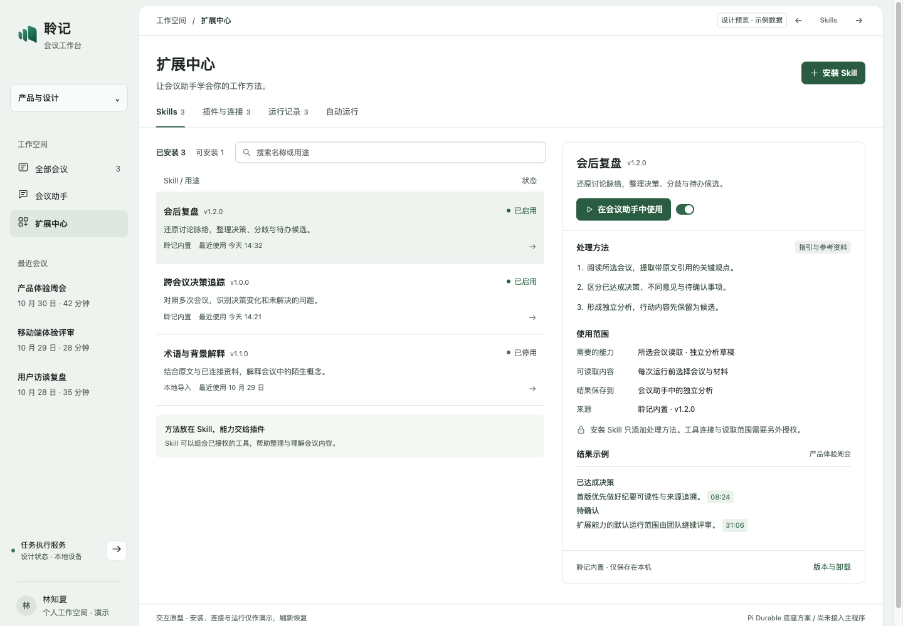
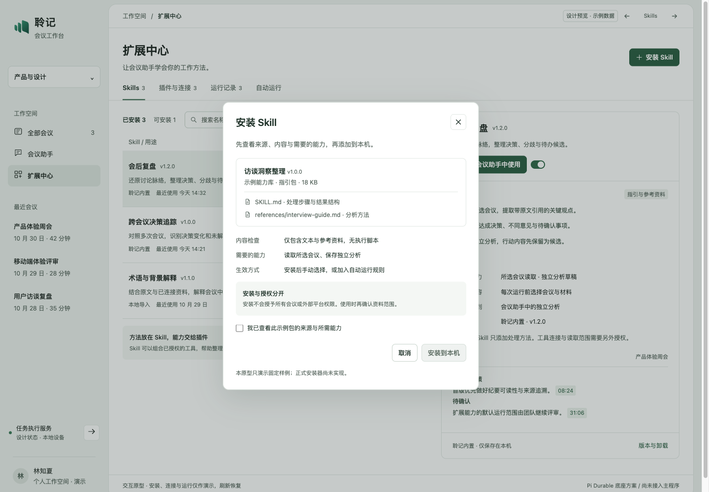
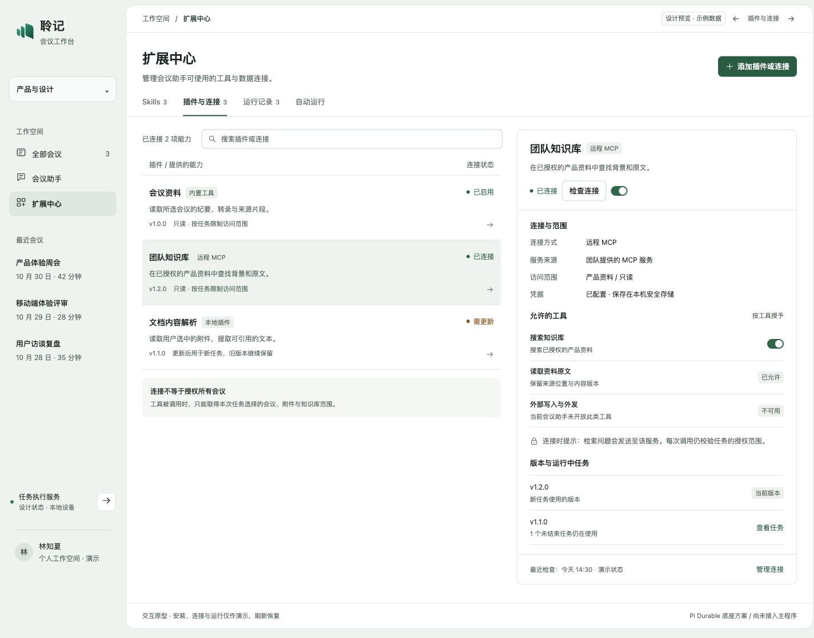
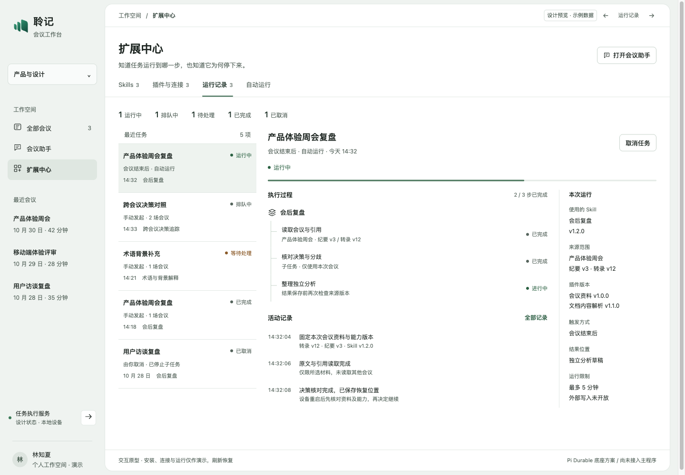
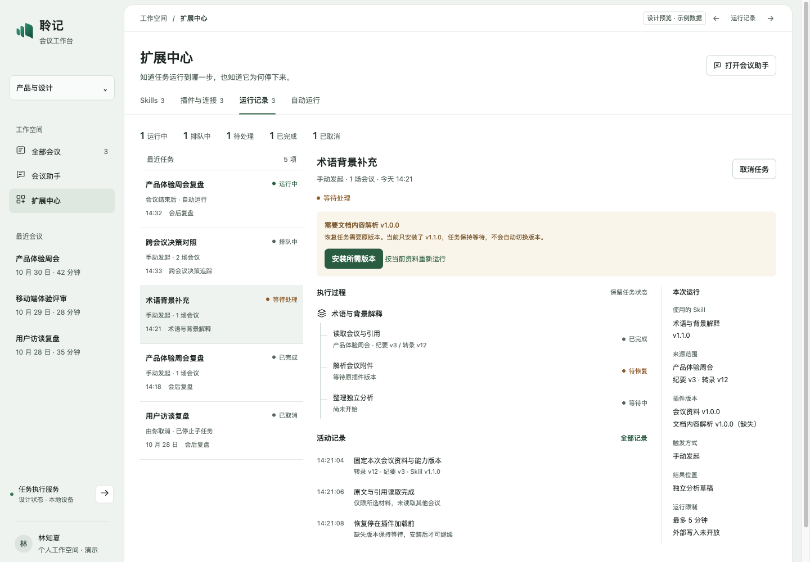
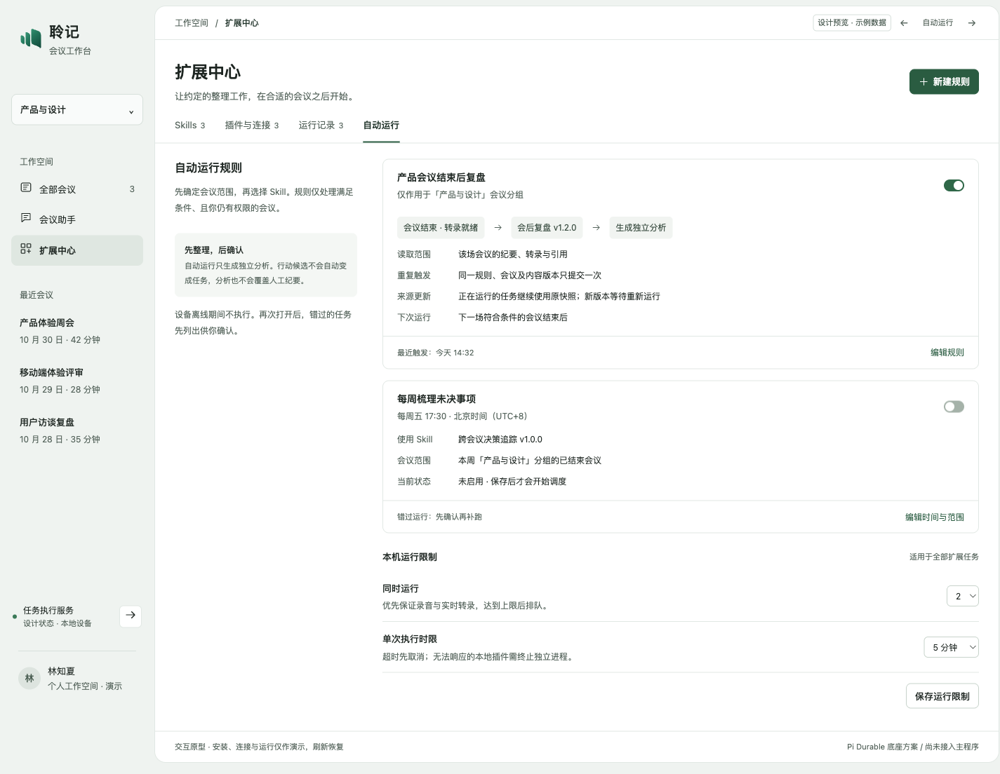
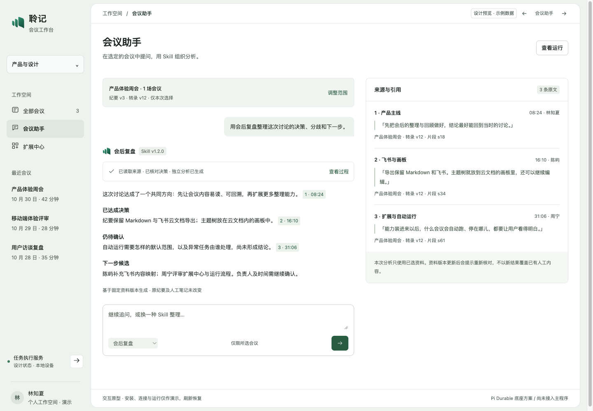

# Skill / 插件中心与会议任务调度

**视觉稿已被用户否定，保留作历史对比。** 最新重绘、截图与当前预览见 [连续工作面方案](extension-center-redraw-2026-10-31.md)。本文的能力范围和 Pi 分期仍是 proposed，未获产品接入验收。

2026-10-31，**proposed，等待设计确认**。本轮交付独立交互原型与截图；Pi Durable 尚未接入产品。底座依据是上轮 [8 项隔离 fixture](../evidence/pi-meeting-fixture-2026-10-31.json)，不把合成验证当真实会议、模型或 MCP 验收。

产品继续以会议为主。Markdown 与飞书云文档沿用固定导出；画板属于云文档组件。Skill 不承担自定义导出。

## 先看页面

沿用白色主体、克制玉绿、清晰紧凑的工作台。左侧保留会议上下文；扩展中心包含四个页签，使用能力时进入会议助手。Pi 的底层术语不进入日常操作。

| 页面 | 用户要回答的问题 | 核心操作 |
| --- | --- | --- |
| Skills | 这个方法能帮我整理什么？ | 查看方法、来源与所需能力；安装、启停、带入会议助手 |
| 插件与连接 | 助手会访问什么？ | 查看数据传出范围、授权工具、连接状态和被任务占用的旧版本 |
| 运行记录 | 任务做到了哪里，为什么停下？ | 查看主任务与子任务、来源版本、活动记录；取消、处理阻塞或新建运行 |
| 自动运行 | 什么会议会在什么时候运行？ | 限定会议分组、触发条件、Skill；配置并发和时限 |
| 会议助手 | 基于哪些资料得出了这个结论？ | 确认资料范围、对话调用 Skill、查看执行过程与原文引用 |

### Skills 与安装





正式安装支持受控本地 Skill 文件夹/包；内置能力也进入同一目录。首期只接受 `SKILL.md` 与受限参考资料，检查名称、版本、体积、路径穿越、符号链接、可执行文件与内容摘要。带脚本/依赖命令的包显示“不兼容”，不能当成普通文本 Skill 执行。自带工具声明不能授予权限；指令也不能覆盖产品授权。原型只展示固定示例，不解析实际包。

安装、启用、任务授权是三个动作。关闭 Skill 阻止新任务使用，但已固定的任务保留旧版本。卸载先检查占用，未结束任务使用的版本不立即删除；主动撤回数据/工具权限则立即影响后续调用与结果访问。

### 插件、连接和版本



内置领域工具、远程 MCP、审核过的本地插件分别标明来源。连接授权展示会传出什么、访问哪些资料、开放哪些工具。MCP 的“只读”声明不是授权凭证，工具调用时仍由宿主复查。

连接/插件设置变更形成新配置版本。新任务使用新版本；未结束任务保留当时的代码、配置摘要与能力清单。撤销凭据、撤权和安全下架优先于继续运行，固定版本不能保留已失效权限。凭据只存后端安全存储，不放进 Skill、模型上下文、前端状态或日志。

### 运行、取消与恢复





用户看到排队中、运行中、等待处理、取消中、已取消、已完成和失败。等待处理必须给出原因及可行动作：旧版本缺失、权限失效、来源变化、连接失效、设备错过运行。后续实施还需补齐失败/空态的真实错误映射。

取消先传给父子任务；不接受新工具调用，等待在途调用收束后再标记“已取消”。无法响应取消的本地代码需停止其独立进程；独立进程只提供生命周期控制，本身不构成权限沙箱。

应用重开后载入未完成任务，检查拥有者、资料权限、插件版本、恢复位置与预算，再交 Pi 继续。缺原版本保持等待；“按当前资料重新运行”明确新建任务并重新确认范围，不将旧任务悄悄切换到新版本。能否重放每一类步骤由宿主定义；不承诺外部副作用的 exactly-once。

### 自动运行



规则默认从手动启用开始，第一类触发是“会议已结束、停止排空完成且所需转录可用”；不能把点击停止或短暂断线当作材料就绪。第二类是明确时区与会议范围的定时整理。

规则提交键包含规则及其版本、会议 ID、资料版本与输入摘要，服务端唯一约束防重复。真实执行前再次鉴权并冻结实际会议集合；本周范围在触发时解析为具体 ID，不能让模型发现任意会议。资料更新后不静默替换正在运行的快照。

设备离线不执行本地任务。错过的定时运行先列出时间和范围，用户确认后补跑。并发/时限属于宿主的全局 admission 策略，不能靠 Pi 单轮工具并发替代。录音、ASR、实时转录优先；扩展任务的实际预算与性能需接入后测定，原型中的 2 项/5 分钟是可调整的设计值。

### 会议助手与来源



调用 Skill 前选择会议及材料，默认不加入人工笔记。任务固定纪要、转录、片段、Skill 与插件版本。每次读取和结果交付都检查权限；结果保存前校验引用及资料修订。来源变化时标记需核对，保留原结果，不后台覆盖人工修订。结果只进入独立分析。

手机按列表/详情、对话/引用分屏，保持可返回路径。[Skills](../evidence/extension-center-20261031/08-mobile-skills.png) · [详情](../evidence/extension-center-20261031/09-mobile-detail.png) · [阻塞任务](../evidence/extension-center-20261031/10-mobile-blocked.png) · [对话](../evidence/extension-center-20261031/11-mobile-chat.png) · [引用](../evidence/extension-center-20261031/12-mobile-sources.png)。

## Pi Durable 的引入方式

架构提议见 [ADR 0019](../adr/0019-meeting-durable-runtime.md)。复用 Durable 的 conversation/task、inbox、任务图、协作式取消和持久恢复；聆记保留会议授权、引用/修订、独立分析、包与配置版本、全局预算和本地进程控制。停止在宿主重写另一套 agent scheduler。

首期不同时引入 coding-agent SDK。把受支持的 Skill 文本和参考资料适配为 Durable 的指令 section，显式提供会议领域工具。它不是现有 coding-agent Skill/extension 的自动兼容层。模型不获得任意文件、命令行、数据库或网络入口。

## 分期计划与验收

以下是建议实施顺序，没有编造工期。设计确认后先执行第一阶段，再按证据扩展。

| 阶段 | 最小交付与文件范围 | 完成证据 |
| --- | --- | --- |
| A · 一个真实会议任务 | `services/records/src` 内新增 Durable 任务模块和独立 SQLite 存储，复用现有鉴权/供应商入口；Web 助手可选一个内置 Skill，SSE 展示过程与引用；独立分析存储 | 所选真实会议可读、越权拒绝、引用/修订校验、重启恢复、父子取消、结果幂等；现有录音/转录/纪要回归通过 |
| B · 安装与运行中心 | `apps/web/src` 增加中心页，后端包目录与内容校验；启停/版本占用/卸载；运行列表、详情和可恢复错误 | 恶意路径/脚本包拒绝，配置升级和旧任务可并存，撤权立即生效，缺旧版本不漂移，清理不破坏未结束任务 |
| C · 受控插件与 MCP | 一个审核过的只读 MCP；本地插件独立进程、握手与退出/崩溃状态；连接权限和凭据生命周期 | 真 MCP 超时/断网/撤权，外部查询范围提示，进程失联与取消，无敏感日志；不把普通子进程当权限隔离 |
| D · 自动运行 | 会后事件与定时触发，确定会议集合，去重提交；并发/时限、离线待确认、规则版本 | 结束排空前不启动，重复事件只提交一次，重启不重复生成，来源变化需核对；长会议与录音并行性能测量 |

阶段 A 先使用已有 Record worker 的执行宿主，不新增独立常驻微服务。实现时应把 Durable 存储、任务映射、取消与恢复收在一个深模块后；安装包与领域权限另有明确所有者。当前的纪要 worker 继续执行既有工作，不在首阶段迁移所有纪要任务。

**迁移与回退：** 新任务和数据库独立启用，不改写既有会议表和人工稿。启用前固定 Pi 1.4.0 与依赖锁，记录 schema 及备份；实验性 API 升级先跑恢复 fixture。回退先关闭新入口/规则，排空或暂停新任务，保留任务库和引用快照；禁止直接用旧二进制写入不兼容库。原有纪要和固定导出继续沿既有路径。

## 原型运行与验证范围

仓库根目录执行：

```sh
python3 -m http.server 4187 --bind 127.0.0.1
```

[Skills](http://127.0.0.1:4187/apps/web/prototypes/minutes-publish/center.html?view=skills) · [插件](http://127.0.0.1:4187/apps/web/prototypes/minutes-publish/center.html?view=plugins) · [运行](http://127.0.0.1:4187/apps/web/prototypes/minutes-publish/center.html?view=runs) · [自动运行](http://127.0.0.1:4187/apps/web/prototypes/minutes-publish/center.html?view=schedule) · [助手](http://127.0.0.1:4187/apps/web/prototypes/minutes-publish/center.html?view=assistant)。顶部箭头仅用于原型切页。

所有会议内容、来源与任务均为示例。安装、连接、保存和运行仅改变页面内存；对话追问模拟延迟，不调用真实模型。原型不是可运行的权限系统、包扫描器、调度器或插件沙箱。详细界面检查记在 [验证记录](../evidence/extension-center-20261031/validation.md)。本轮仅本地提交，不推送或发布。
