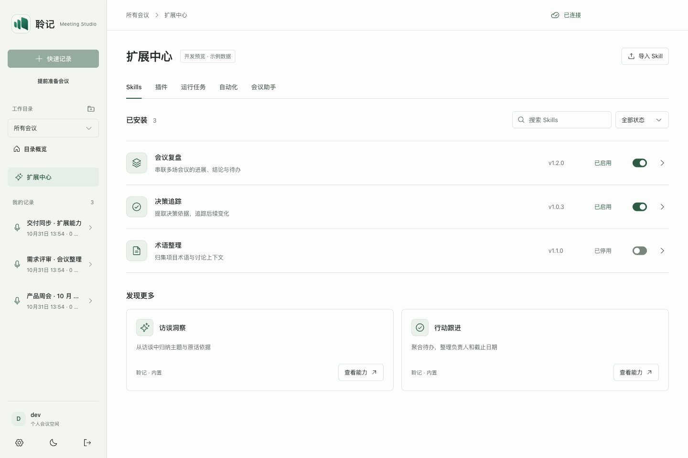
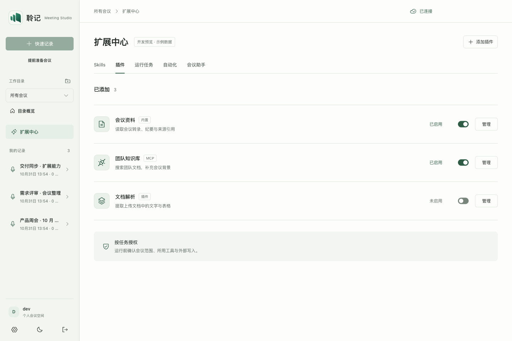
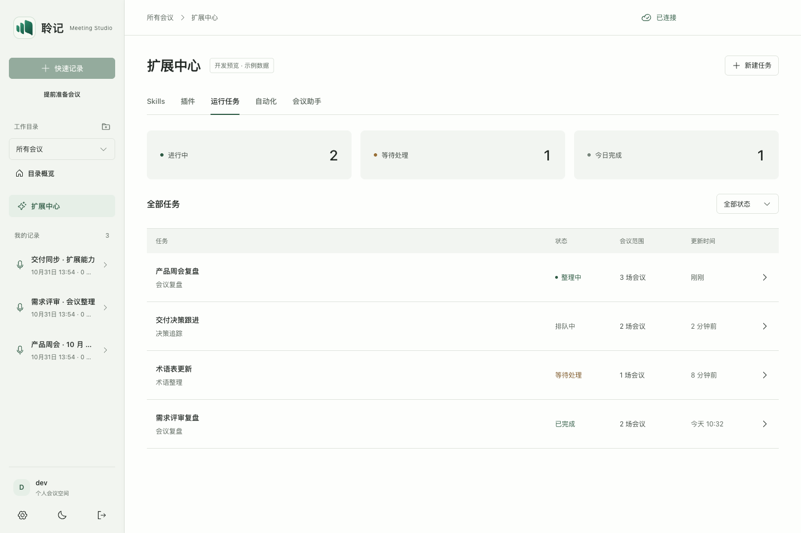
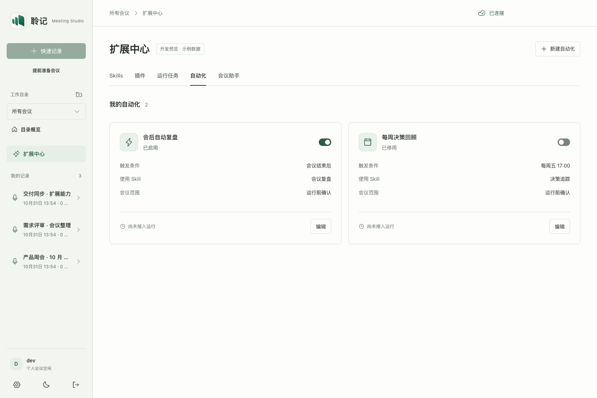
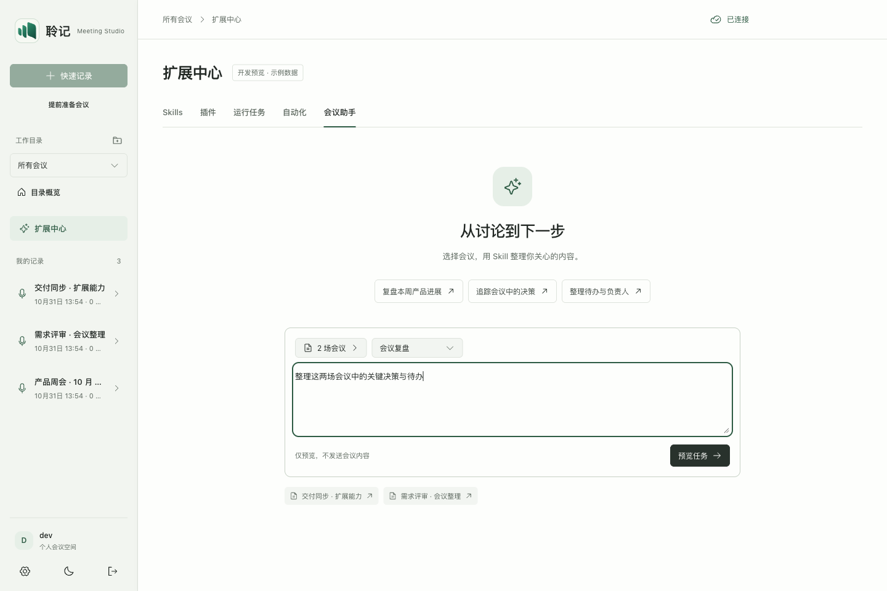

# 扩展中心：真实应用预览，待界面确认

本轮按「浅色专业、合理间距、同类等高、减少说明小字」调整，并将页面放入现有 React/Vite 应用。下方图片由 ego lite 对实际应用页面截图，复用真实侧栏、工作目录、会议导航、按钮、选择器与弹窗；不是独立 HTML 原型，也不是生成图片。

当前阶段为本地开发预览。三场会议为通过隔离 Record API 创建并导入文字的合成数据；Skill、插件、任务与自动化为内存中的示例状态。未替换已安装客户端，未接入真实 Pi/MCP 执行或发布。

## 本轮调整

- 以 8px 为间距基准：卡片间距 16px，常规内边距 20–24px，桌面工作区边距 40px。
- 桌面常规按钮、筛选器与搜索框均为 36px；手机为 40px。同组工具同高，状态开关保留独立触控区域。
- Skills、插件、任务分别采用统一行高；发现卡片和自动化卡片在同组内等高，操作区底部对齐。
- 配置统一进入右侧抽屉；标题、滚动正文与底部操作区分开，窄屏占满宽度。
- 删除重复的页面副标题、泛泛的能力提示、冗余状态说明及装饰性关闭动效；保留权限、数据范围、错误与预览标识。
- 会议范围只有点击确认才提交；关闭或 Esc 丢弃本次勾选。停用 Skill 同步停用其自动化，禁止启用依赖已停用 Skill 的规则。

## 主页面

### Skills

### 插件

### 运行任务

### 自动化

### 会议助手

选择的会议来自真实 Record API；当前只预览任务范围，不执行模型或发送会议内容。

## 配置与任务流程

| 页面 | 预览 |
| --- | --- |
| 选择会议 | [截图](../evidence/extension-app-preview-20261031/06-meeting-scope.png) |
| 任务确认 | [截图](../evidence/extension-app-preview-20261031/07-task-plan.png) |
| Skill 详情 | [截图](../evidence/extension-app-preview-20261031/08-skill-detail.png) |
| 插件工具与权限 | [截图](../evidence/extension-app-preview-20261031/09-plugin-tools.png) |
| 任务进度 | [截图](../evidence/extension-app-preview-20261031/10-run-detail.png) |
| 指定版本缺失 | [截图](../evidence/extension-app-preview-20261031/11-blocked-run.png) |
| 自动化编辑 | [截图](../evidence/extension-app-preview-20261031/12-rule-editor.png) |
| 手机宽度 | [截图](../evidence/extension-app-preview-20261031/13-mobile-skills.png) |
| 平板宽度 | [截图](../evidence/extension-app-preview-20261031/14-tablet-skills.png) |
| 返回现有会议页 | [截图](../evidence/extension-app-preview-20261031/15-existing-meeting.png) |

## 确认后的落地顺序（计划，尚未实施）

1. **先接入一次完整的会议任务。** 会议范围与来源版本确认 → 持久化任务 → 排队执行 → 流式结果 → 来源引用；复用已有 Pi 会议调度 fixture 的契约，增加真实持久化与重启恢复证据。
2. **接入 Skill 生命周期。** 安装校验、版本锁定、启停、升级与回退；运行中的任务保留原版本，停止或卸载不能破坏其恢复条件。
3. **接入插件与 MCP。** 将安装/启用与进程健康分开；工具发现、任务权限、超时、取消、撤权和失败恢复均由宿主校验，再交给 harness 执行。
4. **再开放自动化。** 会议结束/固定时间触发，加去重、并发限制和恢复；会议读取与外部写入分别确认，保留人工介入位置。

宿主继续负责账户权限、会议数据、来源版本与执行边界，Pi Durable 负责会话/任务持久化、恢复和 agent 调度。边界仍以 [proposed ADR 0019](../adr/0019-meeting-durable-runtime.md) 为准。本轮不把预览中的状态开关视为已实现的服务端控制。

飞书导出保留为云文档路径，画板是云文档中的组件；Skill 导出路径继续暂停。

## 复核依据

见 [本轮验证](../evidence/extension-app-preview-20261031/validation.md)。确认或调优的对象是本页的真实应用布局和交互；运行底座接入完成后仍需另一轮真实任务与故障恢复验证。
