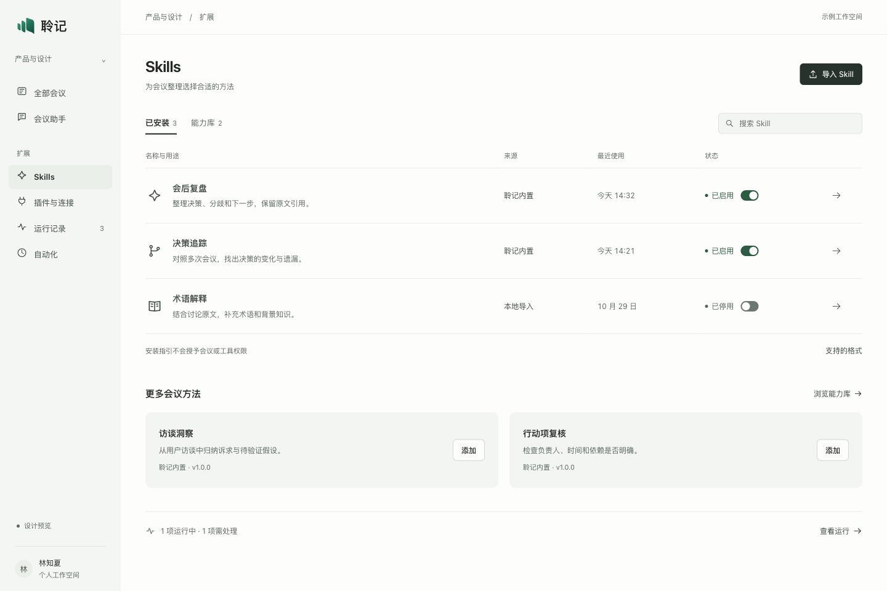
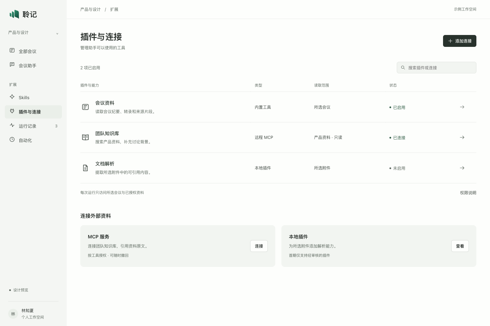
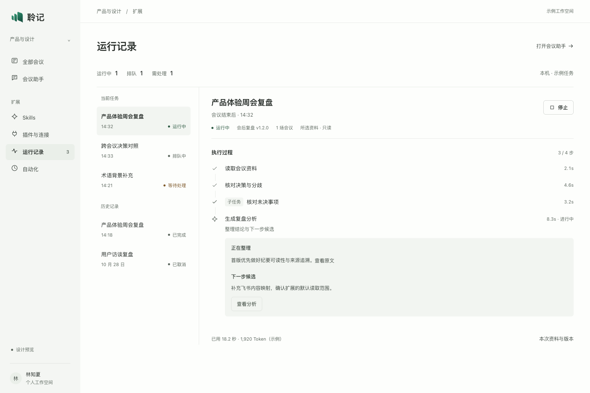
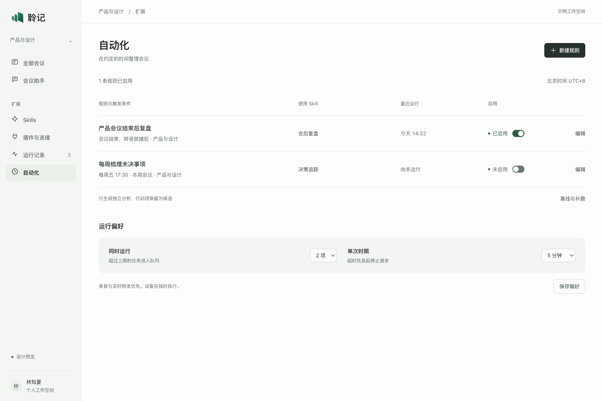
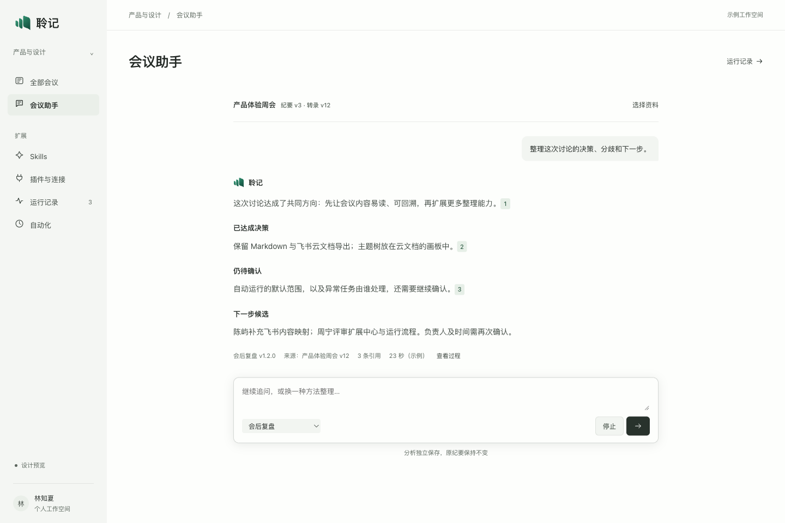

# 扩展中心：连续工作面重绘

2026-10-31。状态：**待用户确认的设计稿**。上一稿的样式、布局、容器位置与说明文字被用户否定；本稿按要求使用 taste skill 与 finesse-ui 重绘。仅更新隔离原型，不接入主程序。

## 本轮改动

| 项目 | 上一稿 | 本稿 |
| --- | --- | --- |
| 导航 | 会议侧栏、最近会议与中心页签同时占位 | 单一窄侧栏；Skills、插件、运行与自动化直接可达 |
| 工作面 | 带圆角的外框中继续嵌套面板 | 连续的近白工作面，统一 40px 内容边距 |
| 能力列表 | 左列表、右侧常驻详情 | 全幅列表；详情、安装和设置按需从右侧展开 |
| 操作位置 | 分散在多层容器与详情底部 | 页级操作统一右上；抽屉操作固定在底部 |
| 文案 | 长说明、重复标题与底层术语 | 使用具体动词；少用说明句；格式、版本和恢复细节按需展开 |
| 运行页 | 列表、过程和窄上下文栏并列 | 队列与任务过程双栏；资料版本单独查看 |

保留聆记标识、浅色专业方向、系统中文字体和克制玉绿。采用 taste 的 Achromatic ledger（seed 1662024059）：导航与主要按钮用墨色，玉绿承担运行状态与焦点。finesse 按 product / redesign 路径处理，未套用品牌展示页、磨砂玻璃、渐变或装饰动效。

## 核心页面

### Skills

名称与用途放在同一行组，来源、最近使用、状态沿固定列对齐。能力库与本地导入分开，安装后的启停仍独立管理。



### 插件与连接

默认列表展示类型、读取范围和连接状态。工具权限、版本与凭据状态放入统一抽屉，避免长说明常驻页面。



### 运行记录

当前任务与历史记录同时可见。任务过程展示具体步骤、引用资料和耗时；已完成步骤可展开，当前步骤展开。停止按钮保留固定位置，先显示停止中，收到确认后再结束。



### 自动化

会后触发、定时触发统一为规则行。并发与时限放在同一组运行偏好中，编辑和新建使用相同抽屉。新规则默认停用。



### 会议助手

对话以阅读宽度居中，引用原文按需展开；输入区保留 Skill、停止与发送。已生成分析标明自己的来源版本，调整下一次运行范围不会改写旧分析。



## 抽屉与其他状态

所有抽屉共享 470px 桌面宽度、同一页头和底部操作栏，手机使用全屏详情。内容滚动时，主要动作保持在底部。

- [Skill 详情](../evidence/extension-redraw-20261031/06-skill-detail.png)
- [插件工具权限](../evidence/extension-redraw-20261031/07-plugin-tools.png)
- [导入 Skill](../evidence/extension-redraw-20261031/08-import.png)
- [编辑自动化](../evidence/extension-redraw-20261031/09-rule-edit.png)
- [缺少原插件版本](../evidence/extension-redraw-20261031/10-blocked.png)
- [引用原文](../evidence/extension-redraw-20261031/15-sources.png)

响应式预览：[手机 Skills](../evidence/extension-redraw-20261031/11-mobile-skills.png) · [手机任务](../evidence/extension-redraw-20261031/12-mobile-run.png) · [平板 Skills](../evidence/extension-redraw-20261031/13-tablet-skills.png) · [手机助手](../evidence/extension-redraw-20261031/14-mobile-assistant.png)。

## 产品范围与底座计划

本轮仅重绘上述五页与关联详情。既有主程序、录音、转录、纪要和固定导出均未修改。Markdown 与飞书云文档仍走固定导出；画板仍属于云文档组件；没有恢复 Skill 自定义导出。

Pi Durable 的接入顺序沿用 [上一份分期计划](extension-center-2026-10-31.md#分期计划与验收)与 [ADR 0019](../adr/0019-meeting-durable-runtime.md)。本稿新增的是设计与交互状态，不能视为正式安装器、工具授权系统、MCP 客户端或已接入的调度底座。所有运行、凭据和 Token 数均为示例；没有访问真实模型、会议或外部服务。

## 查看与验证

仓库根目录启动：

```sh
python3 -m http.server 4187 --bind 127.0.0.1
```

[Skills](http://127.0.0.1:4187/apps/web/prototypes/minutes-publish/center.html?view=skills) · [插件与连接](http://127.0.0.1:4187/apps/web/prototypes/minutes-publish/center.html?view=plugins) · [运行记录](http://127.0.0.1:4187/apps/web/prototypes/minutes-publish/center.html?view=runs) · [自动化](http://127.0.0.1:4187/apps/web/prototypes/minutes-publish/center.html?view=schedule) · [助手](http://127.0.0.1:4187/apps/web/prototypes/minutes-publish/center.html?view=assistant)。

验证范围、图片审查与工具限制见 [本轮记录](../evidence/extension-redraw-20261031/validation.md)。本轮继续仅本地，不推送或发布。
