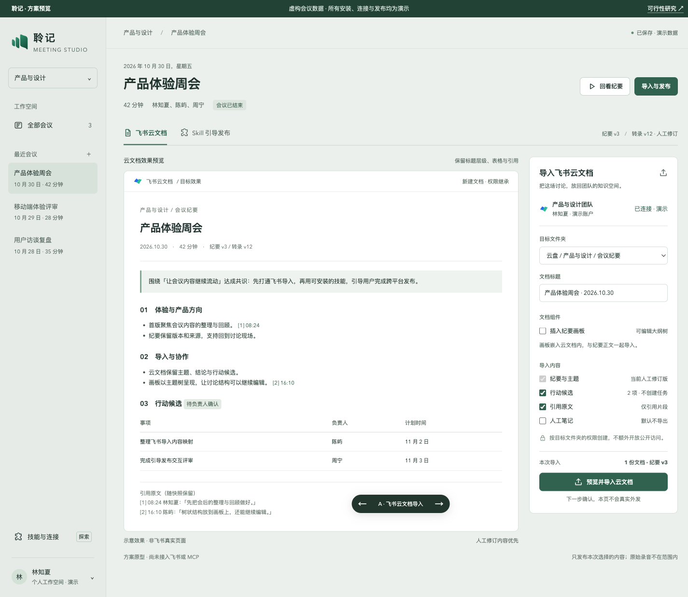
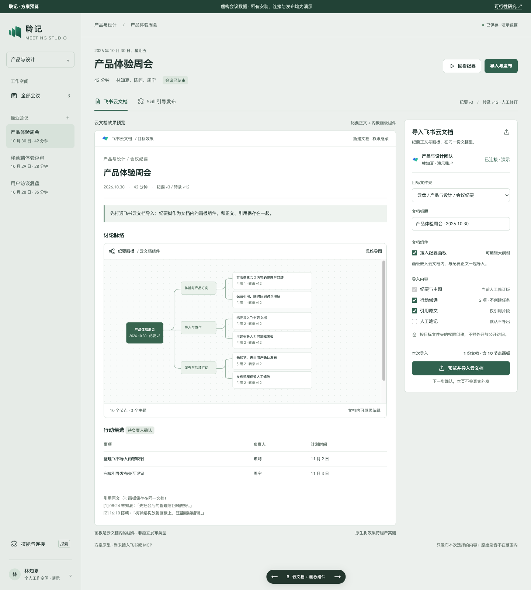
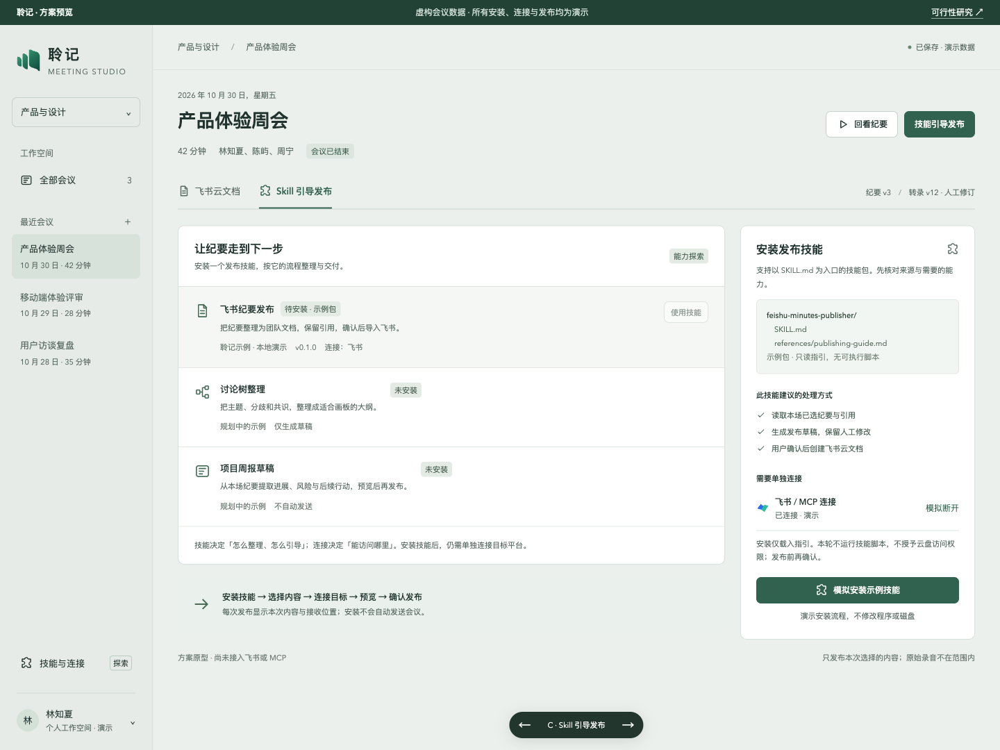
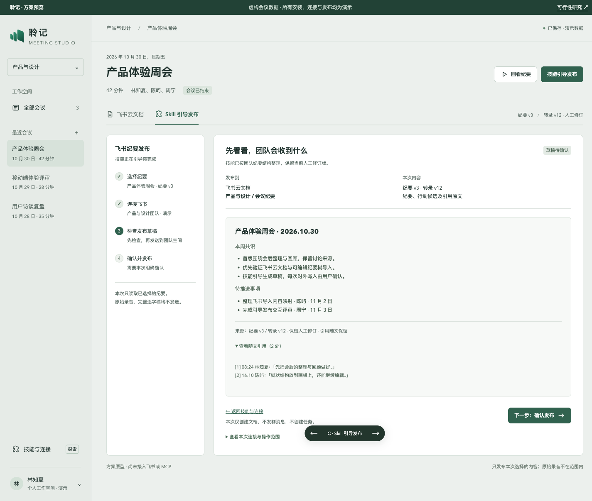

# 纪要导入与 Skill 发布：方案与可操作预览

研究开始于 2026-10-30，浏览器验证于 2026-10-31（Asia/Shanghai）。状态：**proposed，只完成研究和独立交互原型**。所有会议、人名、连接、安装和发布回执均为演示；截图没有调用飞书或 MCP。

## 画板归属云文档，作为组件选项

根据用户于 2026-10-31 的明确修正，产品只设“飞书云文档”发布分类。画板是文档内的内容组件，按需勾选“插入纪要画板”；A/B 仅比较同一份云文档是否含画板，不是两个发布目标。正文、画板、表格与引用一起预览、一起确认。

## 建议先做飞书导入闭环

| 入口 | 目标效果 | 可行性与首版边界 |
| --- | --- | --- |
| 导入飞书云文档 | 保留标题层级、主题、表格、行动候选及引用原文 | 官方 API 路径明确。首次完成应用配置和用户授权，之后选位置、预览、确认导入。引用按快照保存，不能只放无法访问的 localhost 链接。 |
| 云文档内插入纪要画板组件 | 根节点 → 主题 → 讨论要点的原生可编辑大纲树 | 官方支持创建文档内画板和原生思维导图节点。推荐新建纪要文档并附画板；也可更新已有文档内的画板组件。长正文、表格和详细引用保留在同一云文档正文中。节点布局、折叠和真实渲染待租户实测。 |
| 安装 skill 并引导发布 | 安装 → 选纪要 → 连接目标 → 检查草稿 → 确认 → 留回执 | 格式可采用 Agent Skills，程序需新增宿主、安装管理和连接管理。首版支持指引与资料包，脚本执行另行设计。 |
| 通过 MCP 发布 | 技能引导内容整理，受支持的工具执行外部写入 | 浏览器由后端连接远程 MCP，本地 stdio 需要桌面或桥接。实际服务器必须提供对应写入工具；没有工具时给出连接指引或导出文件。 |

接口、授权、限额和一手来源见[可行性研究](../research/minutes-feishu-skill-publishing-2026-10-30.md)。以上均为方案判断，不是联调通过。架构边界见[proposed ADR 0017](../adr/0017-minutes-publishing-skills.md)。

“一键”指连接配置完成后的便捷导入入口；首次授权和每次对外写入的内容核对仍需显式完成。导入行动候选不会自动建立飞书任务或发送群消息。

## 查看三个预览场景和发布确认

原型沿用聆记的 sage/jade、系统中文字体、左侧会议列表与纪要版本提示。独立放在 `apps/web/prototypes/minutes-publish/`，没有接入主程序路由、构建入口或真实发布服务。

在仓库根目录运行一条命令：

```sh
python3 -m http.server 4187 --bind 127.0.0.1
```

然后打开：

- [A：飞书云文档](http://127.0.0.1:4187/apps/web/prototypes/minutes-publish/?variant=doc)
- [B：云文档内嵌画板组件](http://127.0.0.1:4187/apps/web/prototypes/minutes-publish/?variant=board)
- [C：Skill 安装与引导发布](http://127.0.0.1:4187/apps/web/prototypes/minutes-publish/?variant=skill)

可通过底部切换器或键盘左右键切换。勾选内容会改变导入预览；Skill 场景先点击“模拟安装示例技能”，再点击“开始引导发布”。安装只保存在本页内存，刷新清除。发布确认只产生模拟回执。

### 云文档导入



### 云文档内嵌画板组件



### 安装发布技能



### 检查发布草稿



[发布确认截图](../evidence/minutes-publishing-20261030/publish-confirm.png) · [手机宽度截图](../evidence/minutes-publishing-20261030/mobile-document.png)

## 现有代码能复用的内容

核查基线：本工作区 `dev_browser-records` 的 `315e38a`（v0.1.5）。这不代表其他分支或已发布版本的现状；本轮研究分支继承该基线。工作区中原有播放器与 IDE 未提交改动未纳入本轮。

| 当前代码 | 已核实能力 | 后续接入位置 |
| --- | --- | --- |
| `apps/web/src/components/ExportDialog.tsx` | Markdown/WAV 导出 | 增加飞书导入入口，保留已有导出 |
| `services/records/src/markdown-export.mjs` | 人工修订优先、版本与引用快照导出 | 复用内容选择与引用；脚注需转换为飞书可读引用段落，不假设 Markdown 脚注原样支持 |
| `apps/web/src/minutes-views.ts` | 主题及表格归属，保留未归属内容 | 生成云文档正文及内嵌画板树；完整内容不能因折叠或摘要丢失 |
| `apps/web/src/model.ts` | 纪要修订、转录修订、引用快照、人工标记 | 绑定发布计划，确认后内容改变须重新确认 |
| `apps/web/src/components/ShareDialog.tsx` | 会议快照与分享范围选择 | 复用范围语言；平台连接与公开分享仍各自授权 |

CodeGraph 已用于定位上述符号并读取当前源码；源码补查未发现 Record 服务或当前 Web 中已有 Feishu/MCP/Skill 发布宿主。因此后续实施需要新增集成能力，不能只向现有导出窗口添加按钮。

## 本地验证与尚未覆盖的内容

- `node --check`：原型模块语法通过；内置断言确认 1 个根节点、3 个主题、6 个要点，共 10 个节点，以及 2 项行动候选。
- ego lite：确认窗口初始禁用发送，勾选后允许模拟导入；模拟回执明确未创建真实资源。
- ego lite：引用原文、行动候选、人工笔记勾选会改变预览；断开连接后禁用导入；技能未安装不能使用，模拟安装后可以进入发布向导。
- ego lite：三个预览场景均检查 768px、390px 宽度，无页面横向溢出；桌面截图逐张目视检查。画板在窄屏中允许局部横向浏览。
- 本页资源记录未出现对第三方域名的请求。原型没有外部请求、凭据输入、上传或发布代码。
- taste-skill 源码检查：0 FAIL，2 WARN；日期标签是会议上下文，阴影只用于浮动切换器、提示与确认对话框。品牌与字体沿用既有方案。未运行其独立浏览器检查器，按项目规则使用 ego lite 验证。
- 本轮未修改产品运行代码，没有运行产品完整 Node/Go 回归，也没有构建、安装或发布产品版本。真实飞书、OAuth、MCP、长纪要与故障恢复尚未实测。

后续建议按云文档导入、文档内原生画板树、可安装技能与 MCP 三阶段推进。先在一个飞书租户中验证，之后再评估跨企业分发与更多平台。
