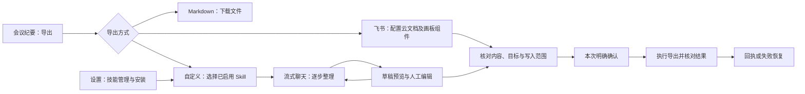
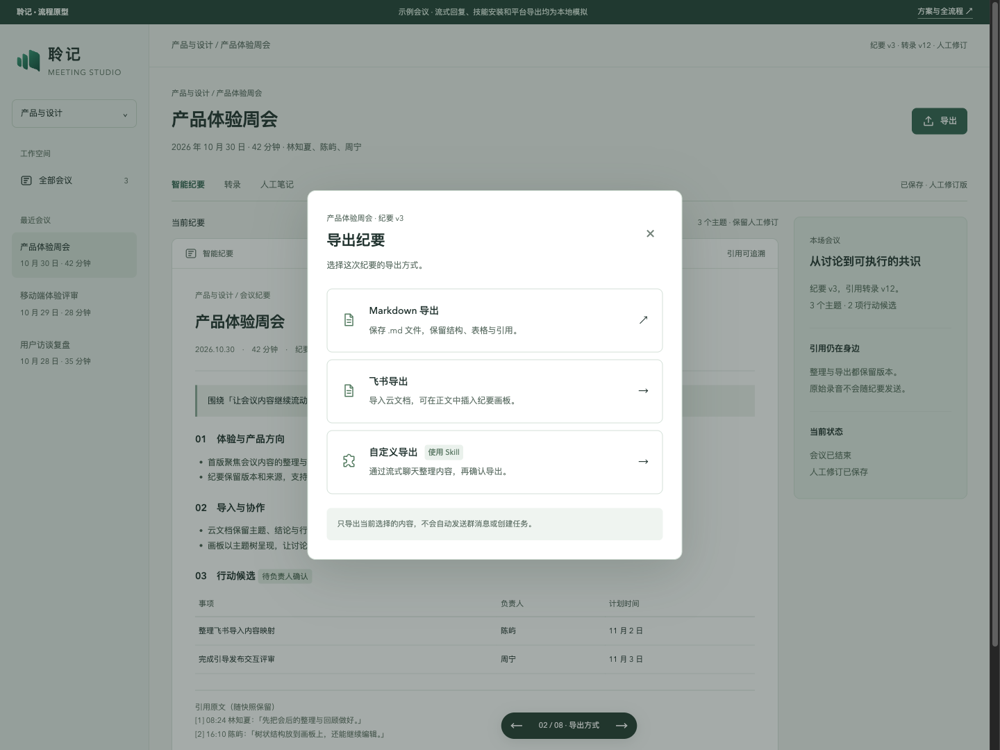
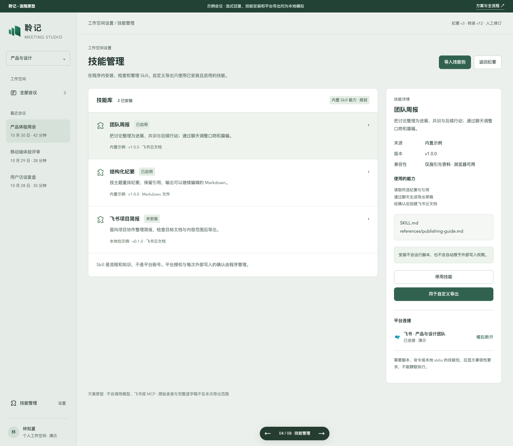
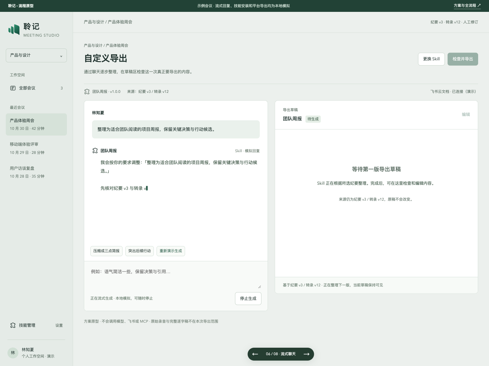
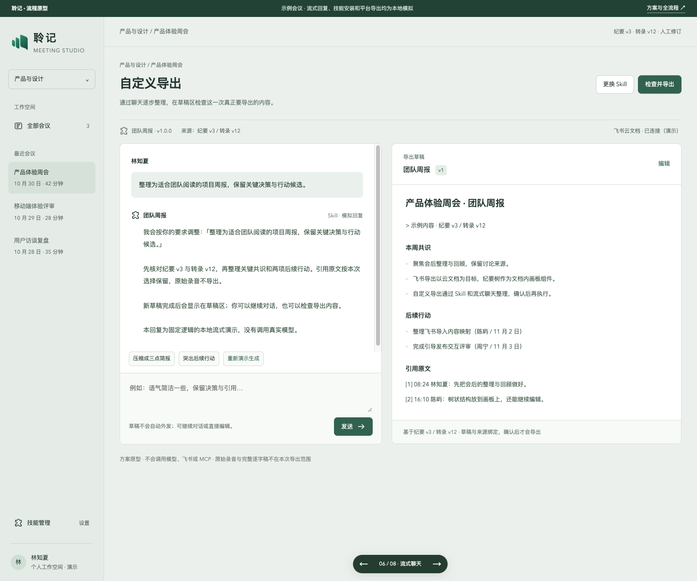

# 纪要导出与 Skill 流式聊天：完整流程预览

状态：**proposed，第二版方案与独立交互原型**。2026-10-31 按用户反馈重设计。本轮尚未接入产品主程序、真实模型、飞书或 MCP。会议数据、技能包、流式输出和平台回执均为本地演示；示例 Markdown 可以实际下载到本机。

## 用户已明确的产品边界

- 纪要页只保留一个“导出”入口，进入后才提供 **Markdown 导出 / 飞书导出 / 自定义导出** 三个选项。
- 飞书导出以云文档为目标；**画板是文档内的组件**，不能作为单独发布分类。正文、内嵌画板、表格和引用一起预览、一起确认。
- 自定义导出依赖程序内置的 Skill 宿主能力。Skill 有独立管理页，可以查看来源、版本、兼容性、使用能力，并安装、启用或停用。
- 自定义导出必须使用**流式聊天**，允许多轮整理、停止生成、检查与编辑草稿，再确认导出。旧版分步表单方案被本版替代。

## 从导出入口走到回执



| 页面或状态 | 核心内容与下一步 |
| --- | --- |
| 会议纪要 | 保留现有阅读结构，只增加统一导出入口；不常驻平台或 Skill 导出分类 |
| 导出选择 | 三种方式同一窗口展示，说明本地下载、云文档导入和 Skill 聊天的区别 |
| 飞书配置 | 选择文件夹和标题；可勾选正文中的纪要画板；选择行动候选、引用与人工笔记 |
| 技能管理 | 内置示例与本地技能包列表；检查来源、版本、兼容性和使用能力；安装、启用、停用；平台连接独立管理 |
| 选择 Skill | 只展示已安装且启用的技能；确定本场内容范围和初始要求；无可用技能时引导管理 |
| 流式聊天 | 桌面左侧对话逐步输出、右侧显示导出草稿，窄屏上下排布；可以停止、继续调整或编辑；第一版未完成时禁止确认导出 |
| 人工草稿保护 | 后续生成先作为建议展示，由用户选择采用或保留人工稿；不自动覆盖 |
| 检查与确认 | 核对草稿、来源版本、目标、内容范围；修改标题或目标后旧确认失效 |
| 执行与回执 | 按阶段显示结果；明确资源是否创建；真实实现需保存资源 ID、内容摘要与回执 |
| 失败与重试 | 原型只模拟写入前失败；仅计划未变化时可重试同一计划。真实未知写入结果先核对远端，不能盲目创建副本 |

## 浏览器中直接查看

在仓库根目录运行：

```sh
python3 -m http.server 4187 --bind 127.0.0.1
```

[从导出窗口开始](http://127.0.0.1:4187/apps/web/prototypes/minutes-publish/?screen=export) · [技能管理](http://127.0.0.1:4187/apps/web/prototypes/minutes-publish/?screen=skills) · [自定义导出起点](http://127.0.0.1:4187/apps/web/prototypes/minutes-publish/?screen=select) · [聊天完成态预览](http://127.0.0.1:4187/apps/web/prototypes/minutes-publish/?screen=chat)

点击“自定义导出 → 选择 Skill → 开始流式聊天”查看真实发生的本地模拟输出。聊天完成后可以继续发送要求或编辑右侧草稿。“压缩成三点简报”等示例使用固定模板展示草稿变化，不代表真实 LLM 的指令理解质量。聊天要求不会附加进对外文档。

底部深色切换器属于原型工具，可快速查看八个页面，支持键盘左右键。直接打开确认或回执页面只是展示预置状态。安装与启停只保存在本页内存，刷新恢复；安装窗口展示固定示例包，没有解析任意用户包或执行脚本。

原型代码位于 `apps/web/prototypes/minutes-publish/`，没有接入主程序路由或构建入口。

## 查看全流程截图

### 统一导出入口



### 技能管理



### 自定义导出：流式聊天



### 草稿完成后继续聊天或检查导出



其他页面与状态：

- [会议页](../evidence/minutes-export-flow-20261031/00-meeting.png) · [飞书文档与画板组件](../evidence/minutes-export-flow-20261031/02-feishu-document.png)
- [安装技能](../evidence/minutes-export-flow-20261031/04-skill-install.png) · [选择技能与内容](../evidence/minutes-export-flow-20261031/05-custom-skill.png)
- [检查与确认](../evidence/minutes-export-flow-20261031/08-review.png) · [回执](../evidence/minutes-export-flow-20261031/09-receipt.png)
- [失败恢复](../evidence/minutes-export-flow-20261031/10-failure.png) · [人工编辑保护](../evidence/minutes-export-flow-20261031/11-manual-draft.png) · [无可用技能](../evidence/minutes-export-flow-20261031/12-empty-skills.png)
- [手机聊天](../evidence/minutes-export-flow-20261031/13-mobile-chat.png) · [手机导出](../evidence/minutes-export-flow-20261031/14-mobile-export.png) · [手机技能管理](../evidence/minutes-export-flow-20261031/15-mobile-skills.png)

## 实施可行性与新增工作

飞书文档转换及文档内原生树的官方依据见[一手研究](../research/minutes-feishu-skill-publishing-2026-10-30.md)。Skill 格式、MCP 工具覆盖、OAuth 与脚本兼容性边界沿用研究结论。用户反馈确定了产品交互，不代表实现已批准或联调已通过。

浏览器首版建议后端提供 Skill 目录与安装存储、按需加载指引与参考资料、已有模型配置的调用适配、流式会话、草稿版本和导出执行。浏览器只显示对话与草稿；凭据仍在后端。聊天内容、草稿和外部执行计划分别保存，模型文字不能直接触发写入。具体架构处于 [proposed ADR 0017](../adr/0017-minutes-publishing-skills.md)。

现有 `ExportDialog.tsx` 可承接三种纪要导出入口，`markdown-export.mjs` 可复用人工修订优先、版本和引用快照，`minutes-views.ts` 可复用主题及表格归属。当前工作区基线 `315e38a` 的 Record/Web 没有已核实的 Skill 宿主与 MCP 发布会话，不能只添加一个聊天窗口就称为完成。

实施前需确定首批受支持的 Skill 类型和模型协议。首版可支持无脚本的指引包与远程 MCP；脚本、本地文件和 stdio 另行设计宿主兼容与权限。飞书租户授权、真实树渲染、真实模型流式和工具调用、断线恢复与跨企业分发仍需独立验证。

## 本地验证

- 模块语法与断言通过：10 个树节点、2 项行动候选、2 个内置技能示例；示例聊天可以改变草稿结构，内部要求不混入导出正文。
- ego lite 验证统一三选项入口、画板嵌入同一文档、Skill 安装确认、启停与空列表、安装后可选，以及范围变化不丢失输入要求。
- 验证流式逐步输出、停止与重新生成、第一版未完成禁用导出、人工编辑保留与新建议待采用。
- 验证确认初始禁用、显式勾选后启用、修改标题或目标使确认失效、模拟失败、原计划重试与回执。
- 实际下载示例 Markdown，核对人工编辑文本仍被保留。
- 八个页面分别检查 768px 和 390px，共 16 组，无页面横向溢出；桌面截图目视检查。画板局部可以横向浏览。
- taste-skill 源码检查 0 FAIL、1 WARN：阴影只用于浮动切换器、提示与对话框。使用 ego lite 验证浏览器，没有启动其他浏览器检查器。
- 未修改产品运行代码，未运行产品完整 Node/Go 回归；未构建安装包、发布产品版本、连接真实模型或实际外发纪要。

第一版研究与截图保留于本地提交 `70f8be9`；本版以用户最新反馈为准。
