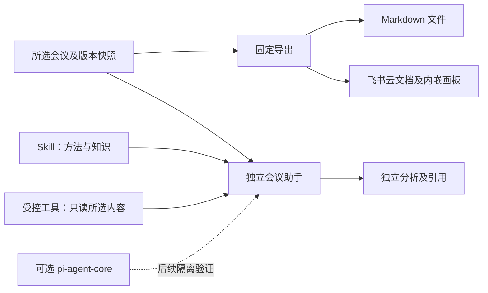
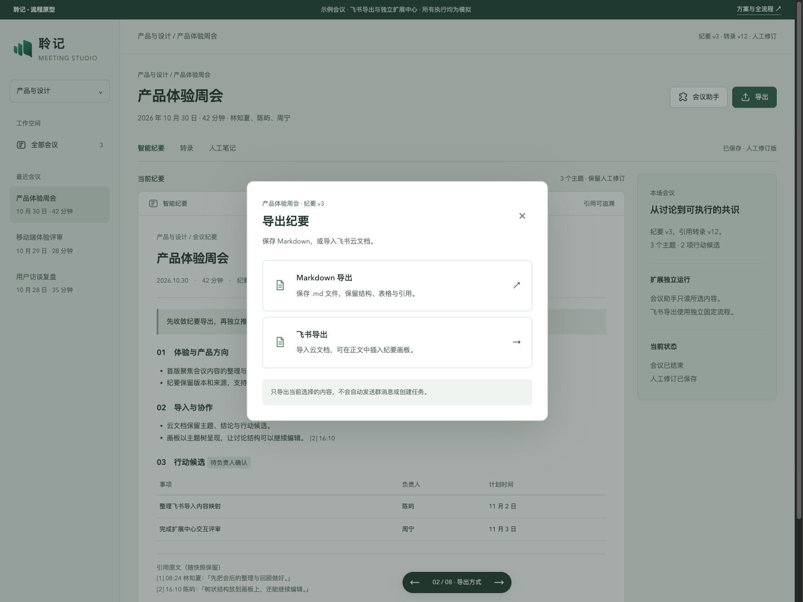
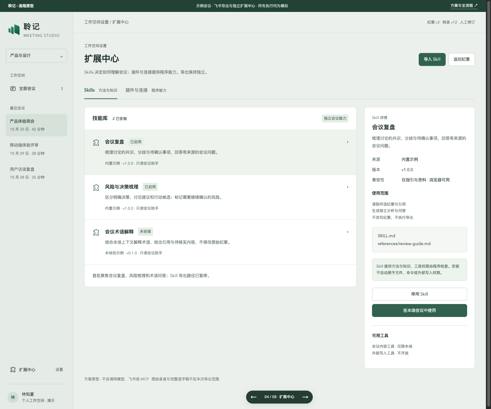
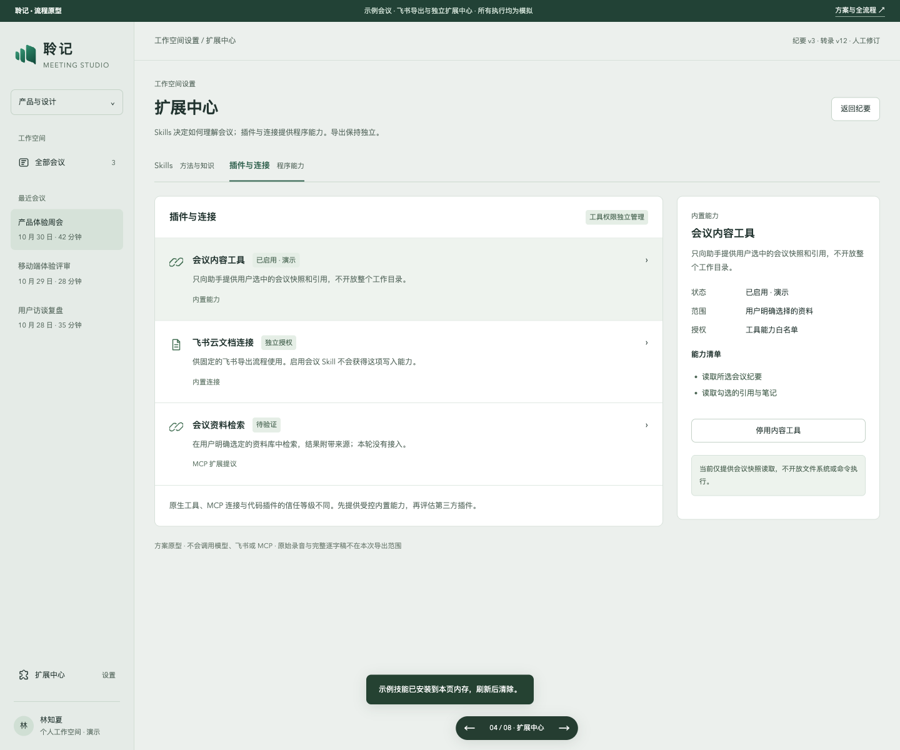
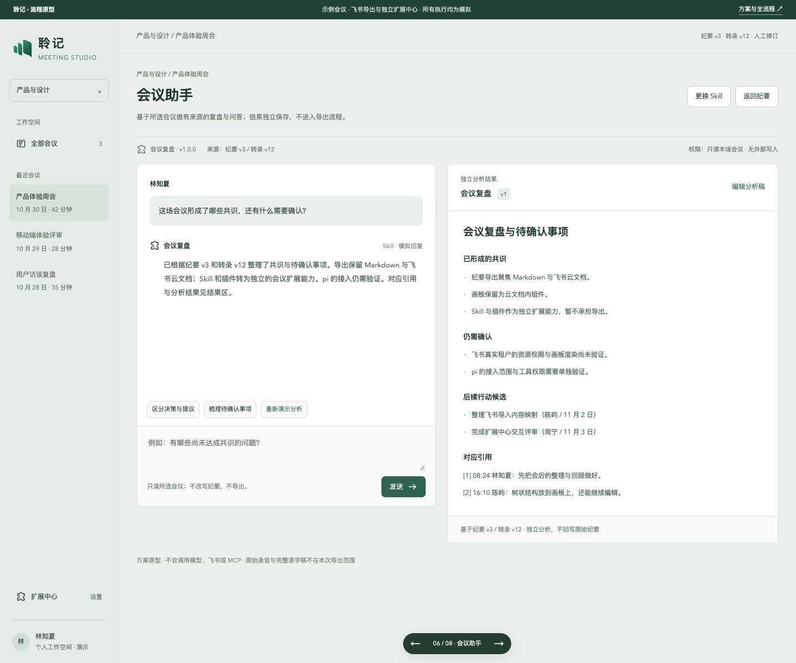

# V3：固定飞书导出与独立会议扩展

2026-10-31。状态：**proposed，方向设计与隔离原型**。本版按用户最新反馈暂停 Skill/自定义导出，保留飞书云文档，并独立设计 Skill/插件能力。V1/V2 的 Skill 导出方案不再是当前方向，历史截图仍留作追溯。

本轮没有修改产品主入口、接入真实飞书或模型，也没有安装 Pi。所有会议、安装、流式结果与平台回执均为本地模拟；Markdown 示例可实际下载。

## 导出与扩展各有入口

| 位置 | 当前方案 |
| --- | --- |
| 纪要页 → 导出 | 仅 Markdown 导出、飞书导出；移除自定义/Skill 导出选项与跳转 |
| 飞书导出 | 固定云文档导入，可在正文中勾选纪要画板；保留版本、人工修订和引用 |
| 纪要页 → 会议助手 | 选择已启用的 Skill 和读取范围，做复盘、风险梳理或问答，不外发 |
| 设置 → 扩展中心 → Skills | 查看来源、版本、指引与兼容性，安装、启停，在所选会议中使用 |
| 扩展中心 → 插件与连接 | 独立管理会议内容工具、资料检索提议和飞书连接的能力与状态 |



飞书导出不依赖 Skill 安装、分析草稿、会话结果或 pi。助手读取范围与导出内容分别维护；助手中勾选笔记或修改分析，不能隐含加入纪要导出。助手也不提供发布、导出或执行命令按钮。

## Skill、插件与引擎分别设计

- Skill 是处理方法与知识，首批用会议复盘、风险/决策梳理、术语解释三个例子。安装指引不授予程序或平台权限。
- 插件提供受控程序能力或 UI；原生工具、MCP 连接与第三方代码插件分别标记来源与运行条件。首批工具只读用户选定的会议快照。
- 飞书连接是独立授权的固定导出能力，不注册进会议助手的工具集合。
- 引擎负责模型、循环、事件与取消。产品数据、会话 UI、工具授权、业务校验及外部写入仍由聆记负责。
- 后续可能增加“采用为笔记”等本地写入建议，但需要独立设计确认与人工稿保护。本版只提供独立分析，不回写纪要。

相关架构为 [proposed ADR 0018](../adr/0018-independent-extensions-and-pi-runtime.md)。这不是已实现的插件运行时、权限系统或兼容承诺。

## pi harness 的结论

建议按需求递进：

| 方式 | 适用情形 | 当前结论 |
| --- | --- | --- |
| 先不用 Pi | 固定的会议问答、摘要或风险分析 | 可复用现有后端，依赖少；本轮不新增运行时 |
| `pi-agent-core` | 明确需要多轮领域工具、流式事件和取消 | 值得做隔离验证，显式注册少量会议只读工具 |
| 完整 `pi-coding-agent` harness | 确实需要完整会话树、资源/技能生态及其扩展机制 | 暂不默认接入会议产品，需要处理额外工具、持久化和配置发现 |

[固定版本的一手研究](../research/pi-harness-extension-feasibility-2026-10-31.md)核实了当前官方仓库、包名和 MCP/SDK 差别。该结论没有运行时实测背书。当前终端 Node 22.14.0 低于本次 Pi 1.4.0 声明的 ≥22.19，未来验证应使用隔离环境，不默改系统或产品运行时。

第一条验证只做“所选会议问答”，对比现有模型调用与 core：能流式、能取消、能追溯引用、不能访问其他会议，且原纪要不变。不要先把完整编码 CLI 放进 Web 后端。

## 查看当前预览

仓库根目录一条命令启动：

```sh
python3 -m http.server 4187 --bind 127.0.0.1
```

[导出入口](http://127.0.0.1:4187/apps/web/prototypes/minutes-publish/?screen=export) · [Skills](http://127.0.0.1:4187/apps/web/prototypes/minutes-publish/?screen=skills) · [插件与连接](http://127.0.0.1:4187/apps/web/prototypes/minutes-publish/?screen=skills&tab=plugins) · [会议助手](http://127.0.0.1:4187/apps/web/prototypes/minutes-publish/?screen=select)

底部深色切换器只是原型工具，不是产品导航。安装、启停、连接与分析只保存在本页内存，刷新恢复。技能安装窗口只展示固定示例包，不解析任意上传包或执行脚本。直接打开回执页是预置状态。

### 导出只保留 Markdown 与飞书



### 独立 Skills



### 插件与连接



### 只读会议助手



其他预览：[纪要页双入口](../evidence/minutes-extension-direction-20261031/00-meeting.png) · [飞书云文档及画板](../evidence/minutes-extension-direction-20261031/02-feishu-document.png) · [飞书确认](../evidence/minutes-extension-direction-20261031/06-feishu-confirm.png) · [回执](../evidence/minutes-extension-direction-20261031/07-feishu-receipt.png) · [Skill 安装](../evidence/minutes-extension-direction-20261031/08-skill-install.png) · [手机扩展中心](../evidence/minutes-extension-direction-20261031/09-mobile-extensions.png) · [手机会议助手](../evidence/minutes-extension-direction-20261031/10-mobile-assistant.png)。

## 本地证据与限制

本轮源码检查、浏览器验证、当前提交及推送情况见本轮交付说明；截图与模拟状态不能替代飞书租户、真实模型、权限隔离或 Pi 验证。官方飞书能力依据仍见[先前一手研究](../research/minutes-feishu-skill-publishing-2026-10-30.md)。当前工作区运行代码基线是 `315e38a`，研究提交未改产品运行实现，其他分支/版本不由此推断。

旧版完整聊天导出原型留存在 `fe14937`；当前以本版的两类导出和独立扩展为准。

### 当前原型检查结果

- 模块语法检查与断言通过；taste-skill 源码检查 0 FAIL、1 WARN（阴影仅用于浮动控件与对话框）。
- ego lite 验证导出选项只有两种；会议助手没有导出跳转；画板 10 个节点仍位于同一云文档组件中。
- 验证所有 Skill 和会议内容工具停用时，固定飞书导出仍可走到确认与模拟回执；内容工具停用时不能启动会议助手。
- 验证安装需勾选，安装后可选；助手笔记范围与导出范围独立。实际下载示例 Markdown，确认没有混入人工编辑的助手分析或助手单独选中的笔记。
- 飞书导出仍需明确确认，修改目标标题使旧确认失效。
- 8 个预览页及插件选项卡分别检查 768px、390px，共 18 组，无页面横向溢出；共保存 11 张当前方向截图。
- 未安装 Pi、更新 Node、加载第三方代码插件或访问真实模型/飞书。未改产品运行代码，未运行产品完整 Node/Go 回归、未构建或发布安装包。
