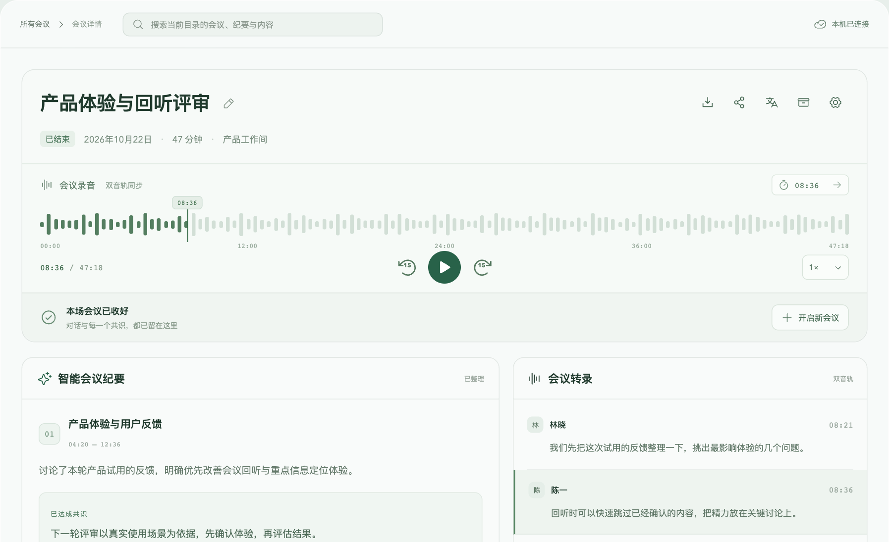

## 2026-10-27 用户增量确认

播放控件直接可见，移除额外加载入口；WAV 按播放操作读取。标题与双轨说明不再重复展示，波形与按钮区域压缩，时间刻度两侧保留内边距。标题行保留状态和录音时长，其余信息使用悬浮提示。沿用 C 版真实波形、时间刻度与居中播放，并保留44px播放/定位操作目标。详见[v0.1.31](../releases/v0.1.31-preview.md)。

## 2026-10-23 用户增量确认

在 C 波形版上调整：直接点击或拖动波形定位，移除右上快速跳转和左下重复时间；倍速改成靠近播放键的紧凑图标菜单。保留波形刻度、游标、前后 15 秒和双轨同步。下文原 C 版中的时间输入框要求由本条取代。见[本轮验证](../evidence/pause-catchup-controls-2026-10-23.md)。

# 录音回放：C 波形版

2026-10-23 用户明确确认采用 C「波形＋时间刻度＋居中播放」。本文件替代 A 单行进度条作为当前回放设计依据；A 的历史选择和验收仍保留在旧记录中。

- 上排左侧为会议录音和双音轨状态，右侧为时间输入及跳转。
- 中间为真实留存音频的波形、当前播放位置和五个时间刻度。
- 下排左侧为当前／总时长，中间为后退 15 秒、圆形播放／暂停、快进 15 秒，右侧为共享倍速菜单。
- 浅深主题使用既有 sage/jade 变量。窄容器优先保留完整波形、时间和 44px 播放按钮，控制区可换行。
- 拖动时只预览，释放后同步定位；键盘定位、取消拖动、暂停状态和双音轨倍速保持既有语义。
- 波形来自原音 PCM 固定摘要，失败应明确提示并保留定位播放；不得用随机柱形表示录音内容。

设计图包含示例会议内容和装饰波形。本次实现的波形形状来自实际录音，不要求与示例柱形相同。原生界面视觉验收与源码／测试验证分别记录。
