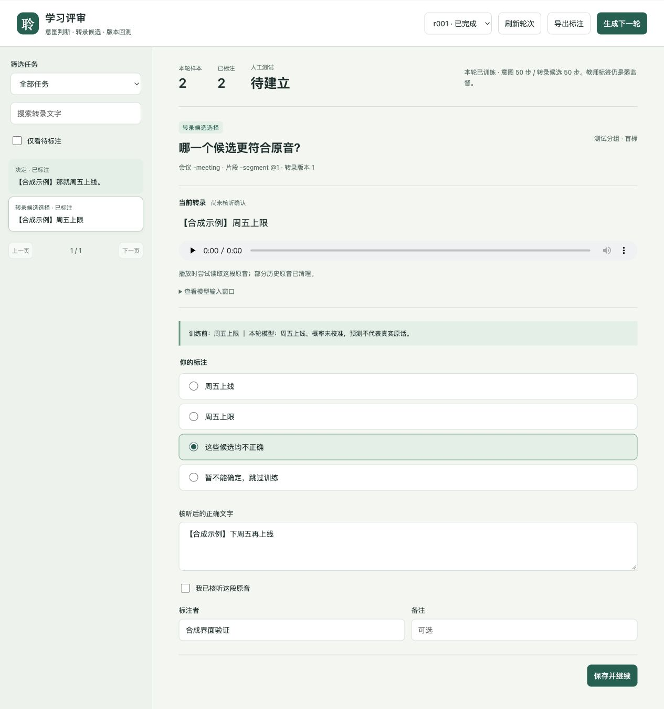

# Alpha 双任务学习与标注

本轮已实现从当前 Alpha 数据到 wgs 联合训练、旁路回测、本地核听标注和下一轮训练的闭环。学习服务独立运行；没有改写原会议转录、纪要或行动，也没有重启现有 Alpha 录音服务。

## 先打开评审页面

本轮运行地址：[本地学习评审](http://127.0.0.1:55344)。页面可选择 r001、r002、r003；每轮有 468 条可标注样本。

服务停止后，从项目根目录启动：

```bash
node scripts/alpha-learning/review-server.mjs .data/alpha-learning
```

控制台输出回环地址，`.data/alpha-learning/review-server-state.json` 记录本轮进程与地址。可添加第三个参数指定端口。停止时只终止该进程，不要停止录音/API/worker。服务不对公网开放，写入校验同源与随机令牌。

## 核听、标注，再训练

1. 选择意图或转录候选样本。当前转录只是待核对材料，不是原话真值。
2. 有原音时播放核听。意图选择存在、不存在或跳过；转录选择候选，均不正确时填写正确文字。无法确定时跳过。
3. 填写标注者，仅在实际核听后勾选核听确认，保存并继续。标注独立保存，可导出 JSONL；不会写回会议内容。
4. 在对应轮次点击“生成下一轮”。默认继承选中轮次适配器并训练 100 步，保留分组；结束后点击“刷新轮次”，选择新轮次，继续核对。

验证和测试样本先盲标，再展示训练前、本轮模型及教师弱标。修改已看过预测的标签时，不再把该修订当独立金标准。模型概率未经校准，不能直接作为外发行动授权。

下一轮默认继承冻结的转录候选、有效人工反馈及教师弱标。正确文字会加入新的候选，产生新样本 ID，并保留原反馈身份；选择跳过始终排除该条训练标签。同一个输入哈希才能复用标签。超过四个候选或超过原生预算时会明确拒绝，需要重新整理该候选集。

训练和回测按会议隔离：train 用于训练，dev/test 人工 gold 用于评测，silver 的独立分组只统计弱教师一致率。人工 ASR gold 必须关联原音哈希且确认核听。训练与测试不能共享完全相同的请求。

## 已完成的实际运行

| 项目         | 当前证据                                                     |
| ------------ | ------------------------------------------------------------ |
| 数据快照     | 10 个有效记录、1140 个转录片段；快照时 3 个仍在录音          |
| 当前问题样本 | 445 条意图 + 23 条转录候选；按每个会议最多 12 个意图片段采样 |
| 分组         | 9 个非空会议：train 5 / dev 3 / test 1                       |
| 原音再识别   | 23 段成功；12 段得到不同的第二候选                           |
| 教师弱标     | 意图 48 条、转录候选 12 条                                   |
| 首轮训练     | 24 条意图 + 6 条转录候选弱标；各更新 50 步                   |
| 首轮损失     | 0.7042 → 0.0965；只代表对训练标签的拟合                      |
| 后续验证     | r002 继承后各更新 2 步；r003 冻结脚本后各更新 1 步           |
| 回测与重载   | 三轮均完成 468 条预测、保存及新进程适配器重载                |
| 人工质量     | 目前真实人工标注为 0，未建立 gold 测试集                     |

468 条是本轮选取的决策问题数；并非全部 1140 个片段都已训练。30 条独立弱标回测只度量教师一致性，不是识别准确率。r002、r003 用于验证继承与冻结脚本，不是人工反馈优化轮次。

NeoHorse 训练的是**文本意图和候选选择**。它不能直接听音，不能从文字通顺程度证明真实原话，也没有训练 ASR 声学模型。已有 ASR 输出和教师预测均是弱标签。安装版历史记录已清理的原音无法恢复；原音不可用的 ASR 标签不会进入音频 gold 评测。

## 命令行与刷新数据

已有轮次上继续训练：

```bash
node scripts/alpha-learning/run.mjs \
  --workspace .data/alpha-learning --parent r003 --round r004 \
  --steps 100 --accept-silver
```

只有显式 `--accept-silver` 才允许弱标签进入训练；页面下一轮入口沿用本次已授权的弱监督。联合训练 CLI 支持 2–2000 步，默认 100 步；两类任务没有都具备训练数据时跳过训练，仍生成旁路预测和可标注结果。

补入正在增长的 Alpha 数据，用全新轮次加 `--refresh`。它重新拍快照、调用现有供应商补候选及弱标；旧轮次保留。刷新不自动继承旧人工标注，因为转录/候选/音频身份可能变化，需要重新审核。默认继续轮次使用冻结输入，不会自动追加新片段。

默认读取已安装 Alpha 与项目开发 Alpha 的数据根。数据可用性、记录代次和删除/过期状态在复用前核对；源库只读连接不做迁移。wgs 默认路径为 `/home/westwell/ai-labs/neohorse-jev-4b`，使用已有 SSH 别名和环境。不会替换原模型或历史适配器。并发 GPU 任务通过 flock 拒绝，失败轮次保留日志，重试须使用新轮次编号。

## 数据和证据位置

- `.data/alpha-learning/intake-20261013/`：本地快照、来源映射及清单；映射不上传。
- `.data/alpha-learning/asr-20261013/`：候选、精确片段 WAV 和供应商调用统计。
- `.data/alpha-learning/rounds/rNNN/`：标注包、独立人工 reviews、审计、评分、检查点报告和失败日志。
- wgs 的 `learning/alpha-20261013-rNNN/`：数据、预测及实际 LoRA 权重；r003 起含冻结 runtime 和文件哈希。
- 仓库[验证统计](../evidence/alpha-learning/validation-2026-10-13.json)：只含计数、指标和哈希，没有会议原文、音频、账号或凭据。

真实学习材料在 gitignored `.data`，文件/目录分别使用 0600/0700，不纳入 Git 或项目记忆。NeoHorse 只收到文本请求与标签；原音只由本地核听服务和已授权的现有 ASR 供应商处理。缓存原音校验 PCM 哈希，源记录删除、过期或代次变化后拒绝服务。历史学习副本和适配器不自动清除；删除源记录不等于消除已训练参数的影响。

验证：40 项 Python 检查、5 项新增 Node 回归、258 项 Node 全量回归、ESLint 和 Python 编译通过。合成数据完成浏览器保存/纠错、小屏无横向溢出验证；真实 r003 页面确认 468 条、0 条人工标注和原音 WAV 读取。主产品部署、人工质量和 ASR 声学训练未包含在这些证据中。



见 [ADR 0015](../adr/0015-alpha-dual-task-learning.md)。
