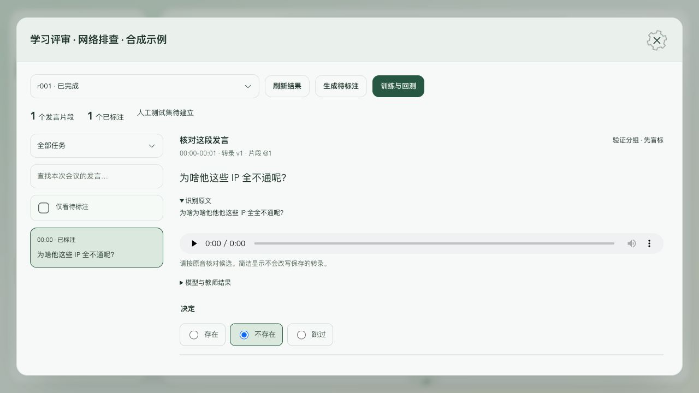

# Alpha 双任务学习与标注

Alpha 13 已在源码中接入会后待标注、人工确认训练和回测流程；现有旁路实验服务也可继续使用。会议转录、纪要和行动保持原写入流程。当前运行的旧 Alpha 未被替换，安装新包后才启用会后自动任务。

## Alpha 13 中的入口

录音结束后，等待转录排空，再打开会议详情的“学习评审”。准备任务与音频/纪要分别运行，状态持久化并随记录更新；Alpha 集成准备不另存片段 WAV，核听读取仍在留存期的原音；旧版本结果通过 generation、转录版本、片段引用和输入哈希隔离。失败会保留状态并有限重试，重启后撤销旧租约，使用新轮次目录恢复。

同一发言只列一张卡，将五类意图和转录候选集中标注。简洁显示会把“为啥为啥他他他这些 IP 全全不通呢？”显示为“为啥他这些 IP 全不通呢？”，可展开原始识别文字。数字、IP、否定、强调和正常叠词保留；不同时间/来源的真实发言不按文字直接删除。原始转录和模型训练输入不做这层显示简化。

保存标注后打开“训练与回测”，核对计划并勾选确认。训练使用当前账户已确认且版本有效的标签，**Alpha 和评审页面不使用教师弱标签训练**。ASR 标签必须关联音频哈希并确认核听，两类任务都需有训练分组标签；dev/test 保持会议隔离，只做评测。源记录过期、删除或标注变化会使待执行确认失效，需要重新核对计划。正在编辑但未保存时，训练与轮次切换禁用。

训练完成后保留 `t-rNNN` 新轮次，刷新并选择它继续核对。核听补入的文字生成新候选和新样本身份，带着原反馈引用进入后续训练；旧标注只在输入身份相同时继承。后续 LoRA 只继承权重，不恢复优化器状态，也不自动切换主系统模型。

需要核听的会议须开启原音留存。未留存或已清理的原音不因学习任务延期删除；这类候选仍可查看、暂存或跳过，但不能标记为首次核听 gold。学习准备仅沿用已有 ASR/LLM 供应商和现有私有 wgs，不新增第三方。Alpha 本机需已有可用的 `wgs` SSH 配置；连接检查先于供应商补处理，失败不会伪造结果。

原生界面使用 React 工作台组件，保持原生 CSP 的 iframe 禁用策略。当前只支持 Alpha 的本机 SQLite 学习接入；Postgres/S3、跨设备学习部署和真实质量仍需单独验证。单场最多采样 1000 个意图片段，每轮旁路预测最多 10000 个问题；超出原生预算的问题保留标注并排除本轮训练。

## 旁路评审页面

本轮运行地址：[本地学习评审](http://127.0.0.1:55344)。页面可选择 r001、r002、r003；每轮 468 个问题已合并为 104 个独立发言片段，支持会议筛选和按时间排列。

服务停止后，从项目根目录启动：

```bash
node scripts/alpha-learning/review-server.mjs .data/alpha-learning
```

控制台输出回环地址，`.data/alpha-learning/review-server-state.json` 记录本轮进程与地址。可添加第三个参数指定端口。停止时只终止该进程，不要停止录音/API/worker。服务不对公网开放，写入校验同源与随机令牌。

## 核听、标注，再训练

1. 选择意图或转录候选样本。当前转录只是待核对材料，不是原话真值。
2. 有原音时播放核听。意图选择存在、不存在或跳过；转录选择候选，均不正确时填写正确文字。无法确定时跳过。
3. 填写标注者，仅在实际核听后勾选核听确认，保存并继续。标注独立保存，可导出 JSONL；不会写回会议内容。
4. 在对应轮次点击“生成下一轮”。仅使用已保存人工标签，默认继承选中轮次适配器并训练 100 步，保留分组；结束后点击“刷新轮次”，选择新轮次，继续核对。

验证和测试样本先盲标，再展示训练前、本轮模型及教师弱标。修改已看过预测的标签时，不再把该修订当独立金标准。模型概率未经校准，不能直接作为外发行动授权。

下一轮默认继承冻结的转录候选、有效人工反馈及教师弱标。正确文字会加入新的候选，产生新样本 ID，并保留原反馈身份；选择跳过始终排除该条训练标签。同一个输入哈希才能复用标签。超过四个候选或超过原生预算时会明确拒绝，需要重新整理该候选集。

训练和回测按会议隔离：train 用于训练，dev/test 人工 gold 用于评测，silver 的独立分组只统计弱教师一致率。人工 ASR gold 必须关联原音哈希且确认核听。训练与测试不能共享完全相同的请求。

## 已完成的实际运行

| 项目         | 当前证据                                                     |
| ------------ | ------------------------------------------------------------ |
| 数据快照     | 10 个有效记录、1140 个转录片段；快照时 3 个仍在录音          |
| 当前问题样本 | 445 条意图 + 23 条转录候选；按每个会议最多 12 个意图片段采样 |
| 分组         | 9 个非空会议：train 5 / dev 3 / test 1                       |
| 原音再识别   | 23 段成功；12 段得到不同的第二候选                           |
| 教师弱标     | 意图 48 条、转录候选 12 条                                   |
| 首轮训练     | 24 条意图 + 6 条转录候选弱标；各更新 50 步                   |
| 首轮损失     | 0.7042 → 0.0965；只代表对训练标签的拟合                      |
| 后续验证     | r002 继承后各更新 2 步；r003 冻结脚本后各更新 1 步           |
| 回测与重载   | 三轮均完成 468 条预测、保存及新进程适配器重载                |
| 人工质量     | 目前真实人工标注为 0，未建立 gold 测试集                     |

468 条是本轮选取的决策问题数；并非全部 1140 个片段都已训练。30 条独立弱标回测只度量教师一致性，不是识别准确率。r002、r003 用于验证继承与冻结脚本，不是人工反馈优化轮次。

NeoHorse 训练的是**文本意图和候选选择**。它不能直接听音，不能从文字通顺程度证明真实原话，也没有训练 ASR 声学模型。已有 ASR 输出和教师预测均是弱标签。安装版历史记录已清理的原音无法恢复；原音不可用的 ASR 标签不会进入音频 gold 评测。

## 命令行与刷新数据

已有轮次上继续训练：

```bash
node scripts/alpha-learning/run.mjs \
  --workspace .data/alpha-learning --parent r003 --round r004 \
  --steps 100
```

只有实验 CLI 显式 `--accept-silver` 才允许弱标签进入训练；Alpha 与评审页面不传这个参数，并要求有效人工标签和计划确认。联合训练 CLI 支持 2–2000 步，默认 100 步；两类任务没有都具备训练数据时跳过训练，仍生成旁路预测和可标注结果。

补入正在增长的 Alpha 数据，用全新轮次加 `--refresh`。它重新拍快照、调用现有供应商补候选及弱标；旧轮次保留。刷新不自动继承旧人工标注，因为转录/候选/音频身份可能变化，需要重新审核。默认继续轮次使用冻结输入，不会自动追加新片段。Alpha 的会后任务使用所属记录的实际数据根，不自动合并开发目录或迁移其他账户数据。

默认读取已安装 Alpha 与项目开发 Alpha 的数据根。数据可用性、记录代次和删除/过期状态在复用前核对；源库只读连接不做迁移。wgs 默认路径为 `/home/westwell/ai-labs/neohorse-jev-4b`，使用已有 SSH 别名和环境。不会替换原模型或历史适配器。并发 GPU 任务通过 flock 拒绝，失败轮次保留日志，重试须使用新轮次编号。

## 数据和证据位置

- `.data/alpha-learning/intake-20261013/`：本地快照、来源映射及清单；映射不上传。
- `.data/alpha-learning/asr-20261013/`：候选、精确片段 WAV 和供应商调用统计。
- `.data/alpha-learning/rounds/rNNN/`：标注包、独立人工 reviews、审计、评分、检查点报告和失败日志。
- wgs 的 `learning/alpha-20261013-rNNN/`：数据、预测及实际 LoRA 权重；r003 起含冻结 runtime 和文件哈希。
- 仓库[验证统计](../evidence/alpha-learning/validation-2026-10-13.json)：只含计数、指标和哈希，没有会议原文、音频、账号或凭据。

真实学习材料在 gitignored `.data`，文件/目录分别使用 0600/0700，不纳入 Git 或项目记忆。NeoHorse 只收到文本请求与标签；原音只由本地核听服务和已授权的现有 ASR 供应商处理。缓存原音校验 PCM 哈希，源记录删除、过期或代次变化后拒绝服务。历史学习副本和适配器不自动清除；删除源记录不等于消除已训练参数的影响。

验证：40 项 Python 检查、5 项新增 Node 回归、258 项 Node 全量回归、ESLint 和 Python 编译通过。合成数据完成浏览器保存/纠错、小屏无横向溢出验证；真实 r003 页面确认 468 条、0 条人工标注和原音 WAV 读取。主产品部署、人工质量和 ASR 声学训练未包含在这些证据中。


见 [ADR 0015](../adr/0015-alpha-dual-task-learning.md)。

## Alpha 13 本轮验证

真实已结束 Alpha 记录只读准备：256 个片段生成 1280 个意图问题和 256 个 ASR 候选问题，按 256 个发言归组；未执行训练，也未写入真实人工标注。该记录原音已清理，候选没有核听真值。

隔离的合成契约夹具通过真实 wgs 桥接：准备阶段禁止训练；确认后的纯人工标签格式连续两轮训练，每轮 ASR/意图各更新 1 步，第二轮含新文字候选、适配器继承及新进程重载，弱标签开关均关闭。夹具用于机制验证，不是人工核听或真实质量证据。

279 项 Node 全量回归、40 项 Python 检查、ESLint、类型检查和 Web 构建通过。浏览器已验证原生组件入口、浅色/深色桌面显示、集中保存、未保存禁止训练和独立页面会议筛选。统计见[集成验证证据](../evidence/alpha-learning/integration-2026-10-13.json)。本轮窄屏尺寸控制未生效，未计作新界面的窄屏验证。安装包验证与发布状态见后续交付证据；不能由这些本地检查推断旧客户端已更新。


