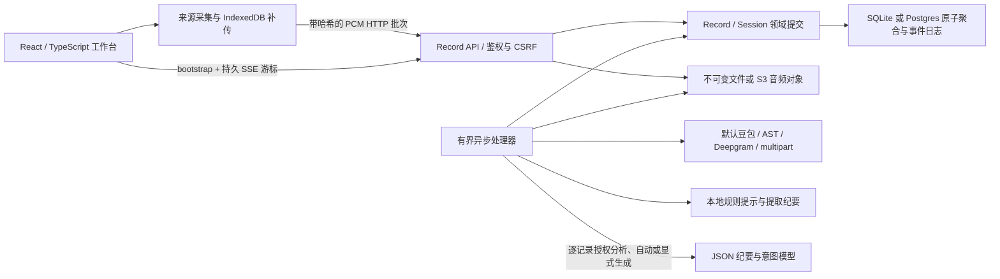

# v0.1.5 豆包音频纪要发布准备（2026-10-22）

本轮豆包音频纪要已纳入 v0.1.5 发布准备，见[安装说明](../releases/v0.1.5-preview.md)。原有验证边界保留，构建与发布完成后补记回执。

# 播放器 A 版增量（2026-10-22）

## 2026-10-22 豆包音频纪要本地增量

已在本地实现可选 `doubao-audio` 模式（`f189cf7`），通过 Responses 原生音频输入，保留并行转录版本引用、ASR＋LLM 和 OpenAI Realtime。真实合成语音探针及真实纪要模型工作流通过；工作流 ASR 为 fixture，真实设备长录音与安装包为 NOT_VERIFIED。见[配置说明](doubao-audio.md)和[测试证据](../evidence/doubao-audio-2026-10-22.md)。

已按用户选择实现 A 版完整单行控制；新增跳转、拖动与倍速。正式 Developer ID 签名与 Apple 公证仍受账号缺失阻塞。见[安装说明](../releases/v0.1.4-preview.md)、[安全提示](../releases/macos-trust.md)和[本地验证](../evidence/playback-a-trust-2026-10-22.md)。远端发布以 Actions 与发布回执为准。

# v0.1.2 长会议与恢复已发布（2026-10-22）

本轮已将两小时限制移除、单路音源故障隔离及 C 版界面纳入同一测试安装包，发布使用后台 GitHub Actions。见[安装说明](../releases/v0.1.2-preview.md)与[修复验证](../evidence/recording-unlimited-recovery-2026-10-22.md)。下文“仅本地/尚未发布”描述保留其历史时点；本轮已由 tag push 自动触发后台 Actions，三个任务成功，五附件完整下载及摘要相符，见[发布回执](../evidence/preview-v0.1.2-2026-10-22.md)。

## Realtime 与长会议源码增量（2026-10-22）

已增加可选 `openai-realtime` 纪要输入模式，原音独立进入会话，ASR 并行留证，正式纪要保留冻结片段版本引用与人工保护。默认仍为旧链路。已去除两小时累计音频和文件导入时长检查，保留容量与任务预算保护。363 项 Node 回归（含 16 项新用例）、ESLint、类型检查与 Web 构建通过，隔离浏览器配置与授权流程通过。三小时仅验证合成双音轨元数据，真实模型和实体长录制未验；未打包或发布。见[说明](openai-realtime.md)与[证据](../evidence/openai-realtime-2026-10-22.md)。本段替代下文历史描述中的两小时上限。

# C 版录音区与队列源码增量（2026-10-22）

用户确认 C「一体会议头部」后，已实现气泡反馈、同排录音状态/音源/操作、图标工具栏与齿轮整理设置；调整块间距，并修复慢音源阻塞快音源后续上传的问题。347 项 Node、ESLint、类型检查、Web 构建及隔离浏览器检查通过；两路延迟上传仍可收尾并完成尾段确认。合成 ACK 基准中快路完成中位 388→42 ms，真实 ASR 端到端速度待实测。见[本轮证据](../evidence/compact-recording-c-2026-10-22.md)。本轮未推送或发布，当前公开 v0.1.1 不含这些增量。

# v0.1.1 公开测试版增量（2026-10-22）

四项修复已随 [v0.1.1](https://github.com/RoyalLiang/LingJi-Meeting-Studio/releases/tag/v0.1.1) 发布；源码与工作流 `6e719c7`，bundle `0.1.23`。[Actions run 39722736145](https://github.com/RoyalLiang/LingJi-Meeting-Studio/actions/runs/39722736145) 由 tag push 后台触发，verify/build/publish 全部成功。五个公开附件已完整下载并核对字节与 SHA-256，包内独立后端及隔离启动/重启检查通过，详见[发布证据](../evidence/preview-v0.1.1-2026-10-22.md)。

本地 340 项 Node 回归及静态检查通过；云端相同源码检查通过。测试包 ad-hoc 签名、未公证，未替换本机安装，也未验收真实设备/供应商、长会议或完整原生冷启动。安装前退出旧版并备份数据。下方保留各阶段证据。

# 会议收尾与启动增量（2026-10-22）

源码 `9db4982` 修复收尾被后台上传/刷新阻塞、错误接入文案、列表乱序与过期响应覆盖；优化语音处理提示条及启动恢复/首屏并发。338 项回归、静态/类型检查、Web 构建和独立审查通过；隔离浏览器确认挂起上传时可结束且尾段可补齐，390px 与明暗提示条通过。100 场合成历史的无变化恢复写入从 100 次变为 0 次，后台就绪中位 60→27 ms；不是完整 App 冷启动测量。见[本轮证据](../evidence/meeting-lifecycle-startup-2026-10-22.md)。上述增量已纳入 v0.1.1；公开安装包与后台构建结果见[发布证据](../evidence/preview-v0.1.1-2026-10-22.md)。

# v0.1.0 公开测试版增量（2026-10-21）

v0.1.0 已由 [Actions run 39552320372](https://github.com/RoyalLiang/LingJi-MS/actions/runs/39552320372) 构建并发布 [GitHub pre-release](https://github.com/RoyalLiang/LingJi-MS/releases/tag/v0.1.0)。源码 ef9786c、工作流 cf61105，公开五附件字节与 SHA-256 已核对；云端 323 项 Node、21 项 Rust 及包内隔离启动/重启通过。完整边界见[首发证据](../evidence/first-public-preview-2026-10-21.md)。

本轮源码增加豆包端点语言参数修正、显式关闭顺滑改写、可选中英二遍场景背景，以及离线 CER/WER 配对评估。新增 macOS Preview 打包配置，正式签名工作流不变。准确率尚无本轮人工金标准验证；打包与发布事实以 [v0.1.0 安装说明](../releases/v0.1.0-preview.md)及发布页为准。标注方案见[识别质量](asr-quality.md)。下方历史记录不代表本版额外完成了真实供应商或实体设备验收。

# 当前运行路径与证据

## 2026-10-21 会议收尾与导出（源码验证）

已按用户确认的 A 版移除播放右上方悬浮重置，并将导出入口放在播放旁。收尾等待在途上传与尾包，媒体加载失败可重试；完整保存的封存音轨仍可在 ASR 排空前播放。导出支持带冻结原文引用的 Markdown 纪要和逐音源 WAV，中文文件名和原生下载反馈已接入。

自动会议名会在已校验的会中纪要生成后同步，人工名称受保护。agent 的文字上下文扩展为新内容之前两分钟，标记旧事实并按议题组织分段；字节预算、版本引用与人工保护继续生效。刷新间隔不变，尚未实现纪要 agent 直接听音频。

316 项回归、ESLint、类型与构建通过；隔离浏览器验证 ASR 待处理时双路播放、导出及桌面/手机明暗布局。真实会议质量、实体采音、新版原生打包与安装尚未验证。详细范围和证据见[本轮验证](../evidence/meeting-exports-2026-10-21.md)。

核查日期：2026-10-12。本页描述当前代码及本地验证；[改造前快照](prototype-baseline-2026-10-11.md)保留历史事实。音频采集链路的供应商验证以合成语音为主；经用户授权的 Alpha 学习另使用现有会议文本，尚无人工质量金标准。

## P0/P1 本地实现增量（2026-10-13）

按用户指令已实施 EP-01～04：有界 opt-in 诊断、同事务事件/Record 列表投影与 Web 增量合并、IndexedDB v2 有界队列、按预算分窗和分层终稿。JSON 聚合仍为写入权威；新投影为可重建副本。原音频容量和 48 MiB 本地限额没有提高。

标准回归 140/140；全部 Records 回归 118 通过、1 项 Postgres 环境测试跳过。真实 Chrome 仅验证合成元数据的队列恢复；长纪要仅通过本地 HTTP 模型夹具。阶段功能、回退、微基准及环境缺口见 [P0/P1 验证记录](../evidence/client-brain-research/p0-p1-validation-2026-10-12.md)。P2～P5、真实会议质量和两小时双来源录制仍待后续验证。

## 会议音频来源修复（2026-10-13）

“快速记录”“开始聆记”默认并行接入麦克风和共享系统／会议音频；麦克风可独立关闭。某一路授权失败会明确报告，并保留已接入的另一路。首次共享仍需在浏览器中选择来源并开启声音共享。暂停会排空旧音源并保留当前浏览器共享流，继续时复用仍存活的音轨，以新 Source/epoch/session 记录；刷新页面、退出共享、离开记录或结束会议后需要重新授权。系统全局声音是否可用仍取决于设备与浏览器。

录音中可显式开启／关闭独立麦克风。关闭会停止该媒体轨道、释放音频上下文、丢弃未完成缓冲和尚未开始保存的包，系统音轨继续录制；重新开启创建新 Source/epoch。只录麦克风时关闭它会暂停本场会议。已保存音频仍可补传与转录，不会撤回历史内容。会议软件的静音状态不会传给网页；如手动开启聆记麦克风，仍须在聆记中关闭。

本轮 145 项 Node 回归、ESLint、类型检查和构建通过。隔离 Chromium 使用合成音轨经过真实 AudioWorklet、IndexedDB 和上传客户端，验证系统音轨持续上传、关闭麦克风后不再产生新上传、重新开启和共享拒绝；桌面、390px 手机及深浅主题已检查。未使用实体麦克风、真实腾讯会议／飞书、系统共享选择器或真实供应商，不能据此宣称实机授权和会议静音联动已验证。

`npm run dev` 启动 `apps/web` 的 Vite 首页、`services/records/src/server.mjs` 和 `services/records/src/worker.mjs`。主协议是同源 `/api/records`，API 默认 3030，Web 默认 3000。开发账户与配置方式见[运行手册](runbook.md)。

| 能力 | 当前实现 | 已有证据 |
| --- | --- | --- |
| 页面 | 固定居中的玻璃框架、内部滚动、浅/深主题、自定义选择器与播放器；主阅读区为智能纪要，含当前讨论、引用表格与图表；实时翻译按需打开次级面板 | 本轮虚构会议的桌面/手机隔离浏览器流程及七张截图审查；未新增真实浏览器音频采集证据 |
| 来源 | 默认会议录音并行接入麦克风和共享系统／会议音轨，麦克风可独立关闭；分别诊断信号；麦克风自动模式优先已识别实体设备，可指定设备；音频/文字导入 | 合成语音经过实际浏览器采集、AudioWorklet、上传、真实豆包与 SSE 显示；本轮合成音轨验证独立开关，实体设备矩阵未验 |
| 领域 | Record 长期容器；快速记录可空标题；暂停后新 Session 继续本场，结束后新建；Source/epoch/sequence/sampleOffset 定位音频 | 领域、乱序、重传及停止协议故障测试 |
| 持久化 | SQLite FULL/WAL；Postgres JSONB 行锁；音频 fsync 或 S3 条件写 | SQLite 重启恢复；PG 未集成；S3 仅 SDK 契约 fixture |
| 接收 | 先对象后元数据，哈希、乱序水位、缺片范围、冲突校验 | 持久 ACK、seal 后补传、冲突及 WAV Range 测试 |
| 事件 | 聚合内原子事件日志，最多 1000 条；SSE id/cursor、过期 reset | SSE 与权限测试；浏览器导入后转录自动出现 |
| ASR | 默认豆包 v3 二进制 WebSocket；兼容旧 AST、Deepgram、multipart；按来源保持顺序，两个来源可并行；最多 5 次尝试 | 豆包约 5.97 秒中文合成语音真实识别通过；本地协议 fixture 核对部分/最终响应；双来源并行测试 |
| 意图 | 本地保守规则；逐记录点击授权模型分析；决定、行动候选、提议、问题、否定/撤回及片段版本引用 | 浏览器合成样本提取决定和行动候选；版本与旧结果拒绝测试；真实模型调用未验 |
| 纪要 | 明确区分本地提取与 AI 总结；Chat/Responses JSON 与 SSE；自动会中草稿/终稿、连续主题树、当前讨论、行级引用表格；条目分布与引用覆盖图；快照/哈希、引用校验、租约/fence、并发编辑保护 | 本轮结构校验、来源定位、人工修订保护及浏览器 fixture 通过；真实模型质量未验 |
| 翻译 | 用户点击开启本场已有及后续确认原文的逐段翻译；默认英文，可选中/日/西/法/德；专用豆包 Responses 模型与配置；目标修订和 fence 隔离旧请求 | 本地请求契约、切换/暂停竞态与浏览器 fixture 通过；真实豆包连接及译文准确率未验 |
| 配置 | 设置页修改地址、协议、资源、模型、密钥；旧变量别名兼容；配置热读取；密钥仅返回布尔状态 | 0600 文件、空值保留、显式清空、CSRF、管理员限制和地址原值往返测试 |
| 版本与隐私 | 最近 10 个纪要历史版本、20 个片段编辑版本；签名 cookie、Origin/CSRF、TTL、墓碑清理、范围分享 | 历史、隔离、TTL、删除 fencing、分享撤销测试 |
| 扩展 | 手工说话人、全文搜索、三模板、ICS/工单候选导出、原音回放 | 静态及协议检查；浏览器播放器播放结束无错误 |

旧 gateway / transcript-api / ai-worker 保留兼容原型；旧 AI worker 仍是占位，当前链路由 records worker 处理。Go 未成为主链。新链路通过独立适配器接入旧 AST 协议，未复用旧网关会话。

## 当前环境边界

- 模型地址按保存值请求。本轮排查确认此前配置的站点根地址返回 HTTP 200 HTML，导致 `invalid_llm_response`；已将本机配置修正为核对过的完整 Responses 接口，真实虚构文本 JSON 连接测试成功。另复现流式超时被误报为无效 JSON，终稿时限改为 4 分钟、租约 5 分钟；一场已启用自动纪要的失败会议已重新整理为 v1，141 段引用快照通过校验并保存，真实耗时约 139 秒，转录版本未改变。HTTPS 握手仍失败，当前连接沿用用户配置的 HTTP 服务。此证据证明该次整理闭环恢复，不证明摘要语义质量、意图或译文质量。
- 约 6 秒合成语音的识别成功不能证明真实会议、跨片段语义、60 分钟会话、CER 或延迟指标。当前默认两秒短批次，各批次独立识别，跨批次上下文仍是评测重点。
- 意图仅覆盖最近 120 个片段。引用校验只能证明引用版本存在，不能证明语义判断正确；候选不会自动执行或外发。
- 浏览器 API 可用不能证明所选共享来源带有声音。物理麦克风、拔插、权限拒绝、休眠恢复和 Windows/macOS 浏览器矩阵仍未验；自动模式在已知系统默认输入为虚拟设备且存在已识别实体麦克风时改用实体输入，无法识别时跟随系统默认。
- 账户是邮箱标识的本地密码账户；没有邮箱验证、找回密码、OIDC、组织席位或团队权限。开发账户只在开发模式创建，生产模式不提供开发入口。
- IndexedDB 上限 48 MB，满时明确停止并提示；不能跨设备补传。文件全量解码，上限 64 MB、两小时，长压缩音频仍受设备内存限制。
- 默认临时原音在转录完成后清理；失败片段最长保留 24 小时。离线浏览器数据需用户导出或清理；服务器不能远程擦除离线设备。
- 当前仍有一条历史失败音频记录，首片段已达到重试上限，后续片段按顺序阻塞。本轮保留原数据，未自动重试未知会议音频。
- 聚合日志与本地用量是首版工程选择，不是完整事件溯源、大规模容量证明或供应商账单。真实 PG/S3、部署和试点尚未验收；用户已提供 GitHub 发版仓库 RoyalLiang/lingji，没有执行远程工单或自动外发。

## 2026-10-12 增量实现

已加入 Chat Completions/Responses 双协议与供应商 SSE；按记录启用会中自动草稿、停止排空后终稿；流式预览、主题背景、主题树与引用片段时长。ASR、纪要、意图和翻译独立轮询。新开发启动默认包含 `--host 0.0.0.0`，API 保持 loopback 并由 Vite 代理。旧记录不会默认启用自动纪要。

这些能力已通过本地回归和隔离浏览器联调；真实 HTTP 模型、物理多人会议质量和完整音频到纪要延迟分位数尚未验证。详见[增量纪要说明](live-minutes.md)。

## 2026-10-12 说话人增量

默认豆包中英文来源级持续识别、确认分句持久化、匿名编号复用、最多 10 人、重连原音锚定与待确认处理已实现；22.47 秒双人合成 A-B-A 的 12 块音频经真实 WSS 得到“1→2→1”并完成 SQLite 排空。其他语言及供应商仍走原短批次路径。主题分区合为连续容器，纪要设置收拢，平板面板避免切断正文。详见[连续性说明](speaker-continuity.md)及[验收](acceptance.md)。

2026-10-12 补充：说话人 SHA-256 会内身份已持久化并带到分句，真实豆包虚构 A-B-A 音频在中途丢失连接所有权后重新识别，仍得到两名说话人及 1→2→1，全部 12 块完成排空。一遍实时结果作为独立草稿经 SSE 显示；浏览器首包 400 毫秒，后续 1 秒。逐字动画只用于实时草稿追加，纠错和历史确认稿直接显示。575 毫秒是供应商首次文本耗时，不是浏览器麦克风端到端指标。

2026-10-12 SSE 修复：前端受控重建事件流，不再假设 HTTP 502 后浏览器原生 EventSource 会自动恢复；每次重试先读取最新快照，取消过期回调与重复连接。页头显示实际订阅状态。单次 502 的隔离浏览器恢复及后续事件刷新已验收。

## 2026-10-12 音源与纪要视图

默认录音提供麦克风与共享音频的双来源流程，持续静音会按来源提示；音频包不再显示为待识别语音段落。首次静音来源不抢占说话人起始编号。纪要提供主题树、发言人总结、关键决策与正文视图，保留流式草稿、冻结引用与人工编辑保护。当前纪要已进入主阅读区；次级面板用于实时翻译，窄屏独立打开。

83 项回归与静态、构建、文档检查通过。实体设备和远程 HTTP 模型的新纪要输出仍未验收；证据细分见[音源检测与智能纪要](capture-and-minutes.md)。

## 2026-10-12 工作台反馈修复

设置保存改为局部刷新与可见 toast；新模型地址默认 Responses，保留已明确保存的 Chat 配置；在线会议入口明确要求分享系统音频；会中阅读自动跟随，历史阅读可暂停；备份检查响应后下载，失败直接显示错误。87 项回归与静态、构建、文档检查通过。浏览器使用合成音轨与虚构会议验收，实际下载 JSON 已解析；本轮未调用外部供应商。详见[工作台交互反馈](workbench-feedback.md)。

## 会议入口与主题树增量

「开始聆记」从用户点击独立请求麦克风和共享音频，缺少来源时弹窗引导；补接不会重复创建已接入来源。纪要主题树采用连续主线、紧凑标题和右移内容块。详见 [实现与隔离浏览器验收](meeting-entry-and-brand.md)。真实设备和在线会议能力仍需单独验证。

## 2026-10-12 设置稳定性与转录术语

模型地址按填写的完整接口保存和请求，不再补全路径或随协议变化替换后缀。设置弹窗只由关闭按钮关闭；保存保持表单节点、按钮尺寸与透明度、焦点和滚动位置稳定。同步翻译立即显示选择值，失败回退并提示，不触发工作台全局 busy。

豆包短批次补充二遍识别，与持续识别共用术语配置；设置中的正确术语写法通过官方 corpus.context.hotwords 传入下一次连接，不替换已有转录。112 项当前工作区回归及隔离浏览器的慢请求、失败、手机浅深主题检查通过。真实会议 CER 改善尚未测量，详见[本轮验收](settings-quality.md)。

## 2026-10-12 工作目录增量

已新增工作目录创建、改名、单条/原子批量归档及未归档兼容。首页统计会议时长（并行音轨不重复计时）、纪要覆盖、近 30 天节奏、主题名称分布、已有历史摘要、决策与行动候选。按需跨会议模型分析支持增量草稿、取消、会议版本引用校验和范围变化后的旧结果隐藏。搜索保留单层焦点环，右边缘可回到顶部并暂停自动跟随；系统使用已选“声音成章”标识。

本轮新增 8 项本地回归与隔离浏览器验收，仅使用虚构会议和本地 SSE 模型。真实远程模型质量、PG 并发和长期历史性能尚未验证；不改动 VPN 转录问题。实现与口径见 [工作目录说明](workspaces.md)。

## 2026-10-12 智能纪要主阅读区与实时翻译

默认主区显示智能纪要，连续主题树下呈现可查原文的总结表格，“当前正在聊”固定在主容器底部，等待 agent 时显示轻量动效，收到模型快记后展示；不把逐字原文或识别草稿当作总结。表格与图表视图统计本版纪要条目和引用覆盖，不代表模型准确率。会中更新自动跟随；向上阅读、编辑和查看引用会暂停，可点击“回到最新纪要”恢复。既有未启用 AI 的记录仍需主动开启；确认原文、引用修订和人工纪要保护保留。

原纪要按钮改为实时翻译入口，默认英文；关闭面板继续翻译，点击暂停才停止。翻译使用独立的 `doubao-seed-translation-250915` Responses 请求，地址按原值使用，专用配置与密钥回退规则见[运行手册](runbook.md)。原文和原音继续按既有留存规则保存。

当前工作区 119 项回归、ESLint、Web 类型检查与构建通过；界面使用虚构会议和本地模型 fixture 验收。真实豆包翻译连接、纪要/译文准确率、长会话及本轮真实浏览器采集尚无新增证据。原逐字记录版本保存在本地 annotated tag `transcript-v1-frozen-20261012`（`2846797439a7fc67960181df0be640e479f9f8c0`，未推送）。实现与使用边界见[智能纪要说明](intelligent-minutes.md)。

## 2026-10-12 搜索、底部总结与目录控件

搜索移至右侧顶部中央宽框，仍按当前目录过滤会议与内容。修复提前准备会议的负边距重叠；工作目录与归档菜单对齐触发框宽度、文字边缘及间距，长名称最多两行，手机工作目录选择框可正确伸缩。归档目标与按钮分开布局，手机操作按钮等宽。

当前可以直接点击录音说话；后台先由 ASR 保存确认转录，再把文字快照交给 agent，尚未实现纪要 agent 直接消费原始音频。底部总结独立滚动并保留手动阅读暂停，尊重减少动态偏好。119 项本地回归、类型、构建和浏览器布局/原有交互检查通过；本轮未增加真实供应商或音频硬件采集验证。

## 2026-10-13 实时记录稳定性修复

浏览器默认双音源；暂停保留共享流，AudioWorklet 停止输入后排空尾包，继续生成新的音源身份。暂停期间不写入音频，但浏览器共享提示和已授权音轨仍保留；结束或离开记录会释放。

主阅读区不再因原始转录版本或底部流式预览变化强制滚动。人工阅读暂停会跨任务切换保留。顶部搜索两侧使用固定宽度轨道，同步状态变化不再改变输入框位置或宽度；900 px 以下搜索独占一行。当前讨论固定三行，生成下一轮前保留已有要点；移除了通用 AI 警示块，保留引用和版本冲突提示。独立转录组件保留片段 DOM 身份，识别纠正直接显示；该组件当前未挂载在默认纪要主区。

完整输入在字节预算内时只调用一次模型，不再固定每 24 段拆分；超过预算仍使用分层汇总、缓存、引用校验和人工版本保护。最终汇总可输出流式预览。80 段短转录回归从 5 次调用降到 1 次，这不是远程供应商耗时承诺。

验证结果和边界见[实时记录修复验收](../evidence/recording-stability-2026-10-13.md)。本轮没有重启已有服务、修改真实会议内容或调用远程模型。

## 原生客户端安全更新（2026-10-13）

Tauri 客户端新增签名更新检查、可选下载、会议结束并补传完成后的手动重启安装；安装前同时核对全量 IDB 队列、Rust 采集/安装互斥和后端停止/ACK。GitHub 签名标签工作流提供四目标构建、draft 汇总和单独发布。均为本地实现，未执行远程发布；已有 Alpha 需要手动建立可信更新基线。见[更新说明](client-updates.md)、[发版步骤](../releases/github-client.md)和[验证证据](../evidence/client-brain-research/client-updater-validation-2026-10-13.md)。

## 独立客户端后台与本机存储（2026-10-13）

Apple Silicon Alpha 5 的本地实现内置 Node 24.21.0、SQLite 3.53.4、Record API 与 worker，使用独立本机账户、供应商配置和数据目录，不依赖 Web 开发后台。SQLite 保留 WAL/FULL 与事务投影，大段 JSON 及音频按收益使用带校验的无损压缩；原始对象兼容读取，48 MiB IndexedDB 待传缓冲继续保留。旧 Web/Alpha 的会议和队列保留，不自动迁移。

实现、运行与权限边界见[客户端说明](native-client.md)，安装步骤见[Alpha 5](../releases/macos-alpha.md)，取舍见 [proposed ADR 0013](../adr/0013-standalone-client-storage.md)。本地合成基准和包验证不能证明真实语音压缩率、云端转录/纪要总耗时或全新 Mac 首次授权；本轮具体测试结果以产物验证记录为准。

## 客户端界面细节（2026-10-13）

Alpha 8 改用小尺寸清晰 SVG 标识，共享弹窗与侧栏关闭按钮增加齿轮旋转反馈，选择框统一展开、收起及选中效果，尊重减少动态效果偏好。185 项回归及隔离 Chromium 交互检查通过；当前 WebKit 运行环境不匹配，原生动效尚未验证。见[验收记录](../evidence/client-ui-polish-2026-10-13.md)。

## 原生动效与纪要延迟修订（2026-10-13）

Alpha 9 放大并自动旋转关闭齿轮，普通反馈改自动 toast；修复系统 WKWebView 的选择框鼠标焦点及无 overlay 退出闪影。新模型表格必须明确归属主题，历史纪要不自动重写；前端引用/图表改索引、按需展开来源。后台独立窗口限并发、会中窗口按完整转录位置锚定以复用缓存，保留人工与引用版本保护。212 项本地回归及 Chromium 验收通过，真实供应商延迟/限流尚未验证，详见[本轮验收](../evidence/native-ui-minutes-2026-10-13.md)。

## Alpha 10 原音与更新控件修订（2026-10-13）

新会议录制前可显式选择“保留原音供回放”，默认关闭并记住本机偏好，快速记录与准备表单一致；已清理历史原音无法恢复，入口提前显示不可用原因。更新策略使用三档下拉，macOS 菜单栏提供检查、后台下载开关、手动重启；旧自动安装偏好关闭，全部信任/录音/补传门禁保留。关闭按钮默认与悬停透明，填写表单与静态弹窗各自明确初始焦点；整理失败提示继续保留但不可选中文字。摘要合并使用独立最高96KB输入预算，完整保留主题表格引用，超过硬上限有限失败。验收边界与本地发行记录见[Alpha 10 证据](../evidence/client-controls-alpha10-2026-10-13.md)。

## Alpha 11 会议收尾与阅读修订（2026-10-13）

新录音默认保存原音，去掉选择框与重复说明；会后主区显示智能纪要，旧会中失败隔离。未命名记录在转录排空后提取关键词，AI终稿可优化自动名，人工标题受保护。终稿暂时性错误按实际失败时间有限重试，手动成功停止，新手动失败开启独立重试链。

来源弹窗显示精确冻结版本上下文。分享可用草稿，本机导出独立HTML，远端保留到期/撤销；字段白名单与最小引用披露。Mac下载回调已补齐，隔离Tauri应用实际落盘通过。首次系统授权保留，重复的自有音源确认框移除；补齐原生新会议默认开启麦克风，继续只恢复此前成功音源。追加的弹窗已统一字段对齐、间距与单边界，纪要底部按供应商回传显示真实计量，ASR仅音轨时长；最终验收结果见[Alpha11验收](../evidence/client-meeting-alpha11-2026-10-13.md)。

## Alpha 13 学习评审接入（2026-10-13）

已实现会后待标注队列与 Alpha 原生评审组件，按会议/发言归组并提供原文对照。学习准备独立于录音，只有转录排空后开始；人工保存、计划确认后才训练，接口校验 owner、CSRF、来源版本和音频核听条件。训练结果保留新轮次，暂不改写主转录或自动启用模型。

本地 Node279/Python40、浏览器合成流程、真实 wgs 合成继承与重载通过；另只读处理一场256片段现有Alpha记录，生成1536问题，未训练、未标记人工真值。运行中的旧Alpha未替换。使用与环境边界见[学习说明](alpha-learning.md)，Alpha 13 安装包与隔离原生冒烟通过，见[交付证据](../evidence/alpha-learning/alpha13-package-2026-10-13.md)。

## 长会议与连接恢复修复（2026-10-14）

当前源码的会中纪要改为累计已校验结果，新增转录结合短上下文与稳定项目主题生成；已校验窗口可先展示。SSE 背压等待排空，并保护关闭中的响应，修复心跳写入导致本机后台退出的路径。归档目标、断连读取、错误 toast 和处理区域间距已调整。源码与本地隔离验证通过，Alpha 17 已冻结打包并通过隔离原生启动与重启恢复，本轮未执行现有客户端覆盖安装，真实模型长会话、物理采音及新版 WebView 完整会议交互尚未验收，详见[本轮验收记录](../evidence/meeting-recovery-incremental-2026-10-14.md)。

## 原音回放与转录处理解耦（2026-10-14）

Alpha 18 允许封存且完整持久化的音轨在 ASR 尚未完成时回放，保留缺包、留存、清理、授权与到期限制。取消或跳转后不写旧音频响应，背压等待会清理监听器。261014 的双源 3,723 个音频对象已只读校验完整，没有改写原音或转录状态。290 项回归、包内 Node24 的 6 项回放检查、合成浏览器媒体和隔离原生启动恢复均通过；真实会议更新后的声音核听仍待验，见[回放修复证据](../evidence/recording-playback-261014-2026-10-14.md)。

## Alpha19 原音播放器合并与拖动修复（2026-10-14）

双音源共用一套原音控件，播放、暂停、重置与定位同时控制两路声音，时长取最长音轨。按住刻度拖动时仅更新预览，松开后每路定位一次；切换会议也会取消尚在加载的旧播放。标题区保留宽度，操作区按容器换行，避免挤压会议信息。295 项回归、类型检查、ESLint、Web 构建、31 分钟双源合成浏览器播放与 375/700px 布局检查通过。Alpha19 的包内 Node24 11 项播放检查和隔离原生保存恢复通过；真实会议核听、原生 WebView 拖动和实体触屏尚待验，见[本轮证据](../evidence/unified-recording-player-2026-10-14.md)。

## Alpha20 播放圆点与标题栏修订（2026-10-14）

进度点改为无边框、无阴影的单层实心圆，拖动时刻度区不再显示焦点外框；键盘定位通过刻度颜色和圆点大小提示焦点。长标题独立展示，元数据与操作按钮共享一行，按容器宽度收紧控件并自然换行。295 项回归、类型检查、ESLint、Web 构建及明暗主题、连续指针拖动、键盘定位和 375px 布局的隔离浏览器检查通过。Alpha20 包内 Node24 的 11 项回放检查、签名与架构检查、隔离原生保存恢复通过；原生 WebView 实际缩放与实体触屏尚待验，见[本轮证据](../evidence/recording-player-polish-2026-10-14.md)。

## 2026-10-15 录制与识别恢复（源码验证）

修复短暂识别连接失败 5 次后永久停留、识别失败被新音频状态掩盖，以及原生短停顿缓冲不足和意外 EOF 静默结束。原音改为固定播放／暂停按钮与悬浮重置，移除音频包说明。307 项 Node 回归、21 项原生测试、ESLint、类型检查与 Web 构建通过，隔离浏览器验证双路播放与固定布局。详见[核查记录](../evidence/capture-recognition-recovery-2026-10-15.md)。

历史约 30 分钟停止没有留下原因；没有发现固定 30 分钟结束计时器，不能将缓冲复现直接当作历史根因。实体长会议与真实 ASR／LLM 恢复尚未验证，未替换当前安装或重传真实会议。

Alpha21 安装包已生成并通过包内 49 项录制／识别恢复／播放检查、24 个源码哈希与 10 个后端文件核对、签名和隔离原生启动／重启恢复。版本为 `0.1.0-alpha.21`，冻结提交 `d2ead64deee67f6409710ad3c080aa06c8547403`。未安装到 Applications，未打开真实音频设备或调用供应商；边界见[包体证据](../evidence/client-meeting-alpha21.json)。
