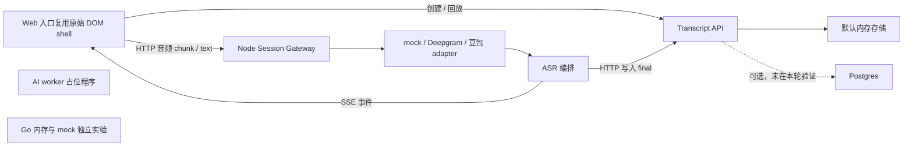

# 当前原型已经做到哪里

核查日期：2026-10-11。依据：当前工作区源码、CodeGraph 与本地测试。基准提交为 `522a854f64d6fd246c53fc9fb08b612051a4f834`，**工作区还有用户既有未提交实现**，本报告描述这些文件在场的状态，不等同于该提交内容。

用户本轮确认首版浏览器优先、尽量免安装。旧文档中的 Windows/桌面优先为历史方向；它们的技术迁移计划没有自动生效。

## 先看能运行的主链路

`apps/web/src/server.mjs` 的 `/` 实际提供 `apps/desktop/src/shell.html`，并复用 shell JS、CSS 与 overlay。`apps/web/src/client.js` 的旧调试界面仍在目录中，文件存在不代表它是当前首页启动路径。当前不是已经完成的 React/Next.js/Tauri 应用。

## 能力与证据边界

| 能力 | 当前事实 | 证据 |
| --- | --- | --- |
| Web/desktop preview | 原始 HTML/JS，支持会话、回放与采集界面；不是正式桌面安装包 | [Web 路由](../../apps/web/src/server.mjs)、[shell](../../apps/desktop/src/shell.js) |
| 麦克风采集 | shell 包含 getUserMedia、AudioWorklet PCM 采集与旧兼容路径 | [shell](../../apps/desktop/src/shell.js)，采集函数约 4747–5205 行 |
| 标签页/屏幕音频 | 本轮搜索未发现 getDisplayMedia 实现，需新增 | 同上及 `apps/web/src` |
| 实时传输 | 浏览器到自有网关是 HTTP chunk；网关到浏览器是 SSE；第三方 adapter 内部可使用 WebSocket | [网关](../../services/session-gateway/src/server.mjs)、[广播](../../services/session-gateway/src/components/broadcaster-component.mjs) |
| ASR | mock、Deepgram、豆包 adapter 存在；测试覆盖选择、缺凭证、fallback 等 | [provider factory](../../services/session-gateway/src/providers/index.mjs)、[测试](../../tests/provider-and-desktop-preview.test.mjs) |
| 翻译 | 有 provider 译文消费及 mock 翻译路径，不代表任意语言真实翻译可用 | [编排](../../services/session-gateway/src/components/asr-orchestrator-component.mjs)、[翻译](../../services/session-gateway/src/components/translation-component.mjs) |
| 领域模型 | Session、Transcript、Translation、AudioChunk、replay shaping 已抽到 `@tts/domain` | [领域包](../../packages/domain/src/index.mjs)、[测试](../../tests/domain-and-components.test.mjs) |
| 保存与回放 | memory/Postgres adapter 与 schema 存在；本轮只验证 memory 主链路 | [store](../../services/transcript-api/src/store.mjs)、[schema](../../services/transcript-api/sql/schema.sql) |
| 纪要 | 数据类型、读写存储接口存在；AI worker 仅打印占位日志 | [worker](../../services/ai-worker/src/worker.mjs)、[API 应用服务](../../services/transcript-api/src/application/services.mjs) |
| 分享 | token/bootstrap 路径存在，内存实现检查到期/撤销；不等于已完成公网权限与安全审查 | [分享服务](../../services/transcript-api/src/application/services.mjs)、[memory store](../../services/transcript-api/src/storage/memory-store.mjs) |
| Go 引擎 | 独立程序固定内存仓库+mock provider，默认 3010 与 Node 网关冲突 | [Go 入口](../../services/engine-go/cmd/server/main.go) |
| 工程门禁 | npm test 可运行；lint/typecheck 是 echo TODO | [根 package.json](../../package.json) |

## 不能从原型升级为产品承诺的缺口

1. **看见不等于保存。**编排若干路径在持久化前广播 final；API 写入失败时 UI 可能已显示“最终文本”。需要持久化提交与事件投递的一致性设计。
2. **重连不等于补齐。**广播器使用进程内订阅集合，只写 `data:`，没有持久 SSE `id`/重放游标。重新连接不能证明离线期间内容已补齐。
3. **音频 ACK 不等于持久音频。**AudioChunkStreamTracker 在内存记 sequence、bytes；重复或较小 sequence 返回 409。它没有实现持久幂等 ACK、缺口对账与崩溃恢复。
4. **时间轴不等于真实音频位置。**编排 nextTiming 按词数估算时长，不能作为精确点击回听依据。中文词数假设尤其需要替换为采样时间或可靠 provider 时间戳。
5. **停止不等于内容完整。**stopSession 先将业务状态改成 completed，再清理 provider 状态；adapter 有终结处理，但主生命周期没有可验证的音频/转录完成屏障。
6. **fallback 不等于恢复成功。**factory 支持回落 mock，这适合开发；面向用户时必须明确禁止静默制造模拟记录。
7. **有音频片段表不等于录音完整。**现有音频路径包括 provider 生成的音频片段；不能据此宣称原始会议录音已按保留策略完整归档。
8. **本地服务不等于安全公网服务。**当前绑定本机、通配 CORS 等原型约定，需要单独加入身份认证、workspace 隔离、限额、分享权限和日志脱敏。

这些是源码事实推导出的风险，未在本轮注入故障或真实录音重现。

## 本轮验证

- 初次 Node 测试被沙箱回环端口权限与缺失 `@tts/domain` 链接阻挡。仅恢复 `node_modules/@tts/domain -> ../../packages/domain` 本地 workspace 链接，没有改 manifest/lockfile。
- 允许本机测试监听后，`npm test`：**22 通过，0 失败**。覆盖内存链路、provider 配置行为、页面路由及领域/组件行为；不是音频质量或浏览器端交互验收。
- `services/engine-go` 中 `go test ./...` 通过；只有领域包包含测试，其余显示无测试文件。不能称作 Go 全链路已验证。
- 未运行 Postgres 集成、真实 ASR/LLM、物理麦克风/标签页采集、长时间录制、生产部署或公网安全验收。

测试输出保存在 gitignored `.agent-runtime/`，正式阅读时以本节和可重复命令为入口。
