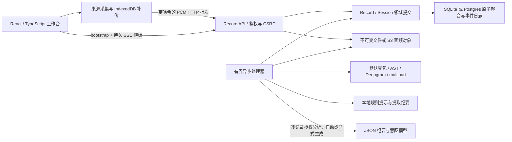

# 当前运行路径与证据

核查日期：2026-10-12。本页描述当前代码及本地验证；[改造前快照](prototype-baseline-2026-10-11.md)保留历史事实。真实供应商验证仅使用合成语音，未使用真实会议。

## P0/P1 本地实现增量（2026-10-13）

按用户指令已实施 EP-01～04：有界 opt-in 诊断、同事务事件/Record 列表投影与 Web 增量合并、IndexedDB v2 有界队列、按预算分窗和分层终稿。JSON 聚合仍为写入权威；新投影为可重建副本。原音频容量和 48 MiB 本地限额没有提高。

标准回归 140/140；全部 Records 回归 118 通过、1 项 Postgres 环境测试跳过。真实 Chrome 仅验证合成元数据的队列恢复；长纪要仅通过本地 HTTP 模型夹具。阶段功能、回退、微基准及环境缺口见 [P0/P1 验证记录](../evidence/client-brain-research/p0-p1-validation-2026-10-12.md)。P2～P5、真实会议质量和两小时双来源录制仍待后续验证。

## 会议音频来源修复（2026-10-13）

“快速记录”“开始聆记”和继续会议默认只申请共享的系统／会议音频，不额外打开麦克风；拒绝共享、没有音轨或浏览器不支持时也不自动回退到麦克风。共享请求优先展示屏幕来源并请求系统音频；用户仍需在浏览器中选择来源并开启声音共享。网页不能免除每次共享授权，详见 [W3C Screen Capture](https://www.w3.org/TR/screen-capture/)；`displaySurface` 仅为选择器偏好，见 [Chrome 官方说明](https://developer.chrome.com/docs/web-platform/screen-sharing-controls)。系统全局声音是否可用仍取决于设备与浏览器。

录音中可显式开启／关闭独立麦克风。关闭会停止该媒体轨道、释放音频上下文、丢弃未完成缓冲和尚未开始保存的包，系统音轨继续录制；重新开启创建新 Source/epoch。只录麦克风时关闭它会暂停本场会议。已保存音频仍可补传与转录，不会撤回历史内容。会议软件的静音状态不会传给网页；如手动开启聆记麦克风，仍须在聆记中关闭。

本轮 145 项 Node 回归、ESLint、类型检查和构建通过。隔离 Chromium 使用合成音轨经过真实 AudioWorklet、IndexedDB 和上传客户端，验证系统音轨持续上传、关闭麦克风后不再产生新上传、重新开启和共享拒绝；桌面、390px 手机及深浅主题已检查。未使用实体麦克风、真实腾讯会议／飞书、系统共享选择器或真实供应商，不能据此宣称实机授权和会议静音联动已验证。

`npm run dev` 启动 `apps/web` 的 Vite 首页、`services/records/src/server.mjs` 和 `services/records/src/worker.mjs`。主协议是同源 `/api/records`，API 默认 3030，Web 默认 3000。开发账户与配置方式见[运行手册](runbook.md)。

| 能力 | 当前实现 | 已有证据 |
| --- | --- | --- |
| 页面 | 固定居中的玻璃框架、内部滚动、浅/深主题、自定义选择器与播放器；主阅读区为智能纪要，含当前讨论、引用表格与图表；实时翻译按需打开次级面板 | 本轮虚构会议的桌面/手机隔离浏览器流程及七张截图审查；未新增真实浏览器音频采集证据 |
| 来源 | 默认会议录音仅采集共享系统／会议音轨，麦克风显式开启且可独立关闭；分别诊断信号；麦克风自动模式优先已识别实体设备，可指定设备；音频/文字导入 | 合成语音经过实际浏览器采集、AudioWorklet、上传、真实豆包与 SSE 显示；本轮合成音轨验证独立开关，实体设备矩阵未验 |
| 领域 | Record 长期容器；快速记录可空标题；暂停后新 Session 继续本场，结束后新建；Source/epoch/sequence/sampleOffset 定位音频 | 领域、乱序、重传及停止协议故障测试 |
| 持久化 | SQLite FULL/WAL；Postgres JSONB 行锁；音频 fsync 或 S3 条件写 | SQLite 重启恢复；PG 未集成；S3 仅 SDK 契约 fixture |
| 接收 | 先对象后元数据，哈希、乱序水位、缺片范围、冲突校验 | 持久 ACK、seal 后补传、冲突及 WAV Range 测试 |
| 事件 | 聚合内原子事件日志，最多 1000 条；SSE id/cursor、过期 reset | SSE 与权限测试；浏览器导入后转录自动出现 |
| ASR | 默认豆包 v3 二进制 WebSocket；兼容旧 AST、Deepgram、multipart；按来源保持顺序，两个来源可并行；最多 5 次尝试 | 豆包约 5.97 秒中文合成语音真实识别通过；本地协议 fixture 核对部分/最终响应；双来源并行测试 |
| 意图 | 本地保守规则；逐记录点击授权模型分析；决定、行动候选、提议、问题、否定/撤回及片段版本引用 | 浏览器合成样本提取决定和行动候选；版本与旧结果拒绝测试；真实模型调用未验 |
| 纪要 | 明确区分本地提取与 AI 总结；Chat/Responses JSON 与 SSE；自动会中草稿/终稿、连续主题树、当前讨论、行级引用表格；条目分布与引用覆盖图；快照/哈希、引用校验、租约/fence、并发编辑保护 | 本轮结构校验、来源定位、人工修订保护及浏览器 fixture 通过；真实模型质量未验 |
| 翻译 | 用户点击开启本场已有及后续确认原文的逐段翻译；默认英文，可选中/日/西/法/德；专用豆包 Responses 模型与配置；目标修订和 fence 隔离旧请求 | 本地请求契约、切换/暂停竞态与浏览器 fixture 通过；真实豆包连接及译文准确率未验 |
| 配置 | 设置页修改地址、协议、资源、模型、密钥；旧变量别名兼容；配置热读取；密钥仅返回布尔状态 | 0600 文件、空值保留、显式清空、CSRF、管理员限制和地址原值往返测试 |
| 版本与隐私 | 最近 10 个纪要历史版本、20 个片段编辑版本；签名 cookie、Origin/CSRF、TTL、墓碑清理、范围分享 | 历史、隔离、TTL、删除 fencing、分享撤销测试 |
| 扩展 | 手工说话人、全文搜索、三模板、ICS/工单候选导出、原音回放 | 静态及协议检查；浏览器播放器播放结束无错误 |

旧 gateway / transcript-api / ai-worker 保留兼容原型；旧 AI worker 仍是占位，当前链路由 records worker 处理。Go 未成为主链。新链路通过独立适配器接入旧 AST 协议，未复用旧网关会话。

## 当前环境边界

- 模型地址按保存值请求。本轮排查确认此前配置的站点根地址返回 HTTP 200 HTML，导致 `invalid_llm_response`；已将本机配置修正为核对过的完整 Responses 接口，真实虚构文本 JSON 连接测试成功。另复现流式超时被误报为无效 JSON，终稿时限改为 4 分钟、租约 5 分钟；一场已启用自动纪要的失败会议已重新整理为 v1，141 段引用快照通过校验并保存，真实耗时约 139 秒，转录版本未改变。HTTPS 握手仍失败，当前连接沿用用户配置的 HTTP 服务。此证据证明该次整理闭环恢复，不证明摘要语义质量、意图或译文质量。
- 约 6 秒合成语音的识别成功不能证明真实会议、跨片段语义、60 分钟会话、CER 或延迟指标。当前默认两秒短批次，各批次独立识别，跨批次上下文仍是评测重点。
- 意图仅覆盖最近 120 个片段。引用校验只能证明引用版本存在，不能证明语义判断正确；候选不会自动执行或外发。
- 浏览器 API 可用不能证明所选共享来源带有声音。物理麦克风、拔插、权限拒绝、休眠恢复和 Windows/macOS 浏览器矩阵仍未验；自动模式在已知系统默认输入为虚拟设备且存在已识别实体麦克风时改用实体输入，无法识别时跟随系统默认。
- 账户是邮箱标识的本地密码账户；没有邮箱验证、找回密码、OIDC、组织席位或团队权限。开发账户只在开发模式创建，生产模式不提供开发入口。
- IndexedDB 上限 48 MB，满时明确停止并提示；不能跨设备补传。文件全量解码，上限 64 MB、两小时，长压缩音频仍受设备内存限制。
- 默认临时原音在转录完成后清理；失败片段最长保留 24 小时。离线浏览器数据需用户导出或清理；服务器不能远程擦除离线设备。
- 当前仍有一条历史失败音频记录，首片段已达到重试上限，后续片段按顺序阻塞。本轮保留原数据，未自动重试未知会议音频。
- 聚合日志与本地用量是首版工程选择，不是完整事件溯源、大规模容量证明或供应商账单。真实 PG/S3、部署和试点尚未验收；GitHub 地址未提供，没有远程工单或自动外发。

## 2026-10-12 增量实现

已加入 Chat Completions/Responses 双协议与供应商 SSE；按记录启用会中自动草稿、停止排空后终稿；流式预览、主题背景、主题树与引用片段时长。ASR、纪要、意图和翻译独立轮询。新开发启动默认包含 `--host 0.0.0.0`，API 保持 loopback 并由 Vite 代理。旧记录不会默认启用自动纪要。

这些能力已通过本地回归和隔离浏览器联调；真实 HTTP 模型、物理多人会议质量和完整音频到纪要延迟分位数尚未验证。详见[增量纪要说明](live-minutes.md)。

## 2026-10-12 说话人增量

默认豆包中英文来源级持续识别、确认分句持久化、匿名编号复用、最多 10 人、重连原音锚定与待确认处理已实现；22.47 秒双人合成 A-B-A 的 12 块音频经真实 WSS 得到“1→2→1”并完成 SQLite 排空。其他语言及供应商仍走原短批次路径。主题分区合为连续容器，纪要设置收拢，平板面板避免切断正文。详见[连续性说明](speaker-continuity.md)及[验收](acceptance.md)。

2026-10-12 补充：说话人 SHA-256 会内身份已持久化并带到分句，真实豆包虚构 A-B-A 音频在中途丢失连接所有权后重新识别，仍得到两名说话人及 1→2→1，全部 12 块完成排空。一遍实时结果作为独立草稿经 SSE 显示；浏览器首包 400 毫秒，后续 1 秒。逐字动画只用于实时草稿追加，纠错和历史确认稿直接显示。575 毫秒是供应商首次文本耗时，不是浏览器麦克风端到端指标。

2026-10-12 SSE 修复：前端受控重建事件流，不再假设 HTTP 502 后浏览器原生 EventSource 会自动恢复；每次重试先读取最新快照，取消过期回调与重复连接。页头显示实际订阅状态。单次 502 的隔离浏览器恢复及后续事件刷新已验收。

## 2026-10-12 音源与纪要视图

默认录音提供麦克风与共享音频的双来源流程，持续静音会按来源提示；音频包不再显示为待识别语音段落。首次静音来源不抢占说话人起始编号。纪要提供主题树、发言人总结、关键决策与正文视图，保留流式草稿、冻结引用与人工编辑保护。当前纪要已进入主阅读区；次级面板用于实时翻译，窄屏独立打开。

83 项回归与静态、构建、文档检查通过。实体设备和远程 HTTP 模型的新纪要输出仍未验收；证据细分见[音源检测与智能纪要](capture-and-minutes.md)。

## 2026-10-12 工作台反馈修复

设置保存改为局部刷新与可见 toast；新模型地址默认 Responses，保留已明确保存的 Chat 配置；在线会议入口明确要求分享系统音频；会中阅读自动跟随，历史阅读可暂停；备份检查响应后下载，失败直接显示错误。87 项回归与静态、构建、文档检查通过。浏览器使用合成音轨与虚构会议验收，实际下载 JSON 已解析；本轮未调用外部供应商。详见[工作台交互反馈](workbench-feedback.md)。

## 会议入口与主题树增量

「开始聆记」从用户点击独立请求麦克风和共享音频，缺少来源时弹窗引导；补接不会重复创建已接入来源。纪要主题树采用连续主线、紧凑标题和右移内容块。详见 [实现与隔离浏览器验收](meeting-entry-and-brand.md)。真实设备和在线会议能力仍需单独验证。

## 2026-10-12 设置稳定性与转录术语

模型地址按填写的完整接口保存和请求，不再补全路径或随协议变化替换后缀。设置弹窗只由关闭按钮关闭；保存保持表单节点、按钮尺寸与透明度、焦点和滚动位置稳定。同步翻译立即显示选择值，失败回退并提示，不触发工作台全局 busy。

豆包短批次补充二遍识别，与持续识别共用术语配置；设置中的正确术语写法通过官方 corpus.context.hotwords 传入下一次连接，不替换已有转录。112 项当前工作区回归及隔离浏览器的慢请求、失败、手机浅深主题检查通过。真实会议 CER 改善尚未测量，详见[本轮验收](settings-quality.md)。

## 2026-10-12 工作目录增量

已新增工作目录创建、改名、单条/原子批量归档及未归档兼容。首页统计会议时长（并行音轨不重复计时）、纪要覆盖、近 30 天节奏、主题名称分布、已有历史摘要、决策与行动候选。按需跨会议模型分析支持增量草稿、取消、会议版本引用校验和范围变化后的旧结果隐藏。搜索保留单层焦点环，右边缘可回到顶部并暂停自动跟随；系统使用已选“声音成章”标识。

本轮新增 8 项本地回归与隔离浏览器验收，仅使用虚构会议和本地 SSE 模型。真实远程模型质量、PG 并发和长期历史性能尚未验证；不改动 VPN 转录问题。实现与口径见 [工作目录说明](workspaces.md)。

## 2026-10-12 智能纪要主阅读区与实时翻译

默认主区显示智能纪要，连续主题树下呈现可查原文的总结表格，“当前正在聊”固定在主容器底部，等待 agent 时显示轻量动效，收到模型快记后展示；不把逐字原文或识别草稿当作总结。表格与图表视图统计本版纪要条目和引用覆盖，不代表模型准确率。会中更新自动跟随；向上阅读、编辑和查看引用会暂停，可点击“回到最新纪要”恢复。既有未启用 AI 的记录仍需主动开启；确认原文、引用修订和人工纪要保护保留。

原纪要按钮改为实时翻译入口，默认英文；关闭面板继续翻译，点击暂停才停止。翻译使用独立的 `doubao-seed-translation-250915` Responses 请求，地址按原值使用，专用配置与密钥回退规则见[运行手册](runbook.md)。原文和原音继续按既有留存规则保存。

当前工作区 119 项回归、ESLint、Web 类型检查与构建通过；界面使用虚构会议和本地模型 fixture 验收。真实豆包翻译连接、纪要/译文准确率、长会话及本轮真实浏览器采集尚无新增证据。原逐字记录版本保存在本地 annotated tag `transcript-v1-frozen-20261012`（`2846797439a7fc67960181df0be640e479f9f8c0`，未推送）。实现与使用边界见[智能纪要说明](intelligent-minutes.md)。

## 2026-10-12 搜索、底部总结与目录控件

搜索移至右侧顶部中央宽框，仍按当前目录过滤会议与内容。修复提前准备会议的负边距重叠；工作目录与归档菜单对齐触发框宽度、文字边缘及间距，长名称最多两行，手机工作目录选择框可正确伸缩。归档目标与按钮分开布局，手机操作按钮等宽。

当前可以直接点击录音说话；后台先由 ASR 保存确认转录，再把文字快照交给 agent，尚未实现纪要 agent 直接消费原始音频。底部总结独立滚动并保留手动阅读暂停，尊重减少动态偏好。119 项本地回归、类型、构建和浏览器布局/原有交互检查通过；本轮未增加真实供应商或音频硬件采集验证。
