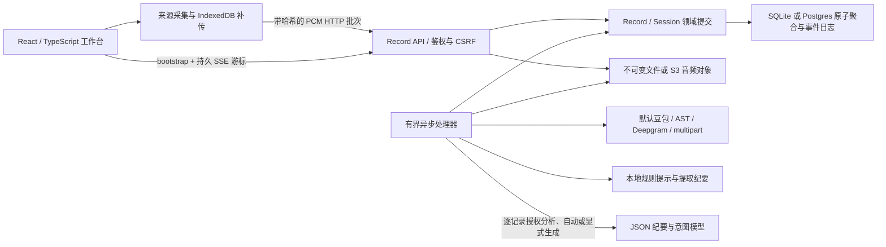

# 当前运行路径与证据

核查日期：2026-10-12。本页描述当前代码及本地验证；[改造前快照](prototype-baseline-2026-10-11.md)保留历史事实。真实供应商验证仅使用合成语音，未使用真实会议。

`npm run dev` 启动 `apps/web` 的 Vite 首页、`services/records/src/server.mjs` 和 `services/records/src/worker.mjs`。主协议是同源 `/api/records`，API 默认 3030，Web 默认 3000。开发账户与配置方式见[运行手册](runbook.md)。

| 能力 | 当前实现 | 已有证据 |
| --- | --- | --- |
| 页面 | 固定居中的玻璃框架、内部滚动、按需纪要、浅/深主题、自定义选择器与播放器；全宽 13px 紧凑转录、双音源摘要 | 桌面 1280×720、手机 390×844/320×740；外层不滚动；原生 select 与 audio controls 数量为 0 |
| 来源 | 默认会议录音同时采集共享音轨与麦克风，分别诊断信号；自动模式优先已识别实体麦克风，可指定设备；音频/文字导入 | 合成语音经过实际浏览器采集、AudioWorklet、上传、真实豆包与 SSE 显示；实体设备矩阵未验 |
| 领域 | Record 长期容器；快速记录可空标题；暂停后新 Session 继续本场，结束后新建；Source/epoch/sequence/sampleOffset 定位音频 | 领域、乱序、重传及停止协议故障测试 |
| 持久化 | SQLite FULL/WAL；Postgres JSONB 行锁；音频 fsync 或 S3 条件写 | SQLite 重启恢复；PG 未集成；S3 仅 SDK 契约 fixture |
| 接收 | 先对象后元数据，哈希、乱序水位、缺片范围、冲突校验 | 持久 ACK、seal 后补传、冲突及 WAV Range 测试 |
| 事件 | 聚合内原子事件日志，最多 1000 条；SSE id/cursor、过期 reset | SSE 与权限测试；浏览器导入后转录自动出现 |
| ASR | 默认豆包 v3 二进制 WebSocket；兼容旧 AST、Deepgram、multipart；按来源保持顺序，两个来源可并行；最多 5 次尝试 | 豆包约 5.97 秒中文合成语音真实识别通过；本地协议 fixture 核对部分/最终响应；双来源并行测试 |
| 意图 | 本地保守规则；逐记录点击授权模型分析；决定、行动候选、提议、问题、否定/撤回及片段版本引用 | 浏览器合成样本提取决定和行动候选；版本与旧结果拒绝测试；真实模型调用未验 |
| 纪要 | 明确区分本地提取与 AI 总结；Chat/Responses JSON 与 SSE；自动会中草稿/终稿、主题分区、主题树；快照/哈希、引用校验、租约/fence、并发编辑保护 | API 与浏览器本地提取通过；旧任务、删除、人工修改及模型接口 fixture 通过；真实模型质量未验 |
| 配置 | 设置页修改地址、协议、资源、模型、密钥；旧变量别名兼容；配置热读取；密钥仅返回布尔状态 | 0600 文件、空值保留、显式清空、CSRF、管理员限制和基础地址补全测试 |
| 版本与隐私 | 最近 10 个纪要历史版本、20 个片段编辑版本；签名 cookie、Origin/CSRF、TTL、墓碑清理、范围分享 | 历史、隔离、TTL、删除 fencing、分享撤销测试 |
| 扩展 | 手工说话人、全文搜索、三模板、新片段翻译、ICS/工单候选导出、原音回放 | 静态及协议检查；浏览器播放器播放结束无错误；真实翻译未验 |

旧 gateway / transcript-api / ai-worker 保留兼容原型；旧 AI worker 仍是占位，当前链路由 records worker 处理。Go 未成为主链。新链路通过独立适配器接入旧 AST 协议，未复用旧网关会话。

## 当前环境边界

- 模型地址保留用户当前 HTTP 配置。用户已授权仅用虚构数据测试，但自动审批拒绝向未验证的 HTTP IP 明文发送密钥；同地址 HTTPS 握手失败。因此没有执行此次真实云端摘要或意图请求。本机接口 fixture 证明调用路径和返回处理，不证明供应商模型可用或质量。
- 约 6 秒合成语音的识别成功不能证明真实会议、跨片段语义、60 分钟会话、CER 或延迟指标。当前默认两秒短批次，各批次独立识别，跨批次上下文仍是评测重点。
- 意图仅覆盖最近 120 个片段。引用校验只能证明引用版本存在，不能证明语义判断正确；候选不会自动执行或外发。
- 浏览器 API 可用不能证明所选共享来源带有声音。物理麦克风、拔插、权限拒绝、休眠恢复和 Windows/macOS 浏览器矩阵仍未验；自动模式在已知系统默认输入为虚拟设备且存在已识别实体麦克风时改用实体输入，无法识别时跟随系统默认。
- 账户是邮箱标识的本地密码账户；没有邮箱验证、找回密码、OIDC、组织席位或团队权限。开发账户只在开发模式创建，生产模式不提供开发入口。
- IndexedDB 上限 48 MB，满时明确停止并提示；不能跨设备补传。文件全量解码，上限 64 MB、两小时，长压缩音频仍受设备内存限制。
- 默认临时原音在转录完成后清理；失败片段最长保留 24 小时。离线浏览器数据需用户导出或清理；服务器不能远程擦除离线设备。
- 当前仍有一条历史失败音频记录，首片段已达到重试上限，后续片段按顺序阻塞。本轮保留原数据，未自动重试未知会议音频。
- 聚合日志与本地用量是首版工程选择，不是完整事件溯源、大规模容量证明或供应商账单。真实 PG/S3、部署和试点尚未验收；GitHub 地址未提供，没有远程工单或自动外发。

## 2026-10-12 增量实现

已加入 Chat Completions/Responses 双协议与供应商 SSE；按记录启用会中自动草稿、停止排空后终稿；流式预览、主题背景、主题树与引用片段时长。ASR、纪要、意图和翻译独立轮询。新开发启动默认包含 `--host 0.0.0.0`，API 保持 loopback 并由 Vite 代理。旧记录不会默认启用自动纪要。

这些能力已通过本地回归和隔离浏览器联调；真实 HTTP 模型、物理多人会议质量和完整音频到纪要延迟分位数尚未验证。详见[增量纪要说明](live-minutes.md)。

## 2026-10-12 说话人增量

默认豆包中英文来源级持续识别、确认分句持久化、匿名编号复用、最多 10 人、重连原音锚定与待确认处理已实现；22.47 秒双人合成 A-B-A 的 12 块音频经真实 WSS 得到“1→2→1”并完成 SQLite 排空。其他语言及供应商仍走原短批次路径。主题分区合为连续容器，纪要设置收拢，平板面板避免切断正文。详见[连续性说明](speaker-continuity.md)及[验收](acceptance.md)。

2026-10-12 补充：说话人 SHA-256 会内身份已持久化并带到分句，真实豆包虚构 A-B-A 音频在中途丢失连接所有权后重新识别，仍得到两名说话人及 1→2→1，全部 12 块完成排空。一遍实时结果作为独立草稿经 SSE 显示；浏览器首包 400 毫秒，后续 1 秒。逐字动画只用于实时草稿追加，纠错和历史确认稿直接显示。575 毫秒是供应商首次文本耗时，不是浏览器麦克风端到端指标。

2026-10-12 SSE 修复：前端受控重建事件流，不再假设 HTTP 502 后浏览器原生 EventSource 会自动恢复；每次重试先读取最新快照，取消过期回调与重复连接。页头显示实际订阅状态。单次 502 的隔离浏览器恢复及后续事件刷新已验收。

## 2026-10-12 音源与纪要视图

默认录音提供麦克风与共享音频的双来源流程，持续静音会按来源提示；音频包不再显示为待识别语音段落。首次静音来源不抢占说话人起始编号。纪要新增主题树、发言人总结、关键决策与正文视图，保留流式草稿、冻结引用与人工编辑保护。桌面支持侧栏与展开阅读，手机使用独立面板。

83 项回归与静态、构建、文档检查通过。实体设备和远程 HTTP 模型的新纪要输出仍未验收；证据细分见[音源检测与智能纪要](capture-and-minutes.md)。

## 2026-10-12 工作台反馈修复

设置保存改为局部刷新与可见 toast；新模型地址默认 Responses，保留已明确保存的 Chat 配置；在线会议入口明确要求分享系统音频；转录与实时草稿自动跟随，历史阅读可暂停；备份检查响应后下载，失败直接显示错误。87 项回归与静态、构建、文档检查通过。浏览器使用合成音轨与虚构会议验收，实际下载 JSON 已解析；本轮未调用外部供应商。详见[工作台交互反馈](workbench-feedback.md)。

## 会议入口与主题树增量

「开始聆记」从用户点击独立请求麦克风和共享音频，缺少来源时弹窗引导；补接不会重复创建已接入来源。纪要主题树采用连续主线、紧凑标题和右移内容块。详见 [实现与隔离浏览器验收](meeting-entry-and-brand.md)。真实设备和在线会议能力仍需单独验证。
