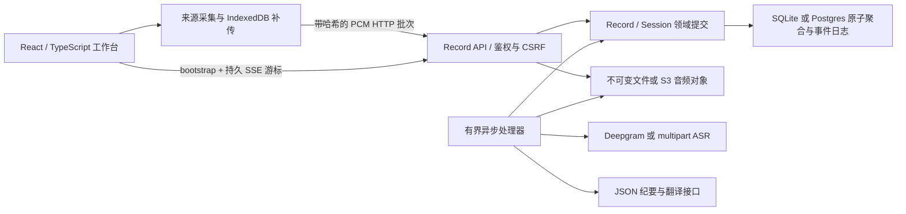

# 当前运行路径与证据

核查日期：2026-10-11。本页描述本轮实现；[改造前快照](prototype-baseline-2026-10-11.md) 保留历史事实。

`npm run dev` 启动 `apps/web` 的 Vite 首页、`services/records/src/server.mjs` 和 `services/records/src/worker.mjs`。主协议是同源 `/api/records`，API 默认 3030，Web 默认 3000。

| 能力 | 当前实现 | 已有证据 |
| --- | --- | --- |
| 页面 | React 组件、浅/深主题、玻璃工具栏、按需纪要、移动布局 | TypeScript、Vite、本机浏览器交互 |
| 领域 | Record 长期容器；Session 可中断采集；Source/epoch/sequence/sampleOffset 定位音频 | 领域与协议故障测试 |
| 持久化 | SQLite FULL/WAL；Postgres JSONB 行锁；音频 fsync 或 S3 条件写 | SQLite 重启恢复；PG 未集成；S3 仅 SDK 契约 fixture |
| 接收 | 先对象后元数据，哈希、乱序水位、缺片范围、冲突校验 | 丢序、重传、seal 后补传测试 |
| 事件 | 聚合内原子事件日志，最多 1000 条；SSE id/cursor、过期 reset | SSE 与权限测试 |
| ASR | 2 秒短批次、Deepgram/multipart 接口；最多 5 次尝试，失败显式阻塞 | 故障注入与 fixture；没有真实质量结果 |
| 纪要 | JSON 适配器、快照/哈希、引用校验、租约/fence、并发编辑保护 | 旧任务、删除与人工修改测试；没有真实模型质量结果 |
| 版本 | 当前纪要 + 最近 10 个历史版本；片段最近 20 个编辑版本；生成快照 | 版本读取和人工修订测试 |
| 隐私 | 账户密码哈希、签名 cookie、Origin/CSRF、原音 TTL、墓碑禁访、清理状态 | 隔离、TTL、fencing、分享撤销测试 |
| 扩展 | 多源、手工说话人、全文搜索、三模板、新片段翻译、导出、留存原音 Range 回放 | 静态检查与相关协议测试；真实翻译未验 |

旧 gateway / transcript-api / ai-worker 服务兼容原型。旧 AI worker 仍是占位，新纪要由 records worker 处理。Go 未成为主链，旧豆包流式适配器未接入新 Record 协议。

## 明确限制

- API 检测不能证明所选来源带有音频。跨系统真机矩阵、60 分钟长会话和用户试点未完成。
- 短批次没有供应商 partial、上下文拼接和自动说话人分离。需要真实中文会议评测质量、边界截断和积压。
- Postgres/S3 没有专用集成环境。S3 使用私有、未启用版本控制的专用桶；服务外备份删除由部署方治理。
- 账户是邮箱标识的本地密码账户；没有邮箱验证、找回密码、OIDC、组织席位或团队权限。
- IndexedDB 不保证永不被回收；关页停止采集。本地队列上限 48 MB，满时明确停止并提示未保存的最后片段。跨设备不能补传另一设备的数据。
- 音频文件全量解码，64 MB 文件、两小时上限；长压缩音频可能受设备内存限制。
- 默认临时原音在会话转录完成后清理，逐片段最长 24 小时；本机待传数据由浏览器保留，可导出备份或清理站点数据。服务器不能远程擦除离线设备。
- 有限日志与聚合事务是首版工程选择，不是完整事件溯源或大型并发容量证明。用量不是供应商账单。
- 工单只导出候选；GitHub 地址未提供，没有远程工单、自动参会或自动外发。
