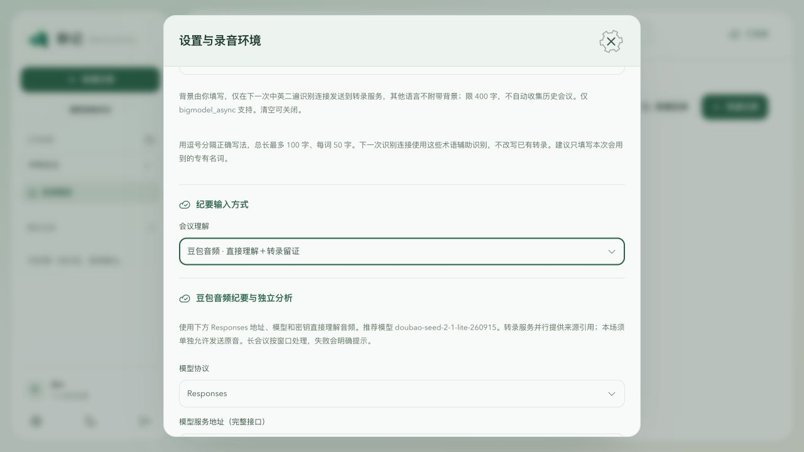
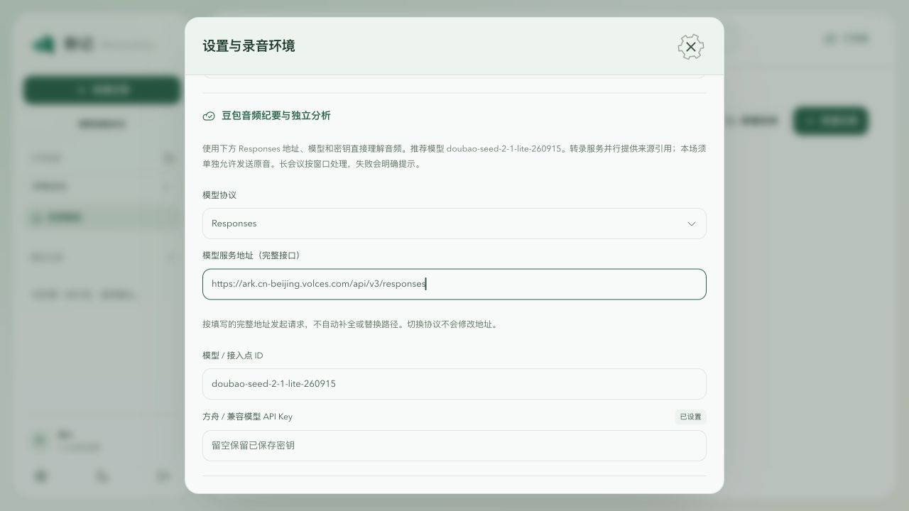
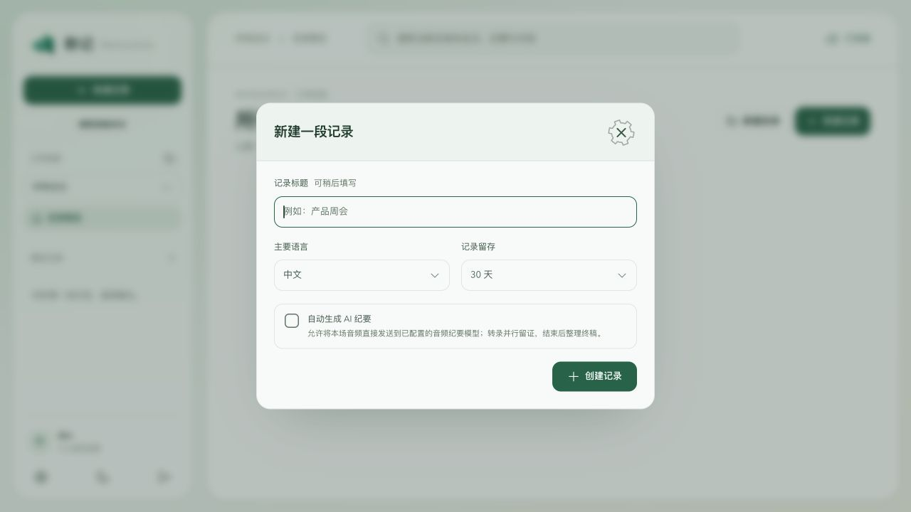

# 豆包音频纪要配置

本地代码已支持“音频直接理解＋并行转录留证”。豆包通过 Responses API 接收音频，原 ASR 服务继续提供逐字稿、片段时间和版本引用；原 ASR＋LLM 与 OpenAI Realtime 模式仍可选。

当前实现提交为 `f189cf7`。本次完成本地与真实豆包接口验证，现按持续授权准备 v0.1.5 测试包，见[安装说明](../releases/v0.1.5-preview.md)；实际发布状态以 Release 和 Actions 回执为准。使用包含该提交的本地构建，或在仓库运行 `npm run dev`。旧 App 如果没有“豆包音频”选项，需要更新构建；只改模型名称仍会使用旧文字纪要链路。

## 在 App 中配置

打开“设置与诊断 → 模型与转录服务”，填写：

| 设置项 | 值 |
| --- | --- |
| 会议理解 | 豆包音频 · 直接理解＋转录留证 |
| 模型协议 | Responses |
| 模型服务地址（完整接口） | `https://ark.cn-beijing.volces.com/api/v3/responses` |
| 模型 / 接入点 ID | `doubao-seed-2-1-lite-260915` |
| 方舟 / 兼容模型 API Key | 在密码框填写已开通该模型的方舟密钥 |

点击“保存服务配置”，再点击“测试纪要”。测试只向模型发送合成静音，不读取已有会议。密钥保存在服务端配置中，对前端只返回“已设置”；留空保存会保留原密钥。





转录服务保持原来的 ASR 地址与密钥。方舟模型密钥和豆包语音 ASR 密钥是两个配置，不能因为名称都含“豆包”就互相替代。保留 ASR 是为了逐字稿与纪要溯源；ASR 未就绪时，不能完成带转录引用的音频纪要。

## 允许本场音频发送

新建会议时，“自动生成 AI 纪要”默认不勾选；勾选表示允许将本场原音发送到所选纪要模型。既有会议需在“整理设置”开启自动整理，或在明确告知原音发送的界面手动生成 AI 纪要。



模型直接接收有界 WAV 音频窗口和冻结的转录片段。每个事实仍必须引用片段 ID 与版本；模型引用未知版本会失败，转录被修订后旧任务结果不能落成新纪要，人工纪要仍受保护。最终长会议可分层合并已校验的窗口纪要，合并阶段不重复上传全部原音。

服务失败会提示错误，不自动切成文字模式或模拟结果。纪要请求不启用示例中的 `web_search`，避免把外部搜索内容混入会议事实。

## 后端配置

开发环境也可以在服务端 `.env` 配置，不能使用 `VITE_*`：

```dotenv
MINUTES_MODE=doubao-audio
LLM_PROTOCOL=responses
LLM_API_URL=https://ark.cn-beijing.volces.com/api/v3/responses
LLM_MODEL=doubao-seed-2-1-lite-260915
LLM_API_KEY=<方舟密钥>
```

已有 App 保存的服务端配置会覆盖同名环境变量，应优先在 App 设置页保存并核对。切换配置不重新生成历史纪要；排队任务保留任务创建时的模型版本。

## 验证与限制

- 真实音频探针：仅上传约 17.5 秒合成中文语音，没有附带转录，成功识别“小林负责、下周三前提交测试结果、上线时间未定”。
- 真实纪要模型工作流：经过 repository、worker、音频窗口和引用校验，产出两条转录版本引用与两条原音映射。此项 ASR 使用受控测试转录，不能当作真实 ASR 验证。
- App 设置页保存和新会议默认授权状态已核对；本地定向 11 项、全量 Node 385 项、lint、typecheck、Web 构建通过。完整回执见[测试证据](../evidence/doubao-audio-2026-10-22.md)。
- 聆记录音无两小时自动停止上限。豆包单次音频输入有供应商限制，本实现按每个来源约两分钟拆窗，单次音频拼接最多五分钟，避免将整场长会议作为一次请求。多小时真实设备录音、休眠恢复和真实会议准确率仍为 `NOT_VERIFIED`。
- 本次合成会议的完整模型工作流约 56.5 秒；这不代表真实会议延迟或长会议容量。原音过期或已清理的历史会议不能直接重放为音频纪要，可由用户显式选择旧文字模式。

官方参考：[音频理解](https://docs.volcengine.com/docs/ark/audio-understanding?lang=en)、[创建 Response](https://docs.volcengine.com/docs/ark/create-model-responses-api?lang=zh)、[模型列表](https://docs.volcengine.com/docs/ark/model-list?lang=zh)。
