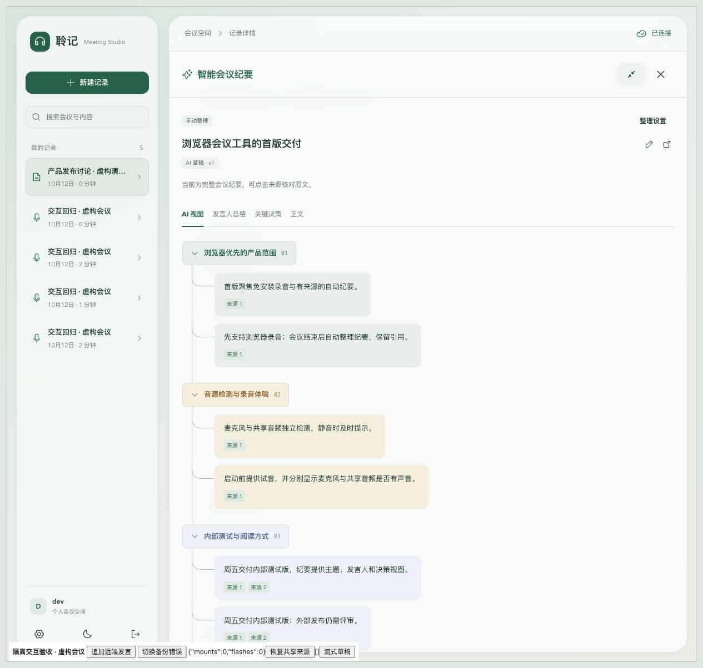
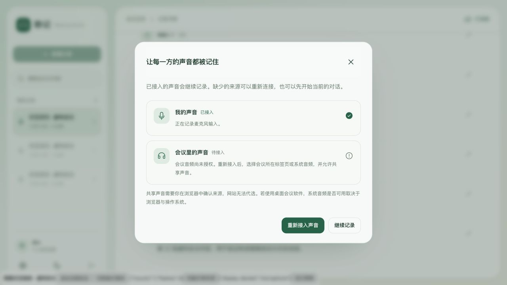
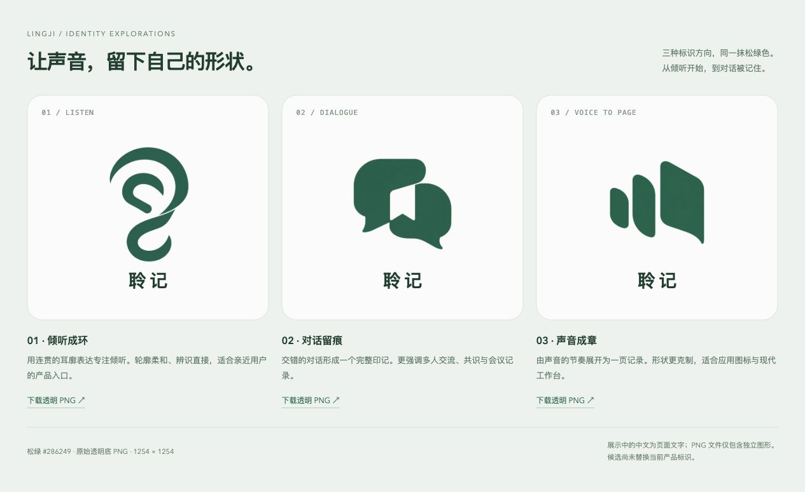

# 会议启动、主题树与聆记标识

本文记录本次已实现的界面行为与本机验收边界。截图和浏览器验证使用隔离 API、合成音源与虚构会议，没有调用真实 ASR 或远程纪要模型。

## 一次开启，分别接入两路声音

主入口改为「开始聆记」。点击时立即请求会议音频和麦克风；两路接入各自处理结果。取消共享、浏览器不支持共享、来源没有音轨或麦克风拒绝授权，都不会让另一条成功的来源被丢弃。

缺少来源时自动打开「让每一方的声音都被记住」弹窗，展示「我的声音」「会议里的声音」及具体错误。用户可以重试缺失来源，也可以继续当前录制。关闭弹窗后，页面持续说明当前仅接入哪一路声音。重试复用已接入的来源；同类并发请求合并，避免重复创建麦克风和音频来源。录制中的「音频来源」可重新打开此弹窗。「仅麦克风」保留为用户主动选择的单来源入口。

自动接入由用户点击触发，不在页面加载时录音。浏览器的共享选择器仍需用户确认，应用不能默选会议标签页或持久记住屏幕共享授权。W3C 的 [Screen Capture 规范](https://www.w3.org/TR/screen-capture/#dom-mediadevices-getdisplaymedia)要求瞬时用户激活，且不允许持久化该共享权限。操作系统与浏览器也可能只提供画面、不提供声音；应用会检查实际音轨。

领域实现分为两层：

- [CaptureController](../../apps/web/src/audio/capture.ts)：接入去重、独立失败与音频生命周期。
- [CaptureSetup](../../apps/web/src/components/CaptureSetup.tsx)：来源状态与补接引导，不持有音频流。

record/session/source/epoch/sequence、PCM 分块、上传幂等、停止排空及转录版本协议保持原有实现。

## 连续的纪要主题树

主题间移除布局空隙，以相接的纵向边框形成连续主线；主题标题变为紧凑标签。内容块向右缩进，由圆弧连接到主线。内容按实际文字宽度展开，保持同主题底色。来源引用、主题折叠、发言人总结和关键决策入口继续可用。

侧栏与展开阅读分别调整缩进。手机缩短枝线并保留可读宽度。深色主题使用现有设计令牌。

手机与深色验收截图：

- [390px 主题树](../evidence/meeting-entry/minutes-tree-mobile.jpg)
- [390px 深色音频弹窗](../evidence/meeting-entry/capture-partial-mobile.jpg)
- [深色主题树](../evidence/meeting-entry/minutes-tree-dark.jpg)

## 三款标识候选

[标识对比页](../../assets/brand/lingji/index.html)提供「倾听成环」「对话留痕」「声音成章」三个独立透明 PNG。原图均为 1254 × 1254，已检查透明通道范围为 0–255。对比页中文字独立排版，图形尚未替换当前产品标识。

这些是可供选择和页面使用的位图原稿；矢量定稿与小尺寸光学校正不在本次交付内。

## 验证结果

- Node 回归：91 项通过，包括共享取消、共享 API 缺失、无音轨、双路失败、保留成功来源、并发去重及重复启动。
- ESLint、Web 类型检查、生产构建和文档引用检查通过。
- 浏览器：点击前未申请采集；拒绝共享后麦克风继续工作并显示弹窗；补接共享时调用记录为 display-denied → microphone → display，没有重复申请麦克风。
- 布局：390px 页面无横向溢出；主题折叠后相邻分支几何间距仍为 0；浅色、深色、侧栏及展开阅读均已检查。

本次没有重做供应商转录质量或真实硬件验证。实体麦克风、系统共享声音、操作系统权限、真实在线会议以及长时间录制仍需在目标设备上试录确认。浏览器合成音源验证不等于实体设备验收。
