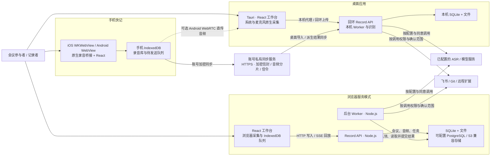
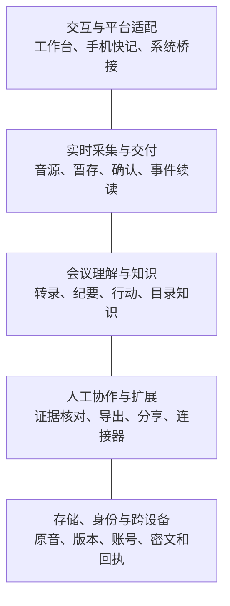

# 聆记系统架构与能力分层

本文描述开发分支 `dev_mobile-desktop-polish` 的产品源码快照 `a85978ca5a942740ba31f58a986e6d3bcd94fda1`，核对日期为 2026-11-27。产品版本字段为 `0.3.39.3`。各平台可安装版本与发布验收见[当前能力与边界](current-state.md)和[安装及发布记录](../releases/github-client.md)。

聆记把会议录音、转录、纪要和原文证据放在同一工作台。浏览器工作台和桌面应用复用 React 界面和 Record 协议。桌面默认在本机运行 Record API、识别和后台任务。手机快记先保存原音，由桌面接收后进入同一套录音与转录流程。

## 运行拓扑

实线显示主要数据路径，虚线显示可选路径。生产账号私有同步一般是桌面本机后台以外的 HTTPS 服务。它使用 Record 服务中的同步路由，也可按同步环境单独部署。WebRTC 直传的信令依赖账号同步服务。图中手机到桌面的虚线表示音频数据路径，仍可经 TURN 转发。

| 运行形态 | 入口与部署 | 本地数据和进程边界 |
| --- | --- | --- |
| 浏览器工作台 | `npm run dev` 启动 Vite、Record API 和独立 Worker。生产 Web 入口提供静态资源，并代理 Record API 请求。 | 页面在 IndexedDB 暂存采集队列。API 与 Worker 通过配置好的存储交换会议状态及任务。 [启动器](../../scripts/dev.mjs) · [生产入口](../../apps/web/src/production-server.mjs) |
| 桌面工作台 | Tauri 装载 Web 工作台，启动回环 Node 后台，为前端和原生录音连接本机服务。 | 后台使用本机 SQLite 和文件，进程内启动 Worker。原生音源及权限随平台和安装方式变化。 [Tauri 入口](../../apps/desktop/src-tauri/src/main.rs) · [桌面后台](../../services/records/src/desktop-backend.mjs) · [平台能力](native-client.md) |
| 手机快记 | iOS 与 Android 使用各自的原生容器、麦克风桥接和共用的移动 React 入口。 | 音频先写入手机录音库。账号同步发送与桌面导入各自确认。 [移动入口](../../apps/web/src/mobile-main.tsx) · [iOS 容器](../../apps/ios/LingJi/LingJiApp.swift) · [Android 容器](../../apps/android-preview/src/com/rookiehouse/lingji/preview/MainActivity.java) |
| 账号私有同步 | Record 服务提供 HTTPS 同步路由、账号鉴权、密文存取及直传信令。生产启用 HTTPS 私有同步时要求 PostgreSQL。 | 手机及桌面执行信封加解密，服务管理账号隔离、顺序、幂等、配额和接收房间。 [服务配置](../../services/records/src/server.mjs) · [同步路由](../../services/records/src/private-sync-routes.mjs) · [操作手册](private-sync.md) |

旧版 `dev:legacy-web` 页面和 `session-gateway`、`transcript-api`、`ai-worker` 属于早期链路。Go 引擎仍为独立实验入口。当前工作台与发布包的运行入口以[启动器](../../scripts/dev.mjs)和[桌面后台](../../services/records/src/desktop-backend.mjs)为准。

## 能力分层

图按产品职责组织能力。存储、身份与同步为多个环节提供基础能力，运行时调用见上方拓扑。

| 层 | 产品能力 | 实现与边界 |
| --- | --- | --- |
| 交互与平台适配 | 会议、手记、工作目录、纪要与引用、设置、导出。手机提供快记、回听、会议浏览及发送。 | React 工作台共享界面，平台桥接处理录音权限、系统音频及原生生命周期。 [Web 入口](../../apps/web/src/main.tsx) · [移动工作台](../../apps/web/src/components/MobileSyncWorkspace.tsx) |
| 实时采集与交付 | 多音源录制、分片上传、暂存重传、录音暂停、停止排空、SSE 恢复。 | Record 内的分片身份由 session、source、epoch 和 sequence 标识。确认水位用于重传与恢复，前端通过快照与事件游标更新视图。 [音频队列](../../apps/web/src/audio/queue.ts) · [Record 状态](../../packages/records/src/record.mjs) · [事件订阅](../../apps/web/src/record-subscription.ts) |
| 会议理解与知识 | 实时转录草稿、最终修订、说话人、翻译与词表、纪要、行动候选和目录问答。 | Worker 认领可恢复任务。桌面本地模型路径提供 Zipformer 草稿和 SenseVoice 最终修订，模型切换取决于配置。纪要按转录版本及引用片段建立证据。 [Worker](../../services/records/src/worker.mjs) · [纪要流水线](../../services/records/src/minutes-pipeline.mjs) · [本地模型](funasr.md) · [目录知识](knowledge-and-voiceprints.md) |
| 人工协作与扩展 | 核对证据、编辑和导出、加密分享、飞书与 Git 任务、远程扩展。 | 会议任务记录输入、执行状态和结果。自动纪要提交检查转录版本和人工修改；有副作用的外部操作要求相应权限和确认。 [会议任务](../../services/records/src/meeting-tasks.mjs) · [会议 Agent](../../services/records/src/meeting-agent.mjs) · [连接器](../../services/records/src/connectors.mjs) · [加密分享](encrypted-sharing.md) |
| 存储、身份与跨设备 | 本地会议库、录音回放、搜索、密文同步、手机录音接力。 | Record 持久化与音频对象各有接口。账号同步客户端使用加密信封、传输游标及回执。加密分享有独立授权和撤销路径。 [存储入口](../../services/records/src/repository.mjs) · [同步加密](../../apps/web/src/sync/vault.ts) · [同步存储](../../services/records/src/private-sync-store.mjs) |

## 数据与所有权

| 对象 | 谁写入及如何恢复 |
| --- | --- |
| Record、会话与音源 | Record API 写入采集状态和接收水位。浏览器、桌面原生采集和手机录音导入使用各自的会话或音源身份。原音分片按身份与摘要幂等，续发以持久确认水位为准。 [Record 状态](../../packages/records/src/record.mjs) · [传输协议](record-transport.md) |
| 转录与纪要 | Worker 提交转录。纪要任务保存源转录版本和引用范围，写回时校验版本及人工修改。手记、纪要和目录知识按工作目录组织。 [后台处理](../../services/records/src/worker.mjs) · [工作目录](workspaces.md) |
| 同步信封与回执 | 手机和桌面在各自设备中加解密。同步服务保存密文、进度和交付回执。桌面接收录音后生成本机 Record，派生会议内容通过另一路同步操作更新。 [加密同步](private-sync.md) · [桌面导入](../../apps/web/src/sync/mobile-desktop.ts) |
| 连接器任务与回执 | 任务内核记录外部动作的输入和状态，连接器核对权限并保存平台回执。写入结果不明时按平台规则对账。 [会议任务](meeting-task-kernel.md) · [连接器协议](connectors.md) |

## 设计分析

- **先保存再识别。** 原音分片的持久确认与识别结果各有进度。后台任务可以重试，界面可从事件游标继续。录音端仍需处理磁盘或浏览器存储配额、待发送队列，以及停止时的最终确认。 [传输协议](record-transport.md) · [录制可靠性](capture-reliability.md)
- **实时草稿和最终修订共用会议时间线。** 局部转录优先可见，后续修订保留版本以便引用。窗口化处理和任务认领控制重复请求；旧版本任务提交及纪要引用需要校验，避免把旧结果写到当前版本。 [Worker](../../services/records/src/worker.mjs) · [纪要与引用](intelligent-minutes.md)
- **桌面和服务部署共享 Record 语义。** 桌面 SQLite 与文件可以单机运行。服务端可配置 PostgreSQL 和对象存储，需要各自验证连接、持久化、故障恢复及清理。录制同意、截图授权、原音留存、云端识别、分享和连接器写入各自管理。 [存储与性能](storage-and-performance.md) · [连接器](connectors.md)
- **跨设备分发有独立的交付确认。** 手机保存、同步服务接收、桌面持久导入、转录完成是四个可观察状态。直传改善可达时的音频路径；跨公网成功率仍受 ICE、网络切换和 TURN 部署影响。 [手机交接泳道](system-workflows.md#手机快记到桌面)

## 验证边界

| 证据层 | 可以确认 |
| --- | --- |
| 固定提交源码 | 入口、平台桥接、数据流、配置条件与状态迁移。图及源码链接的基线均为本文开头的提交。 |
| 自动化与制品 | 通过版本记录和既有回归核对具体平台、提交、套件与产物。 [功能与发布回归](release-regressions.md) · [安装及发布记录](../releases/github-client.md) |
| 环境与现场 | 真机锁屏与系统音源、两台异网设备的直连及中继、生产 PostgreSQL/对象存储、真实模型延迟与质量、各平台上架状态均需对应环境证据。 [验收清单](acceptance.md) · [公网部署和验证](private-sync.md) |

下一步可按[功能泳道与状态流转](system-workflows.md)从按钮操作追到持久确认、任务产出和外发边界。
