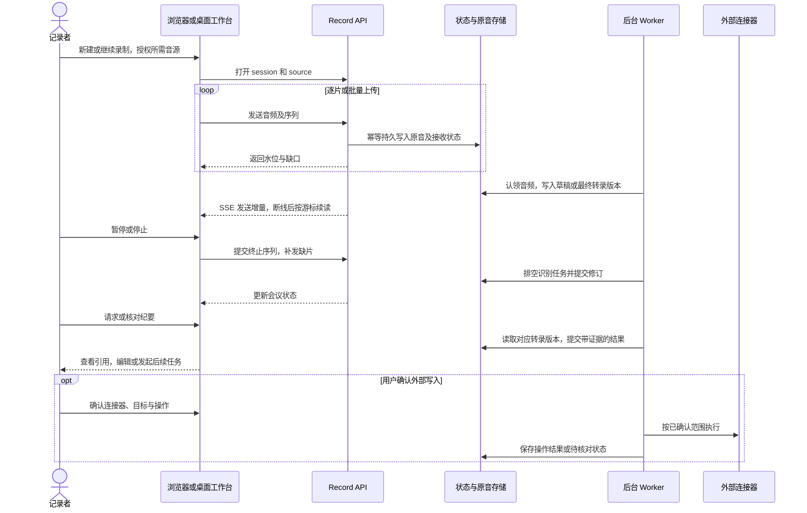
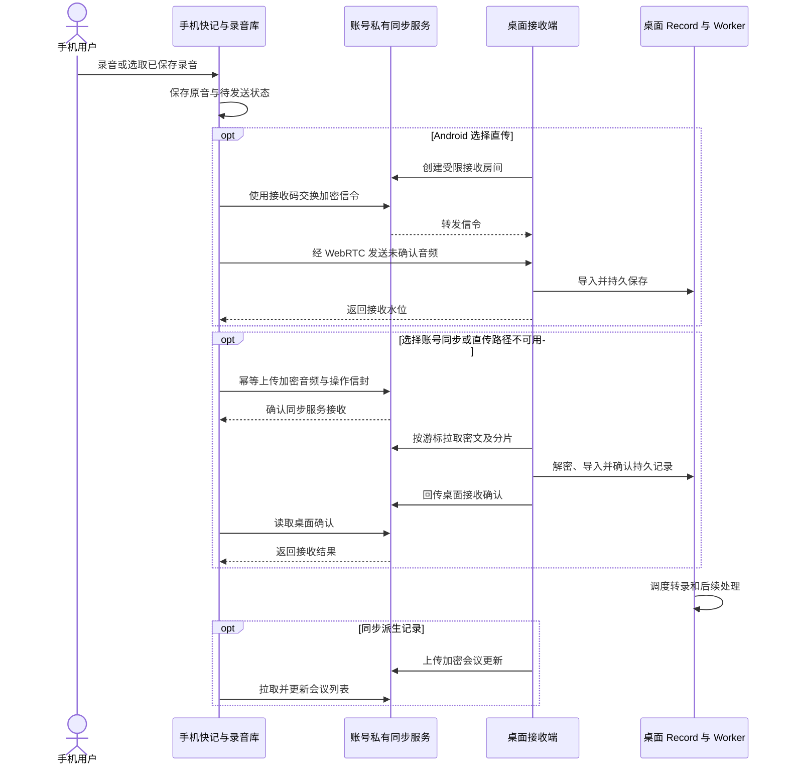

# 聆记功能泳道与状态流转

源码基线为 `a85978ca5a942740ba31f58a986e6d3bcd94fda1`。运行模式与各层职责见[系统架构与能力分层](system-architecture.md)。

## 会中录制到会后整理

按参与者、工作台、Record API、存储、Worker 和外部系统划分泳道。桌面运行时，Record API 和 Worker 都在本机后台进程中执行。

| 场景 | 状态如何推进 | 实现索引 |
| --- | --- | --- |
| 授权失败、断开或静默断流 | 采集端保留可恢复的缓冲状态并显示异常。数据上传缺口通过持久确认水位重试。SSE 静默或断开时，前端合并最近快照并从最新事件游标重连。 | [采集控制](../../apps/web/src/audio/controller.ts) · [Record API](../../services/records/src/server.mjs) · [事件订阅](../../apps/web/src/record-subscription.ts) |
| 暂停、恢复和停止 | 暂停封存当轮会话及音源的终止序列，后续恢复开启新会话。停止封存整条记录的采集。缺片仍可在终止序列范围内补传，持续等待的识别批次进入排空，失败重试仍适用退避。 | [Record 状态机](../../packages/records/src/record.mjs) · [录音生命周期](meeting-lifecycle.md) · [传输协议](record-transport.md) |
| 识别与纪要 | 可见的草稿和最终修订使用各自的识别时机。会中和会后纪要依据所绑定的转录版本、证据片段和生成上下文。结果提交继续检查当前任务、版本与人工修改。 | [Worker](../../services/records/src/worker.mjs) · [纪要流水线](../../services/records/src/minutes-pipeline.mjs) · [纪要与引用](intelligent-minutes.md) |
| 外部动作 | 会议 Agent 可提出行动或调用受控工具。连接器根据操作性质核对账号及权限，外部写入使用用户确认的输入。结果不明确时进入核对流程。 | [会议 Agent](../../services/records/src/meeting-agent.mjs) · [会议任务内核](meeting-task-kernel.md) · [连接器](connectors.md) |

开关涉及不同同意范围。浏览器或系统的录音权限覆盖本次采集，截图、云模型处理、原音留存、加密分享和外部动作分别管理。

## 手机快记到桌面

手机录音、传输服务接收、桌面持久确认与桌面转录分别推进。普通账号同步覆盖 iOS 和 Android。开发分支的手机 WebRTC 直传入口针对支持 WebRTC 的 Android 客户端。

| 场景 | 状态如何推进 | 实现索引 |
| --- | --- | --- |
| 手机离线、关闭回听或发送中断 | 手机先保有录音及待发送状态。回听退出或切换可取消读取和解密。同步可从已确认进度恢复，待发送与已被桌面接收分别显示。 | [移动录音库](../../apps/web/src/sync/mobile-library.ts) · [手机同步](../../apps/web/src/sync/mobile.ts) |
| 账号加密同步 | 两端根据账号同步密钥封装或解开信封。服务端维护顺序与幂等，客户端先持久化导入再推进游标与确认。原音传输确认与派生内容回同步是各自独立的进度。 | [端侧加密](../../apps/web/src/sync/vault.ts) · [同步持久化](../../services/records/src/private-sync-store.mjs) · [桌面导入](../../apps/web/src/sync/mobile-desktop.ts) |
| WebRTC 无法建立、切网或接收码失效 | 两端先通过账号服务交换信令，ICE 按配置探测直连或 TURN 中继。允许重连时按已确认水位续发。路径不可用时，应用把仍需交付的原音转交账号加密同步。取消或协议错误仍保留本机录音，可在交互中确认下一步。 | [直传协议](../../apps/web/src/sync/mobile-direct.ts) · [发送入口](../../apps/web/src/components/MobileDirectAudio.tsx) |
| 桌面接收完成 | 导入端创建或续写 Record 音源。持久确认后更新交付状态，桌面 Worker 继续转录，启用同步时会议派生更新可回到手机。 | [桌面接收与确认](../../apps/web/src/sync/mobile-desktop.ts) · [Worker](../../services/records/src/worker.mjs) |

异网可达性取决于两端网络、HTTPS 信令、ICE 和 TURN 配置。手机锁屏录音、前后台切换及公网回退按平台实际验证。 [跨设备部署和验证](private-sync.md)
