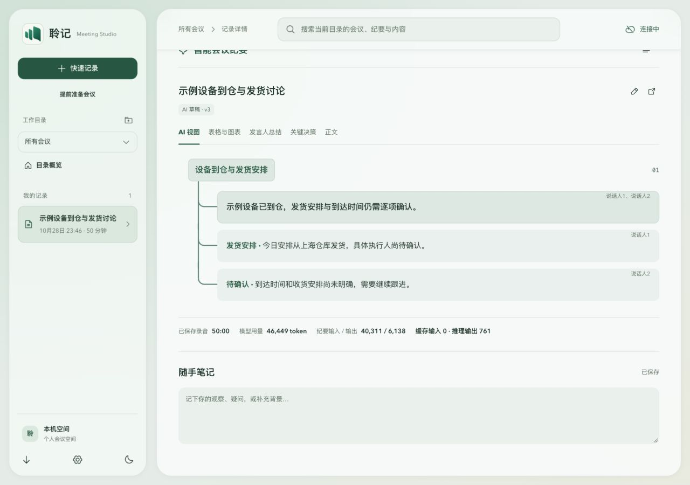

# v0.1.46 树形连接坐标修复

用户放大截图显示小结与普通卡片之间的主干错位。基线为 v0.1.45 产品源码 `e8f34d29176bcc93a4e149bca2e1b996baa16136`；后续回执仅改文档。

## 根因与最小修复

小结有 1px border，普通卡片没有。绝对定位伪元素以包含块为原点，不能只用元素外框加 left；必须再计入左边框。实际复现主干横坐标为 316 / 315 / 315，弯头也相差 1px。上一轮相对偏移检查漏算边框，此处明确更正，没有将旧断言当作像素对齐证据。

仅将小结边框改为 inset box-shadow，保留原底色与 1px 细边界视觉，消除布局边框对原点的影响。不改变节点结构、标题背景、层级缩进、分支重叠和用量数据。

## 失败与通过的浏览器证据

现有完整样式页面，虚构数据；未调用供应商或访问真实会议。新增检查包含元素左边框的实际主干和弯头坐标。

- 修复前：三段横坐标差 1px，复现用户截图。
- 修复后 1280px：三段主干与弯头全部为 367px。
- 修复后 496px：三段主干与弯头全部为 56px。
- 两种宽度主干差值均为 0；正文中心误差小于 0.01px，背景和边界仍保留。

[失败与通过坐标](assets/alignment-v0.1.46/coordinates.json)

## 回归与边界

本地 Node 668/668，lint、typecheck、build:web、check:docs 均通过。独立复审无已确认 P1/P2：实际 MinutesTree 与全量生产 CSS 在 1280/496 两种宽度下覆盖 summary、visual、普通卡、table 的混合及四种单子节点，共 18 个节点的主干/弯头横坐标偏差均为 0。图表和表格的内层边框不影响外层伪元素原点；inset shadow 不改变包含块或创建新层叠上下文。复审 CSS SHA256 为 `87152c04fa686283ab67e8e22711a940d5ec530eced501d7092e5bfd5121c888`，主审已核对一致。CI 结果以发布回执为准。此前后端、网络、原生与渲染逻辑未再次修改，独立复审仍按[原哈希追溯](performance-fixes-v0.1.44-2026-10-29.md)。本次没有改动音频队列、ACK、处理协议或安装保护。

合成浏览器与 CI 不能代替用户 Windows 设备上的实际缩放、GPU、长会议及真实 ASR/LLM 验收。
