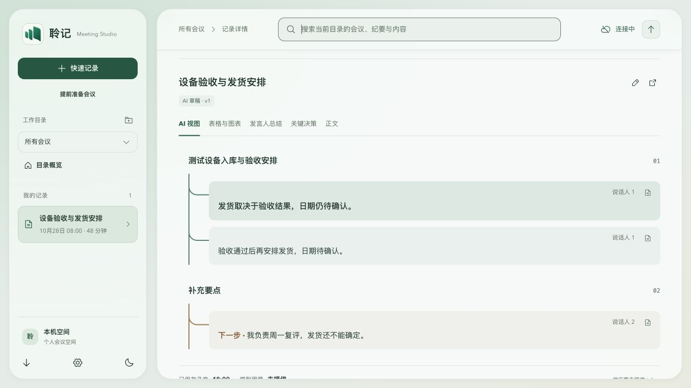
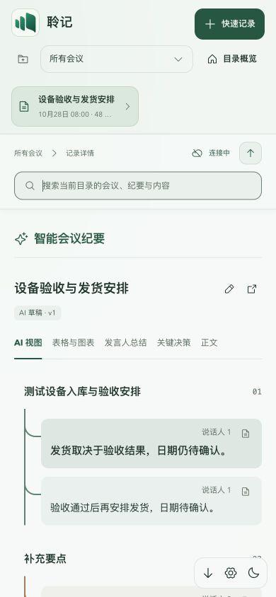
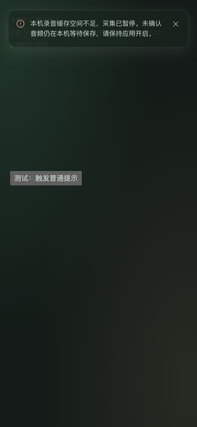

# v0.1.39 本地验证：采集与处理链路

日期：2026-10-28。基线 cea1494d6c131b18537fa9290edcb3dd565385dc。v0.1.37 已推送后发现故障提示会等待排空的缺口，因此保留旧标签并递增 v0.1.38。以下原生和布局验证沿用同轮未变化路径，本页是本地与隔离夹具证据，[发布与安装包回执](preview-v0.1.39-2026-10-28.md)已完成核验。

## 结果

- 完整 App 夹具复现同层重复 key：连续刷新会新增重复纪要块。修复后搜索触发十次刷新仍只有一个纪要和笔记区域。AST 回归从重复 key 失败转为通过；条件表达式中的同层组件由独立审阅人工核对。该问题与缓存满叠加的完整历史场景尚未在用户原记录重放。
- 完整会话页复核原有 14 px / 1.85 正文、10 px 卡片圆角及树形布局；除说话人与来源入口外，基线的字号、配色和卡片规则未变。1280 与390宽均仅一份纪要，无页面横向溢出。早期独立样例容器不作为完整页面样式验收依据。
- v0.1.38 Linux 在 Web/运行时资源准备步骤失败，耗时约3分6秒；公开日志不能读取，尚不能断定唯一原因。官方运行时原为一次180秒下载，因此增加最多两次尝试；固定官方地址、版本与解压前SHA256未放宽。回归模拟第一次超时、第二次坏内容，必须继续拒绝坏摘要。重试通过不代表已确认历史失败原因。

- 新增即时错误红/绿回归：停止排空 Promise 持续挂起时，旧版错误文本为空；新版立刻显示本机缓存故障。继续保留排空，且旧控制器不能改写新会议。

- 完整 Node 回归 607/607；ESLint、Web TypeScript、生产构建通过，212份文档检查通过；独立采集39/39及可靠性9/9通过。原生 Rust 40 通过、1 忽略；smoke 特性 41 通过、1 忽略。
- 跨会议回归：旧会议 48 MiB 积压时新会议可写；实际 512 MiB 满时在启动前拒绝，恢复补传后可重试，旧队列未删除。浏览器和原生容量失败均不创建采集管线；空会议反复恢复轮询不排纪要任务。
- 模拟双路 70 分钟 PCM（268800000 原始字节）全部留在本机队列。ACK、重复 ACK、错误 ACK、延迟三分钟尾部、正常停止排空、临时保存失败与恢复均通过。此处不涉及真实音频设备或识别质量。
- 独立审阅用实际 worker 路径注入 160 ms 预览写延迟，30 次模型增量：读取约 1009→329 ms，回调累计等待 659→0.1 ms，预览写入 6→1 次。最终提交等待在途预览；取消后无恢复或迟到写入。这是合成延迟结果。
- 独立隔离 SQLite/API 压测：70 分钟形状的 8400 音频片段、1680 转录、70 完成任务，约 6.92 MB；健康检查 p95 124 ms、音频 ACK p95 371 ms、SSE p95 217 ms，未出现 HTTP 错误。不能据此排除真实长会、慢供应商或同步大记录写入问题。
- macOS 原生 smoke 客户端实际 IPC 验证 ACK 权限、双源合成采集、后台九秒、重复最小化/关闭/恢复及重启补传通过。使用隔离配置，无真实设备、真实供应商或用户会议。
- 签名更新隔离夹具通过：非法元数据、无更新、篡改签名、错误版本均拒绝；有效签名可下载，八种忙碌条件阻止安装。替换仅作用于临时 Fixture.app，未修改用户应用。POSIX 交接脚本验证等待退出、启动失败回滚、成功保留备份及特殊路径；新应用就绪才清理备份。
- 浏览器 1280×900、390×844 验证说话人、图标引用、处理进度和无横向溢出；深色窄屏错误约 358×74 px，位于顶部 20 px。普通提示不盖住未关闭错误，关闭后可见计时继续，两秒后消失。测试视口已恢复，测试页已关闭。

## 界面证据

下图全部为虚构会议，无用户原文。

## 边界与后续

未重放用户原始 70 分钟会议，因此没有证明该历史故障的唯一根因或恢复已丢采样。原生未确认缓存尚不支持崩溃恢复；新预算仍有限；后台同步聚合写仍可能占事件循环。当前说话人补齐依赖供应商或人工提供的可验证身份，未增加声纹模型。

未执行用户真实安装替换；Windows/Linux 原生和包验证交由 CI，设备现场升级仍待验收。旧客户端首次升级请先完全退出。自动会议起止只有[研究建议](../research/meeting-lifecycle-signals-2026-10-28.md)，未因静音自动结束会议。
