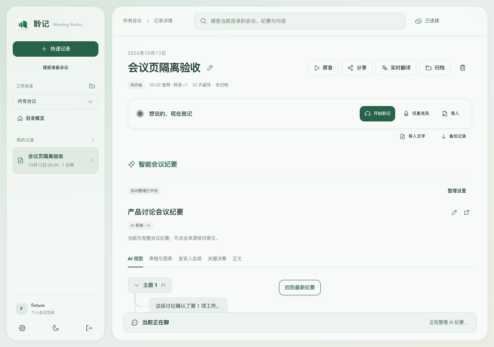
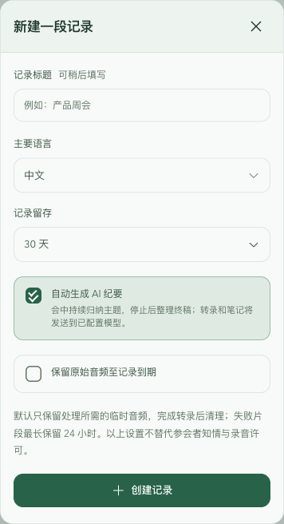
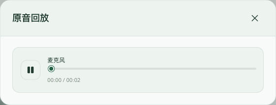

# 会议页八项优化验收

日期：2026-10-13。本文记录本轮代码与隔离验收；不代表真实会议、远程模型质量或实体设备验收。

## 已实现

默认隐藏“正在归纳会中主题”生成过程，主要阅读区保留树形 AI 纪要。需要查看时可在整理设置中主动开启；人工版本保护和冻结引用继续生效。

表格模型没有显式主题 ID，因此按 `segmentId + revision` 的精确引用匹配主题。只在每条引用都唯一归属同一主题时放入对应主题；跨主题、旧修订或未匹配的行进入可见“补充表格”分支。每行保留一次，源数据与复制、查看引用能力均保留。专门的表格与图表视图仍展示完整表格。

主题节点减少纵向留白。隔离页面中，典型节点由 81.195 px 降至 73.195 px，约减少 9.85%；长文本高度仍由实际内容决定。

登录表单和开发账户入口共享同步防重入锁，提交直到 bootstrap 完成前持续处于忙碌状态。bootstrap 请求去重；登录期间保留表单，不切换全页加载画面。失败后可重试。

“回到顶部”移入顶部工具栏的固定位置，不占会议阅读区，不随出现/隐藏改变搜索框位置。弹窗共用固定标题、关闭按钮与独立滚动内容；移动端表单改为单列，字段提示与标题同行。设置弹窗仍需显式关闭。

会议右侧新增“原音”按钮，点击打开原音回放。仅对开启留存、未清理、已完成处理且有已确认音频的来源显示播放器。未留存、已清理、处理中有明确状态；不会开启留存或为缺失原音生成替代内容。关闭弹窗会暂停并卸载播放器。

录音控制区移除默认音源、自动纪要等重复描述；补传阻止继续的原因、音源状态与实际授权提示保留。

## 验证

- 185 项 Node 回归、ESLint、TypeScript 与 Web 构建通过。新增登录时序、纪要表格归属和原音留存边界回归；原有菜单栏回归纳入默认测试。
- 隔离浏览器连续派发 5 次登录表单提交并点击开发账户入口，实际登录请求为 1 次，bootstrap 为首次检查与登录后初始化各 1 次，全页 loading 闪现为 0。
- 两个主题的表格行分别出现在对应分支；跨主题和旧修订数据保留，未重复或丢失。
- 滚到底部后，“顶部”按钮仍处于工具栏内；搜索框横向位置及宽度不变。点击后会议滚动区回到顶部。
- 合成 WAV 被实际媒体元素解码与播放，播放时间前进。关闭弹窗后播放器卸载。未留存、已清理或处理中的记录不挂载音频元素。
- 1280×900、390×844 与 390×500 窗口验收通过；短窗口弹窗仅内容滚动，标题和关闭按钮位置不变。浅深主题已检查，页面无水平溢出、无浏览器运行错误。

详细脚本和 JSON 位于 gitignored `.agent-runtime/tasks/20261013-client-ui/`。未重启已有录音、API、worker 或 Web 开发进程。本轮未请求实体设备权限，未调用真实 ASR/LLM，未访问用户会议。

## 截图

