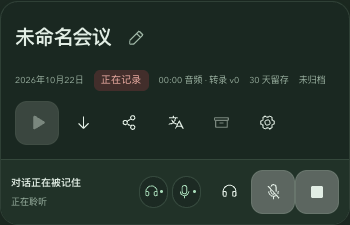

# C 版录音区、气泡反馈与音频队列验证

日期：2026-10-22。范围为用户提出的五项优化；基线 `81573fbc2d31de69ba4853faab2e8496255f8c33`。本文与生产实现一同提交。本轮是本地源码增量，公开 v0.1.1 尚不包含这些变化，未创建新安装包或发布。

## 版式确认与实现

三版只读原型使用合成内容，分别为 A「紧凑控制条」、B「顶部录音轨」、C「一体会议头部」。用户确认 C。原型及三张原图保存在本地分支 `dev_recording-ui-previews-20261022`，提交 `1bf8e7907607a8826a308991a210ccabe3c69bed`；未合入生产分支。

生产实现包含：

1. 音频处理受阻、服务配置、采集恢复、连接及纪要异常反馈使用浮层气泡，不挤占内容布局。可恢复警告支持关闭，后台刷新及短暂处理态不会自动重开；语音处理状态图标可再次打开提示。普通成功提示继续自动关闭，需用户处理的警告保留关闭和相关操作。
2. 标题、图标操作和录音控制合并为同一会议头部。“正在处理音频…”和导入进度位于录音状态容器；两个音源与录音操作保持同排。窄屏收起音源文字，保留完整无障碍名称与悬停说明。
3. 导出、分享、翻译、归档与整理设置使用图标和可访问名称。低频学习评审、删除保留在页尾，手机工具栏不再多出孤立的一行。
4. 收紧头部、纪要、笔记之间的间距；录音行保持紧凑，390px 窄屏录音按钮仍有 44px 点击区域。
5. 整理设置改由主操作栏齿轮打开对话框，保留自动整理、刷新间隔、历史版本、模板及人工版本保护。

交互组织参考 [Material Snackbar 指南](https://m3.material.io/components/snackbar/guidelines)与 [Apple Alerts 指南](https://developer.apple.com/design/human-interface-guidelines/alerts)。

## 传输瓶颈与修复

最小回归场景固定账号、网络可用状态和 IndexedDB 数据：慢音源首包 ACK 暂不返回，快音源连续四包已在本机保存。旧代码只有快音源首包能发送，后续包等待慢音源；连续两次红灯，另一个“新包到达”场景同样失败。

诊断比较了批次等待屏障、存储选头开销、权限/网络门禁三个假设。挂起与释放慢路 ACK 即可控制快路停滞；本轮定位到跨音源批次等待。

队列现在在一个请求完成后补充可用槽位，并在新包到达时唤醒已有排空任务。各音源保持串行，最大两路并发；记录、session、source、epoch、sequence、摘要及持久化后删除的约束保留。存储/网络变化仍等待在途 ACK，失败音源保留待重试片段，停止调用继续加入既有排空任务。

固定合成 ACK 延迟：每路 10 包，麦克风 40 ms、会议声音 2 ms，重复三次。

| 指标中位数 | 修改前 | 修改后 |
| --- | ---: | ---: |
| 快音源完成自己的十包 | 388 ms | 42 ms |
| 两路全部完成 | 425 ms | 421 ms |

这些是队列调度测量。真实网络、供应商 ASR 和单音源识别耗时仍需实测。原始回执见[队列基准](compact-recording-2026-10-22/queue-benchmark.json)。

## 验证结果

- `npm test`：347 项全部通过，新增气泡用例已加入显式测试清单。覆盖慢路隔离、新包唤醒、离线尾段、存储异常等待、停止排空、警告去重和处理进度位置；既有重传、账号、导出、纪要引用与人工修订保护回归通过。
- `npm run lint`、`npm run typecheck`、`npm run build:web` 通过；Web 构建仍有既有主包大小与动态导入分块提示。
- 真实 React 页面、临时 Record API 和两路合成采集：1440px、1100px、390px 明色及暗色检查通过。录音子区块中心同排，页面无横向溢出，主操作按钮只有图标；齿轮打开原有设置。
- 气泡关闭不改变头部位置/高度，后台刷新后不重弹，状态图标可以重开。
- 两路上传均被隔离服务器挂起时仍能结束会议；释放上传后，两路尾段均满足 `lastSequence=watermark=0`。本轮没有改变封存成功与后台补传的边界。
- 只读原型和最终浏览器截图使用合成会议、临时数据库和禁止真实设备的采集替身。未调用真实 ASR/LLM，未读取或改写真实会议，未替换已安装应用。

浏览器几何及交互回执见 [UI 验证](compact-recording-2026-10-22/ui-check.json)。实体设备长录制、真实供应商端到端性能与原生安装包本轮未验证；当前结果为源码与隔离环境验证。

## 实际界面截图

以下截图来自生产 React 组件的隔离合成验证。

[音频警告气泡](compact-recording-2026-10-22/audio-warning.png) · [齿轮整理设置](compact-recording-2026-10-22/settings.png)
