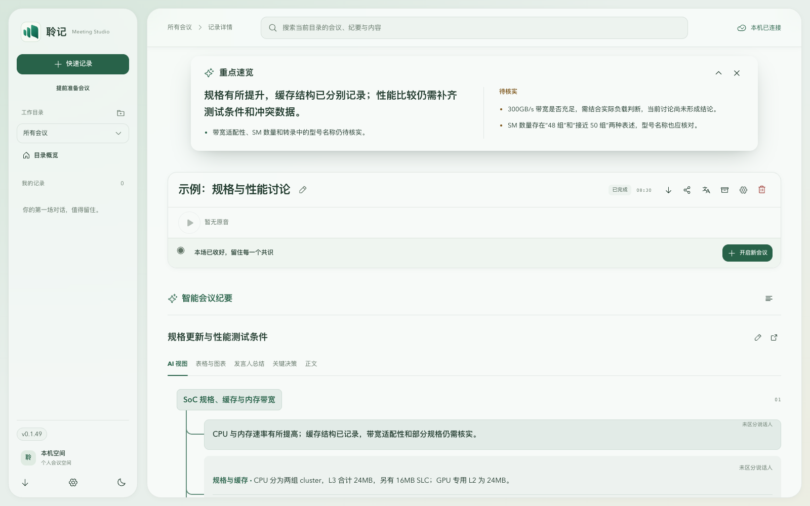
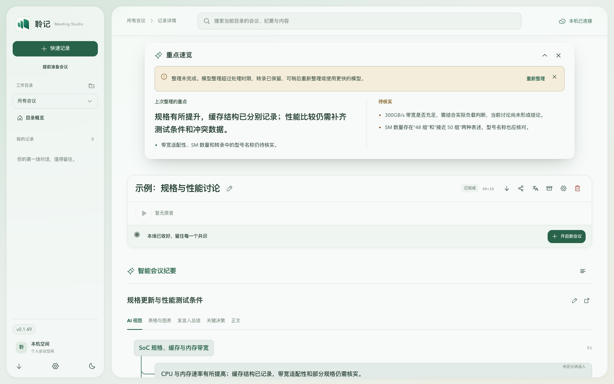

# 会后重点顶部卡片与整理失败提示

后续修订：用户已要求将失败警告改为独立悬浮 Toast，本页内嵌警告方案及对应截图已被替代；顶部方案 A 保留。当前实现与发布状态见[悬浮 Toast 验证](minutes-floating-toast-2026-10-30.md)。

2026-10-30，基于已发布 v0.1.49 的主分支 `49b6c2a`。用户已选择顶部方案 A；本轮已形成本地实现，尚未发布。

桌面重点速览改为导航下方居中的横向悬浮卡片。卡片位于正文滚动区之外，正文保持完整宽度；支持收起为一行、关闭与重新打开。仅在会议结束后自动展开，会中仍可手动查看。翻译面板临时占用空间或切换窄屏时，收起状态不会重置。窄屏保留底部卡片。移除底部来源说明及空行动占位文字。

纪要整理失败使用卡片内的浅暖色提示，保留具体原因和重新整理入口，不再覆盖顶部导航或搜索。卡片收起为一行时显示简短失败状态；关闭卡片或打开翻译面板时，恢复入口显示在纪要模块内。同一失败任务只显示一处提示，已关闭提示不会因位置变化重新弹出。重试期间保留上次重点，并明确它是上次结果。过期结果与转录版本提示也显示在纪要模块内。

## 验证

- Node 24 完整回归 696 项通过，含新增 4 项组件测试；lint、typecheck、build:web 通过。
- 浏览器使用实际 React 页面与合成会议 API，复现并确认失败提示没有 popover 定位，不遮挡导航；重试仅提交一次，并保留已有重点。
- 桌面 1600×1000、中等窗口 1000×1000、窄屏 390×844，检查顶部卡片占位、正文宽度、内部滚动、横向溢出及手机底部定位。
- 核对正常、失败、有旧结果、无最终结果、重试中、收起、关闭、提示关闭记忆、会中手动打开、Escape 关闭和焦点返回；收起状态跨翻译面板与 portal 切换保留。
- 深色主题和只有结论与行动项时的全宽结论布局通过；独立审阅确认状态归属与提示唯一性。

[窄屏失败提示截图](assets/highlights-top-2026-10-30/failure-mobile.png)。页面使用示例数据，不包含真实会议内容。

## 分发与边界

本轮修复失败提示的展示与恢复入口，没有修改模型超时、供应商调用或纪要生成协议。真实模型超时、Windows/macOS 实体 WebView 和长会议未重放。

GitHub SSH 与 HTTPS 均被网络重置，无法重新核对最新远端、推送或触发后台发布。保留本地提交；未递增版本、创建新标签或宣称已发布。恢复网络后须重新核对 main 与未使用标签，随后递增版本、执行发布契约检查并通过既有 GitHub Actions 发版。设计原型另存本地分支 `dev_highlights-floating-prototype-20261030`（`54fc9ba`），同样待推送。
