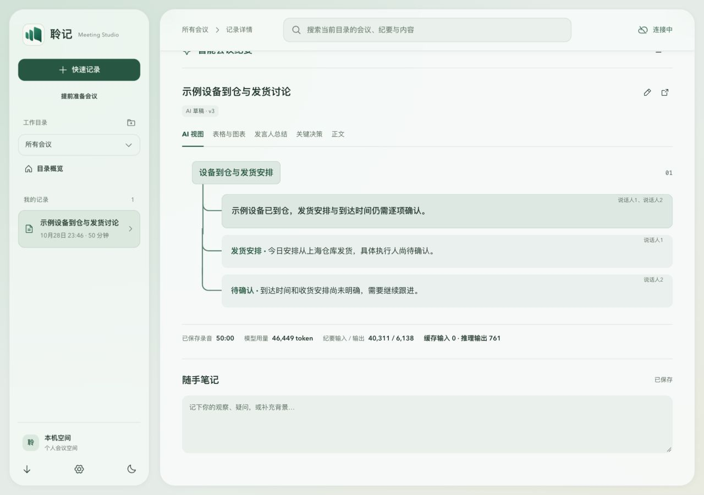

# v0.1.45 树形层级与用量栏验证

基线为已推送的 v0.1.44 源码 `cc212a46aa5f008c7dc479536009e7f4d4946459`。追加需求：分支叠加自然、有父子层级、不贴边留缝；移除供应商说明与“用量明细”文字。v0.1.44 标签不移动，本轮使用新版本。

## 当前实现

树形连接改为子行各自的竖线与圆角分支，在父容器内放到卡片后方；主干伸入主题标题背景下方，末支在最后一张卡片的中线收尾。主题和小结的背景均保留。用量栏只删除供应商说明及明细标题，不改动实际用量数据和未知值处理。

## 实际浏览器验证

使用现有完整样式页面与明确标注的虚构数据，未调用模型或读取真实会议。1280px 下主干较主题左边内缩 18px，卡片较主题缩进 54px；分支越过卡片左边 8px 并位于其背景后方，消除接缝。主题底色存在，主干起点在标题底边之上。

1280px 与 496px 均无横向溢出；正文垂直中心误差小于 0.01px。用量栏不包含“供应商”和“用量明细”，仍保留 46,449 token 及缓存/推理的合成数值。实际 DOM/样式量测断言通过，见[结果](assets/layout-v0.1.45/layout-check.json)。

## 回归与边界

本轮 Node 668/668，lint、typecheck、build:web、check:docs 通过；[发布回执](preview-v0.1.45-2026-10-29.md)已核验五项 CI、最终源码 SHA 与四个公开附件。v0.1.44 的后端、原生、网络与渲染逻辑未再变动，其[独立复审与量测](performance-fixes-v0.1.44-2026-10-29.md)仍按原源码哈希追溯。

截图与浏览器量测不能替代用户 Windows 原机、真实长会议、真实供应商与设备故障验收；本轮没有改动音频队列、ACK 或安装保护。

## 后续用户截图揭示的验证遗漏

用户放大截图确认主干出现 1px 横向错位。上述量测只计算了元素外框加伪元素 left，遗漏小结卡片自身的 1px 边框；真实包含块原点使第一段主干比其余段多偏移 1px。原始量测保留，不能据它宣称所有主干已对齐。v0.1.46 将以不影响布局的内描边保持边界，并检查包含边框在内的实际坐标。
