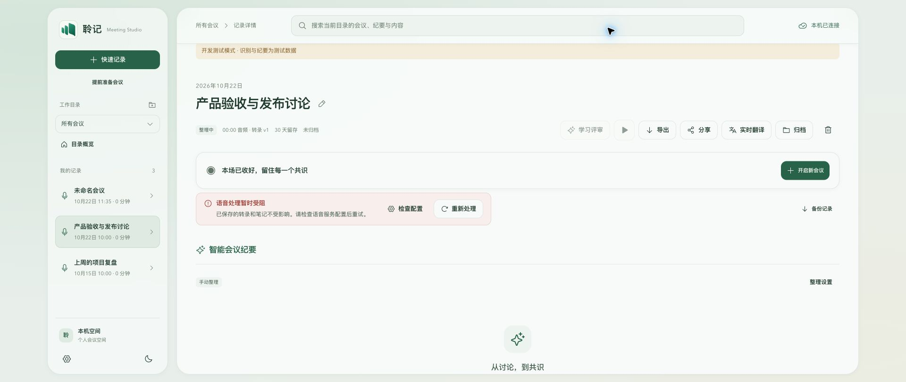
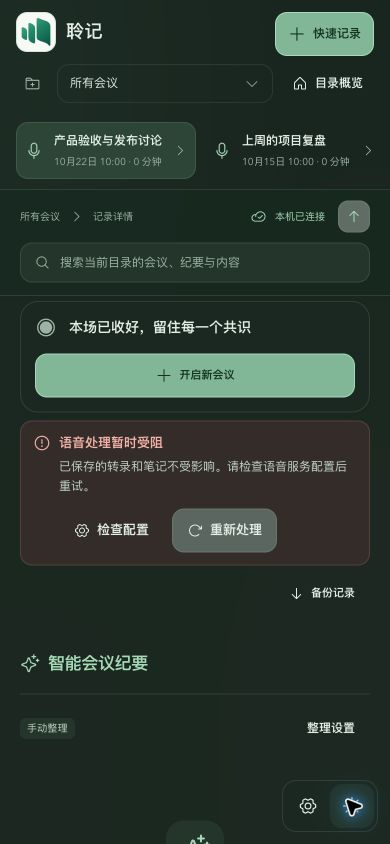

# 会议收尾、提示条、排序与启动优化

核查日期：2026-10-22。WORK-ID：`TTS-20261022-MEETING-LIFECYCLE`。基线 `c3bb975d2fe7ee9ce74db9ae949620482eac88ff`，实现提交 `9db49823483923d612f2cba0af999551bac01104`。范围是本地源码修复与验证，尚未发布新安装包。

## 已核实的问题与修改

| 问题 | 修复与验证依据 |
| --- | --- |
| 会议封存后仍等待后台上传，刷新失败也会使结束操作返回失败 | 收尾仍等待控制器落盘、读取本机 manifest 并提交 seal/pause；成功后立即释放操作，上传、转录及刷新继续执行。GET/PATCH/封存请求有 15 秒超时，失败仍保留错误，不假报成功。 |
| 通用 busy 状态使保存或重试显示“正在接入声音” | 单独区分 idle、starting、stopping；仅 starting 显示接入，stopping 显示收尾。 |
| 语音处理提示的文字和按钮挤在一起 | 提示移入录音控制下的处理区；标题、说明、检查配置与重新处理分组。只有仍保留且已有采样的原音才提示可播放/导出。 |
| 旧会议后台更新把新会议挤下去 | SQLite 与 PostgreSQL 列表均按 createdAt 倒序，id 作为稳定次序。SQLite 验证包括搜索和重新打开数据库；真实 PG 未运行。 |
| 收尾解锁后，过期列表可能覆盖新目录或新会议 | 所有列表入口统一使用请求版本、query/scope 和账户缓存 epoch 校验。两项旧请求后返回的实际函数反例先失败、修复后通过。 |
| 每次启动重写未变化的历史会议；首屏请求串行 | 完成记录先判断是否确实需要排队学习评审，再进入持久化；原有中断租约恢复分支保留。bootstrap 后的记录权限与目录请求并发。 |

## 验证

环境：macOS Apple Silicon，项目内 Node `v24.21.0` 运行时。所有数据为虚构会议或测试替身；没有打开真实录音设备、调用真实供应商或读取当前安装 App 的会议。

- `npm test`：338/338 通过，包含新增的 9 项生命周期、排序、启动及列表交错回归。
- `npm run lint`、`npm run typecheck`、`npm run build:web`：通过。Vite 仍提示主 JS 大于 500 kB；本轮没有放宽该警告或进行大范围模块拆分。
- 独立审查者复核本轮 diff，并运行新增 9 项测试；另外验证了实际 stopCapture 的 GET/POST 失败路径。所发现的列表竞态已修复并复核，没有剩余阻断。
- Chrome 隔离页面：1280px 与默认桌面尺寸、390px 窄窗口、浅/深主题；390px 页面无横向溢出，提示操作按钮均为 44px 高。检查配置可打开设置，重新处理可提交，均未误显示接入声音。
- 完整页面收尾：使用显式合成采集替身，让真实音频上传请求在测试服务挂起。结束前后均观察到 `waiting=1, released=false`；结束对话框已关闭，“开启新会议”可用，“正在接入声音”数量为 0。释放上传后，记录仍 sealed，`samples=1600`，`lastSequence=watermark=0`，尾段成功补齐。
- 原始日志、测试替身、浏览器回执及测量保存在本地 gitignored `.agent-runtime/meeting-20261022/` 和 `.agent-runtime/lifecycle-*.log`；不包含真实录音或密钥。

### 启动测量边界

相同合成场景：100 场已结束会议，每场 120 条转录片段，学习评审已就绪，临时 SQLite/压缩聚合，后台 workers 关闭，未生成原音对象。三次后台就绪测量：

| 项目 | 修复前 | 修复后 |
| --- | --- | --- |
| 无变化恢复写入 | 100 次 | 0 次 |
| 恢复耗时 | 60 ms | 24 ms |
| 后台就绪三次 | 85 / 60 / 58 ms | 56 / 27 / 24 ms |
| 后台就绪中位数 | 60 ms | 27 ms |

新增[可复现基准](../../scripts/benchmark-client-startup.mjs)，运行 `npm run benchmark:startup`。独立复跑得到 50 / 25 / 24 ms，中位 25 ms；毫秒级波动不作 SLA。该脚本只使用并清理自己创建的临时目录，关闭 worker，不调用模型。

上述数字只描述该合成历史场景的后台就绪，不包含系统代码签名校验、原生窗口/WebView、首次加载、真实历史音频目录或完整 App 冷启动。不能声称 App 整体启动加速某个百分比。

## 界面证据

以下均为隔离的虚构会议。主阅读区和录音控制保持现有布局。

## 交付与剩余边界

风险分级 medium：涉及收尾与后台补传的等待边界；未更改音频标识、幂等提交、人工纪要保护或数据结构。回退可对本轮提交执行正常 revert，不改写共享历史。

Gate 0/1：范围、授权、方案和回归依据已具备，pass。Gate 2：本地测试及独立 AI 审查通过，最终人工回应仍待项目 AGENTS.md 的交付前自查；总体保留 unknown，不冒充人工批准或真实合并。Gate 3/4：unknown，未执行本轮发布、安装或生产验证。

当前已安装 App 与公开 v0.1.0 尚不包含这些改动。本轮没有推送新提交、移动已发布标签、生成新安装包或替换当前安装；需要后续发版采用。实体麦克风/系统声音断开、原生 App 整体冷启动、真实 ASR/LLM 和长会议尚未验证，隔离替身不替代这些验收。
