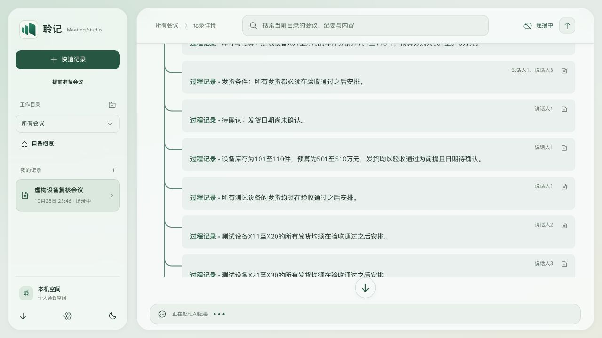

# v0.1.40 纪要完整性验证

日期：2026-10-29。本地实现与验证；[三平台发布回执](preview-v0.1.40-2026-10-29.md)已核对。

## 复现与修复

通过真实的 MinutesPanel、runMinutesPipeline、commitMinutes、seal 和 generateMinutes 入口复现失败，再修复验证：

- 第一窗进度遮盖已有完整文档。
- 12个叶窗成功，根汇总只保留一条内容；即使概要引用全量原文，也不能证明细节完整。
- 同一片段、不同项目的相同描述被错误去重；只存在于主题提要的事实遗漏；表格拆单元格后设备与属性关联丢失。
- 笔记变化使旧基线失效，停止时首窗替换完整文档；覆盖单源及双源，引用覆盖不能证明内容覆盖。
- 扩展正文在停止及正常单窗增量提交时超过20节而被拒绝；容量只从可信服务端清单和已验证基线推导，模型自报coverage不能授权放宽限制。
- 旧纠错被邻接上下文抬高时间；根汇总遗漏撤回时丢失已验证撤回。历史讨论不进入当前行动和决策数组。
- 本地提取前12段限制、行动命中抑制普通事实、多窗候选超过限制。180段本地提取保留180个来源，行动仍按既有最近50项规则产生。
- 非流式Chat Completions长度截断但JSON合法时被误当完整结果提交。

新增完整性回归18项；独立复审定向71项通过，已报必修问题闭合。发布前全量Node回归628/628通过；lint、typecheck、build:web、文档链接检查与git diff --check通过。测试使用Node 24.21.0；本地临时数据库启动曾失败一次，定向复查及最终全量重跑通过，未据此修改产品逻辑。

## 实际模型与缓存

使用本机现有模型配置，输入全部为虚构设备数据，不使用用户会议内容。

一次30片段验证保留60/60项数值。另一组三人文本具有50分钟时间轴形状，经实际3窗加1次汇总共4次模型请求，保留60/60项数值；总量46,449 token（输入40,311、输出6,138）。这不是50分钟录音或ASR测试。

最终实现重新整理这份真实模型结果，复用4项缓存，新增付费请求0次，修订升至v2，60/60项数值仍保留。该结果说明有效缓存可修复旧结果，不保证所有历史会议都具有可复用缓存。

## 完整应用界面

加载实际App与CSS，接口仅使用上述虚构数据。AI视图、表格和发言人总结显示说话人1/2/3。30行表格来源图标逐行显示；60/60项数值存在于实际渲染正文与表格。新任务已有第一窗时，仍显示完整的30行结果。

1280px及390px检查无全页水平溢出，卡片编号不超出边界。未改变基础字体、配色、圆角和树形间距；来源图标绝对定位规则收窄至卡片直接子级，避免套到表格各行。

## 验证边界

未对用户的原始会议自动重生成，未修改正在运行的旧工作副本或原始数据库。用户此前反馈所有版本都存在问题，本轮没有将某个旧版作为已知正确基线。仍需用户设备上的真实长会议、原记录重新整理、ASR分人准确度与原地升级验收。
