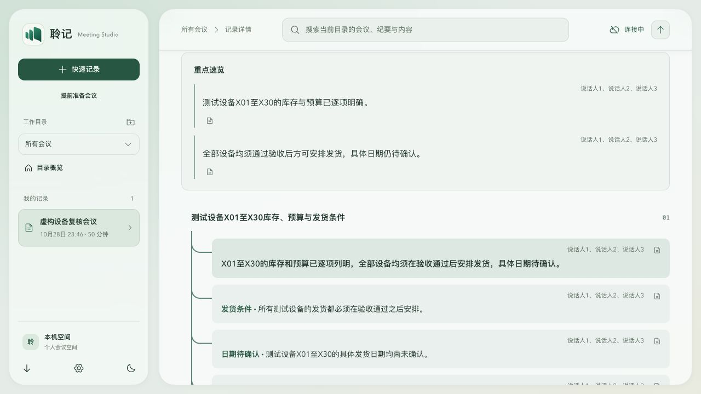
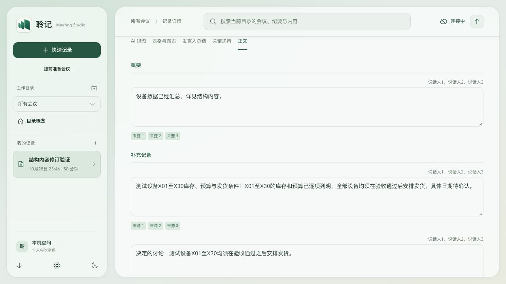

# v0.1.42 纪要调用链验证

日期：2026-10-29。本地实现与验证；[三平台发布回执](preview-v0.1.42-2026-10-29.md)已核对。

## 失败路径与回归

除[v0.1.40主体证据](minutes-completeness-v0.1.40-2026-10-29.md)外，逐项复现并补齐以下调用端：

- 普通章节和保留章节在宽主题下共用引用、描述相同，前端再次去重，导致项目A/B标题与语义消失。现在保留章节上下文和标签，明确topicId跨章节也不丢源标题；原表格归属与歧义保护保留。
- 无改动人工保存把表格独有事实从当前版本删除。正文、编辑准备和保存共用规范化；无改动保存保留原表格，实际修订保留完整正文；用户明确删掉内容后再次保存不回填。
- 合法7999字叠加标签、状态后超过单项限制。安全分块并重组每节100项；规范化幂等，全部字符与待确认语义保留；输入窗、本地提取与正文分块不损坏扩展汉字。
- 合法长文档676KB被统一600KB读取上限拒绝。纪要PATCH按已存文档推导专用额度，最高16MiB；真实HTTP长文保存成功，其他写接口仍拒绝超限请求。
- Markdown丢条目标签或冻结归属、显示原始姓名。Web与导出共用编号规则，当前转录修订变化后仍按冻结身份显示；原数据不改写。

行动文本相同时仍保留项目标签、关联主题、风险或待确认状态；最大长度行动文本不因附加标签而截断，正文、表格、人工保存、Markdown、日历及工单候选使用一致上下文。

固定源码独立复审130/130通过，未发现新的已证实P1/P2。最终全量Node647/647、lint、typecheck、build:web、文档和差异检查通过。

## 完整应用验证

使用实际App、CSS及明确标记的虚构数据，不修改用户原始会议。

三人真实模型结果在实际渲染中保留60/60项数值，表格30行，说话人编号1/2/3一致。另将60项数值仅放表格，正文页仍呈现60/60，修订输入框仍有60/60，未读取隐藏原文冒充正文覆盖。浏览器实际提交仅包含title、sections、actions、decisions，共8048字节，不发送evidenceSnapshot；真实HTTP保存与删除另外验证。

1280px与390px检查无全页水平溢出；宽表格使用独立滚动容器，卡片元信息保持既有布局。没有重新设计卡片字体、圆角、颜色或间距。

## 模型、缓存与边界

沿用真实配置模型处理虚构文本的证据：3窗加1次汇总保留60/60项数值。有效4项缓存可重新合并，新增付费调用0次；保留细节在本地完成，不追加模型回填请求。50分钟时间轴形状不是50分钟录音验证。

未对用户原始会议自动重生成，也未切换正在运行的旧工作副本或数据库。真实长会议、ASR分人质量、用户原记录以及三平台实际设备升级仍需现场验收。原本未录到、未转录或首次模型提取就遗漏的内容，不会由保留算法凭空恢复。
