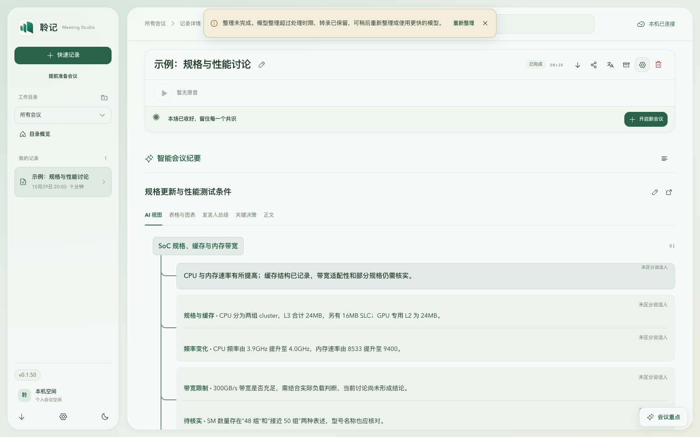

# 整理失败的独立悬浮 Toast

日期：2026-10-30。用户纠正此前内嵌警告方案，要求“需要的是悬浮 toast，完成后重新发布”，并明确指定“图中浅黄背景，顶部居中”和桌面单行显示。本轮基于本地 `c815cbe` 修正，包含尚未发布的顶部重点方案 A；版本配置已统一准备为 v0.1.50，macOS bundleVersion 为 0.1.72，远端 main 基线及 v0.1.50 标签未使用已重新核对。

整理未完成使用独立悬浮 Toast，位于窗口顶部居中，采用用户截图对应的浅黄色警告背景；窄屏仍在顶部居中，并限制宽度避免溢出。它不占据正文布局，不嵌入重点卡片；关闭、收起卡片或切换翻译面板都保持唯一提示。保留失败原因、重新整理与关闭按钮。关闭后的同一失败任务不会因位置、刷新或卡片变化重新弹出；新的任务失败可以再次提示。重试期间保留上次重点。

复用既有 Toast 的优先级、可访问性和持久警告行为，只增加 className 透传及纪要失败专用浅黄色背景；位置直接复用既有 Toast 的顶部居中规则，桌面图标、说明、重试与关闭横向同排，窄屏保留自然换行。其他通知的位置与持续时间不变。过期结果和转录版本提示仍为模块内提示，不在本轮失败警告范围。

## 验证

- 修改前：新增 className 透传测试失败；实际浏览器断言失败，因为原提示没有 `popover="manual"`，属于内嵌内容。
- 修改后：42 项定点组件和通知测试通过；Node 24 全量 697 项通过，含版本同步与发布说明契约；lint、typecheck、build:web 通过。
- 实际 React 页面配合合成会议 API：核对 Toast 为打开的 manual popover、fixed 定位、唯一实例，在窗口顶部水平居中，浅色主题背景为 #f5eddb，深色主题沿用警告色板；900/1280/1600px 桌面断言说明文字只有一行，重试与文字垂直中心一致；更窄窗口允许自然换行，保留完整原因。
- 桌面 900/1280/1600×1000、701px 窄窗口与手机 390×844，检查卡片展开、收起、关闭、正文滚动、同任务关闭记忆、刷新、新任务再现、单次重试、旧重点保留与深色主题。可操作警告等待超过普通 Toast 的两秒时长仍可见。
- 独立审阅另行验证翻译面板暂隐、其他 Toast 优先级和恢复行为，无确认缺陷；未修改源码或执行发布。

[卡片展开](assets/minutes-floating-toast-2026-10-30/desktop-open.png) · [手机](assets/minutes-floating-toast-2026-10-30/mobile-closed.png) · [深色](assets/minutes-floating-toast-2026-10-30/desktop-dark.png)。均为示例会议，不含用户真实会议内容。

## 发布准备与边界

此前 GitHub 直连的 SSH、HTTPS 与 API 返回连接重置；通过既有本机代理的命令级通道恢复，不修改系统代理。已重新 fetch，远端 main 为 49b6c2a，属于本轮 HEAD 的祖先，v0.1.50 标签未使用。首次标签操作在用户补充新样式时被自动审批拦截，确认本地和远端均未创建 v0.1.50，未推送过时实现。完成最新样式验证后，按持续授权原子推送 main 与新标签，由现有 preview-release.yml 构建和发布；最终结果以本版本发布回执为准，不覆盖已有标签或附件。

模型超时、纪要生成协议、自动录音起止与真实供应商未改动。实体 Windows/macOS WebView、真实长会议与真实模型超时未重放；本地浏览器通过不代表这些范围已验证。
