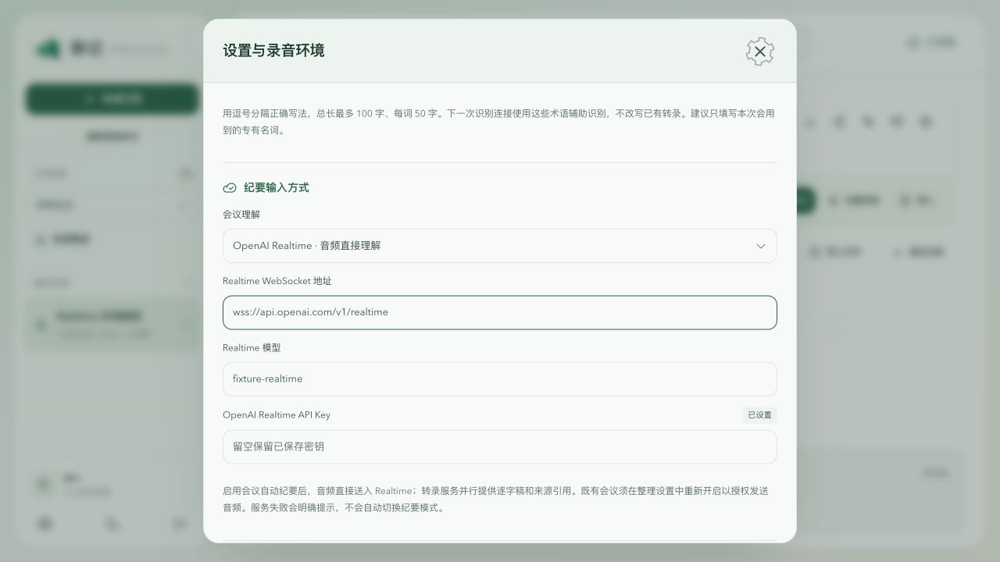
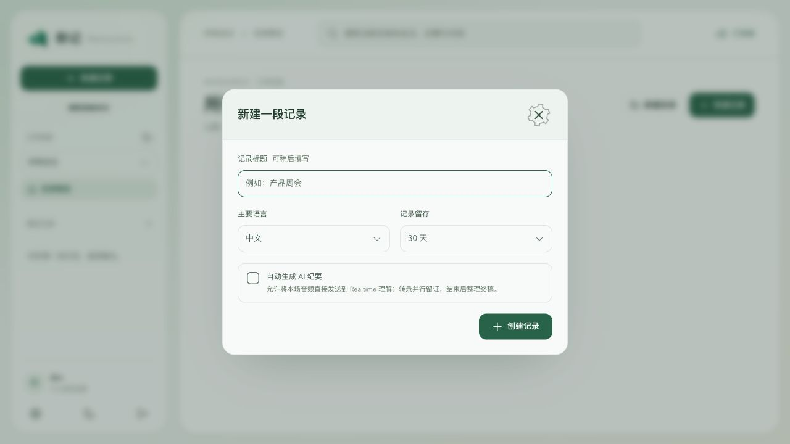

# OpenAI Realtime 与长会议本地验证

日期：2026-10-22。范围：可选原音理解＋并行 ASR 留证、兼容旧纪要链路、解除两小时限制。后端修复阶段为本地提交 `f9fbb5d`，独立评审发现已合并到该阶段；界面和说明作为后续本地阶段提交。本轮不推送、不打包、不发布。

## 已完成的本地检查

| 检查 | 结果与边界 |
| --- | --- |
| `node --test tests/records-openai-realtime.test.mjs` | 16/16 通过；本机 WebSocket/HTTP 夹具与临时 SQLite |
| `npm test` | 363/363 通过；包含本轮 16 项用例和既有 347 项回归 |
| `npm run lint` | 通过；项目规定的 Node 服务、脚本与测试范围 |
| `npm run typecheck` | 通过 |
| `npm run build:web` | 通过；保留既有大于 500 kB 的构建体积提示 |
| 隔离浏览器 | 切换 Realtime、显示独立字段、保存成功、新会议原音发送选项默认关闭、勾选后创建成功 |

定向用例覆盖：

- 独立密钥保存、占位密钥检查、WebSocket 地址校验和默认旧模式。
- PCM16 16kHz → 24kHz 转换。
- 无转录时原音先进入 Realtime，ASR 块状态和原音对象保持独立。
- 双音轨正式纪要的真实片段引用、冻结转录快照和实际用量汇总。
- 既有转录授权不能自动发送原音；HTTP 创建也强制执行这一边界。
- 断线重建、五分钟会话轮换、授权撤回与错误退避。
- 失败响应的实际用量记录、未完成 JSON 隔离、跨模式缓存隔离。
- 人工修订后的旧结果隔离、录音完成时仍在生成的终稿连接保护。
- 不保留原音时，临时音频等待 Realtime 终稿完成后清理。
- 三路重叠音轨和长转录发言的有界分窗。
- 三小时双音轨的合成元数据时间轴、累计样本数、连续 watermark 和重传幂等；这不是三小时真实录音。

## 评审发现与处理

固定后端 diff 经过独立只读评审。发现并修复：完成录音时关闭正在生成的会话、ASR 完成后过早清理临时原音、重叠音轨累计超出单次音频预算。复查未发现这三项修复的剩余阻塞。

需求轴评审确认了显式提交与自定义响应输入的官方协议，但在完整报告前受账户工具额度限制；没有将该部分宣称为完整通过。需求逐项对照和回归由实施侧继续完成，未获得人工上线审批。

本轮共享工作区中另一条流程已提交 C 版界面改造；其提交保留原样。本轮只提交明确属于本轮的文件，IDE 改动不纳入。

## 浏览器证据

预览使用独立临时数据库、开发账户和虚构模型/密钥，没有启动 worker、真实录音或供应商调用。

## 未验证

真实 OpenAI 账户、模型可用性、端点兼容性、多人会议质量、语音身份、实际音频到纪要延迟、费用账单、长时间重连、实体设备三小时录制、Postgres/S3 和发行安装包均为 NOT_VERIFIED。当前公开版本不会因为本地源码变化而自动升级。

操作说明：[OpenAI Realtime](../engineering/openai-realtime.md)。设计状态：[ADR 0016](../adr/0016-openai-realtime-minutes.md)。
