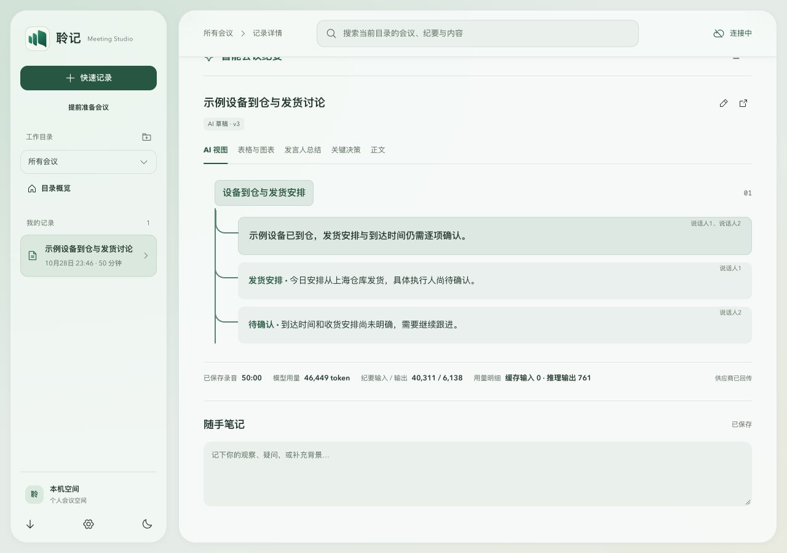
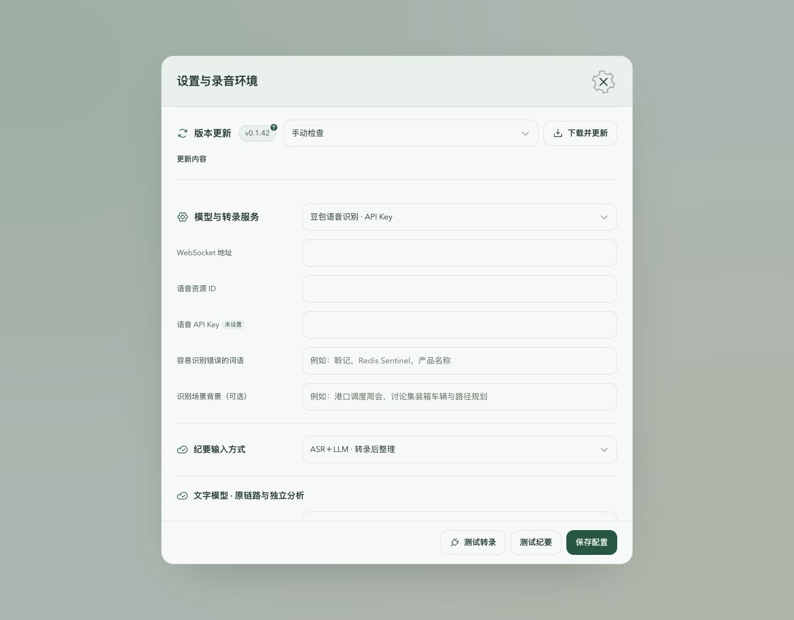

# v0.1.44 性能与可靠性修复验证

本轮实现 [v0.1.43 固定版本评审](performance-review-v0.1.43-2026-10-29.md)确认的 8 项问题。基线为 `d95edd86e0384e5fb93342a2237cbce053373b7d`；该提交只补审查文档，产品源码仍为 v0.1.43。发布状态与最终源码 SHA 以发布回执为准。

## 8 项修复及保护边界

| 问题 | 当前实现 | 验证 |
| --- | --- | --- |
| ARC01 原生异常丢尾 | 关闭采集后排空已接收输入并写尾包；原错误继续上报 | 真实 Pipeline/PacketQueue 的 overflow、设备错误、discard 与编码失败回归 |
| NET01 发送永久占用 | WebSocket 写入有 45 秒期限和取消信号，异常终止连接并走已有重试 | 真实回环 WS 停读、恢复、取消；worker 释放 lease，逐项保留已确认 chunks 并从前序重放 |
| BE-PERF-003 固定前 100 条饥饿 | audio/minutes/learning 独立 keyset 游标，每轮仍最多 100 条 | 201 条待办轮转；100 个旧任务不阻塞新会议转录 |
| BE-PERF-001 前序二次扫描 | 每个 source 一次建立首个未完成 sequence | 保留 expired、重试耗尽前驱阻塞语义；不跳过音频缺口 |
| BE-PERF-004 目录分析空转 | feed meta 保存轻量 analysisInput，兼容旧记录的单项缓存 | 旧 meta 首次读取一次；meta 变更即失效；删除与到期仍过滤 |
| FE01 转录重复渲染 | 空 delta 保持 segments 引用；主题按 id+revision 索引；预览与历史子树分开 | 3,000 段重叠主题、修订、翻译与说话人更新验证 |
| FE02 纪要重复渲染 | 稳定引用回调，记忆树形子组件和 speaker map | 同纪要、时钟与 SSE 元数据更新对照 |
| FE03 编辑复制整份纪要 | 只替换修改的条目和章节；草稿冻结引用、转录修订与说话人编号 | 未修改对象共享且不被改写；后台较早片段到达不改变草稿编号 |

未迁移音频格式或存储，没有删除待保存队列，也没有绕过 ACK、安装安全、租约或人工编辑保护。独立进程与追加日志方向仍在 [ADR 0022](../adr/0022-capture-processing-isolation.md)的 proposed 范围。

## 同一基线的隔离量测

环境：macOS arm64 / Apple M4 Pro / Node 24.21.0；浏览器为 Chromium 156。全部使用虚构数据与临时 SQLite，没有真实会议音频或外部供应商调用。后端一次预热、7 次顺序采样；浏览器使用生产 React，测同步 render+commit 墙钟时间，各 7 次更新。原始数据在本页 assets，不能推广为所有设备的百分比收益。

| 负载 | 基线中位耗时 | 本轮中位耗时 |
| --- | --- | --- |
| 70 分钟双源 8,400 chunks、半数积压的 aggregate emit | 129.59 ms | 38.67 ms |
| 20 场历史各 3,000 chunks、2 个已完成目录分析的空转周期 | 144.41 ms | 0.19 ms |
| 打开 3,000 段转录后的空元数据 delta | 26.7 ms | 0.1 ms |
| 3,000 条纪要的计时 / SSE 元数据更新 | 14.9 / 13.5 ms | 0.2 / 0.2 ms |
| 3,000 条纪要的单字段输入 | 12.2 ms | 0.6 ms |

转录主题 evidence 读取由 4,804,500 次降至 6,000 次；7 次编辑的全量结构克隆由 7 次降至 0。目录分析 8 个空转周期的完整记录解压由 320 次降至 0。

限制：完整 aggregate 解压、序列化和压缩仍存在；无积压 emit 约 40 ms，no-op 约 30–31 ms，没有声称全部消除存储写放大。首次打开 3,000 段转录仍有明显挂载成本，本轮主要减少后续无关更新。纪要树同时按用户要求移除来源图标，首次挂载对照包含这项 DOM 差异。

[浏览器基线](assets/performance-v0.1.44/browser-before.json) · [优化后](assets/performance-v0.1.44/browser-after.json) · [存储基线](assets/performance-v0.1.44/storage-before.json) · [存储优化后](assets/performance-v0.1.44/storage-after.json) · [目录基线](assets/performance-v0.1.44/workspace-before.json) · [目录优化后](assets/performance-v0.1.44/workspace-after.json)

## 界面约束与截图

按用户澄清恢复主题标题本身的浅色背景、圆角和边界；分支沿用此前的 36px 圆角连接线。保留小结背景，正文垂直居中，说话人角落绝对定位，不额外占行；树内来源图标数为 0。宽屏卡片正文中心偏差小于 0.01px，窄屏双行偏差为 0。默认仍为 AI 树形视图。

版本只显示一个当前版本胶囊；有更新时在右上角显示小箭头，目标版本通过悬停和无障碍标签提供。更新内容继续使用独立弹窗。模型与转录区域标题统一为 ink-1，16 个可见输入/下拉控件在 1280px 视口均为左 487 / 右 995，无横向溢出。截图为明确标注的虚构数据夹具。

## 回归与独立复审

完整 Node 回归 668/668，0 fail/skip；ESLint、类型检查、Web 构建、文档检查均退出 0。本地原生 43 项通过，1 项真实更新源测试按既有设置忽略。网络回环/原生代理测试在允许绑定端口的环境执行，沙箱端口限制的失败不作为产品结果。

三位专家以基线加文件 SHA-256 固定实际工作树，复审前后哈希一致，未发现剩余已复现 P1/P2。文件哈希已由主审逐项核对并归档：[复审版本](assets/performance-v0.1.44/review-hashes.json)。

- 后端：修复回归 5/5、目录回归 8/8、额外真实临时 SQLite 边界探针 4 组；覆盖游标删行/新增、legacy meta 变化/到期、owner/scope/hash 一致和运行中修订取消。
- 网络/原生：实际 WS/worker 网络回归 28/28，直接导入生产 audio 模块的 Rust 测试 20/20，真实只读文件 I/O 错误补证 1/1。该审查者此前提供过草案，重新读取实际产物并独立运行验证，不称完全盲审。
- 前端：实际源码浏览器状态回归 35/35，相关 Node 回归 65/65；覆盖翻译/来源/说话人更新、后台修订、原引用保存、草稿编号冻结与重复编辑。探针未加载产品 CSS，视觉另由本页实际界面截图验证。

独立评审补发现草稿说话人编号会随后台较早片段到达重排，已改为进入编辑时冻结当时的编号映射；WS 测试也改为不假定某个固定 TCP 缓冲大小。

## 未验证范围

Windows 用户原机、原受影响会议、真实双源 70–90 分钟录音、真实 ASR/LLM、实体设备故障与磁盘耗尽尚未复验。PostgreSQL 分支做静态核对，本地运行证据为 SQLite；CI 构建不等于现场验证。性能量测是同机合成负载，不是用户会议的资源占用承诺。
