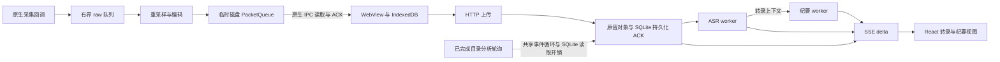

# v0.1.43 性能与可靠性专家评审

确认 **8 项问题：3 项 P1 可靠性问题、5 项 P2 性能问题**，均经过独立复核。没有证据可将这些问题全部归因为用户原 Windows 现场事故；本轮交付审查与复现证据，以下修复尚未实施。

日期：2026-10-29（Asia/Shanghai）。源码基线：`2a4e02f5aa35da8a7088e96fa66ac30739c243e0`，标签 `v0.1.43`。审查开始时 HEAD `e65802aa577f9785d3bac48635f2bae373aad69d` 仅增加发布回执，产品源码与标签一致。

## 结论与优先级

| 优先级 | ID | 已确认机制 | 直接影响 |
| --- | --- | --- | --- |
| P1 | ARC-01 | 原生过载/致命采集错误使有效尾音收尾被跳过 | 已接收但尚未编码的音频无法进入保存队列 |
| P1 | NET-01 | ASR WebSocket 发送等待没有应用层截止时间，busy 又屏蔽租约恢复 | 单个连接可拖住该 worker 的后续 audio 轮；正常结束会议不能解除该等待 |
| P1 | BE-PERF-003 | 记录处理 lane 共用固定前 100 条 due 记录，无分页/轮转 | 无关旧任务可持续挡住新录音进入识别 |
| P2 | BE-PERF-004 | 已完成目录分析仍反复加载、解码整库会议 | 停录后仍有周期性后台阻塞，随历史和分析任务数量放大 |
| P2 | BE-PERF-001 | 每次整聚合读写、克隆/序列化/压缩，并扫描积压块的前序依赖 | 长会议的一次小更新占用较长同步执行时间 |
| P2 | FE-01 | 展开转录反复扫描主题证据；无关 delta 也重建片段数组 | 转录规模变大后，普通更新仍重算、重渲染全文 |
| P2 | FE-02 | 不变纪要跟随父计时和元数据更新重渲染 | 录音期间持续重复计算大树 |
| P2 | FE-03 | 每输入一个字深复制整个纪要草稿并重渲染全部编辑框 | 长稿修订输入变慢 |

主审将两项后端开销由专项初评 P1 校准为 P2：已测到合成负载下的阻塞，但没有原机端到端耗时、丢音或明确 SLA 违约证据。严重度与证据可信度分别判断。

## 范围、方法与覆盖

用户明确要求前端、后端、网络、架构四方向深审，本轮按完整运行链而非最近一次 diff 取样。四个独立 AI 审查视角分别负责前端、后端、网络、原生架构与主审合并；没有外部人工专家签字或生产验收。

经过去重，**73 个源文件有定点语义覆盖**。覆盖清单枚举 356 个源代码单元，其中 243 个未深入语义审查、40 个旧入口/实验实现明确排除；文件被列为已审仅表示其中列明的函数和调用链已审，不表示整文件逐行通过，也不输出全库无缺陷结论。

- 当前默认链路：React Web → Record API/worker；桌面为 Tauri 原生采集 + WebView + 自带 Node/SQLite 后台。桌面 API 与六个语义 worker lane 共用一个 Node 事件循环，lane 独立不能隔离同步 CPU/数据库阻塞。开发入口则分别启动 API/worker 进程，不能直接套用桌面阻塞程度。
- 重点覆盖：采集/持久化 ACK/停止排空、浏览器队列、ASR 连接恢复、后台任务选择、SQLite 聚合与投影、目录分析、SSE/delta、长转录、纪要与修订、播放器/Toast/Modal 的资源释放。
- 排除/未验：旧 Web/desktop shell、旧 Session/Transcript 服务、Go 实验、完整发布脚本及工具链审计；真实 PG/S3、多 worker 部署和全量安全/依赖漏洞扫描。生成的打包副本不当作另一份权威源码审查。
- 未访问用户数据库、真实音频、供应商服务或凭据。测试服务使用本机临时端口、临时 SQLite、虚构记录，运行后清理。

[完整覆盖清单](performance-v0.1.43/coverage.json) · [冻结量测与复核结果](performance-v0.1.43/metrics.json)

## 关键运行关系

下图是转录后整理模式的简化调用关系，未画直音理解分支。原音保存、转录和纪要分别完成；跨层开销会相互放大的程度仍需原机追踪，不是本轮完整端到端压测结论。

源入口：[desktop-backend.mjs:103](https://github.com/RoyalLiang/LingJi-Meeting-Studio/blob/2a4e02f5aa35da8a7088e96fa66ac30739c243e0/services/records/src/desktop-backend.mjs#L103)、[scripts/dev.mjs:40](https://github.com/RoyalLiang/LingJi-Meeting-Studio/blob/2a4e02f5aa35da8a7088e96fa66ac30739c243e0/scripts/dev.mjs#L40)。

## P1：优先修复的可靠性问题

### ARC-01：原生错误停止跳过尚可保存的尾音

位置：[audio/mod.rs:144](https://github.com/RoyalLiang/LingJi-Meeting-Studio/blob/2a4e02f5aa35da8a7088e96fa66ac30739c243e0/apps/desktop/src-tauri/src/audio/mod.rs#L144)、[收尾条件:359](https://github.com/RoyalLiang/LingJi-Meeting-Studio/blob/2a4e02f5aa35da8a7088e96fa66ac30739c243e0/apps/desktop/src-tauri/src/audio/mod.rs#L359)。主审发现并复现，网络专家独立核对完整恢复链。分类：限定条件下已复现。

输入队列容量为 256 块。队列满或致命设备错误会同时设置 error 与 stop；线程结束时仅在 error 为空才处理已有 raw frames 并执行 pipeline.finish。因此有效的已接收数据也被跳过。WriterGuard 只关闭 PacketQueue，上层只能排空已编码完整包，无法补回未编码帧。

隔离探针复用实际 queue_input、Pipeline、PacketQueue，以及逐字提取的生产收尾代码。给入 0.1 秒 partial，再排入 256×10ms 数据：正常停止得到 **42,560 个 16kHz 样本**、队列剩 0 块；第 257 块触发过载后得到 **0 个样本**、仍剩 256 块。这里的 2.66 秒是给定输入量，不是每次故障固定损失量；此前已编码的完整包仍受排空保护。

最小方向：区分主动 discard 与采集错误；编码器仍可用且未主动丢弃时，保存已经接收的有效帧和尾音，同时继续上报错误。编码/磁盘本身失败时保留失败状态。回归必须覆盖 raw 队列溢出、致命设备错误、正常停止和主动丢弃四种完整收尾路径。

### NET-01：ASR 发送停滞无法靠租约或正常结束恢复

位置：[doubao.mjs:106](https://github.com/RoyalLiang/LingJi-Meeting-Studio/blob/2a4e02f5aa35da8a7088e96fa66ac30739c243e0/services/records/src/doubao.mjs#L106)、[speaker-streams.mjs:19](https://github.com/RoyalLiang/LingJi-Meeting-Studio/blob/2a4e02f5aa35da8a7088e96fa66ac30739c243e0/services/records/src/speaker-streams.mjs#L19)、[发送等待:68](https://github.com/RoyalLiang/LingJi-Meeting-Studio/blob/2a4e02f5aa35da8a7088e96fa66ac30739c243e0/services/records/src/speaker-streams.mjs#L68)。网络专家发现，主审读取调用链并独立重跑对照。分类：本机停读和状态恢复路径已复现；无应用层上界为静态明确。

触发路径为豆包说话人流式 ASR。write 逐帧等待 socket.send 回调，没有发送 deadline/AbortSignal；45 秒计时器只有 end 后才启动。processSource 的 busy 早返回先于 fence/lease 检查。worker 等待整轮 Promise.all，故一条挂起写即可阻止该进程启动下一 audio 轮。

生产 WS 函数连接本机停读服务端，发送随机 PCM：第 2 个 15 秒/480,000B 批次在 **1000ms 观察窗**内未结束、state.error 为空。恢复读取后成功完成；显式 close 后以 ECANCELED 结束。状态探针把 lease 人工置为过期，仍是 opens=1、writes=1、closes=0；seal 后 asrEnded=false，原等待仍未结束。没有把一秒观测写成实测无限等待。

反证：桌面整体退出会直接 closeSpeakerStreams，已验证 close 能解除等待；其他 worker 副本可能在租约过期后接管，多副本恢复未测。因此影响限定为该 worker 进程的后续 audio 轮，不能宣称所有部署全局永久停止。

最小方向：为发送和单次处理设置明确截止/中止，失败进入现有关闭与退避，并让 busy 最终释放；保留已持久化音频供重传。回归覆盖服务端停读、恢复、关闭、过期 lease、用户结束与删除，确认其他记录持续推进。

### BE-PERF-003：固定前 100 条 due 记录饿死后续新录音

位置：[repository.mjs:118](https://github.com/RoyalLiang/LingJi-Meeting-Studio/blob/2a4e02f5aa35da8a7088e96fa66ac30739c243e0/services/records/src/repository.mjs#L118)、[worker.mjs:32](https://github.com/RoyalLiang/LingJi-Meeting-Studio/blob/2a4e02f5aa35da8a7088e96fa66ac30739c243e0/services/records/src/worker.mjs#L32)。后端专家发现，主审独立重跑真实 SQLite/worker 对照。分类：已复现。

audio/minutes/intents/translation 等记录处理 lane 共用 listWork 的 LIMIT 100，无分页/轮转，也未按 lane 的可执行能力筛选。workspace 走专用函数，不在这里混为同一路径。100 条启用了翻译目标但没有可用翻译服务的旧记录可以长期 due，后面的新录音无法进入 audio 候选页。

临时 SQLite 插入上述 100 条记录，再插入含一段已持久化虚构 PCM 的新录音。真实 runCycle(audio) 连跑三次：新录音未入选、转录调用 0 次、chunk 仍 pending。只清除旧记录的无关翻译目标，同一新录音下一轮转录调用 1 次并 done。音频对象持久化仍正常；缺陷发生在识别调度。上游创建限制为同一用户少于 200 条未删除会议（server.mjs:140–142），因此第 101 条可达；全局 listWork 还会混合多个用户的 due 记录。

最小方向：可执行工作按 lane 选择，并使用稳定分页/轮转保证尾部记录获得机会；只增加 ORDER BY 不能消除永久 due 的占位。回归至少包括超出 100 条、配置缺失旧任务、新会议和其他 lane 互不阻塞。

## P2：已量测的性能问题

以下均为合成数据。后端：Node 24.21.0、Apple M4 Pro/macOS、SQLite WAL/FULL、压缩聚合；前端：Chrome 156、production React，未加载生产 CSS。通常为一次预热 + 7 次观察，记录中位数及样本最大值，**不把 7 次的最大值称为总体 p95，也不据同步 render+commit 推算实际 FPS**。

### BE-PERF-004：完成目录分析后仍周期性全库扫描

位置：[workspace-worker.mjs:8](https://github.com/RoyalLiang/LingJi-Meeting-Studio/blob/2a4e02f5aa35da8a7088e96fa66ac30739c243e0/services/records/src/workspace-worker.mjs#L8)、[desktop-backend.mjs:113](https://github.com/RoyalLiang/LingJi-Meeting-Studio/blob/2a4e02f5aa35da8a7088e96fa66ac30739c243e0/services/records/src/desktop-backend.mjs#L113)。

workspace worker 在检查终态前，为每个历史分析 job 加载并解码所有会议。桌面每轮结束 250ms 后再跑，即使分析已完成且内容未变化也重复执行。20 条历史、每条 3000 块元数据，总聚合 JSON 约 38MB：0/1/2 个已完成分析 job 的单轮中位数为 **0.01/64.33/124.60ms**，最大值 0.02/70.95/132.47ms；8 轮分别解码 0/160/320 条记录。主审复测 0.01/64.61/126.80ms，供应商调用均为 0。

最小方向：每周期共用一次读取，进一步用轻量 revision/hash 投影或变更失效机制判断 stale，避免读取原音块元数据；保留历史分析失效检测，不能简单永远跳过 completed。为“完成分析后闲置”增加明确查询/解码次数断言。

### BE-PERF-001：长会话积压放大同步整聚合开销

位置：[repository.mjs:25](https://github.com/RoyalLiang/LingJi-Meeting-Studio/blob/2a4e02f5aa35da8a7088e96fa66ac30739c243e0/services/records/src/repository.mjs#L25)、[整聚合写入:89](https://github.com/RoyalLiang/LingJi-Meeting-Studio/blob/2a4e02f5aa35da8a7088e96fa66ac30739c243e0/services/records/src/repository.mjs#L89)、[change:160](https://github.com/RoyalLiang/LingJi-Meeting-Studio/blob/2a4e02f5aa35da8a7088e96fa66ac30739c243e0/services/records/src/repository.mjs#L160)。

每次小变更需解压/解析整条记录，多次序列化、压缩、投影与克隆；schedule 对每个未完成块又扫描更早未完成块。以 **70 分钟双轨、8400 个一秒块，交错排列**为例：全 done 的 emit 中位数/样本最大值 47.07/51.73ms；每轨前 2100 done、后 2100 pending 时为 **140.53/149.37ms**。主审复测分别 35.66/39.04ms 与 122.53/126.54ms。no-op 虽不重写，仍有约 35–38ms 的整聚合读取与变化检测。

该对照未拆分每个子步骤的耗时，故合并为一个根因组；不声称压缩、SQLite 或 schedule 单独占某个比例。最小方向先将前序块检查改为按 source 的线性计算，减少未变更内容的重复序列化与投影；保留持久化确认与 FULL 安全语义。只有新量测仍表明需要，才提出聚合拆表等迁移 ADR。

### FE-01：展开转录的主题证据扫描与全量更新

位置：[record-subscription.ts:98](https://github.com/RoyalLiang/LingJi-Meeting-Studio/blob/2a4e02f5aa35da8a7088e96fa66ac30739c243e0/apps/web/src/record-subscription.ts#L98)、[Transcript.tsx:40](https://github.com/RoyalLiang/LingJi-Meeting-Studio/blob/2a4e02f5aa35da8a7088e96fa66ac30739c243e0/apps/web/src/components/Transcript.tsx#L40)。

仅元数据 delta 也会重建 segments 数组。展开视图全文排序/过滤，再对每段执行 topics.find/evidence.some。精确源码 SSR 计数：300/1000/3000 段分别产生 48,450/534,840/**4,804,500** 次证据 ID 读取。浏览器 3000 段同类更新中位 **102.5ms**，39,010 个元素；不同轮次有波动，不能据此量化 Windows 现场延迟。

最小方向：无片段变化的 delta 保留原片段数组引用；按 minutes/revision 建主题引用索引，避免每段遍历全部证据；按结果再决定是否需要窗口化，并保护原文定位、搜索、编辑和视觉样式。

### FE-02：不变纪要仍跟随计时和元数据重渲染

位置：[Minutes.tsx:55](https://github.com/RoyalLiang/LingJi-Meeting-Studio/blob/2a4e02f5aa35da8a7088e96fa66ac30739c243e0/apps/web/src/components/Minutes.tsx#L55)、[树渲染:74](https://github.com/RoyalLiang/LingJi-Meeting-Studio/blob/2a4e02f5aa35da8a7088e96fa66ac30739c243e0/apps/web/src/components/Minutes.tsx#L74)。

相同 minutes 引用没有隔离整树更新，计时和元数据刷新会重复生成节点及来源/说话人展示。3000 项纪要：record 不变的父计时更新中位 **71.8ms**；同 minutes 的 SSE 元数据更新 **55.6ms**。这是同步 render+commit；未加载生产 CSS，未测 paint/GPU。

最小方向：将稳定正文与计时/状态区域分开，以真实内容和引用版本作为 memo 依赖，稳定引用回调；保留说话人及人工版本更新，不改变树形卡片外观。

### FE-03：单字修订复制整稿并重渲染全部输入框

位置：[Minutes.tsx:71](https://github.com/RoyalLiang/LingJi-Meeting-Studio/blob/2a4e02f5aa35da8a7088e96fa66ac30739c243e0/apps/web/src/components/Minutes.tsx#L71)、[输入更新:80](https://github.com/RoyalLiang/LingJi-Meeting-Studio/blob/2a4e02f5aa35da8a7088e96fa66ac30739c243e0/apps/web/src/components/Minutes.tsx#L80)。

草稿保留完整冻结快照和派生结构，每个 textarea 的 onChange 再深复制整稿并重渲染全文。3000 项、3030 个 textarea，7 次输入发生 7 次整稿复制，中位 **51.7ms**、样本最大 306.2ms；1000 项输入中位约 15.2ms。

容量反证已核实：1000 项/10 节通过普通 schema；3000 项/30 节不能作为普通单次 provider 输出（超过 20 节），但通过可信多窗口提交和聚合校验。300/1000/3000 三种规模，无改动保存与实际修订共六次真实隔离 HTTP PATCH 均 200。问题不是请求仍携带全部冻结原文。最小方向是可编辑字段使用结构共享，隔离单行输入，并保留版本引用与冻结快照。

## 已检查的保护与未升级项

- v0.1.43 的隐藏转录优化有效：3000 段从未展开/展开后折叠，同类更新约 0.3ms，不把已修复问题重复计数。
- 20 轮 Transcript/MinutesPanel/AudioPlayer/Toast/Modal/计时组件挂载卸载后，受测 interval、rAF、ResizeObserver、window/document 监听及 top-layer 残留均为 0；这不证明数小时堆内存或 GPU 不增长。
- 播放器波形有固定 192 峰值预算；SSE 有 draining/背压保护；IDB 队列、前端重试与永久鉴权错误停止都有既有边界。未把这些误报为无界。
- 前端上传槽公平性仍需另构造旧会话恢复压力测试：正常新会议因创建时间倒序通常先被选中，不能把它与 BE-PERF-003 的后端固定页混为一谈。
- 模型取消后的实际网络释放、长期堆/GPU/电量、多副本接管、磁盘极慢/满盘及 Windows WebView2 硬件组合尚未充分验证，未计入确认数量。

## 修复顺序与验收建议

1. 先逐项修复 ARC-01、NET-01、BE-PERF-003，每项保留失败复现与反证；验收原音完整性、发送超时可恢复、旧任务不挡新录音。仍以已持久化 ACK 为准。
2. 再收紧目录分析闲置扫描和 schedule/聚合重复工作。用同一 70 分钟双轨与 20 条历史数据做前后对照；不同机器的毫秒值不可直接作发布门禁。
3. 最后处理三个前端热点，复用相同普通/多窗口容量数据，核对折叠草稿、来源定位、说话人和树形视觉一致性。
4. 在 Windows 原机采集一次 CPU、Node 事件循环、队列深度、持久化 ACK、ASR 与渲染的同时间窗证据，补全现场归因；随后进行长会议和断网/恢复验收。

这些是最小整改建议，不构成整套重写、迁移或发布决定；当前客户端仍是 v0.1.43，8 项修复均未实施。

## 验证记录与可复核性

| 证据 | 本轮实际结果 | 边界 |
| --- | --- | --- |
| 原生收尾 Rust probe | 正常 42,560 样本，过载 0，残留 256 块 | 实际生产函数/收尾代码；没有启动设备或 Windows |
| WS 停读/恢复/关闭 | 1000ms 窗内停滞；恢复 fulfilled；关闭 ECANCELED | 生产 WS 函数 + 本机服务；无真实供应商 |
| ASR busy/lease/seal | lease 过期和 seal 均不解除挂起；显式释放后完成 | 内存 repository + 实际处理函数 |
| SQLite/worker 饥饿 | 三轮 0 次转录；移除无关 due 后 1 次 done | 真实临时 SQLite/worker；识别函数注入 |
| 闲置扫描/双轨聚合 | 专家与主审分别重跑，冻结数据见 JSON | 不同轮次有正常波动，未做总体 p95 估计 |
| React 与容量 | 实际浏览器；SSR 比较计数；六次隔离 HTTP 保存 | production React 无生产 CSS，非整页 FPS |
| 现有定向功能回归 | 7 文件，67/67，通过、无 skip | 常规功能回归未覆盖这些容量和故障条件 |

反例探针 exit 0 表示成功观察到缺陷，不表示已经修复。此前发布的 653 项功能测试和五项 CI 为基线证据，不充当本轮性能或原机验证。

本机原始证据位于 `.agent-runtime/performance-review-20261029/{frontend,backend,network,architecture}/`，包含探针源码、命令及原始结果；该目录 gitignored，不是远程发布附件。冻结量测和覆盖 JSON 随本报告入库，源码链接绑定不可变 SHA。所有临时服务已关闭，用户原有开发进程和数据未作修改。

主审独立复核：后端三项、网络一项、前端调用链及 4,804,500 次计数；网络专家独立复核 ARC-01。Issue 状态：未发布（本次要求为评审）。未发现 P0 的证据不等于不存在其他高风险问题。

