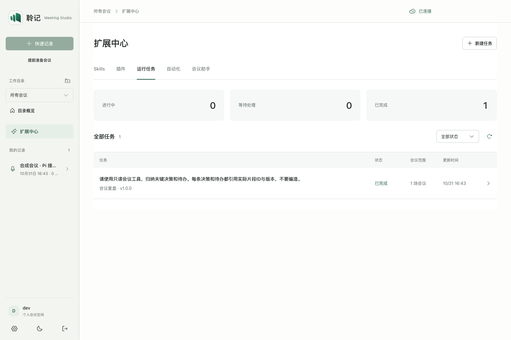
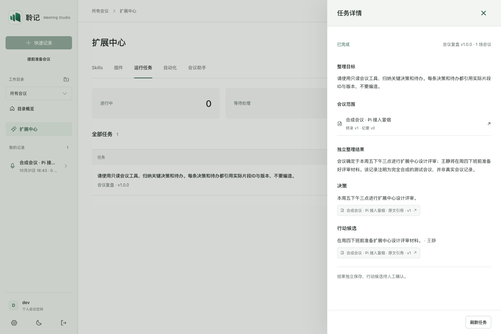

# Pi 接入验证，2026-10-31

状态：本地实现与验证，待交付前自审回应。未推送、发布、安装或替换客户端。基线 `9eddc5d`；源文件摘要见 manifest。

## 结果

| 验证 | 结果 |
| --- | --- |
| Node 26.12.1 全量回归 | 工作区403/403；排除用户未提交改动的干净暂存快照402/402 |
| Rust 客户端回归 | 21/21 |
| ESLint | 通过 |
| Web 类型检查与构建 | 通过；既有主块 >500kB 警告保留 |
| 真实模型冒烟 | 现有 Responses 模型 + 合成会议文字 → Pi 只读工具 → 决策/行动引用；completed、stale=false，原纪要未修改 |
| 真实应用浏览器 | 36/36：旧导出/分享/纪要设置/目录分析/设置入口 + 五页六种宽度无横向溢出 |
| 隔离桌面后端 | 随包 Node26、工作区外独立目录，health/bootstrap/agentTasks 均 200 |
| 独立代码评审 | 当前范围无未解决的可复现 P1/P2；独立新测试17/17及故障隔离定点复核通过 |

新测试覆盖真实 Pi 工具循环、输出引用与全范围读取校验、scope/owner 隔离、幂等/冲突、无模型不降级 mock、人工修改 stale、取消与超时、两轮生产模型桥、SIGKILL 检查点恢复、完成不重放、单写者锁、删除/到期/所有者变化清理、孤儿文件清理及恢复时并发单开。清理测试直接检查 Pi 全部逻辑表中的合成敏感标记，不只检查 API 隐藏结果。

API 冒烟使用本地 HTTP 模型 stub，真实跑生产模型桥；另一次真实供应商调用只使用三段合成会议文字，未读取或发送既有会议。`real-smoke.json` 保留真实结果与版本引用；`bundle-smoke.json` 保留隔离后端启动结果；`browser-smoke.json` 为界面断言。

## 现有能力回归边界

干净快照包含原有385项与新增17项；当前工作区额外包含用户未提交的一项播放回归，因此为403项。这一用例及用户播放源码不纳入本轮提交。

原有 Node 用例全部保留，包括 lifecycle、playback-transport、realtime、minutes-pipeline、minutes-views、settings-quality、workspaces、learning 及 native-client 等；没有改写这些模块来迁就 Pi。用户原有播放代码与对应测试仍保持未提交状态，不纳入本轮提交。

真实应用检查确认 agent 来源可返回原会议，导出、分享、纪要整理设置、工作目录概览和 Provider 设置可打开；这些 UI 检查没有触发录音权限、创建分享链接或改变用户模型设置。

## 调试记录与限制

- 监听 localhost 的 Node/Rust 用例在沙箱中出现 EPERM/PermissionDenied，允许本地端口后通过。未将环境限制报告成产品故障。
- 后端准备会重建 Node 缓存与资源目录，必须先完成再运行依赖它的 npm/Cargo 验证。早先并行导致暂缺 npm/资源文件，已按顺序重新准备并复验。
- 目录概览 UI 需等待实际 API 响应，浏览器断言在内容就绪后检查，最终36/36通过。
- 原生音频设备、真实 ASR/实时音频长会议、跨平台安装、断电、网络真实故障与最终安装包体积未在本轮重测。真实模型只做合成单会议冒烟，不能证明全部真实会议质量和成本。
- 运行中可读草稿尚未实现；模型请求跨崩溃的重试可能重复计费。取消为协作式，未来不配合取消的外部插件仍需进程隔离。

## 已有依赖告警

`npm audit --omit=dev` 检出原有 `protobufjs@8.0.0` critical 包告警；基线与当前同为8.0.0，没有由 Pi 新增。未在此次接入改造中自动升级协议依赖。官方 [GHSA-xq3m-2v4x-88gg](https://github.com/advisories/GHSA-xq3m-2v4x-88gg) 的代码执行问题需要攻击者控制 schema/descriptor；只用可信固定 schema 解码不直接满足该前提。本轮没有完成全部告警的可利用性审计，不能称已无安全风险，应单独修复和复验。

## 实际应用截图

[手机结果](03-mobile-result.png)
