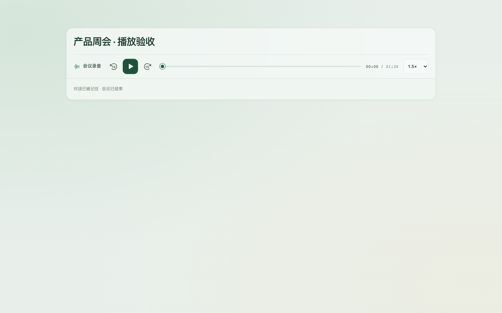

# A 版播放器与 Apple 开发者验证

日期：2026-10-22。范围：本轮播放器源码、隔离浏览器验收与既有包签名诊断；远端发布另记回执。

## 已确认的选择与实现

用户选择 A「一行完整控制」后才实施生产 UI。播放器从图标工具栏移到会议头部独立一行；保留现有导出、分享、翻译、归档和齿轮设置。录制中不展示已保存录音播放器；结束后按原音留存、保存与清理状态提供播放或禁用原因。

新增前后 15 秒、原生进度滑块、时间和五档倍速。最长已保存音轨作为共享时钟；短音轨自然结束，向后跳转时可恢复。暂停时跳转不自动播放，末尾停止，再点击播放从头开始。所有音源元数据就绪后才允许跳转；切换会议和暂停会取消旧播放请求。

拖动时暂停并只更新预览，释放后定位一次并按原播放状态恢复；支持方向键、Home/End、Escape 取消和指针取消。播放错误使用现有气泡组件提供重试。倍速同时作用于两条音轨并保持音高。

交付前补充复核发现：实际 HTMLAudioElement.load() 会将 1.5× 重置为默认 1×。新增失败重试回归先失败（11/12），再将倍速应用移到 load() 后，12/12 通过。该补丁使用递增 v0.1.4，未改写已发布 v0.1.3。

## 当前验证

- 播放传输回归 12/12，含首尾截断、短音轨恢复、同步倍速、未知时长保护、100 次拖动仅一次提交、取消与切换会议、失败后重试、暂停取消未完成跳转恢复。
- 实际 React AudioPlayer + 两条 90/60 秒合成 WAV，在隔离 Chrome 中验证前后跳转、1.5× 双轨播放、短音轨恢复、30 次指针移动零媒体定位而释放后每轨一次定位、键盘 Home/End、末尾重新播放。
- 1440/900/390px 与深色布局没有横向溢出，滑块、按钮和倍速选择器均保留至少 44px 操作尺寸。桌面播放器高 69px，390px 窄屏换行高 117px。
- TypeScript、ESLint、Web 构建与文档链接检查通过；独立源码快照完整回归 **375/375**，ESLint、TypeScript、Web 构建和 115 份文档链接检查通过；快照排除了并行纪要与 IDE 修改。构建保留既有分包大小和动态/静态导入提示，未新增失败。

隔离组件截图（合成音频与虚构标题）：

## Apple 提示的原因与边界

v0.1.2 官方 DMG 为 47,443,524 字节，SHA-256 `d0752b7cdedac862e00036f7a778bf29bde95af77ebc0d8290c9639246d3da5c`。只读挂载后应用 `codesign --verify --deep --strict` 通过；签名为 ad-hoc，TeamIdentifier 未设置，Gatekeeper 执行评估 exit 3 / rejected。挂载已卸载，未安装或启动应用。

用户已确认没有 Apple Developer Program 账号，本机有效 Developer ID Application 身份数量为 0。故本轮不能消除开发者验证提示，也没有把元数据改成正式签名或已公证。新增[官方单应用授权与正式签名条件](../releases/macos-trust.md)。

## 验证限制

真实用户录音、Tauri WebKit、蓝牙输出和全新 Mac 网络下载后的首次打开未验；浏览器合成音频不等于实体设备验收。多次暂停/恢复产生的历史音源时间偏移是现有时间线行为，本轮未重构。工作区另有并行纪要 Provider 改造，本轮提交和构建不包含那些未验收改动。
