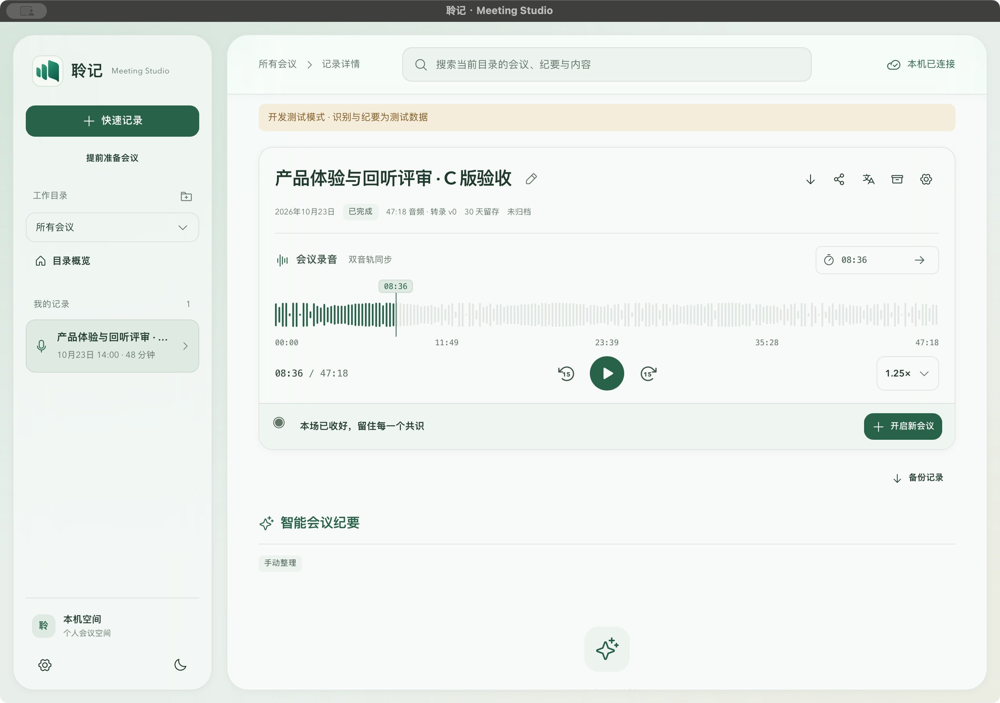
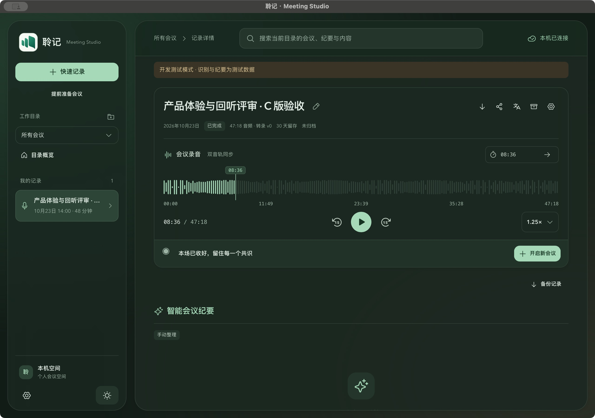

# C 波形回放复核与验证

用户反馈当前进度条与设计不同。重新核对历史素材：A 是单行进度条，C 是波形、刻度和居中播放。用户于本轮明确确认采用 C。设计依据见[录音回放设计](../design/recording-playback.md)。旧 A 验收不作为本轮视觉完成证明。

已实现：真实 PCM 波形（固定 192 点）、双轨共用时间轴、五个刻度、居中圆形播放控制、范围校验后的时间跳转，以及统一倍速菜单。原音仍遵守登录、所属记录、留存、完整持久化与结束状态门禁。后端逐片读取，不向前端返回整段 PCM；取消请求不继续返回部分波形。

本地 411 项 Node 回归、ESLint、类型检查、Web 构建通过。新增检查覆盖真实 PCM 分片、取消／数据损坏、短音轨边界、长时间输入、生产组件的波形／刻度结构、双轨拖动和失败降级。三小时合成 PCM 摘要固定 192 点、818 字节，单次约 297ms；这是合成容量检查，不代表真实存储／设备性能。

未使用浏览器调试。本地调试 App 使用唯一临时 bundle 标识、独立数据目录和合成 PCM，在实际原生窗口确认浅深主题、波形与刻度、居中控制、08:36 时间跳转及 1.25× 倍速选中。没有播放真实会议或打开采集设备；这不是发布安装包验收、实体核听或后台长录制。最初同名窗口匹配只读后即停止，没有计作隔离证据。前轮自动暂停修复继续保留，CI 原生构建错误定位与发布回执另记，不能将本地通过描述为已发布。

## 原生视觉证据

两轴独立审查固定范围 `2912c24...7690398`，Standards／Spec 均无待处理 P 级问题。原生验证使用已编译的生产组件与合成数据，不使用浏览器。

发布增量的两轴评审均发现 preview 版本遗漏更新（P1）。已在首次推送前同步 preview/base/package 为 0.1.10，bundle0.1.32，并核对五份版本配置及发布门禁；未改写远端标签或削减测试。

## v0.1.11 已发布

正式发布的 verify、build、publish 均成功。五个附件、227 个源码摘要及下载包的隔离启动核验通过；范围与限制见[发布回执](preview-v0.1.11-2026-10-23.md)。
