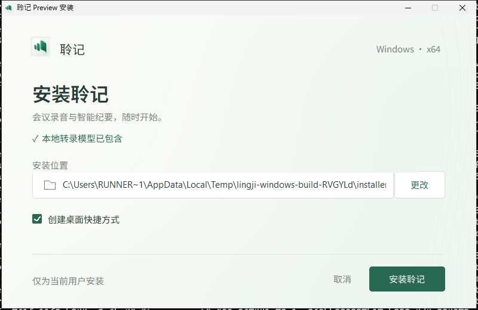

# v0.1.17 发布回执

证据截止：2026-10-25 01:57（Asia/Shanghai）。本轮测试版已发布；实体设备与真实会议验收另列。

- 源码：[`c9c8f1d`](https://github.com/RoyalLiang/LingJi-Meeting-Studio/commit/c9c8f1daddeb389cca8bb93d7741a214079b803f)，标签 `v0.1.17`；产品版本 `0.1.17`，macOS bundle `0.1.39`。main 与标签已原子推送；本回执不生成新版本。
- [正式 Actions](https://github.com/RoyalLiang/LingJi-Meeting-Studio/actions/runs/40116272681)：verify、Mac、Windows、publish 四任务均成功。
- [Release](https://github.com/RoyalLiang/LingJi-Meeting-Studio/releases/tag/v0.1.17)：10 个附件已全部下载，比对大小与 GitHub digest；双平台发布元数据指向相同冻结源码，308 个文件摘要逐一与 Git 对象核对。
- 源清单 SHA-256：`2dbe4801bf8696f3bc5ca763c4d1bcc679b9c92b7915bd7a1ee2686b194e6f5f`。

## 安装包

| 平台 | 下载 | SHA-256 |
| --- | --- | --- |
| macOS Apple Silicon | [DMG](https://github.com/RoyalLiang/LingJi-Meeting-Studio/releases/download/v0.1.17/Lingji-0.1.17-macos-arm64.dmg) | `0313f263dc6f47ceed82b519cfd7506d4a8ef5c9708567451fc585e267aa3bd8` |
| Windows x64 | [EXE](https://github.com/RoyalLiang/LingJi-Meeting-Studio/releases/download/v0.1.17/Lingji-0.1.17-windows-x64-setup.exe) | `8070c40b10937c0197cd94107d0e6d01863b857eb99fe890b07384c5fdeea137` |

## 已实现与验证

- 包内完整携带 SenseVoiceSmall INT8、Silero VAD、sherpa-onnx/ONNX 原生运行时；无需 Python、手工运行转录服务或首次下载模型。保留外部 FunASR 高级选项及既有云端服务。
- 应用按需启动私有推理子进程，空闲卸载、失败后可重新启动；关闭窗口继续菜单栏／系统托盘常驻，真正退出回收。升级旧默认本机服务配置时恢复未过期失败音频，迁移中断可继续，人工修订与原音身份保留。
- Windows 安装器按确认稿使用暖白全幅背景、玉绿按钮与三屏流程；原生控件保留真实复选框和点击行为。字体私有加载，路径仍使用 Windows 系统字体回退。
- 本地 Node 回归 469 项、Rust 28 项、静态／类型检查、156 份文档检查、发布源码／协议 11 项通过；两轴独立评审的确认问题已关闭。
- 后台实际安装／卸载、资源完整性、生产 App 启动／重启、默认本地转录配置通过；包内中文、英文和静音样本在 Mac 与 Windows 均真实推理通过。
- 最终下载的 Mac DMG 已重新校验 CRC、深度签名、版本，在隔离目录启动 App；默认本地模型配置、持久化／退出和包内真实推理再次通过。Windows EXE 已下载并比对摘要，安装及运行验证来自 GitHub-hosted Windows CI。

## 配置

在“设置 → 会议理解”选择 **ASR＋LLM · 转录后整理**，在“转录服务”选择 **本地转录 · SenseVoice（已内置）**。纪要继续使用原豆包等模型的地址、模型 ID 和密钥；本地转录不需要语音密钥。若此前选择“仅豆包音频模型”，先切换会议理解方式，才能使用独立本地转录。

未配置云端服务的新安装默认使用本地模型；已有自定义服务保留。旧失败音频如未自动恢复，可在保存期内点击重新处理。

## 原生界面证据

以下为正式产品安装器在 Windows CI 中的诊断压缩截图；不是设计预览。已检查主按钮命中与复选框状态。[进度页](preview-v0.1.17-native/installing.jpg)、[完成页](preview-v0.1.17-native/finish.jpg)、[结构化校验记录](preview-v0.1.17-native/verification.json)。

## 保留边界

本地离线能力覆盖转录，纪要仍使用已配置的云端模型。公开短样本验证链路，不代表会议准确率；INT8 与完整权重已观察到英文 gold/code 等识别差异。实体 Windows 音频设备、长会议、多人与噪声、100%–200% 实机 DPI 和新电脑仍未验收。

Windows 包未代码签名；Mac 为 ad-hoc 测试签名，未获 Apple 公证。深度签名校验、CI 成功及隔离启动不等于全新电脑的系统信任或物理设备验收。
