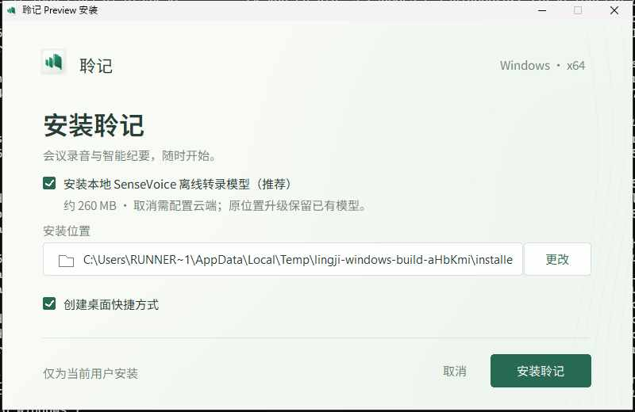
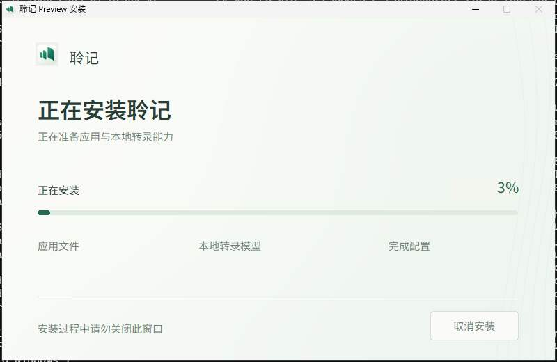
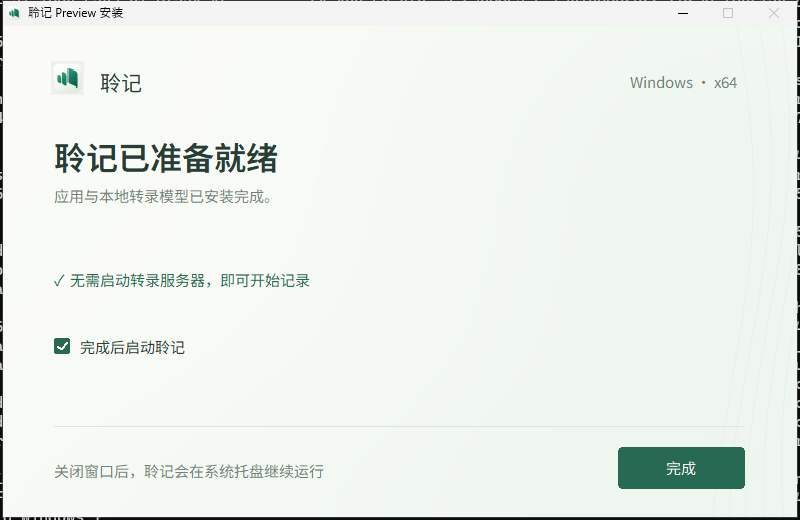

# v0.1.19 交付证据（2026-10-25）

状态：测试版已发布，公开下载附件已核对。源码 `eaf3c0afe8fef55544ce7ca961afe31daca37df7`；macOS bundle `0.1.41`。main 的后续回执提交仅补文档，沿用此标签与附件。

[Actions](https://github.com/RoyalLiang/LingJi-Meeting-Studio/actions/runs/40204022613) 的 verify、build、build_windows、publish 均通过。[Release](https://github.com/RoyalLiang/LingJi-Meeting-Studio/releases/tag/v0.1.19) 为 prerelease，十个附件已下载核对。

## 修复与安装行为

Windows 的 CPAL Xrun、DeviceChanged、RealtimeDenied 通知不再被误判为致命停止；同次可用缓冲继续入队。设备不可用、权限拒绝、流失效、后端故障和持续积压仍停止。缓冲波动可能造成短暂缺音，继续采集不能补回丢帧。

Windows 安装页默认勾选本地 SenseVoice，可取消。取消只跳过新模型文件，安装包下载大小不变；没有模型时需配置云端服务，不会自动切换已有 Provider 或上传录音。原位置、非降级的 NSIS 安装在取消模型且已有 manifest 时覆盖升级，避免旧卸载器删除模型。更换位置或降级不属于此模型保留路径。

## 验证

- 本地：469 项 Node、30 项 Rust、ESLint、TypeScript、Web 构建和文档检查通过。音频先验证原处理会因 Xrun 停止，再验证可恢复通知继续入队、致命故障和持续积压保护。
- Windows CI：原生回归、本地模型真实推理、实际安装/卸载、默认模型、取消后无残留模型且原生 App 可启动均通过；配置为空时不会声称云端转录已就绪。
- 升级夹具：当前候选包装完后将注册版本设为较旧版本，再取消模型升级；37 个原模型文件 SHA256 均保留。该夹具不等于实体 Windows 上的 v0.1.17 用户安装升级验收。
- 公开附件：十个下载文件的 SHA256 与 GitHub 附件摘要、安装包校验文件和发布元数据一致；310 个源码摘要与标签源码核对。
- macOS：CI 独立包/App/内置模型验证通过。本机公开 DMG 的 SHA256 与镜像 CRC 通过；系统拒绝只读挂载，未完成本机下载后 App 运行复测。未遗留该镜像挂载。

v0.1.18 正式构建在 UI Automation 读取原生窗口时失败，publish 被阻止、未发布附件，标签保留。v0.1.19 仅对窗口快照作有界重试，保留进程退出、页面超时、勾选和资源校验失败条件；两条独立评审均无确认遗留问题。

## 原生安装界面

以下为本版本真实 Windows 安装包的 CI 截图，已人工查看。截图不构成实体声卡或高 DPI 验收。

## 下载校验

| 附件 | 字节 | SHA256 |
| --- | ---: | --- |
| INSTALL-macos-arm64.md | 2331 | `a70606c15a6a1e9b2792edb9dfbfa08dcd95b11a08e9f104113f3b74fe89c9cf` |
| INSTALL-windows-x64.md | 3522 | `68ee34099783d33e85007236aa2084d888a5318839615b85063311c1e67ad3ba` |
| Lingji-0.1.19-macos-arm64.dmg | 219511056 | `1600ee4c8a69da323b65110091866b1e6d645a60d1fb00d9b7d78d8eba23c34c` |
| Lingji-0.1.19-windows-x64-setup.exe | 407566159 | `0cde4b9577c1643f6b0d16d698dfe01edf67156ac3208fb7fdf16c0d52a195cc` |
| package-smoke-windows-x64.json | 421 | `db2674497eb2e7894494db3ed4c5ec33957662d6224dae769e49b5ecd5c45130` |
| package-smoke.json | 421 | `4721a4645ff4d6c908f6b1f165a5e2bb121754b724309ba61051e2197722ebde` |
| release-windows-x64.json | 52302 | `8548a3ef856e5651c141365c5c50db5b545e9a957ecff833ab3120f85f567800` |
| release.json | 53056 | `ef8bb43a93cbc8aed2a2763b07e9ca0cf0937dd33464b107a5d0b4d9aa03b5fa` |
| SHA256SUMS-windows-x64.txt | 102 | `6df77b5b42ed08fcf5a620191b30205148032304cc11adc2bd15a4011ecdec91` |
| SHA256SUMS.txt | 96 | `23792c20ebe6ccc68b38f4991dfc96a87e6658f2a2e0ad3058f928423449da3d` |

## 边界

实体 Windows 声卡、麦克风/系统混音、蓝牙/多设备切换、长会议、干净机器、高 DPI 与签名信任未验收。Windows 未签名；macOS 为临时签名、未公证。本轮未调用真实云端 ASR/LLM，不以模型样本或回调测试代替真实会议效果。
