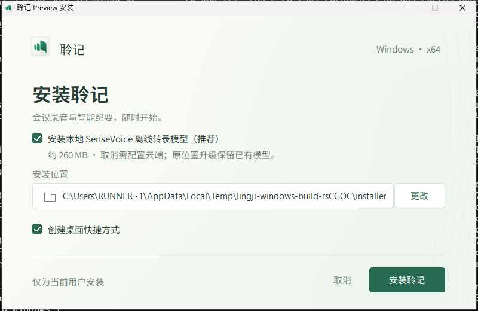
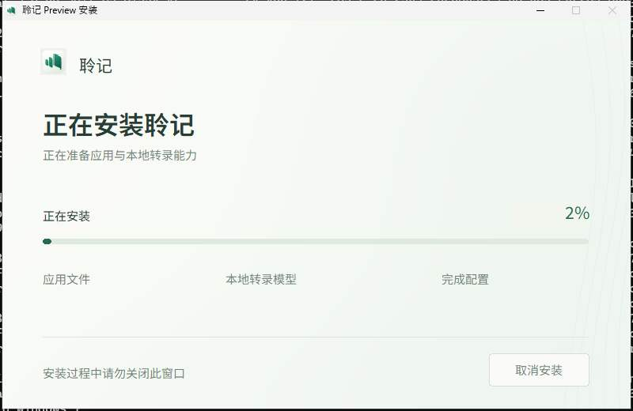
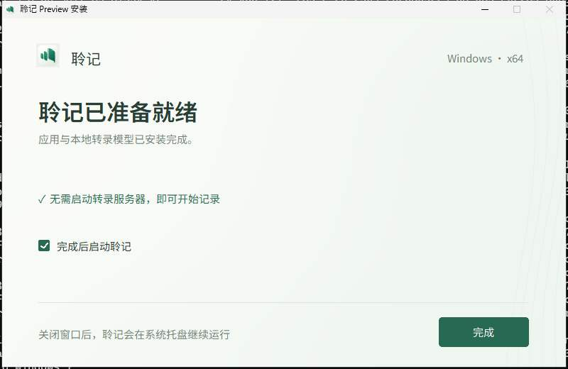

# v0.1.22 已发布与验证（2026-10-26）

[Release](https://github.com/RoyalLiang/LingJi-Meeting-Studio/releases/tag/v0.1.22) · [正式 Actions 40228814842](https://github.com/RoyalLiang/LingJi-Meeting-Studio/actions/runs/40228814842) · [功能与使用说明](../releases/v0.1.22-preview.md)

源码与标签固定为 `b4a88e27b3ee9bb7a13e6c9a2b1f20f46ca61f7e`，版本 0.1.22，macOS 构建号 0.1.44。main 与新标签原子推送；verify、macOS build、Windows build、publish 四项成功。临时诊断流程已移除，既有用户脏文件未提交或覆盖。

## 公开附件

独立下载十个公开附件，逐字节计算 SHA256，核对 GitHub 摘要、两平台校验清单与发布元数据；318 份源码指纹与标签内容一致，两平台来源列表相同。

| 平台 | 安装包 | 字节数 | SHA256 |
| --- | --- | ---: | --- |
| Windows x64 | [Lingji-0.1.22-windows-x64-setup.exe](https://github.com/RoyalLiang/LingJi-Meeting-Studio/releases/download/v0.1.22/Lingji-0.1.22-windows-x64-setup.exe) | 407,622,546 | `c55e816a640a557ee47926378ab6f12d1c80b9fcfc9b0849685a7be5c4f275fb` |
| macOS Apple Silicon | [Lingji-0.1.22-macos-arm64.dmg](https://github.com/RoyalLiang/LingJi-Meeting-Studio/releases/download/v0.1.22/Lingji-0.1.22-macos-arm64.dmg) | 219,547,480 | `e47f86d0f7db580941e5a3c399f58e93b9e7503bd03c144afed0c3a603df08c0` |

其余八附件为两个校验清单、两个发布元数据、两个安装说明、两个包运行报告；均在 Release 中，未覆盖已发布附件。

## 验证证据

- 本地 474 项 Node、32 项 Rust、TypeScript、ESLint、Web 构建及文档引用检查通过。默认 120 秒、手动重启隔离旧 fence、排队音频计时及版本漂移都有回归。
- 本机真实原生 WebView 自动夹具通过：私有会话加载、录音自动最小化、暂停保留胶囊、真实继续、结束确认、恢复主窗口、设置取消后重开、排队时钟、停止排空和重启补传。
- 正式 Windows 原生夹具通过连续六分钟隐藏录音、采样量覆盖、两音轨序号/偏移、持久队列增长、停止排空与重启完整补传。使用合成音频，未打开实体音频设备。
- Windows 完整安装器验证覆盖默认模型、取消模型、云端启动、默认/取消模型的较旧注册版本夹具升级。37 份既有模型文件逐份核对，哈希与设置为旧值的时间戳保持不变；人工改坏的后台资源恢复；安装器 HWND 从开始至完成一致。夹具不是实体旧版安装包升级验收。
- Windows 原生 DLL 内容哈希、junction 与真实 8.3 路径入口回归通过。哈希失败会回退复制；普通同目录 NSIS 升级跳过维护/旧卸载页面，不强行关闭正在录音的应用。
- 两平台包内 SenseVoice 英文、中文、静音基本推理通过；无需 Python 或外部转录服务器，推理时未下载模型，未做会议识别准确率评估。
- 本机下载的公开 Mac DMG 完整性与深层签名检查通过，隔离 App 的独立后端、重启持久化、父进程退出清理和三种公开样本推理通过。工作区挂载路径受限，改在自有 `/private/tmp` 目录只读验证后正常卸载；未强制卸载任何卷。
- Standards 与 Spec 对功能候选 `a96afd09` 增量均静态 PASS；最终产品行为相同，后续为配置同步、行尾回归、临时流程清理与回执。

## 安装器实测图

来自正式 Windows CI 的实际安装器，展示路径是测试临时目录。

## 边界

实体 Windows 声卡/系统音频、蓝牙切换、真实长会议、多屏与高 DPI 尚未验收。Mac 人工视觉、鼠标及物理 Esc 键验收受锁屏阻塞；自动原生交互已经通过。

覆盖升级仅在安装阶段跳过未变化资源；网络仍下载完整包。不同目录、降级与旧 MSI 保留原维护流程。关闭主窗口会后台常驻，升级前请结束录音、完成补传，并从托盘/菜单栏退出。Windows 安装器无 Authenticode 证书；Mac 为临时签名，未公证；透明胶囊未验证 App Store 分发。

## 保留的失败记录

[v0.1.20](preview-v0.1.20-2026-10-26.md) 因预览覆盖版本未同步，verify 拦截；[v0.1.21](preview-v0.1.21-2026-10-26.md) 的 Mac build 成功，但 Windows 新版本回归不容 CRLF，publish 跳过。两标签保留，未移动或覆盖。实际仓库版本一致性、LF/CRLF 回归已加入；[隔离 Windows 40228052109](https://github.com/RoyalLiang/LingJi-Meeting-Studio/actions/runs/40228052109) 及正式 v0.1.22 均通过。
