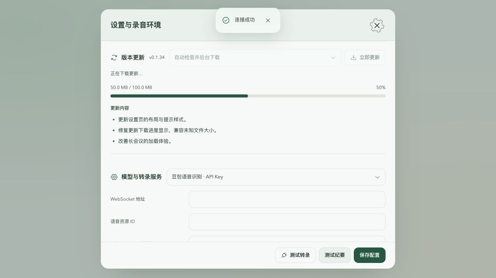

# v0.1.35 设置、通知与转录渲染本地验证

日期：2026-10-28。基线 `21666613df1675f8cdb57c39dcac2dcb68e349d5`。此文是本地证据，三平台已发布，状态见[Actions 与附件核验回执](preview-v0.1.35-2026-10-28.md)。

## 实现与回归

- “版本更新”标题、当前版本、检查策略和更新操作同行；转录服务与纪要输入方式的选择器与标题同行，隐藏重复小字但保留控件可访问名称。窄窗口保持模型标题与选择器同行，版本更新操作有序换行，无横向溢出。
- 更新说明只提取命名的改动章节；同级或更高级标题结束该章节，三级标题也不会泄漏安装、校验或构建章节。链接与强调转换为安全纯文字列表。
- 全宽下载条显示字节与百分比，未知总量使用无确定百分比的进度状态；100% 仍显示正在校验，不提前宣告验签成功。检查/下载/安装门禁逻辑未改。
- 普通 Toast 顶部居中，计时 2000ms；悬停、聚焦、后台与被新提示覆盖期间暂停。错误和显式持久提示保留手动关闭。失败纪要显示在所属区域，保留重新整理及按任务去重关闭。
- 逐字记录与纠错入口改为图标按钮。可访问名称和悬停标题包含片段数量；真实 Chromium 中 Enter 能展开 3000 段。首次展开后保留挂载，收起与收到新片段后再次打开，未保存文本仍保留。
- Windows/Linux 使用来自既有 SVG 标志的专用 64×64 RGBA 托盘图。macOS 保持 22pt 模板。Linux 接入已有托盘状态与菜单；保持原有关闭窗口退出行为，未将 Linux 改为关闭后隐藏。

自动回归：Node **573/573**，Rust **37 通过、1 忽略**。`npm run lint`、`npm run typecheck`、`npm run build:web` 通过；独立评审定向 43 项通过。原生 Linux 编译与运行由发布 CI 单独验证。

`cargo fmt --check` 存在既有全库格式差异（例如未触碰的 `audio/mod.rs`），本轮不重排历史源码。Web 构建仍有既有大 chunk 提示。

## 浏览器验证

真实组件在临时、未提交的样例中渲染，提供合成记录和更新状态；没有执行真实下载安装或模型请求。测试宽度 1280 与 390，覆盖已知/未知下载总量、顶部提示、固定页脚、同行标题以及转录图标键盘操作。

固定 3000 段样例，Chromium 开发构建 React Profiler 一次对照：旧收起区域约 **30028 个 DOM 节点、102ms**；首次延迟加载实现约 **18 节点、0.5ms**（随后图标替换使节点约 20）。旧无关刷新约 **141.5ms**，新已展开区域对无关刷新约 **0.1ms**。首次展开约 208ms，将原本启动时的创建工作推迟到用户需要时；展开后真实转录变化仍正常重绘。

这是固定样例的局部渲染量与开发构建计时，不是端到端启动承诺。样例开启 `.webview2` 样式类并不等于运行了 Microsoft WebView2。未测 Windows GPU、显存、进程内存、真实长期会议或复杂词表负载。Linux 托盘依赖桌面环境的 AppIndicator/状态区域支持，当前没有实机观感验收；[Tauri 官方限制](https://v2.tauri.app/learn/system-tray/)说明 Linux 不提供托盘鼠标事件，因此通过托盘菜单操作。

## 词库研究边界

[网络与离线词库方案](../research/network-offline-vocabulary-2026-10-28.md)核对公共数据来源、许可、供应商词表能力与下载包验证方式。建议先做公共离线词包叠加私有词表，再按需在线补查，候选仍需版本核对与人工确认。本轮是研究交付，未增加联网查询、下载器、第三方词库授权或私人名称外发。
