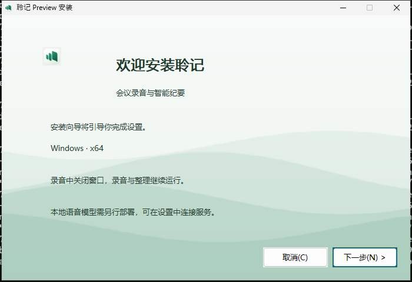
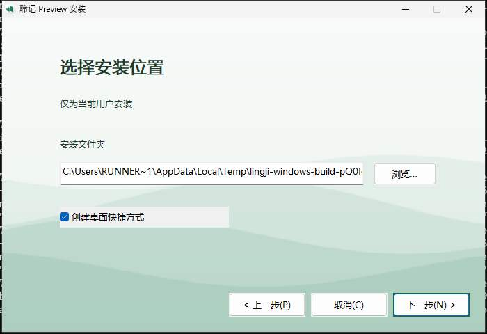
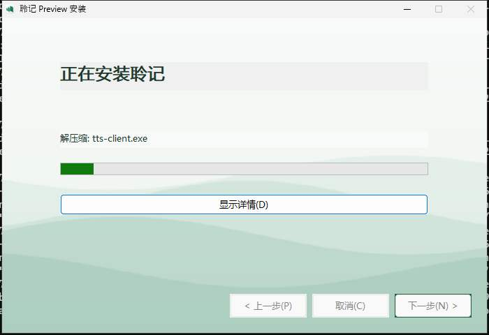
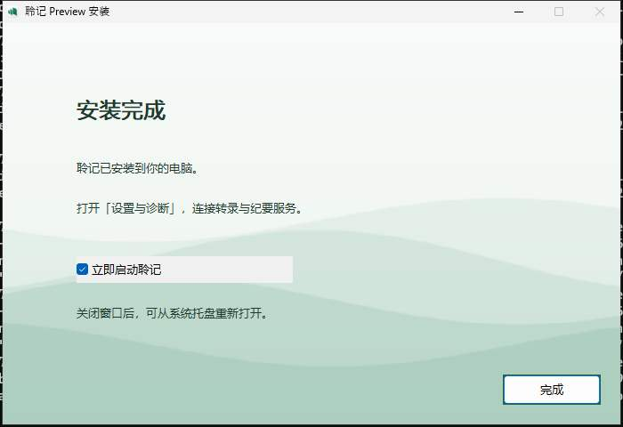

# Windows 安装与双平台常驻验收（2026-10-24）

本轮按用户确认的第二版预览实现 Windows x64 三步安装器，以及 Windows 托盘、macOS 菜单栏后台常驻。本记录区分候选源码验收和正式发布；发布结果以对应版本 Actions 与回执为准。

## 已实现范围

- Windows 10/11 x64 当前用户安装，窗口客户区铺满浅色波形背景，支持选择新安装文件夹、桌面快捷方式、安装后启动。
- 关闭主窗口后继续录音、补传和纪要整理；从托盘、菜单栏或 macOS Dock 恢复。显式退出保留录音和未发送音频检查。
- 安装与卸载遇到仍在后台运行的聆记会停止并提示先退出，不强制结束录音进程。
- 内置 Node 与 Windows WebView2 离线安装组件；后台常驻不包含登录自启。Python、FunASR 与 SenseVoice 服务和模型沿用单独部署方式。

## 验证结果

| 范围 | 证据 | 结论 |
| --- | --- | --- |
| 本机 Node 回归 | 完整 `npm test`，含别名入口真实子进程回归 | 457/457 通过 |
| 本机 Rust、静态检查与 Web 构建 | Rust smoke 29 项、ESLint、类型、文档与 Web 构建 | 通过 |
| macOS 原生合成录音 | 隐藏 9 秒仍采集，恢复、暂停、正常退出、重启后补传 20 个包；核对来源、会话、epoch、sequence 与摘要 | 通过；未打开真实设备 |
| Windows 原生合成录音 | 原生构建、隐藏录音与重启补传 | 通过；未打开真实设备 |
| Windows 真实安装器 | 静默安装、全部运行资源 SHA-256、应用 PE x64、已安装生产应用独立后台启动、重启持久化、开发后端零请求、退出清理与卸载 | 通过 |
| Windows 交互安装器 | 新文件夹安装、三屏截图、完成页启动复选框与卸载清理 | 通过 |

Windows 候选固定源码为 `374c3332dff14bb735ad4df14603c87087bc28ec`；[完整 Actions](https://github.com/RoyalLiang/LingJi-Meeting-Studio/actions/runs/40099797937)。诊断分支工作流在准备正式发布时移除；正式工作流保留这些验收。

## 实际安装截图

以下为 Windows 托管运行机拍摄的真实安装器窗口，不是设计稿。

## 根因与修复

- Windows 不支持按 POSIX 方式同步目录，音频确认前的目录同步曾报 `EPERM`。改为同步已提交文件，错误继续向上返回；保留 POSIX 行为。
- Node 模块路径会规范化，入口参数可能保留短路径或目录别名。原入口直接比较字符串，可能退出 0 却未启动后台；改为规范化入口后比较，并以真实别名子进程覆盖握手、健康检查和父进程 EOF 清理。
- [NSIS GetFullPathName](https://nsis.sourceforge.io/Reference/GetFullPathName) 对新目标末端的检查与安装场景冲突；改用 Win32 规范化，按 [System 插件寄存器协议](https://nsis.sourceforge.io/Docs/System/System.html)传递路径，保留绝对本机子目录检查。
- MUI 外层页眉、品牌区与分隔线覆盖整窗背景。现在在页面显示完成后隐藏外层装饰，保留页内控件与原生导航；定时器使用[官方名称解析宏](https://nsis.sourceforge.io/Docs/nsDialogs/Readme.html#NSD_CreateTimer)。

- 自定义完成页补回官方 MUI 初始化中的 `SetAutoClose true`，安装完毕后自动进入完成页；保留原生复选框点击并读回状态验证取消启动。

## 独立复核与边界

Standards 与 Spec 两轴按固定提交范围分轮复核。发现的旧文档版本链接、定时器函数地址和新控件层级问题均已修复；复核至 `374c333` 无剩余确认问题。代码复核不替代上述安装与原生运行证据。

尚未验证真实 Windows 麦克风/系统音频驱动、设备休眠后的长会议、全新 Windows 安全提示与实际模型部署。macOS 为 ad-hoc 签名且未公证，Windows 为未代码签名测试包。这些结果不能作为实体设备或业务会议验收。
