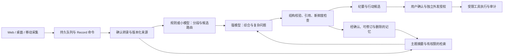

# 跨平台客户端、性能与“最强大脑”演进调研

日期：2026-10-12。代码基线：`96e3c8a`。范围：当前 TTS 工作台及其 Record 链路。本文是研究和建议，架构选择见 [proposed ADR 0010](../adr/0010-cross-platform-brain-evolution.md)，不代表已批准实施或完成上线。

## 建议先改善可靠性和增量处理，再扩平台与模型

“最强大脑”在本文指：能持续采集、理解上下文、引用证据、记住经确认的信息、形成行动候选，并在授权后可靠执行的助手。评价应综合任务成功率、纠错率、延迟、成本、离线能力和可恢复性；没有项目评测支持的通用最强模型排名不能替代选型。

推荐主线：**浏览器入口 → 增量数据与分层纪要 → 经评测的模型路由和记忆 → 按能力门槛加入桌面/移动原生增强 → 分层更新与灰度发布。**

- 客户端：继续复用 React/TypeScript，浏览器优先；PWA 提供安装入口和应用资源缓存。桌面先比较 Tauri 2 与 Electron 的真实采集和长会话表现；Tauri 是候选，不是未经测试的胜者。移动先满足随身麦克风、导入和复盘，需要后台录音时评估 Capacitor 原生插件。
- 性能：当前最明确的本地放大因素是整份 Record 的反复读写、SSE 后全量刷新、浏览器队列全量读取。终稿还有明确的 180,000 JSON 字符上限；先解决这些问题，再判断是否需要换传输或运行时。
- 大脑：保留一个可恢复、可审计的工作流，以小模型做窄任务、强模型做复杂综合；用来源可追踪的结构化记忆和检索补上下文。模型不得拥有最终授权权威。
- 更新：客户端程序、后端协议/数据、提示词与策略、模型制品分别版本化；会中固定版本，安全排空后切换，分批放量和可回退。

跨平台、采集、推理和更新机制的一手资料及版本限制见 [平台资料报告](cross-platform-client-sources-2026-10-12.md)。截至本报告完成，用户尚未选择重点，因此同时覆盖“客户端更新”与“AI 大脑迭代”。

## 当前已实现的链路与尚缺的证据

| 领域 | 当前代码事实 | 不能据此声称 |
| --- | --- | --- |
| 主入口 | `scripts/dev.mjs:7` 启动 React/Vite Web、Record API、worker；Web 声明 React 19、TS 7、Vite 6 版本范围 | 已分发 Windows/macOS/iOS/Android 客户端 |
| 桌面目录 | `apps/desktop/package.json` 启动 Node HTTP shell 预览 | 已有 Electron/Tauri 原生运行时或自动更新 |
| 音频 | AudioWorklet 输出 16 kHz PCM16，首包 0.4 秒、之后 1 秒；本地队列计算 hash 并转 base64 JSON | 所有平台都支持系统音频、锁屏或后台持续采集 |
| 持久化 | 默认 SQLite WAL/FULL + 文件；也有 Postgres/S3 适配；每 Record 一行 JSON 聚合 | Postgres/S3 已通过本轮并发或部署验收 |
| 任务 | ASR、minutes、intents、translation、workspace 五条独立轮询 lane；已有 lease/fence、修订保护 | 五个独立进程；按 lane 独立的待处理索引；公平调度已得到压测证明 |
| 模型 | Chat/Responses 适配、流式临时预览、最终 JSON/引用校验；agent 消费已确认转录快照 | agent 已直接理解原音；流式文本就是更快的最终结果 |
| 意图本地化 | `tools/neohorse` 有离线数据、训练和调试服务；主 worker 的模型意图仍调用现有 `analyzeIntents` | NeoHorse 已接入线上热路径，或已证明质量提升 |
| 工作目录分析 | 有最多 48,000 字符总预算、每会议最多 6,000 字符的快照与覆盖信息 | 已有完整跨会检索、长期记忆或 GraphRAG |

证据入口：[current-state](../engineering/current-state.md)、[现有架构](../design/architecture.md)、[路线](../design/roadmap.md)、[领域 seam 推演](../design/brain-rehearsal.md)。本轮以当前源码为事实依据，历史验收只作明确标注的已有证据。

已有证据中，一次真实终稿整理约 **139 秒**；这是特定任务的历史记录，缺少分阶段 trace，不能判定是排队、网络、供应商推理还是本地写入主导。见 [当前状态](../engineering/current-state.md)。NeoHorse 的独立合成测试只有 10 条，训练前后准确率都为 **70%**；本轮仅核对存档报告，未重新连接远端或复跑训练，不能升级为真实会议效果证据。见 [训练说明](../engineering/intent-dataset.md)和[存档结果](../evidence/intent-dataset/installation-report.json)。

## 三种客户端形态共享业务核心

| 形态 | 推荐职责 | 选择条件与限制 |
| --- | --- | --- |
| Web/PWA 主入口 | 麦克风、受支持浏览器的会议音频、阅读/编辑/分享、已授权云或自托管推理 | 免安装、发布快；PWA 安装不会增加系统音频或无限后台权限，需真机验证 |
| 桌面增强客户端 | 稳定系统音频、托盘、快捷键、本地文件、可选本地 ASR/小模型 | Tauri 复用 WebView，Electron 固定 Chromium；按 OS、权限、休眠恢复、打包和更新实测选择 |
| 移动增强客户端 | 麦克风现场记录、锁屏持续录音、离线队列、导入、复盘 | Capacitor 优先复用现有 Web；原生后台录音与其他 App 双向会议音频是两种不同能力 |

Flutter/React Native 适合移动交互成为主产品、复杂原生 UI 价值足以覆盖重写成本时再评估。目前源码没有证明这种收益；为了“全平台统一框架”重写现有 Web 缺少依据。详见[官方资料比较](cross-platform-client-sources-2026-10-12.md)。

建议抽出三个深接口，不让 UI 知道 provider、sequence 和重试细节：

1. `CaptureAdapter`：显式报告来源能力，处理用户手势授权、采样、暂停、flush、结束；Web/桌面/移动实现它。
2. `RecordClient`：本地持久队列、身份和 hash、持久 ACK、水位/缺口、seal/排空、cursor 补历史；原生版本复用同一协议。
3. `BrainService`：版本化上下文输入、任务预算、路由、结构化结果、引用、授权状态及恢复；页面只消费投影视图。

这与现有“有限命令内核 + 页面体验 facade”方向一致，不需要立即换框架。Record 写入权威仍由协调后端持有；该后端可以本地、自托管或云端。若未来加入完全离线模式，应先定义同步与冲突协议，不能让原生 sidecar 和服务端分别成为同一 Record 的独立写入权威。

## 当前性能风险按证据和优先级排序

| 优先级 | 发现 | 证据等级 | 影响与针对性改进 |
| --- | --- | --- | --- |
| P0 | 终稿快照超过 180,000 字符即拒绝 | 代码确定 + 合成样本触发 | 长会话难以完成；按主题/时间窗整理并保留叶子证据，终稿按预算综合，不能静默截掉后半场 |
| P0 | 音频总 samples 上限按所有来源合计为 120 分钟；chunk 上限 10,000 | 代码确定 | 双来源大约 60 分钟墙钟即可能触顶；明确“来源时长/会议时长”定义和容量，再决定是否调整限制 |
| P1 | 每次 `change()` 读/解析/调度/序列化/写整行；SQLite 同步调用；PG 也整行锁和更新 | 代码确定 + 本机微基准 | 成本随 Record 增长，五 lane 共享进程；拆 append 数据和任务表，保留元数据事务与幂等/修订约束 |
| P1 | 每 SSE 连接约每 250 ms 读完整 Record；事件到达后浏览器刷新完整详情 | 代码确定，未做端到端压测 | 客户端数与记录长度乘法放大；先拆轻量事件/投影查询，再做 delta 合并；保留 bootstrap/reset/cursor 恢复 |
| P1 | 五 lane 复用同一个 `listWork()`、每次最多取 100 条，未按 lane 筛选或排序 | 代码确定，饥饿尚属假设 | 可能重复解码无关记录并遮挡后面的到期任务；按 lane 建可索引 job 状态，稳定排序、公平性与租约认领 |
| P1 | IndexedDB `enqueue`、计数和排空读取完整队列；上传串行 | 代码确定，浏览器成本待测 | 离线积压时复制/遍历 base64；用按 record/source 索引、计数器、有限批读取和有界并发，维持来源顺序 |
| P1 | 自动 live 纪要每 15–120 秒可触发，近窗最多 120 段；意图也可能反复分析全部转录 | 代码确定；模型成本占比待测 | 可能重复 tokens 或被无关修订判旧；按新增确认段/主题变化去抖，缓存键含版本，终稿与 live 分预算 |
| P2 | 文件导入整段解码，再建立 OfflineAudioContext 渲染缓冲 | 代码确定；峰值内存待测 | 64 MiB 压缩文件仍可能解码为数 GiB；分片解码/受控后端转码，先测内存而非只放宽文件限制 |
| P2 | 长正文与多视图刷新 | 风险假设 | 记录增长可能引发 React 渲染/布局成本；用真实 profiler 判断分页、虚拟化与 selector 收益 |
| P2 | 供应商 TTFT、输出 tokens、网络和重试 | 主要耗时来源假设 | 先分段打点；再试分任务模型、输出预算、prompt/cache、供应商连接复用，不能用放大 timeout 当作提速 |

源码定位：[`repository.mjs`](../../services/records/src/repository.mjs) `listWork:58`、`change:94`；[`server.mjs`](../../services/records/src/server.mjs) SSE `160`；[`record-subscription.ts`](../../apps/web/src/record-subscription.ts) `refresh:57`；[`queue.ts`](../../apps/web/src/audio/queue.ts) `enqueue:24`、`drainQueue:46`；[`record.mjs`](../../packages/records/src/record.mjs) `acknowledge:49`、`requestMinutes:150`；[`providers.mjs`](../../services/records/src/providers.mjs) `generateMinutes:58`；[`worker.mjs`](../../services/records/src/worker.mjs) `runCycle:12`、`startWorker:161`。

Node 官方明确 `DatabaseSync` API 同步执行；换成 PG 可改变同步 DB 等待，但不会自动消除 JS JSON 处理和整行写入。PG 官方也提醒大 JSON 更新会锁住整行。[Node SQLite](https://nodejs.org/api/sqlite.html)、[PostgreSQL JSON](https://www.postgresql.org/docs/current/datatype-json.html)。IndexedDB 无范围的 `getAll()` 返回整个 object store 的值，按索引/范围和批量上限读取是可验证的改进方向。[MDN getAll](https://developer.mozilla.org/en-US/docs/Web/API/IDBObjectStore/getAll)

### 本机合成基准量化了存储增长

方法：Apple M4 Pro / arm64 / Node v22.14.0；临时 SQLite WAL、`synchronous=FULL`、文件音频；每项预热 3 次、顺序测量 20 次。合成样本每来源每秒一块、每 5 秒一段转录，保留 1,000 个事件；无纪要历史。`changeScalar` 只发一个事件并返回 cursor。`listWork` 样本为四个长度案例加十六条 30 分钟双来源记录，均待处理。没有调用 ASR/LLM、读取真实记录、启动浏览器或测试 HTTP 并发。

| 墙钟/来源 | chunks/segments | 聚合大小 | get 中位/p95 ms | 小更新中位/p95 ms | public JSON 大小 |
| --- | --- | --- | --- | --- | --- |
| 5 分钟 / 2 | 600 / 120 | 0.47 MB | 0.810 / 1.038 | 2.878 / 3.565 | 49 KB |
| 30 分钟 / 2 | 3,600 / 720 | 2.39 MB | 4.372 / 4.987 | 16.108 / 17.759 | 288 KB |
| 60 分钟 / 2 | 7,200 / 1,440 | 4.69 MB | 8.579 / 8.990 | 29.651 / 32.346 | 576 KB |
| 120 分钟 / 1 | 7,200 / 1,440 | 4.70 MB | 8.794 / 9.235 | 28.915 / 30.800 | 576 KB |

20 条合成记录 `listWork` 中位/p95 **123.232/143.848 ms**，`list` **120.274/136.990 ms**；1 秒 PCM 文件持久化 **3.962/4.096 ms**。30 分钟双来源样本的转录 JSON 为 **226,189 字符**，超过终稿 guard。实际触发时长取决于分句、文字量、元数据和供应商结果，不能把 30 分钟视为统一上限。

这些结果支持“聚合长度会放大本地操作成本”，**不证明生产吞吐、最大并发或真实会中卡顿**。没有 ASR 原音处理、历史版本、同时录制和多客户端，真实负载可能更重；20 次 p95 只是小样本分位数。微基准不是完整业务协议测试，不能据此承诺迁移后的加速倍数。

复现：`node scripts/benchmark-record-aggregate.mjs`。脚本不加载 `.env`，显式禁用 PG/S3，临时库结束即删除。原始证据：[benchmark JSON](../evidence/client-brain-research/aggregate-benchmark-2026-10-12.json)。

### 容量算术说明了离线与导入风险

- 单来源 PCM16/16 kHz：32,000 B/s，约 115.2 MB/h；双来源约 230.4 MB/h。base64 增加约三分之一，未含 JSON/HTTP 头部。当前 1 秒分包不意味着必须用 WebSocket 才能降延迟。
- 队列 guard 统计原始 PCM 的 **48 MiB**，相当于单来源约 26.2 分钟、双来源约 13.1 分钟离线积压；实际磁盘占用还含 base64/元数据，也受浏览器配额影响。这是算术，不是实测离线 SLA。
- 2 小时 48 kHz 立体声 Float32 解码约 **2.76 GB**；16 kHz 单声道 Float32 另需约 **461 MB**，还未算压缩输入和额外副本。当前 64 MiB 输入限制不能单独防止大内存导入。

## 让大脑按任务分工，并保留来源和授权

建议用受控工作流承载主产品，把开放式 agent 留给确实需要动态探索的任务。官方工程资料区分固定 workflow 与动态 agent，建议以可测收益决定复杂度；这是方法参考，不是本项目效果证明。[Anthropic agent patterns](https://www.anthropic.com/engineering/building-effective-agents)

| 大脑层 | 演进方向 | 升级验收 |
| --- | --- | --- |
| 感知 | 保留实时 ASR 与说话人证据；可选端上 VAD/降噪；多模态原音/屏幕只在专门授权和协议完成后试验 | 中文混语、术语、重叠发言、设备中断、耗电；降噪不得吞掉否定词 |
| 路由 | 规则/小模型识别问题、决定、行动候选等；低置信度 abstain；复杂或高影响内容交强模型复核 | 按会议隔离的人工 gold，报告每类 precision/recall/F1、误判和置信度校准；不能只看总准确率 |
| 综合 | live 使用新增段与局部主题；final 分层归并，保留原段 id/revision 和 coverage；直接原音模型先 shadow | 决策和行动事实正确、否定/撤回处理、引用语义支持、完整性、人工修订量、token/耗时 |
| 记忆 | 分离工作记忆、会议事实、用户明确偏好；每条有来源、适用范围、确认状态、版本、TTL 和撤销 | 错误记忆可纠正；删会后检索/缓存失效；跨 workspace 不泄漏；人工确认不被重生成覆盖 |
| 检索 | 先按权限/时间/主题过滤与全文检索，评测不足再混合向量；关系推理确有收益再 GraphRAG | 授权来源召回率、答案可追溯性、旧版本/删除排除、覆盖率与无答案拒答 |
| 工具 | 先查询和本地草稿，再单项确认写入；执行有独立幂等键、前置条件、结果回查和审计 | 重试不重复执行；ASR/转录里的指令不能变成授权；远端失败状态能解释和恢复 |

结构化笔记、上下文压缩和按需取回可以避免把全部历史塞入模型，但摘要会丢失信息，事实核对必须回查原段。[Anthropic context engineering](https://www.anthropic.com/engineering/effective-context-engineering-for-ai-agents) MCP 只作为工具接入协议；仍需要正确的授权受众和令牌隔离，不能借接入统一协议扩大权限。[MCP security](https://modelcontextprotocol.io/docs/2026-07-28/tutorials/security/security_best_practices)

### 按测量选择模型位置，不直接把 4B 模型搬到所有客户端

- 默认：客户端做采集、缓存、信号检测和低成本预处理；受控后端运行工作流，通过已配置 provider 获取高质量综合能力。密钥仍只在后端。
- 隐私/离线增强：优先试验 VAD、小型分类/embedding 或本地 ASR；本地较大模型由原生 sidecar 或自托管服务提供。WebGPU 是选项，支持 API 不等于目标模型可稳定运行。
- 路由策略：按任务风险、语言、设备能力、网络、授权数据范围、成本预算选择 provider。低置信度升级和失败重试要区分；未经授权不能从本地失败静默改成云处理。
- NeoHorse：保留现有离线生成器和训练制品，先做中文真实语义 shadow；当前调试服务是单请求 HTTPServer，不作为生产并发推理服务。没有 gold 改善证据前，不能承担决策真值或工具权限。
- 模型比较：固定数据/提示版本和输出 schema，同时记录正确性、引用支持、行动误报、TTFT、完成时间、tokens、费用和失败率；“最新最大模型”仅是候选。

## 把更新拆成四条独立发布线

当前没有已实现的 PWA/native updater，以下都是建议；平台签名、store 与热更新限制见[官方资料报告](cross-platform-client-sources-2026-10-12.md)。

| 发布线 | 内容 | 切换与回退规则 |
| --- | --- | --- |
| 客户端 | Web 静态资源、PWA 缓存、桌面/移动二进制、采集插件 | signed/hash 校验；录制中不强制 reload/restart；恢复队列可被新旧版本读取；移动遵守商店规则 |
| 后端和协议 | Record API、worker、事件投影、schema/migration | 先兼容性扩展再切客户端；声明协议范围；恢复/历史游标和旧客户端验证；破坏性迁移有恢复预案 |
| 大脑策略 | prompt、路由、工具 schema、阈值、上下文/输出预算、记忆提取 | 会话或任务固定版本；shadow → 小流量 → 放量；授权边界由代码/策略服务强制，不能由远程提示词扩大 |
| 模型制品 | provider/model id、本地权重/量化/adapter、tokenizer | 许可证/来源/摘要校验、资源门槛、下载续传、健康检查；并存上一版制品；新任务采用新版本 |

推荐 manifest 最少记录：`releaseId`、客户端/协议兼容范围、`schemaVersion`、`policyVersion`、`promptVersion`、model/provider 版本、tokenizer/adapter hash、能力和资源要求、发布通道、签名/摘要。每个 job 保存实际版本组合与 transcriptRevision，结果才能复现。

安全切换流程：**下载/缓存 → 校验兼容性和制品 → 等待录制停止、flush 与持久 ACK、必要 ASR 排空 → 保存恢复点 → 激活 → 启动自检 → 观察健康指标 → 确认或回退。** 离线积压无法排空时，应继续当前版本并告知状态，或验证可跨版本恢复后迁移；不能删队列来解除升级阻塞。

下载可以在会中进行，但要限流和检查磁盘/内存，避免抢占录制资源；会中不热替换活跃采集模块、模型或 prompt。终稿可以固定旧任务版本完成，新任务走新版本。

程序回退不自动意味着数据可回退。Record/IDB/记忆/向量索引使用 expand-contract 迁移；旧客户端至少覆盖明确承诺的兼容窗口。无法反向迁移时从备份/事件重建，不能宣称“一键降级”。记忆重建也不得把已经撤销或删除的数据带回。

## 按退出条件推进，不按技术热度推进

以下为实施建议和待确认验收目标，未给出人力/工期承诺，也未授权部署。用一个可测阶段完成后的证据决定下一阶段。

| 阶段 | 工作与依赖 | 退出条件 | 暂缓条件 |
| --- | --- | --- | --- |
| A：建立基线 | 全链路 trace；5/30/60/120 分钟、1/2 来源、1/5/20 活跃记录；断网/重连/停止；冻结评测样本 | 分开 p50/p95/p99 的采集→本地保存→ACK→ASR确认→live/final、队列 age、event-loop lag、RSS/堆、tokens/成本 | 没有代表硬件、数据或测量时，保留未知而非宣布瓶颈已解决 |
| B：修数据放大 | 优先增量读模型/事件、队列索引、按 lane 到期任务、分层终稿；再评估拆表迁移 | 相同样本可复测改善；ACK/幂等/排空/引用/删除语义不退化；超预算时可解释的 coverage；主线程不被大导入打断 | 数据迁移不可恢复或来源版本丢失时不切换 |
| C：大脑质量 | 规则/小模型 shadow、强模型路由、事实记忆和全文检索；依赖稳定来源与 gold | 独立按会议划分测试，行动/决定误报满足评审目标；效果优于既有基线且延迟/成本在预算内；人工修改受保护 | 只有训练损失下降、合成小集准确率或主观好看时不替换主模型 |
| D：跨平台增强 | Web/PWA 能力矩阵；桌面 Tauri/Electron PoC；移动 Capacitor 后台麦克风 PoC；共用 RecordClient | 每个支持 OS/版本/来源完成长会话、锁屏/休眠、中断恢复、升级和队列恢复实测 | 原生壳只增加打包复杂度却没有采集/离线收益时保留 Web |
| E：更新和小规模试点 | 四发布线、制品签名、canary、迁移兼容、健康回退；依赖 D 确定分发方式 | 会中升级不丢音频；断电/下载中断/旧客户端/坏制品恢复；灰度质量不降；明确支持矩阵和限制 | 没有分发证书、store账号或部署环境时只报告本地验证 |

可并行开展非依赖性的 Web 能力矩阵和桌面采集实验；主产品迁移应遵守上述依赖。建议首先落实 **A + B 的最小切片**：测量时间线、轻量投影/队列索引、按预算分段终稿；模型路由 shadow 可同步准备。暂不依据本轮微基准启动 Go/Rust 全量重写、GraphRAG、多 agent 自主执行或全平台 UI 重写。

拟定指标要分层：可靠性要求包括无重复已确认行动、引用有效、人工编辑不被覆盖、停止后可解释排空；性能与质量阈值应在 A 阶段按目标硬件和业务评审确认，不能把本机微基准数值直接作为生产 SLA。

## 本轮交付与验证边界

本轮新增研究报告、proposed ADR、可复现微基准与 JSON 证据，并链接到文档入口。未改业务实现、模型版本、供应商配置或客户端发布方式；未访问真实会议、远端训练/生产服务，也未执行更新或部署。

验证：隔离 SQLite 微基准完成；新增脚本通过仓库 ESLint；文档链接检查结果随提交记录。未新增浏览器/手机/桌面实际采集、PG/S3、模型质量、并发容量或生产证据。

主要不确定性：代表用户的设备和会议样本尚未锁定；139 秒历史耗时尚未有 trace；原生壳的实际收益和浏览器后台限制尚未逐平台复测。若未来约束变为“必须全离线”或“移动端可靠采集任意会议 App”，应重新评估路线，后者不能由跨平台框架名称保证。
